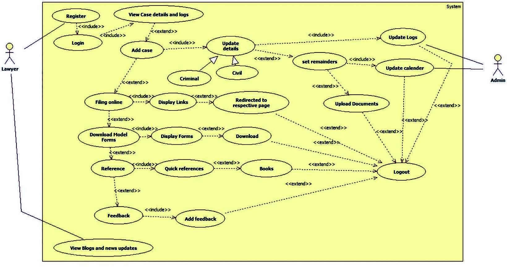
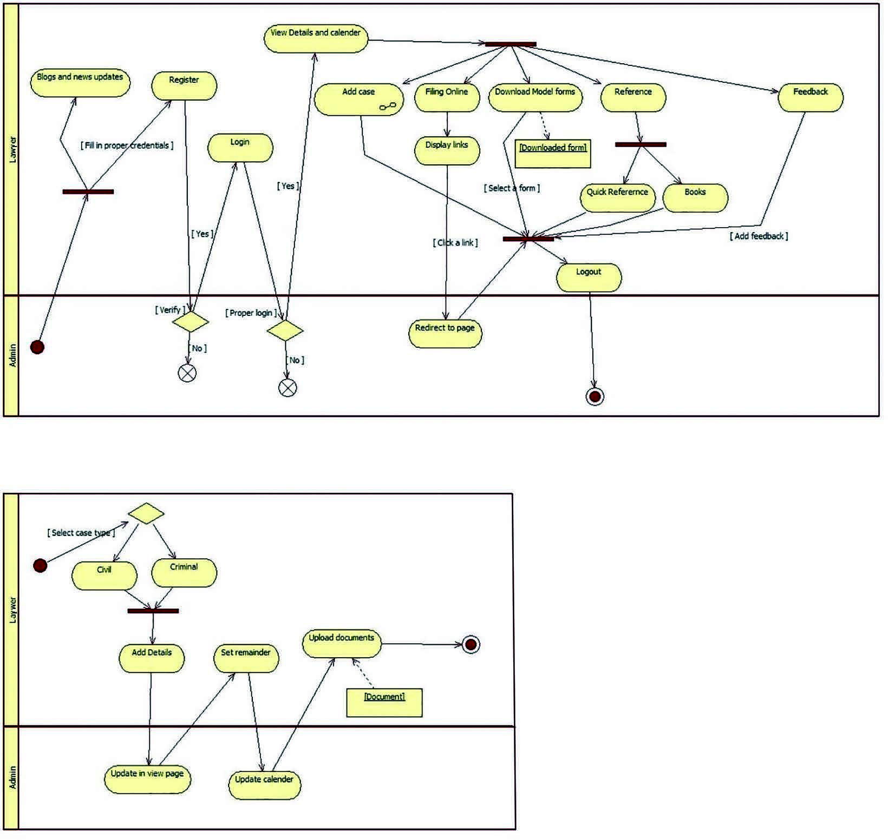
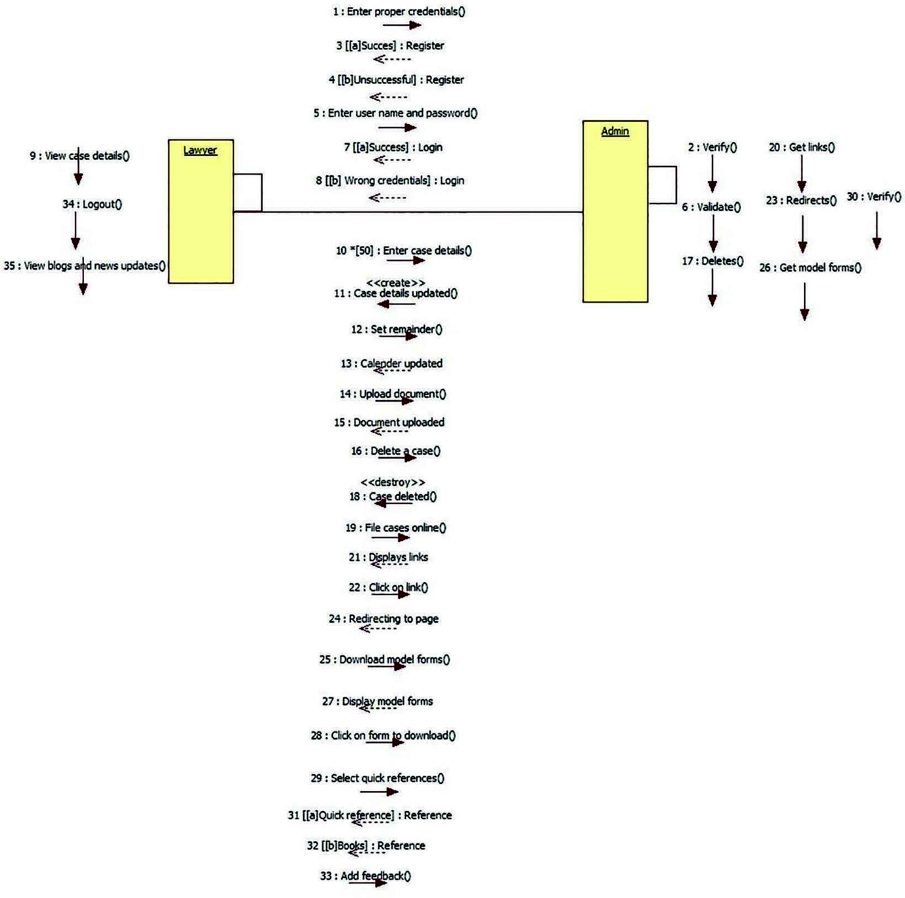
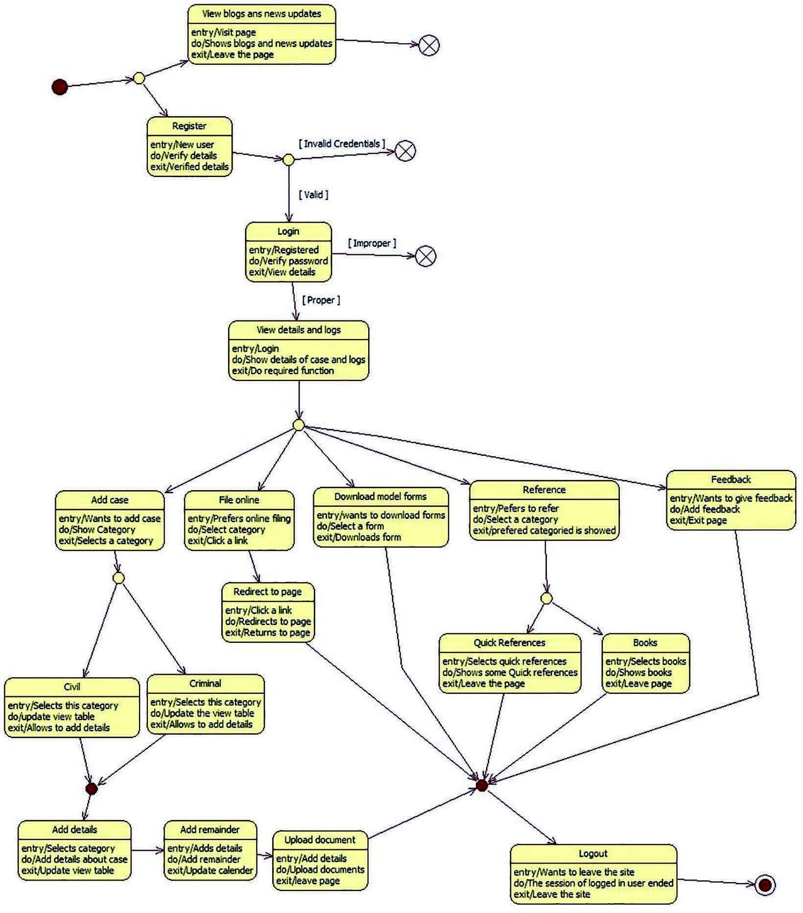
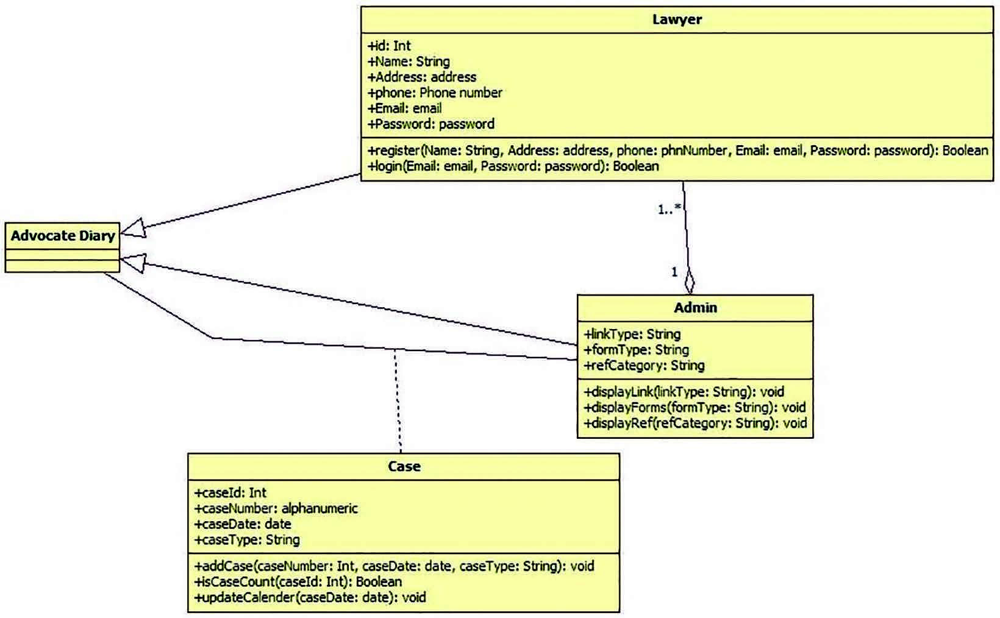
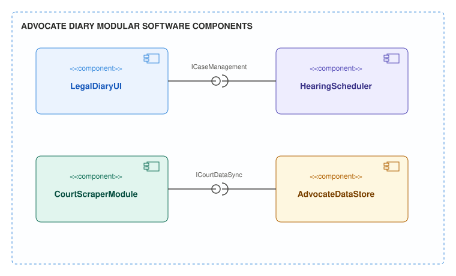
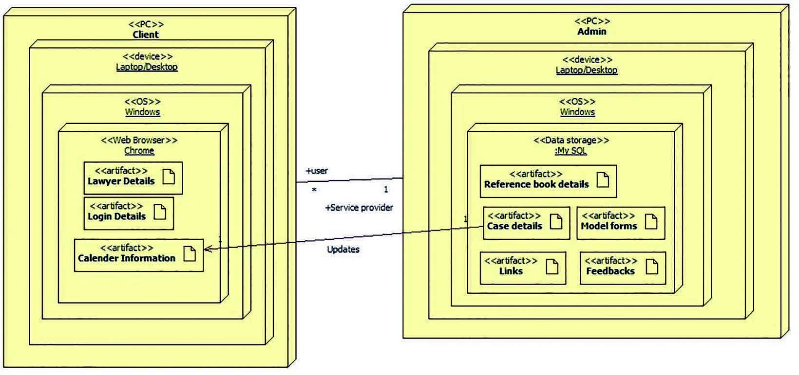

# Chapter 11: Design of UML Diagrams for Advocate Diary

> **Book**: *UML Diagramming: A Case Study Approach* by Dr. Suriya Sundaramoorthy (CRC Press, 2022)  
> **Pages**: 129–138 (Total: 10 pages)  
> **Classification**: Industrial Case Study & UML Modeling Suite  
> **Navigation**: [&larr; Chapter_10_Design_of_UML_Diagrams_for_Product_Recommendation_System](Chapter_10_Design_of_UML_Diagrams_for_Product_Recommendation_System.md) | [📚 Book Index](../UML_Book.md) | [Chapter_12_Design_of_UML_Diagrams_for_My_Helper &rarr;](Chapter_12_Design_of_UML_Diagrams_for_My_Helper.md)

---

## 📌 Executive Summary

Chapter 11 presents an end-to-end software engineering case study for the **Design of UML Diagrams for Advocate Diary**. This chapter demonstrates how business requirements and domain constraints are translated into formal architectural specifications through data-flow modeling and a complete suite of Unified Modeling Language (UML) structural and behavioral models.

The case study analyzes the system from multiple architectural perspectives: identifying external user and service actors, formalizing core operational capabilities, detailing procedural business workflows, specifying domain entity schemas, and architecting modular component deployment across distributed physical infrastructure.

---

## 🎯 Problem Statement & Business Context

The need for law and enforcement in a country with a high population like India is salient. Lawyers play a major role in maintaining most of their data as hard copies. This project is mainly designed for lawyers to make their work more easy and efficient. It is a responsive web application that would provide lawyers with various services that would help them to maintain their documents. The services include a logbook that has details about the cases along with a calendar. The lawyers can also upload and save documents related to their case. It contains formats of model forms and links to online filing. It also provides quick references of common cases and detailed information about laws through e-books. Information about the judicial exams for lawyers is also made available. Furthermore, the web application contains news updates for lawyers, blogs and feedback. This case study will serve as a small hand tool for lawyers to maintain the soft copies of their data (Figures 11.1–11.8).

---

## ⚙️ System Architecture & Functional Capabilities

The **Design of UML Diagrams for Advocate Diary** decomposes business operations into modular functional units. These capabilities address the operational bottlenecks of manual and legacy workflows by introducing automated, role-based, and auditable software processes:

- **Register**: Register allows a new lawyer to create an account.
- **Login**: It allows a valid user to login to the page.
- **View Case Details and Logs**: Displays details about both existing and completed cases along with the calendar.
- **Add Case**: Allows user to add new case.
- **Update Details**: This allows the user to enter specific details about the case.
- **Criminal**: It specifies whether the case is a criminal case.
- **Civil**: It specifies whether the case is a civil case.
- **Update Logs**: This updates the view table with the data provided.
- **Set Remainders**: It allows users to add date and time details for the case.
- **Update Calendar**: This function updates the calendar with the remainder.
- **Upload Document**: A user can upload the documents related to the case.
- **Filing Online**: It is used to file a case or do any other legal related filing online.
- **Display Links**: It displays links to various online filings.
- **Redirected to Respective Page**: This redirects to the link selected.
- **Download Model Forms**: This allows users to download model forms.
- **Display Forms**: It displays various forms on the category selected.
- **Download**: This allows the user to download a model form.
- **Reference**: It displays quick references and books for the user to choose.
- **Quick Reference**: It displays various information about the most common cases.
- **Books**: Helps the user to get information via law e-books.
- **Feedback**: This allows users to add feedbacks.
- **Add Feedback**: This allows the user to type in and send feedbacks.
- **View Blogs and Updates**: It allows users to view blogs and news updates.

---

## 📊 Complete UML Diagram Suite & Architectural Walkthrough

This chapter incorporates **8 crystal-clear, high-resolution diagram(s)** (extracted losslessly from the source edition at up to 2,000+ px) illustrating the end-to-end design from functional use cases to physical hardware deployment:

### Figure 11.1: UML Usecase Diagram

**Diagram Category**: `Use Case Diagram`  
**Architectural Role**: Specifies system boundary, primary external actors, and business use cases with include/extend relationships.

**System Design Analysis**:
Illustrates the functional boundary of the **Design of UML Diagrams for Advocate Diary**. External actors trigger core use cases, demonstrating how business transactions, authorization checkpoints, and service requests flow into the system. Relationships (`<<include>>` for mandatory sub-routines like authentication and validation, and `<<extend>>` for optional or conditional exception branches) formalize the system's external functional contract.

### Figure 11.2: UML Activity Diagrams

**Diagram Category**: `Activity Diagram`  
**Architectural Role**: Illustrates dynamic procedural workflow, decision branching, concurrent action forks, and synchronization joins.

**System Design Analysis**:
Details the step-by-step procedural execution flow for core operations in **Design of UML Diagrams for Advocate Diary**. Begins at an initial state, navigates action states, evaluates guard conditions at decision diamonds, and models parallel execution branches using fork and join synchronizations before reaching the terminal state, ensuring business workflows are deterministic and free of race conditions.

### Figure 11.3: UML Sequence Diagram

**Diagram Category**: `Sequence Diagram`  
**Architectural Role**: Details chronological object interactions, synchronous message exchanges, return flows, and activation lifelines.

**System Design Analysis**:
Traces the time-ordered message sequence between participating objects and services in **Design of UML Diagrams for Advocate Diary**. Vertical dashed lifelines represent entity instances across time, while horizontal solid and dashed arrows show synchronous invocations, data lookups, and return values. Activation bars delineate execution duration, clarifying object collaboration during key transactional workflows.

### Figure 11.4: UML Collaboration Diagram

**Diagram Category**: `Communication Diagram`  
**Architectural Role**: Emphasizes structural object topology and numbered sequence messaging between collaborating entities.

**System Design Analysis**:
Emphasizes the spatial and structural organization of collaborating instances in **Design of UML Diagrams for Advocate Diary**. Shows object links overlaid with numbered messages (e.g., 1.0, 1.1, 2.0), illustrating both structural connectivity and invocation hierarchy, complementing the temporal perspective of the sequence diagram.

### Figure 11.5: UML State Machine Diagram

**Diagram Category**: `State Machine Diagram`  
**Architectural Role**: Captures entity lifecycle states, transition triggers, event guards, and exit/entry actions.

**System Design Analysis**:
Models the complete lifecycle state transitions for central domain entities in **Design of UML Diagrams for Advocate Diary**. Tracks transitions from initial creation through intermediate processing states to completion or cancellation. Explicit state triggers, guard expressions `[condition]`, and entry/exit actions guarantee valid business lifecycle states and eliminate invalid operational state jumps.

### Figure 11.6: UML Class Diagram

**Diagram Category**: `Class Diagram`  
**Architectural Role**: Models static structural classifiers, entity attributes, operations, and associations (composition, aggregation, inheritance).

**System Design Analysis**:
Captures the static structural domain model for **Design of UML Diagrams for Advocate Diary**. Defines primary entity classes, their private/public attributes, operational methods, and relationships. It enforces structural integrity through multiplicities, composition (strong lifecycle ownership of subsidiary records), aggregation, and inheritance hierarchies, forming the foundation for the relational database schema and domain entity classes.

### Figure 11.7: UML Component Diagram

**Diagram Category**: `Component Diagram`  
**Architectural Role**: Architects physical modular software components, provided ball interfaces, and required socket dependencies.

**System Design Analysis**:
Architects the modular software organization for **Design of UML Diagrams for Advocate Diary**. Illustrates autonomous subsystems, business logic controllers, database access layers, and external service adapters. Provided interfaces (ball notation) and required dependencies (socket notation) define clear service contracts, supporting high cohesion and loose coupling.

### Figure 11.8: UML Deployment Diagram

**Diagram Category**: `Deployment Diagram`  
**Architectural Role**: Maps software execution artifacts to hardware computing nodes, client devices, application tiers, and database servers.

**System Design Analysis**:
Maps the physical runtime deployment architecture for **Design of UML Diagrams for Advocate Diary**. Depicts client hardware devices (web browsers, mobile apps), application servers, network firewalls, and persistence database nodes. Communication paths and execution environments reflect production infrastructure, scalability considerations, and network security boundaries.

---

## 💡 Key Architectural Invariants & Domain Lessons

1. **Requirement Traceability**: Every model in the **Design of UML Diagrams for Advocate Diary** suite traces directly to business requirements and operational constraints established in the problem statement.
2. **State & Workflow Integrity**: Dynamic activity and sequence models guarantee deterministic workflow completion, enforce transactional atomicity, and prevent deadlocks.
3. **Modular Encapsulation**: Component boundaries decouple domain business logic from presentation controllers and external integration adapters, supporting high maintainability.
4. **Operational Security & RBAC**: Strict role-based authorization guards sensitive operations across external actor boundaries and administrative lifelines.
5. **High-Fidelity Deployment**: Physical node topologies reflect real-world tiered infrastructure (DMZ, application cluster, isolated persistence layer), ensuring scalability and fault tolerance.

---

## 🔗 Related Resources & Navigation

- **Navigation**: [&larr; Chapter_10_Design_of_UML_Diagrams_for_Product_Recommendation_System](Chapter_10_Design_of_UML_Diagrams_for_Product_Recommendation_System.md) | [📚 Book Index](../UML_Book.md) | [Chapter_12_Design_of_UML_Diagrams_for_My_Helper &rarr;](Chapter_12_Design_of_UML_Diagrams_for_My_Helper.md)
- **Master Book Catalog**: [`UML_Book.md`](../UML_Book.md)
- **High-Resolution Images Archive**: [`images/`](../images/)