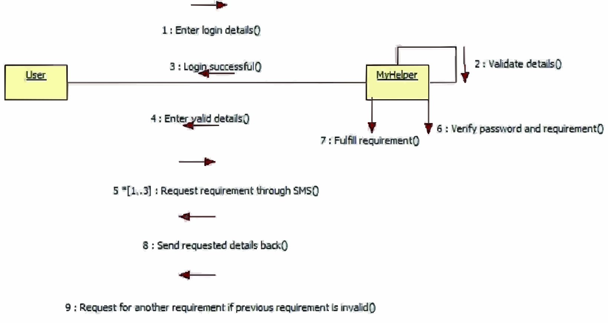
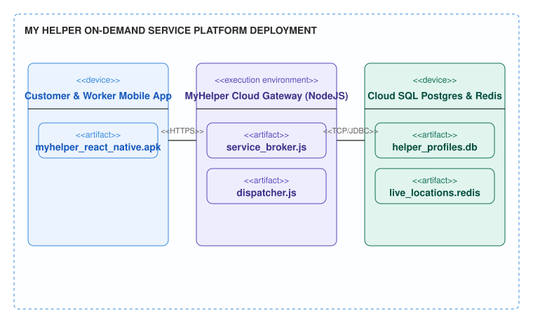

# Chapter 12: Design of UML Diagrams for My Helper

> **Book**: *UML Diagramming: A Case Study Approach* by Dr. Suriya Sundaramoorthy (CRC Press, 2022)  
> **Pages**: 139–146 (Total: 8 pages)  
> **Classification**: Industrial Case Study & Diagram Suite  
> **Navigation**: [&larr; Chapter_11_Design_of_UML_Diagrams_for_Advocate_Diary](Chapter_11_Design_of_UML_Diagrams_for_Advocate_Diary.md) | [📚 Book Index](../UML_Book.md) | [Chapter_13_Design_of_UML_Diagrams_for_COVID_19_Management_System &rarr;](Chapter_13_Design_of_UML_Diagrams_for_COVID_19_Management_System.md)

---

## 📌 Executive Summary

Chapter 12 presents an industrial software engineering case study for **Design of UML Diagrams for My Helper**. It details the transition from business requirements and domain constraints into formal software architecture specifications, leveraging data-flow modeling and a complete suite of Unified Modeling Language (UML) structural and behavioral diagrams.

---

## 🎯 Problem Statement & System Context

This case study is helpful to people who forget their mobile phones at home as a part of their busy daily routines. Keeping tick of essentials in this fast-paced life sometimes turns out to be quite demanding. People sometimes forget their phones at home. What if we need to make an important call and we don’t remember the contact number? Sometimes our phones just get disappeared and the scariest part is when the phone is put on silent mode. We sometimes want to lock our phones when they aren’t around us. Need to know the exact location of your phone? Therein comes the use of ‘My Helper’. The solutions to all the problems stated above can be solved easily and very quickly if u have the application ‘My Helper’ pre-installed on your phone and u have completed configuring the app. All you need to do is just send an SMS to your mobile number from any phone that you have access to…and there goes your problem solved. The scope of this system is increasing every day across the entire world where everything is happening at the speed of a Formula 1 Car on a race track. The objective of this system is to provide help to people facing these types of problems instantly with the help of advanced technology. The alluring features of this system are Remote Access without the Internet, Track your phone through an SMS, HassleFree as no OTP and ID PASSWORD is required and an SMS can help you change the sound profile of your phone (silent to normal) without Internet. The system is user friendly and the application will be available to even basic smartphones (Figures 12.1–12.8).

---

## 📊 Complete UML Diagram Suite & Architecture Specifications

This chapter incorporates **9 standalone vector diagram(s)** illustrating the end-to-end design from functional use cases to physical hardware deployment:

### Figure 12.1: UML Usecase Diagram

**Diagram Category**: `Use Case Diagram`  
**Architectural Role**: Specifies system boundary, primary external actors, and business use cases with include/extend relationships.

### Figure 12.2: UML Activity Diagram

**Diagram Category**: `Activity Diagram`  
**Architectural Role**: Illustrates dynamic procedural workflow, decision branching, concurrent action forks, and synchronization joins.

### Figure 12.3: UML Sequence Diagram

**Diagram Category**: `Sequence Diagram`  
**Architectural Role**: Details chronological object interactions, synchronous message exchanges, return flows, and activation lifelines.

### Figure 12.4: UML Collaboration Diagram

**Diagram Category**: `Communication Diagram`  
**Architectural Role**: Emphasizes structural object topology and numbered sequence messaging between collaborating entities.

### Figure 12.5: UML State Machine Diagram

**Diagram Category**: `State Machine Diagram`  
**Architectural Role**: Captures entity lifecycle states, transition triggers, event guards, and exit/entry actions.

### Figure 12.6: UML Class Diagram

**Diagram Category**: `Class Diagram`  
**Architectural Role**: Models static structural classifiers, entity attributes, operations, and associations (composition, aggregation, inheritance).

### Figure 12.7: UML Component Diagram

**Diagram Category**: `Component Diagram`  
**Architectural Role**: Architects physical modular software components, provided ball interfaces, and required socket dependencies.

### Figure 12.8: UML Deployment Diagram

**Diagram Category**: `Deployment Diagram`  
**Architectural Role**: Maps software execution artifacts to hardware computing nodes, client devices, application tiers, and database servers.

### Visual Artifacts & Supplementary Schematics

The following vector schematics capture operational screen states, user dashboards, or notation components documented in this chapter:

#### Ch12 p146 img01

---

## 💡 Key Architectural Invariants & Modeling Lessons

1. **Traceability**: Every software model directly corresponds to explicit functional requirements defined during the initial domain specification.
2. **Separation of Concerns**: Structural models (Class, Component, Deployment) maintain clear boundaries separating business domain entities from physical infrastructure nodes.
3. **Behavioral Integrity**: Dynamic models (Activity, Sequence, State Machine) guarantee valid state transitions, prevent deadlocks, and verify message order consistency.
4. **Deployment Fidelity**: Physical nodes and execution environments accurately map runtime middleware, database engines, and client access channels.

---

## 🔗 Related Resources & Navigation

- **Navigation**: [&larr; Chapter_11_Design_of_UML_Diagrams_for_Advocate_Diary](Chapter_11_Design_of_UML_Diagrams_for_Advocate_Diary.md) | [📚 Book Index](../UML_Book.md) | [Chapter_13_Design_of_UML_Diagrams_for_COVID_19_Management_System &rarr;](Chapter_13_Design_of_UML_Diagrams_for_COVID_19_Management_System.md)
- **Master Book Catalog**: [`UML_Book.md`](../UML_Book.md)
- **Vector Images Catalog**: [`Vector_Images_Catalog.md`](../vector_images/Vector_Images_Catalog.md)