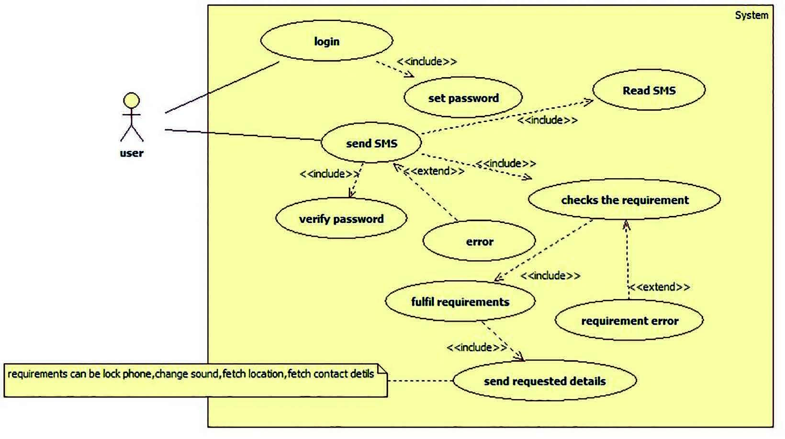
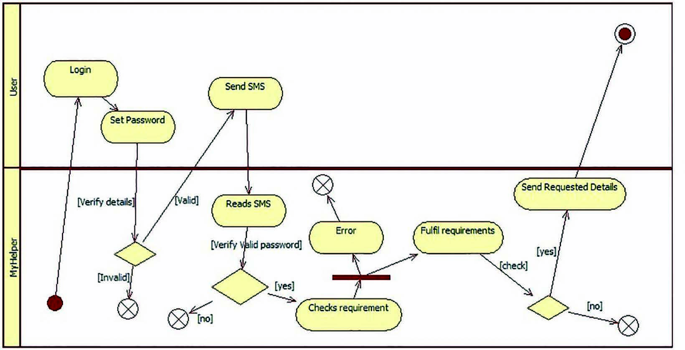
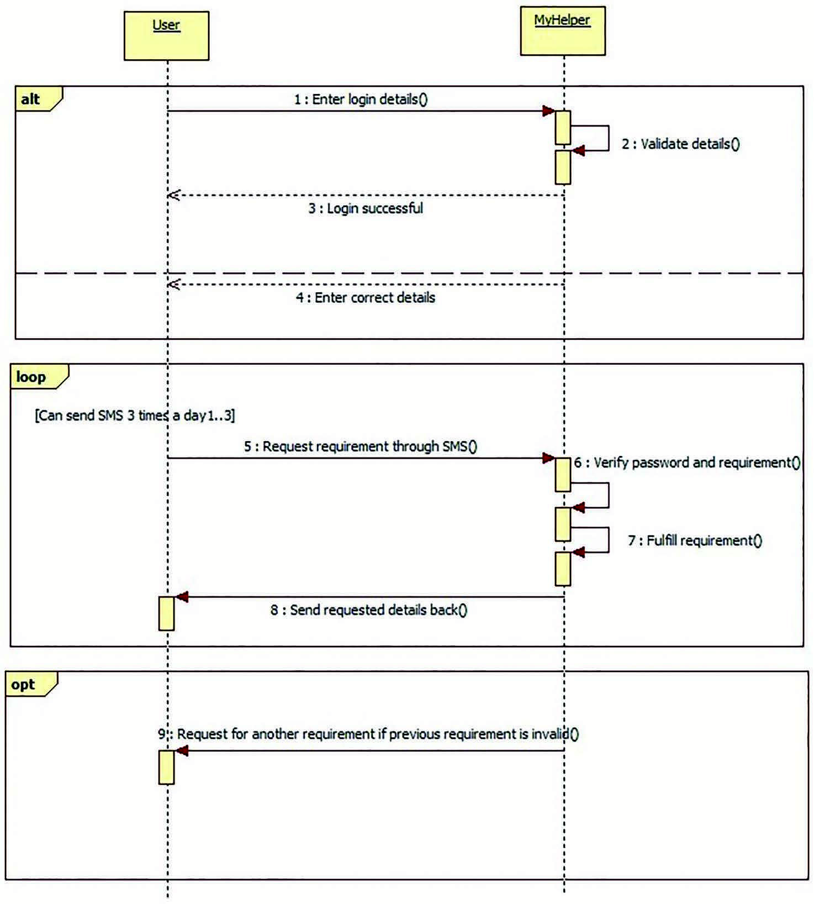
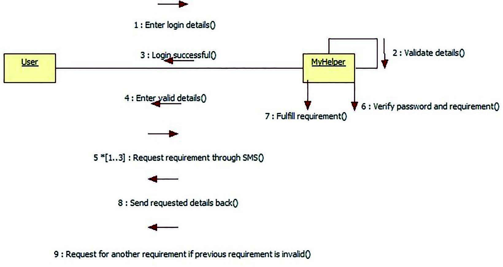
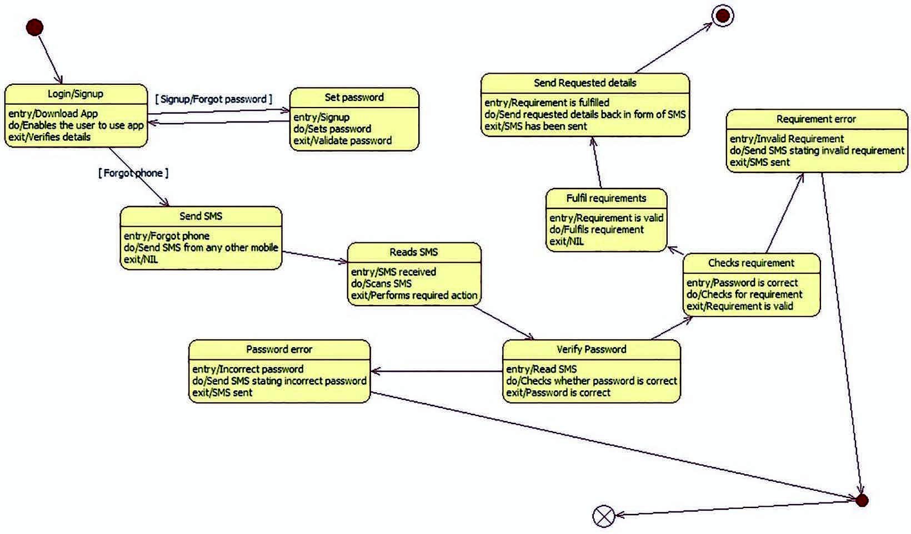
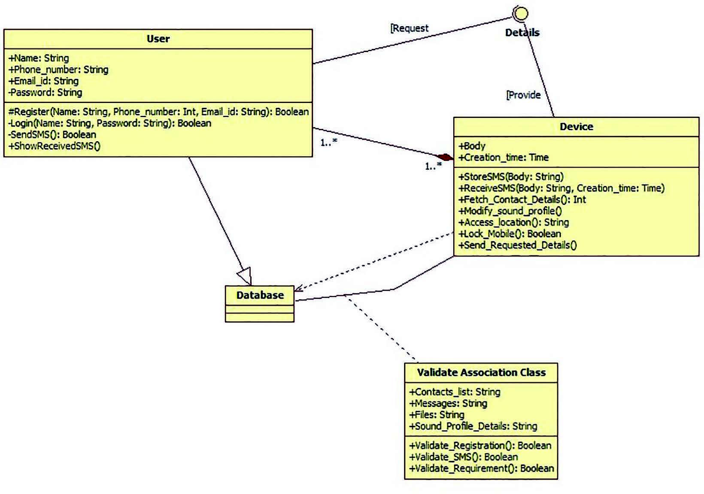
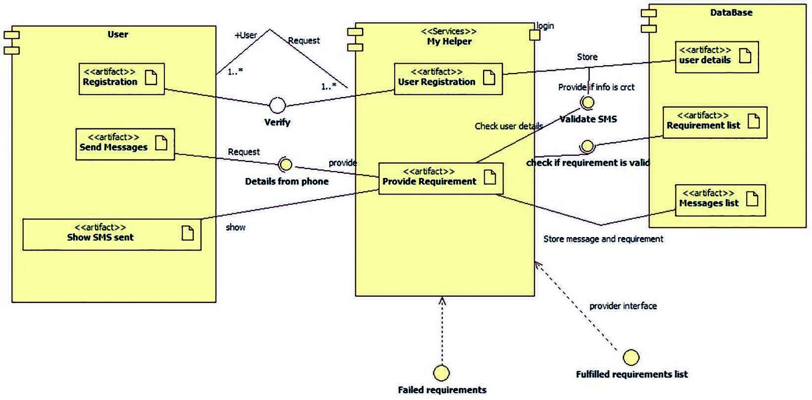
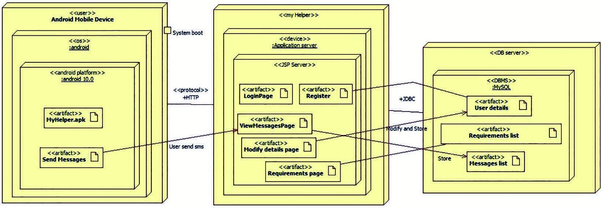

# Chapter 12: Design of UML Diagrams for My Helper

> **Book**: *UML Diagramming: A Case Study Approach* by Dr. Suriya Sundaramoorthy (CRC Press, 2022)  
> **Pages**: 139–146 (Total: 8 pages)  
> **Classification**: Industrial Case Study & UML Modeling Suite  
> **Navigation**: [&larr; Chapter_11_Design_of_UML_Diagrams_for_Advocate_Diary](Chapter_11_Design_of_UML_Diagrams_for_Advocate_Diary.md) | [📚 Book Index](../UML_Book.md) | [Chapter_13_Design_of_UML_Diagrams_for_COVID_19_Management_System &rarr;](Chapter_13_Design_of_UML_Diagrams_for_COVID_19_Management_System.md)

---

## 📌 Executive Summary

Chapter 12 presents an end-to-end software engineering case study for the **Design of UML Diagrams for My Helper**. This chapter demonstrates how business requirements and domain constraints are translated into formal architectural specifications through data-flow modeling and a complete suite of Unified Modeling Language (UML) structural and behavioral models.

The case study analyzes the system from multiple architectural perspectives: identifying external user and service actors, formalizing core operational capabilities, detailing procedural business workflows, specifying domain entity schemas, and architecting modular component deployment across distributed physical infrastructure.

---

## 🎯 Problem Statement & Business Context

This case study is helpful to people who forget their mobile phones at home as a part of their busy daily routines. Keeping tick of essentials in this fast-paced life sometimes turns out to be quite demanding. People sometimes forget their phones at home. What if we need to make an important call and we don’t remember the contact number? Sometimes our phones just get disappeared and the scariest part is when the phone is put on silent mode. We sometimes want to lock our phones when they aren’t around us. Need to know the exact location of your phone? Therein comes the use of ‘My Helper’. The solutions to all the problems stated above can be solved easily and very quickly if u have the application ‘My Helper’ pre-installed on your phone and u have completed configuring the app. All you need to do is just send an SMS to your mobile number from any phone that you have access to…and there goes your problem solved. The scope of this system is increasing every day across the entire world where everything is happening at the speed of a Formula 1 Car on a race track. The objective of this system is to provide help to people facing these types of problems instantly with the help of advanced technology. The alluring features of this system are Remote Access without the Internet, Track your phone through an SMS, HassleFree as no OTP and ID PASSWORD is required and an SMS can help you change the sound profile of your phone (silent to normal) without Internet. The system is user friendly and the application will be available to even basic smartphones (Figures 12.1–12.8).

---

## ⚙️ System Architecture & Functional Capabilities

The **Design of UML Diagrams for My Helper** decomposes business operations into modular functional units. These capabilities address the operational bottlenecks of manual and legacy workflows by introducing automated, role-based, and auditable software processes:

- **Login**: This usecase allows the user to get started with the system.
- **Set Password**: Allows user to set a strong password to use it later.
- **Send SMS**: This usecase allows the user to send SMS to his/her’s mobile number from any other mobile phone.
- **Read SMS**: This usecase is about the ‘My Helper’ application reading SMS sent to the phone.
- **Checks Requirement**: Checks for a valid requirement.
- **Error**: If SMS sending fails, it results in an error.
- **Fulfil Requirement**: Performs operations and satisfies user requirements.
- **Requirement Error**: If the requirement cannot be satisfied by ‘My helper’, it results in an error.
- **Send Requested Details**: Fetch user requirements and send them to the user in the form of SMS.
- **Verif y Password**: Verifying if the password sent in SMS matches the user-set-password

---

## 📊 Complete UML Diagram Suite & Architectural Walkthrough

This chapter incorporates **9 crystal-clear, high-resolution diagram(s)** (extracted losslessly from the source edition at up to 2,000+ px) illustrating the end-to-end design from functional use cases to physical hardware deployment:

### Figure 12.1: UML Usecase Diagram

**Diagram Category**: `Use Case Diagram`  
**Architectural Role**: Specifies system boundary, primary external actors, and business use cases with include/extend relationships.

**System Design Analysis**:
Illustrates the functional boundary of the **Design of UML Diagrams for My Helper**. External actors trigger core use cases, demonstrating how business transactions, authorization checkpoints, and service requests flow into the system. Relationships (`<<include>>` for mandatory sub-routines like authentication and validation, and `<<extend>>` for optional or conditional exception branches) formalize the system's external functional contract.

### Figure 12.2: UML Activity Diagram

**Diagram Category**: `Activity Diagram`  
**Architectural Role**: Illustrates dynamic procedural workflow, decision branching, concurrent action forks, and synchronization joins.

**System Design Analysis**:
Details the step-by-step procedural execution flow for core operations in **Design of UML Diagrams for My Helper**. Begins at an initial state, navigates action states, evaluates guard conditions at decision diamonds, and models parallel execution branches using fork and join synchronizations before reaching the terminal state, ensuring business workflows are deterministic and free of race conditions.

### Figure 12.3: UML Sequence Diagram

**Diagram Category**: `Sequence Diagram`  
**Architectural Role**: Details chronological object interactions, synchronous message exchanges, return flows, and activation lifelines.

**System Design Analysis**:
Traces the time-ordered message sequence between participating objects and services in **Design of UML Diagrams for My Helper**. Vertical dashed lifelines represent entity instances across time, while horizontal solid and dashed arrows show synchronous invocations, data lookups, and return values. Activation bars delineate execution duration, clarifying object collaboration during key transactional workflows.

### Figure 12.4: UML Collaboration Diagram

**Diagram Category**: `Communication Diagram`  
**Architectural Role**: Emphasizes structural object topology and numbered sequence messaging between collaborating entities.

**System Design Analysis**:
Emphasizes the spatial and structural organization of collaborating instances in **Design of UML Diagrams for My Helper**. Shows object links overlaid with numbered messages (e.g., 1.0, 1.1, 2.0), illustrating both structural connectivity and invocation hierarchy, complementing the temporal perspective of the sequence diagram.

### Figure 12.5: UML State Machine Diagram

**Diagram Category**: `State Machine Diagram`  
**Architectural Role**: Captures entity lifecycle states, transition triggers, event guards, and exit/entry actions.

**System Design Analysis**:
Models the complete lifecycle state transitions for central domain entities in **Design of UML Diagrams for My Helper**. Tracks transitions from initial creation through intermediate processing states to completion or cancellation. Explicit state triggers, guard expressions `[condition]`, and entry/exit actions guarantee valid business lifecycle states and eliminate invalid operational state jumps.

### Figure 12.6: UML Class Diagram

**Diagram Category**: `Class Diagram`  
**Architectural Role**: Models static structural classifiers, entity attributes, operations, and associations (composition, aggregation, inheritance).

**System Design Analysis**:
Captures the static structural domain model for **Design of UML Diagrams for My Helper**. Defines primary entity classes, their private/public attributes, operational methods, and relationships. It enforces structural integrity through multiplicities, composition (strong lifecycle ownership of subsidiary records), aggregation, and inheritance hierarchies, forming the foundation for the relational database schema and domain entity classes.

### Figure 12.7: UML Component Diagram

**Diagram Category**: `Component Diagram`  
**Architectural Role**: Architects physical modular software components, provided ball interfaces, and required socket dependencies.

**System Design Analysis**:
Architects the modular software organization for **Design of UML Diagrams for My Helper**. Illustrates autonomous subsystems, business logic controllers, database access layers, and external service adapters. Provided interfaces (ball notation) and required dependencies (socket notation) define clear service contracts, supporting high cohesion and loose coupling.

### Figure 12.8: UML Deployment Diagram

**Diagram Category**: `Deployment Diagram`  
**Architectural Role**: Maps software execution artifacts to hardware computing nodes, client devices, application tiers, and database servers.

**System Design Analysis**:
Maps the physical runtime deployment architecture for **Design of UML Diagrams for My Helper**. Depicts client hardware devices (web browsers, mobile apps), application servers, network firewalls, and persistence database nodes. Communication paths and execution environments reflect production infrastructure, scalability considerations, and network security boundaries.

### Visual Artifacts & Supplementary Schematics

The following high-resolution schematics capture operational screen states, user dashboards, or notation components documented in this chapter:

#### Ch12 p146 img01

**Perspective**: `Conceptual Notation / Architecture Asset` — Supplemental conceptual illustration or notation reference from the source chapter.

---

## 💡 Key Architectural Invariants & Domain Lessons

1. **Requirement Traceability**: Every model in the **Design of UML Diagrams for My Helper** suite traces directly to business requirements and operational constraints established in the problem statement.
2. **State & Workflow Integrity**: Dynamic activity and sequence models guarantee deterministic workflow completion, enforce transactional atomicity, and prevent deadlocks.
3. **Modular Encapsulation**: Component boundaries decouple domain business logic from presentation controllers and external integration adapters, supporting high maintainability.
4. **Operational Security & RBAC**: Strict role-based authorization guards sensitive operations across external actor boundaries and administrative lifelines.
5. **High-Fidelity Deployment**: Physical node topologies reflect real-world tiered infrastructure (DMZ, application cluster, isolated persistence layer), ensuring scalability and fault tolerance.

---

## 🔗 Related Resources & Navigation

- **Navigation**: [&larr; Chapter_11_Design_of_UML_Diagrams_for_Advocate_Diary](Chapter_11_Design_of_UML_Diagrams_for_Advocate_Diary.md) | [📚 Book Index](../UML_Book.md) | [Chapter_13_Design_of_UML_Diagrams_for_COVID_19_Management_System &rarr;](Chapter_13_Design_of_UML_Diagrams_for_COVID_19_Management_System.md)
- **Master Book Catalog**: [`UML_Book.md`](../UML_Book.md)
- **High-Resolution Images Archive**: [`images/`](../images/)