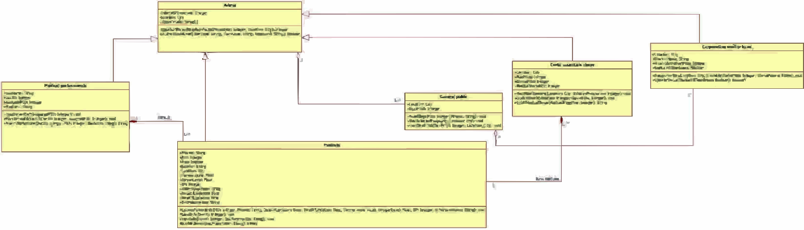

# Chapter 13: Design of UML Diagrams for COVID 19 Management System

> **Book**: *UML Diagramming: A Case Study Approach* by Dr. Suriya Sundaramoorthy (CRC Press, 2022)  
> **Pages**: 147–156 (Total: 10 pages)  
> **Classification**: Industrial Case Study & Diagram Suite  
> **Navigation**: [&larr; Chapter_12_Design_of_UML_Diagrams_for_My_Helper](Chapter_12_Design_of_UML_Diagrams_for_My_Helper.md) | [📚 Book Index](../UML_Book.md) | [Chapter_14_Design_of_UML_Diagrams_for_Car_Care &rarr;](Chapter_14_Design_of_UML_Diagrams_for_Car_Care.md)

---

## 📌 Executive Summary

Chapter 13 presents an industrial software engineering case study for **Design of UML Diagrams for COVID 19 Management System**. It details the transition from business requirements and domain constraints into formal software architecture specifications, leveraging data-flow modeling and a complete suite of Unified Modeling Language (UML) structural and behavioral diagrams.

---

## 🎯 Problem Statement & System Context

The all in one COVID-19 management system simplifies the entire process of decreasing the virus load in the community by digitalization. It includes tracking and treating COVID-19 patients and monitoring the spread of the virus. It aims to assist healthcare organizations and governments to assess patient risk profiles and provide awareness to common people by connecting them with virtual care capabilities. With the current epidemiological situation of COVID-19, there is a high demand to reduce contact between persons and digitize the whole process. This will effectively reduce the infection rate, help the common people and empower medical professionals across the world to help more patients through telemedicine and virtual care. Functionalities: 1. Medical Professionals (Doctors/Nurses): Can monitor the oxygen level, blood pressure level, temperature, symptoms, medicine intake and diet of the registered patient. All the information of the patients from screening to discharge can be viewed. Medicines can also be prescribed to a specific patient. 2. COVID-19 Patients: View the data shared by the doctor, home quarantined patients can update data and checklist of medical shops in their locality. 3. Common People: Check the number of people infected (symptomatic and asymptomatic) and death in their locality ranging from current street, 500 m, 1 km, 5 km, 10 km and view a blog where recovered persons share their experience. 4. COVID-19 Essentials Seller: Can stock up essentials like masks and gloves according to infection in an area. Medical shops nearby the area will be listed. 5. Corporation Worker Head: Workers will be assigned to disinfect Covid-affected areas regularly based on infection data and updates status. 6. Admin: Updates current number of infected persons in a locality (Figure 13.1–13.9).

---

## 📊 Complete UML Diagram Suite & Architecture Specifications

This chapter incorporates **10 standalone vector diagram(s)** illustrating the end-to-end design from functional use cases to physical hardware deployment:

### Figure 13.1: UML Usecase Diagram

**Diagram Category**: `Use Case Diagram`  
**Architectural Role**: Specifies system boundary, primary external actors, and business use cases with include/extend relationships.

### Figure 13.2: UML Activity Diagram Part 1

**Diagram Category**: `Activity Diagram`  
**Architectural Role**: Illustrates dynamic procedural workflow, decision branching, concurrent action forks, and synchronization joins.

### Figure 13.3: UML Activity Diagram Part 2

**Diagram Category**: `Activity Diagram`  
**Architectural Role**: Illustrates dynamic procedural workflow, decision branching, concurrent action forks, and synchronization joins.

### Figure 13.4: UML Sequence Diagram

**Diagram Category**: `Sequence Diagram`  
**Architectural Role**: Details chronological object interactions, synchronous message exchanges, return flows, and activation lifelines.

### Figure 13.5: UML Collaboration Diagram

**Diagram Category**: `Communication Diagram`  
**Architectural Role**: Emphasizes structural object topology and numbered sequence messaging between collaborating entities.

### Figure 13.6: UML State Machine Diagram

**Diagram Category**: `State Machine Diagram`  
**Architectural Role**: Captures entity lifecycle states, transition triggers, event guards, and exit/entry actions.

### Figure 13.7: UML Class Diagram

**Diagram Category**: `Class Diagram`  
**Architectural Role**: Models static structural classifiers, entity attributes, operations, and associations (composition, aggregation, inheritance).

### Figure 13.8: UML Component Diagram

**Diagram Category**: `Component Diagram`  
**Architectural Role**: Architects physical modular software components, provided ball interfaces, and required socket dependencies.

### Figure 13.9: UML Deployment Diagram

**Diagram Category**: `Deployment Diagram`  
**Architectural Role**: Maps software execution artifacts to hardware computing nodes, client devices, application tiers, and database servers.

### Visual Artifacts & Supplementary Schematics

The following vector schematics capture operational screen states, user dashboards, or notation components documented in this chapter:

#### Ch13 p156 img01

---

## 💡 Key Architectural Invariants & Modeling Lessons

1. **Traceability**: Every software model directly corresponds to explicit functional requirements defined during the initial domain specification.
2. **Separation of Concerns**: Structural models (Class, Component, Deployment) maintain clear boundaries separating business domain entities from physical infrastructure nodes.
3. **Behavioral Integrity**: Dynamic models (Activity, Sequence, State Machine) guarantee valid state transitions, prevent deadlocks, and verify message order consistency.
4. **Deployment Fidelity**: Physical nodes and execution environments accurately map runtime middleware, database engines, and client access channels.

---

## 🔗 Related Resources & Navigation

- **Navigation**: [&larr; Chapter_12_Design_of_UML_Diagrams_for_My_Helper](Chapter_12_Design_of_UML_Diagrams_for_My_Helper.md) | [📚 Book Index](../UML_Book.md) | [Chapter_14_Design_of_UML_Diagrams_for_Car_Care &rarr;](Chapter_14_Design_of_UML_Diagrams_for_Car_Care.md)
- **Master Book Catalog**: [`UML_Book.md`](../UML_Book.md)
- **Vector Images Catalog**: [`Vector_Images_Catalog.md`](../vector_images/Vector_Images_Catalog.md)