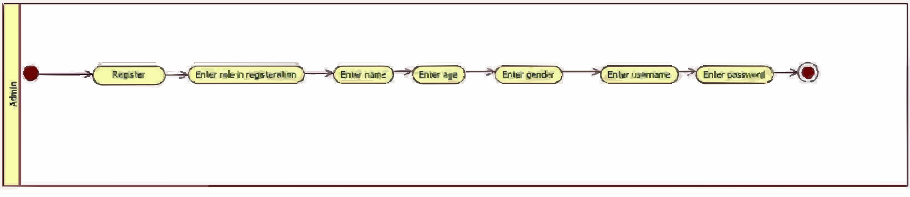
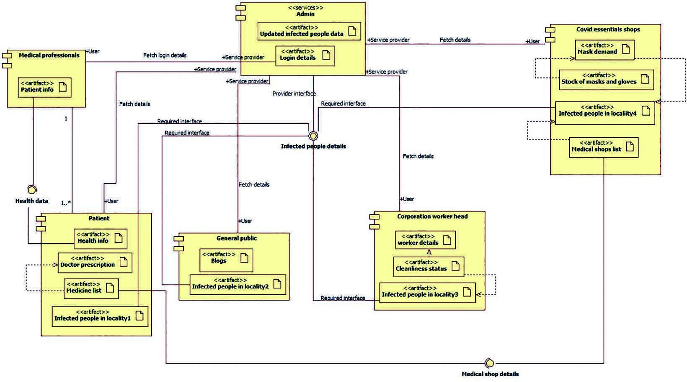

# Chapter 13: Design of UML Diagrams for COVID 19 Management System

> **Book**: *UML Diagramming: A Case Study Approach* by Dr. Suriya Sundaramoorthy (CRC Press, 2022)  
> **Pages**: 147–156 (Total: 10 pages)  
> **Classification**: Industrial Case Study & UML Modeling Suite  
> **Navigation**: [&larr; Chapter_12_Design_of_UML_Diagrams_for_My_Helper](Chapter_12_Design_of_UML_Diagrams_for_My_Helper.md) | [📚 Book Index](../UML_Book.md) | [Chapter_14_Design_of_UML_Diagrams_for_Car_Care &rarr;](Chapter_14_Design_of_UML_Diagrams_for_Car_Care.md)

---

## 📌 Executive Summary

Chapter 13 presents an end-to-end software engineering case study for the **Design of UML Diagrams for COVID 19 Management System**. This chapter demonstrates how business requirements and domain constraints are translated into formal architectural specifications through data-flow modeling and a complete suite of Unified Modeling Language (UML) structural and behavioral models.

The case study analyzes the system from multiple architectural perspectives: identifying external user and service actors, formalizing core operational capabilities, detailing procedural business workflows, specifying domain entity schemas, and architecting modular component deployment across distributed physical infrastructure.

---

## 🎯 Problem Statement & Business Context

- **Core Problem**: Disease epidemics create logistical chaos when tracking patient infections, quarantine compliance, and hospital bed shortages manually.
- **Business Context**: Public health departments need a central epidemic response system to control contagion and allocate medical resources quickly.
- **Key Solution**: Digitally registers patient test results, monitors quarantine periods, tracks available ICU beds/oxygen, and maps infection containment zones.

---

## ⚙️ System Architecture & Functional Capabilities

The **Design of UML Diagrams for COVID 19 Management System** decomposes business operations into modular functional units. These capabilities address the operational bottlenecks of manual and legacy workflows by introducing automated, role-based, and auditable software processes:

- **Prescribe Medicines**: Enables doctors to prescribe medicines to specific patients.
- **Update Data by Home Quarantined Patients**: Enable home quarantined patients to update their health conditions.
- **View Data Shared by Doctor**: Enables patient to view prescription and other remarks of the doctor.
- **Buy Medicine**: Enables patients to view the list of medical shops in their locality.
- **Read Blog of Recovered Patients**: Enables users to read blogs of recovered patients.
- **View the Number of Deaths in the Locality**: Enables users to view the number of deaths in the locality.
- **List all Medical Shops in the Locality**: Enables the COVID essentials shops to list all the medical shops in the locality.
- **Update Status of Cleanliness**: Enables corporation worker head to update the status of cleanliness after a particular area has been disinfected.
- **Assign Workers to Disinfect in an Area**: Workers are assigned according to the infection rate in the locality.
- **Register**: All users except the general public must register to ensure their access control and make use of their distinct functions in the COVID-19 management system.
- **Authenticate User**: To check the access control of the user in this system.
- **Update the Current Number of Infected People**: Enables the admin to update the exact number of infected people belonging to a place frequently.
- **Stock Up Masks and Gloves**: Enables the Covid essentials shops to show their updated stock of the essentials like masks, gloves, hand sanitizers and other disinfectants.
- **View Mask Demand**: Enables the COVID essential shops to view the demand for masks as the number of infected people in locality increases.

---

## 📊 Complete UML Diagram Suite & Architectural Walkthrough

This chapter incorporates **10 crystal-clear, high-resolution diagram(s)** (extracted losslessly from the source edition at up to 2,000+ px) illustrating the end-to-end design from functional use cases to physical hardware deployment:

### Figure 13.1: UML Usecase Diagram

**Diagram Category**: `Use Case Diagram`  
**Architectural Role**: Specifies system boundary, primary external actors, and business use cases with include/extend relationships.

**System Design Analysis**:
Illustrates the functional boundary of the **Design of UML Diagrams for COVID 19 Management System**. External actors trigger core use cases, demonstrating how business transactions, authorization checkpoints, and service requests flow into the system. Relationships (`<<include>>` for mandatory sub-routines like authentication and validation, and `<<extend>>` for optional or conditional exception branches) formalize the system's external functional contract.

### Figure 13.2: UML Activity Diagram Part 1

**Diagram Category**: `Activity Diagram`  
**Architectural Role**: Illustrates dynamic procedural workflow, decision branching, concurrent action forks, and synchronization joins.

**System Design Analysis**:
Details the step-by-step procedural execution flow for core operations in **Design of UML Diagrams for COVID 19 Management System**. Begins at an initial state, navigates action states, evaluates guard conditions at decision diamonds, and models parallel execution branches using fork and join synchronizations before reaching the terminal state, ensuring business workflows are deterministic and free of race conditions.

### Figure 13.3: UML Activity Diagram Part 2

**Diagram Category**: `Activity Diagram`  
**Architectural Role**: Illustrates dynamic procedural workflow, decision branching, concurrent action forks, and synchronization joins.

**System Design Analysis**:
Details the step-by-step procedural execution flow for core operations in **Design of UML Diagrams for COVID 19 Management System**. Begins at an initial state, navigates action states, evaluates guard conditions at decision diamonds, and models parallel execution branches using fork and join synchronizations before reaching the terminal state, ensuring business workflows are deterministic and free of race conditions.

### Figure 13.4: UML Sequence Diagram

**Diagram Category**: `Sequence Diagram`  
**Architectural Role**: Details chronological object interactions, synchronous message exchanges, return flows, and activation lifelines.

**System Design Analysis**:
Traces the time-ordered message sequence between participating objects and services in **Design of UML Diagrams for COVID 19 Management System**. Vertical dashed lifelines represent entity instances across time, while horizontal solid and dashed arrows show synchronous invocations, data lookups, and return values. Activation bars delineate execution duration, clarifying object collaboration during key transactional workflows.

### Figure 13.5: UML Collaboration Diagram

**Diagram Category**: `Communication Diagram`  
**Architectural Role**: Emphasizes structural object topology and numbered sequence messaging between collaborating entities.

**System Design Analysis**:
Emphasizes the spatial and structural organization of collaborating instances in **Design of UML Diagrams for COVID 19 Management System**. Shows object links overlaid with numbered messages (e.g., 1.0, 1.1, 2.0), illustrating both structural connectivity and invocation hierarchy, complementing the temporal perspective of the sequence diagram.

### Figure 13.6: UML State Machine Diagram

**Diagram Category**: `State Machine Diagram`  
**Architectural Role**: Captures entity lifecycle states, transition triggers, event guards, and exit/entry actions.

**System Design Analysis**:
Models the complete lifecycle state transitions for central domain entities in **Design of UML Diagrams for COVID 19 Management System**. Tracks transitions from initial creation through intermediate processing states to completion or cancellation. Explicit state triggers, guard expressions `[condition]`, and entry/exit actions guarantee valid business lifecycle states and eliminate invalid operational state jumps.

### Figure 13.7: UML Class Diagram

**Diagram Category**: `Class Diagram`  
**Architectural Role**: Models static structural classifiers, entity attributes, operations, and associations (composition, aggregation, inheritance).

**System Design Analysis**:
Captures the static structural domain model for **Design of UML Diagrams for COVID 19 Management System**. Defines primary entity classes, their private/public attributes, operational methods, and relationships. It enforces structural integrity through multiplicities, composition (strong lifecycle ownership of subsidiary records), aggregation, and inheritance hierarchies, forming the foundation for the relational database schema and domain entity classes.

### Figure 13.8: UML Component Diagram

**Diagram Category**: `Component Diagram`  
**Architectural Role**: Architects physical modular software components, provided ball interfaces, and required socket dependencies.

**System Design Analysis**:
Architects the modular software organization for **Design of UML Diagrams for COVID 19 Management System**. Illustrates autonomous subsystems, business logic controllers, database access layers, and external service adapters. Provided interfaces (ball notation) and required dependencies (socket notation) define clear service contracts, supporting high cohesion and loose coupling.

### Figure 13.9: UML Deployment Diagram

**Diagram Category**: `Deployment Diagram`  
**Architectural Role**: Maps software execution artifacts to hardware computing nodes, client devices, application tiers, and database servers.

**System Design Analysis**:
Maps the physical runtime deployment architecture for **Design of UML Diagrams for COVID 19 Management System**. Depicts client hardware devices (web browsers, mobile apps), application servers, network firewalls, and persistence database nodes. Communication paths and execution environments reflect production infrastructure, scalability considerations, and network security boundaries.

### Visual Artifacts & Supplementary Schematics

The following high-resolution schematics capture operational screen states, user dashboards, or notation components documented in this chapter:

#### Ch13 p156 img01

**Perspective**: `Conceptual Notation / Architecture Asset` — Supplemental conceptual illustration or notation reference from the source chapter.

---

## 💡 Key Architectural Invariants & Domain Lessons

1. **Requirement Traceability**: Every model in the **Design of UML Diagrams for COVID 19 Management System** suite traces directly to business requirements and operational constraints established in the problem statement.
2. **State & Workflow Integrity**: Dynamic activity and sequence models guarantee deterministic workflow completion, enforce transactional atomicity, and prevent deadlocks.
3. **Modular Encapsulation**: Component boundaries decouple domain business logic from presentation controllers and external integration adapters, supporting high maintainability.
4. **Operational Security & RBAC**: Strict role-based authorization guards sensitive operations across external actor boundaries and administrative lifelines.
5. **High-Fidelity Deployment**: Physical node topologies reflect real-world tiered infrastructure (DMZ, application cluster, isolated persistence layer), ensuring scalability and fault tolerance.

---

## 🔗 Related Resources & Navigation

- **Navigation**: [&larr; Chapter_12_Design_of_UML_Diagrams_for_My_Helper](Chapter_12_Design_of_UML_Diagrams_for_My_Helper.md) | [📚 Book Index](../UML_Book.md) | [Chapter_14_Design_of_UML_Diagrams_for_Car_Care &rarr;](Chapter_14_Design_of_UML_Diagrams_for_Car_Care.md)
- **Master Book Catalog**: [`UML_Book.md`](../UML_Book.md)
- **High-Resolution Images Archive**: [`images/`](../images/)