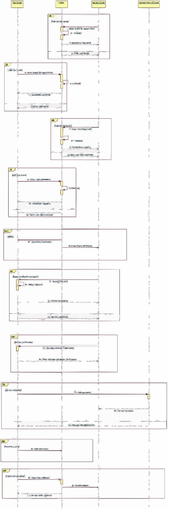

# Chapter 14: Design of UML Diagrams for Car Care

> **Book**: *UML Diagramming: A Case Study Approach* by Dr. Suriya Sundaramoorthy (CRC Press, 2022)  
> **Pages**: 157–166 (Total: 10 pages)  
> **Classification**: Industrial Case Study & Diagram Suite  
> **Navigation**: [&larr; Chapter_13_Design_of_UML_Diagrams_for_COVID_19_Management_System](Chapter_13_Design_of_UML_Diagrams_for_COVID_19_Management_System.md) | [📚 Book Index](../UML_Book.md) | [Chapter_15_Design_of_UML_Diagrams_for_E_Ration_Shop &rarr;](Chapter_15_Design_of_UML_Diagrams_for_E_Ration_Shop.md)

---

## 📌 Executive Summary

Chapter 14 presents an industrial software engineering case study for **Design of UML Diagrams for Car Care**. It details the transition from business requirements and domain constraints into formal software architecture specifications, leveraging data-flow modeling and a complete suite of Unified Modeling Language (UML) structural and behavioral diagrams.

---

## 🎯 Problem Statement & System Context

Most of the car owners do not know whether their car is at risk and needs to be serviced. This considerably increases the risk of malfunctioning of major parts of a car such as the braking system and engine which lead to accidents. Car Care is a multi-brand car service and maintenance application that maintains the date at which the specific part of a car is installed and notifies the expiry date of the parts of the car for both the driver and authorized service centre, so that the car can be serviced. This application enables car owners and service centres to separately login and enter their cars information. After issuing the car, the service centre employee enters the estimated expiry dates of parts of the car in this app. This application notifies the car owners and service centres when the expiry date for parts of the car is reached. Then the service centre employee contacts the owner of a car about service, once the owner accepts service request, the service centre employee picks up the car from home, this saves the time for owner of car. And then service centre employee examines the entire car and prepares the list of the damaged parts of the car and send it to the owner of the car through this app, once the owner selects the damaged parts to be serviced, the employee services the owner selected parts and updates the information about changed parts in the app so that the car can be service again on the expiry date of changed parts. Thus, this application helps in exchanging information between car owners and service centres. This application also enables the online payment for the services (Figures 14.1–14.8).

---

## 📊 Complete UML Diagram Suite & Architecture Specifications

This chapter incorporates **9 standalone vector diagram(s)** illustrating the end-to-end design from functional use cases to physical hardware deployment:

### Figure 14.1: UML Usecase Diagram

**Diagram Category**: `Use Case Diagram`  
**Architectural Role**: Specifies system boundary, primary external actors, and business use cases with include/extend relationships.

### Figure 14.2: UML Activity Diagram

**Diagram Category**: `Activity Diagram`  
**Architectural Role**: Illustrates dynamic procedural workflow, decision branching, concurrent action forks, and synchronization joins.

### Figure 14.3: UML Sequence Diagram

**Diagram Category**: `Sequence Diagram`  
**Architectural Role**: Details chronological object interactions, synchronous message exchanges, return flows, and activation lifelines.

### Figure 14.4: UML Collaboration Diagram

**Diagram Category**: `Communication Diagram`  
**Architectural Role**: Emphasizes structural object topology and numbered sequence messaging between collaborating entities.

### Figure 14.5: UML State Machine Diagram

**Diagram Category**: `State Machine Diagram`  
**Architectural Role**: Captures entity lifecycle states, transition triggers, event guards, and exit/entry actions.

### Figure 14.6: UML Class Diagram

**Diagram Category**: `Class Diagram`  
**Architectural Role**: Models static structural classifiers, entity attributes, operations, and associations (composition, aggregation, inheritance).

### Figure 14.7: UML Component Diagram

**Diagram Category**: `Component Diagram`  
**Architectural Role**: Architects physical modular software components, provided ball interfaces, and required socket dependencies.

### Figure 14.8: UML Deployment Diagram

**Diagram Category**: `Deployment Diagram`  
**Architectural Role**: Maps software execution artifacts to hardware computing nodes, client devices, application tiers, and database servers.

### Visual Artifacts & Supplementary Schematics

The following vector schematics capture operational screen states, user dashboards, or notation components documented in this chapter:

#### Ch14 p166 img01

---

## 💡 Key Architectural Invariants & Modeling Lessons

1. **Traceability**: Every software model directly corresponds to explicit functional requirements defined during the initial domain specification.
2. **Separation of Concerns**: Structural models (Class, Component, Deployment) maintain clear boundaries separating business domain entities from physical infrastructure nodes.
3. **Behavioral Integrity**: Dynamic models (Activity, Sequence, State Machine) guarantee valid state transitions, prevent deadlocks, and verify message order consistency.
4. **Deployment Fidelity**: Physical nodes and execution environments accurately map runtime middleware, database engines, and client access channels.

---

## 🔗 Related Resources & Navigation

- **Navigation**: [&larr; Chapter_13_Design_of_UML_Diagrams_for_COVID_19_Management_System](Chapter_13_Design_of_UML_Diagrams_for_COVID_19_Management_System.md) | [📚 Book Index](../UML_Book.md) | [Chapter_15_Design_of_UML_Diagrams_for_E_Ration_Shop &rarr;](Chapter_15_Design_of_UML_Diagrams_for_E_Ration_Shop.md)
- **Master Book Catalog**: [`UML_Book.md`](../UML_Book.md)
- **Vector Images Catalog**: [`Vector_Images_Catalog.md`](../vector_images/Vector_Images_Catalog.md)