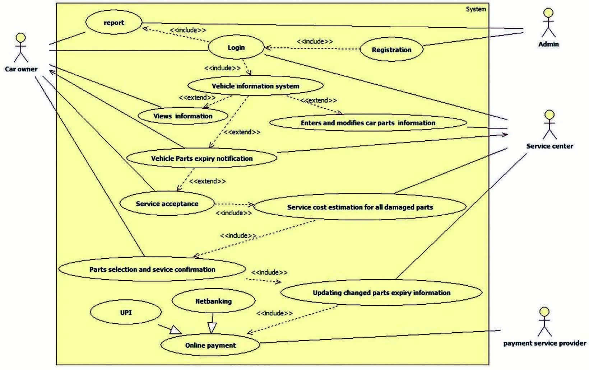
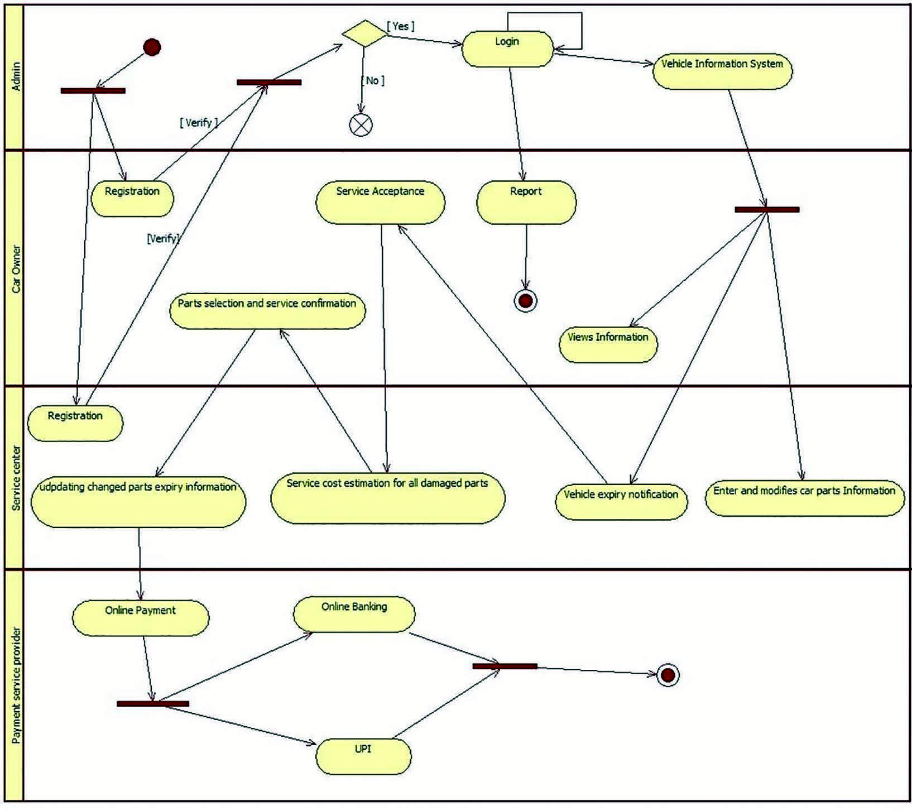
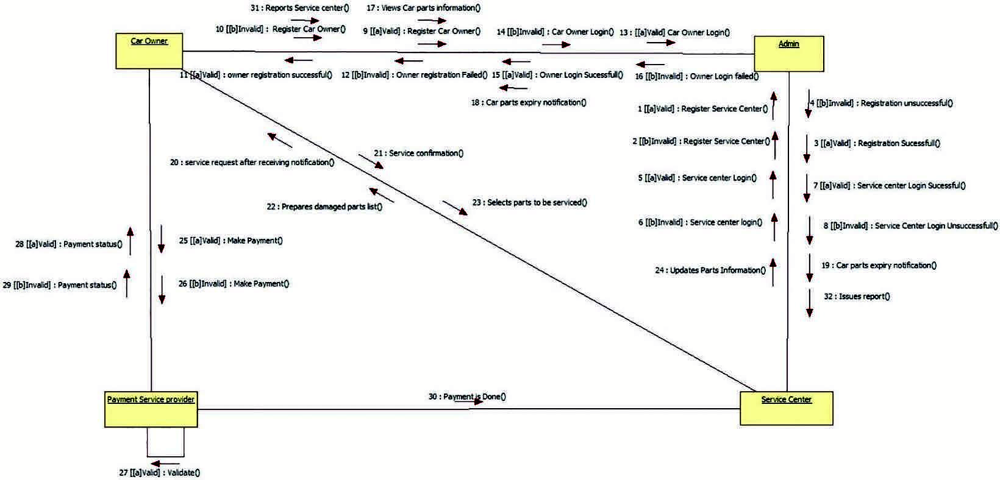
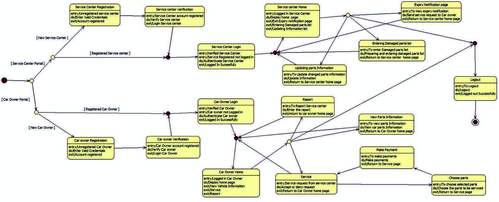
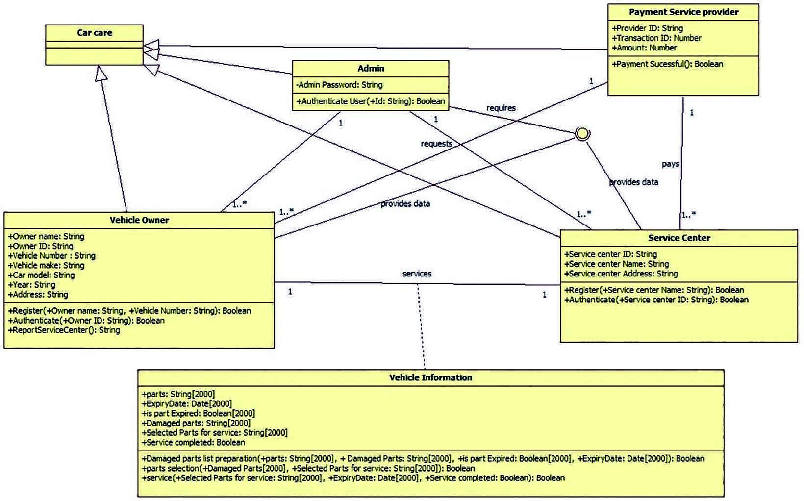
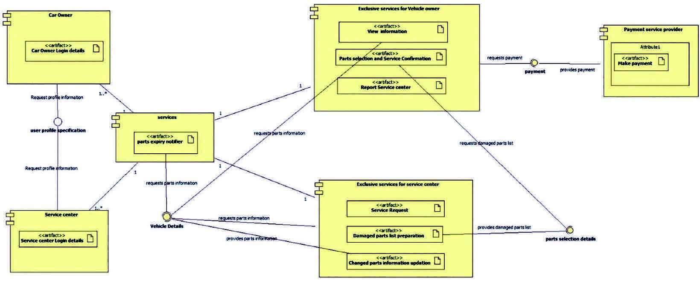
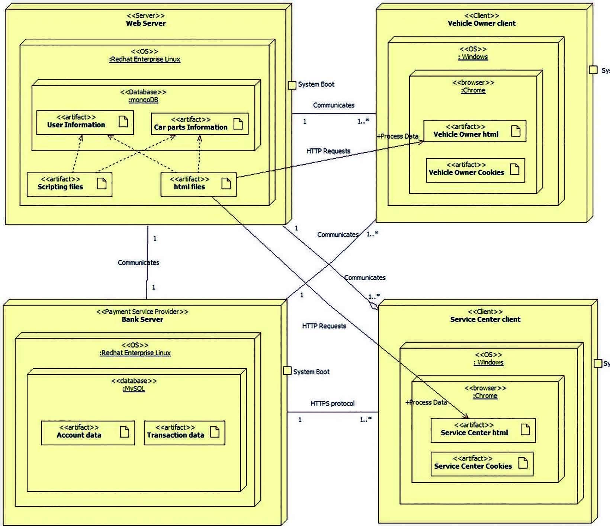

# Chapter 14: Design of UML Diagrams for Car Care

> **Book**: *UML Diagramming: A Case Study Approach* by Dr. Suriya Sundaramoorthy (CRC Press, 2022)  
> **Pages**: 157–166 (Total: 10 pages)  
> **Classification**: Industrial Case Study & UML Modeling Suite  
> **Navigation**: [&larr; Chapter_13_Design_of_UML_Diagrams_for_COVID_19_Management_System](Chapter_13_Design_of_UML_Diagrams_for_COVID_19_Management_System.md) | [📚 Book Index](../UML_Book.md) | [Chapter_15_Design_of_UML_Diagrams_for_E_Ration_Shop &rarr;](Chapter_15_Design_of_UML_Diagrams_for_E_Ration_Shop.md)

---

## 📌 Executive Summary

Chapter 14 presents an end-to-end software engineering case study for the **Design of UML Diagrams for Car Care**. This chapter demonstrates how business requirements and domain constraints are translated into formal architectural specifications through data-flow modeling and a complete suite of Unified Modeling Language (UML) structural and behavioral models.

The case study analyzes the system from multiple architectural perspectives: identifying external user and service actors, formalizing core operational capabilities, detailing procedural business workflows, specifying domain entity schemas, and architecting modular component deployment across distributed physical infrastructure.

---

## 🎯 Problem Statement & Business Context

Most of the car owners do not know whether their car is at risk and needs to be serviced. This considerably increases the risk of malfunctioning of major parts of a car such as the braking system and engine which lead to accidents. Car Care is a multi-brand car service and maintenance application that maintains the date at which the specific part of a car is installed and notifies the expiry date of the parts of the car for both the driver and authorized service centre, so that the car can be serviced. This application enables car owners and service centres to separately login and enter their cars information. After issuing the car, the service centre employee enters the estimated expiry dates of parts of the car in this app. This application notifies the car owners and service centres when the expiry date for parts of the car is reached. Then the service centre employee contacts the owner of a car about service, once the owner accepts service request, the service centre employee picks up the car from home, this saves the time for owner of car. And then service centre employee examines the entire car and prepares the list of the damaged parts of the car and send it to the owner of the car through this app, once the owner selects the damaged parts to be serviced, the employee services the owner selected parts and updates the information about changed parts in the app so that the car can be service again on the expiry date of changed parts. Thus, this application helps in exchanging information between car owners and service centres. This application also enables the online payment for the services (Figures 14.1–14.8).

---

## ⚙️ System Architecture & Functional Capabilities

The **Design of UML Diagrams for Car Care** decomposes business operations into modular functional units. These capabilities address the operational bottlenecks of manual and legacy workflows by introducing automated, role-based, and auditable software processes:

- **Registration**: Registration of car owner and service centre is required to use the system.
- **Login**: Login is required to get access to the system.
- **Vehicle Information System**: Vehicle Information System maintains the information of the vehicle and when the expiry date of parts of car is reached, it notifies both the owner and service centre, so that car can be serviced.
- **Views Information**: This allows the car owner and service centre to know the conditions of parts of the car and other information.
- **Enters and Modifies Car Parts Information**: Service centre employee modifies the car parts information after every service.
- **Vehicle Parts Expiry Notification**: Expiry notification will be sent to the owner and service centre so that the car can be serviced.
- **Service Acceptance**: The Car owner may or may not accept the service request from service centre.
- **Parts Selection and Service Confirmation**: Once the service employee updates the list of damaged parts of the car in the app, the car owner can select the required parts to be serviced.
- **Updating Changed Parts Expiry Information**: After changing the damaged parts the service centre employee, updates the information.
- **Online Payment**: Online payment for the service is done by the Car owner.
- **Net Banking**: Car owner can use net banking facility provided by the payment service provider.
- **UPI**: Car owner can use UPI (Unified Payment Interface) facility provided by the payment service provider.
- **Report**: Car owner reports to the admin about the service centre.

---

## 📊 Complete UML Diagram Suite & Architectural Walkthrough

This chapter incorporates **9 crystal-clear, high-resolution diagram(s)** (extracted losslessly from the source edition at up to 2,000+ px) illustrating the end-to-end design from functional use cases to physical hardware deployment:

### Figure 14.1: UML Usecase Diagram

**Diagram Category**: `Use Case Diagram`  
**Architectural Role**: Specifies system boundary, primary external actors, and business use cases with include/extend relationships.

**System Design Analysis**:
Illustrates the functional boundary of the **Design of UML Diagrams for Car Care**. External actors trigger core use cases, demonstrating how business transactions, authorization checkpoints, and service requests flow into the system. Relationships (`<<include>>` for mandatory sub-routines like authentication and validation, and `<<extend>>` for optional or conditional exception branches) formalize the system's external functional contract.

### Figure 14.2: UML Activity Diagram

**Diagram Category**: `Activity Diagram`  
**Architectural Role**: Illustrates dynamic procedural workflow, decision branching, concurrent action forks, and synchronization joins.

**System Design Analysis**:
Details the step-by-step procedural execution flow for core operations in **Design of UML Diagrams for Car Care**. Begins at an initial state, navigates action states, evaluates guard conditions at decision diamonds, and models parallel execution branches using fork and join synchronizations before reaching the terminal state, ensuring business workflows are deterministic and free of race conditions.

### Figure 14.3: UML Sequence Diagram

**Diagram Category**: `Sequence Diagram`  
**Architectural Role**: Details chronological object interactions, synchronous message exchanges, return flows, and activation lifelines.

**System Design Analysis**:
Traces the time-ordered message sequence between participating objects and services in **Design of UML Diagrams for Car Care**. Vertical dashed lifelines represent entity instances across time, while horizontal solid and dashed arrows show synchronous invocations, data lookups, and return values. Activation bars delineate execution duration, clarifying object collaboration during key transactional workflows.

### Figure 14.4: UML Collaboration Diagram

**Diagram Category**: `Communication Diagram`  
**Architectural Role**: Emphasizes structural object topology and numbered sequence messaging between collaborating entities.

**System Design Analysis**:
Emphasizes the spatial and structural organization of collaborating instances in **Design of UML Diagrams for Car Care**. Shows object links overlaid with numbered messages (e.g., 1.0, 1.1, 2.0), illustrating both structural connectivity and invocation hierarchy, complementing the temporal perspective of the sequence diagram.

### Figure 14.5: UML State Machine Diagram

**Diagram Category**: `State Machine Diagram`  
**Architectural Role**: Captures entity lifecycle states, transition triggers, event guards, and exit/entry actions.

**System Design Analysis**:
Models the complete lifecycle state transitions for central domain entities in **Design of UML Diagrams for Car Care**. Tracks transitions from initial creation through intermediate processing states to completion or cancellation. Explicit state triggers, guard expressions `[condition]`, and entry/exit actions guarantee valid business lifecycle states and eliminate invalid operational state jumps.

### Figure 14.6: UML Class Diagram

**Diagram Category**: `Class Diagram`  
**Architectural Role**: Models static structural classifiers, entity attributes, operations, and associations (composition, aggregation, inheritance).

**System Design Analysis**:
Captures the static structural domain model for **Design of UML Diagrams for Car Care**. Defines primary entity classes, their private/public attributes, operational methods, and relationships. It enforces structural integrity through multiplicities, composition (strong lifecycle ownership of subsidiary records), aggregation, and inheritance hierarchies, forming the foundation for the relational database schema and domain entity classes.

### Figure 14.7: UML Component Diagram

**Diagram Category**: `Component Diagram`  
**Architectural Role**: Architects physical modular software components, provided ball interfaces, and required socket dependencies.

**System Design Analysis**:
Architects the modular software organization for **Design of UML Diagrams for Car Care**. Illustrates autonomous subsystems, business logic controllers, database access layers, and external service adapters. Provided interfaces (ball notation) and required dependencies (socket notation) define clear service contracts, supporting high cohesion and loose coupling.

### Figure 14.8: UML Deployment Diagram

**Diagram Category**: `Deployment Diagram`  
**Architectural Role**: Maps software execution artifacts to hardware computing nodes, client devices, application tiers, and database servers.

**System Design Analysis**:
Maps the physical runtime deployment architecture for **Design of UML Diagrams for Car Care**. Depicts client hardware devices (web browsers, mobile apps), application servers, network firewalls, and persistence database nodes. Communication paths and execution environments reflect production infrastructure, scalability considerations, and network security boundaries.

### Visual Artifacts & Supplementary Schematics

The following high-resolution schematics capture operational screen states, user dashboards, or notation components documented in this chapter:

#### Ch14 p166 img01

**Perspective**: `Conceptual Notation / Architecture Asset` — Supplemental conceptual illustration or notation reference from the source chapter.

---

## 💡 Key Architectural Invariants & Domain Lessons

1. **Requirement Traceability**: Every model in the **Design of UML Diagrams for Car Care** suite traces directly to business requirements and operational constraints established in the problem statement.
2. **State & Workflow Integrity**: Dynamic activity and sequence models guarantee deterministic workflow completion, enforce transactional atomicity, and prevent deadlocks.
3. **Modular Encapsulation**: Component boundaries decouple domain business logic from presentation controllers and external integration adapters, supporting high maintainability.
4. **Operational Security & RBAC**: Strict role-based authorization guards sensitive operations across external actor boundaries and administrative lifelines.
5. **High-Fidelity Deployment**: Physical node topologies reflect real-world tiered infrastructure (DMZ, application cluster, isolated persistence layer), ensuring scalability and fault tolerance.

---

## 🔗 Related Resources & Navigation

- **Navigation**: [&larr; Chapter_13_Design_of_UML_Diagrams_for_COVID_19_Management_System](Chapter_13_Design_of_UML_Diagrams_for_COVID_19_Management_System.md) | [📚 Book Index](../UML_Book.md) | [Chapter_15_Design_of_UML_Diagrams_for_E_Ration_Shop &rarr;](Chapter_15_Design_of_UML_Diagrams_for_E_Ration_Shop.md)
- **Master Book Catalog**: [`UML_Book.md`](../UML_Book.md)
- **High-Resolution Images Archive**: [`images/`](../images/)