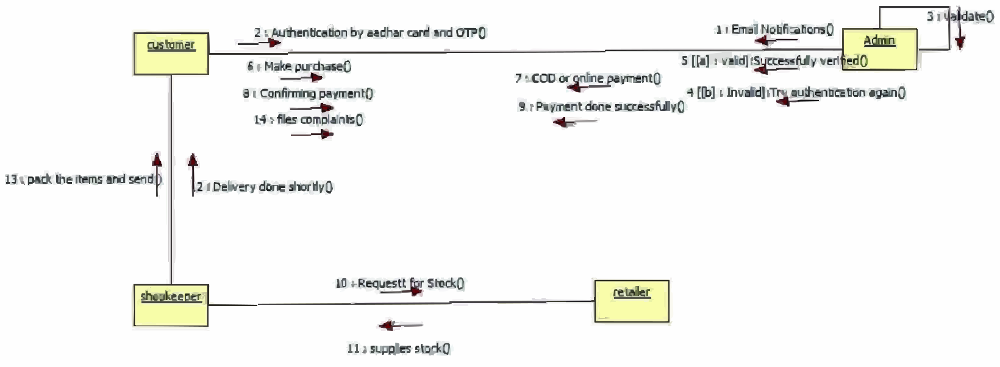

# Chapter 15: Design of UML Diagrams for E Ration Shop

> **Book**: *UML Diagramming: A Case Study Approach* by Dr. Suriya Sundaramoorthy (CRC Press, 2022)  
> **Pages**: 167–176 (Total: 10 pages)  
> **Classification**: Industrial Case Study & Diagram Suite  
> **Navigation**: [&larr; Chapter_14_Design_of_UML_Diagrams_for_Car_Care](Chapter_14_Design_of_UML_Diagrams_for_Car_Care.md) | [📚 Book Index](../UML_Book.md) | [Chapter_16_Design_of_UML_Diagrams_for_Textile_Management_System &rarr;](Chapter_16_Design_of_UML_Diagrams_for_Textile_Management_System.md)

---

## 📌 Executive Summary

Chapter 15 presents an industrial software engineering case study for **Design of UML Diagrams for E Ration Shop**. It details the transition from business requirements and domain constraints into formal software architecture specifications, leveraging data-flow modeling and a complete suite of Unified Modeling Language (UML) structural and behavioral diagrams.

---

## 🎯 Problem Statement & System Context

Public Distribution System (PDS) is an Indian food security system. It is established by the Government of India under the Ministry of Consumer Affairs, Food, and Public Distribution and managed jointly with state governments in India. The traditional PDS is used to distribute grocery items to India’s poor who are valid ration cardholders. The validity and the allocation of the ration cards are monitored by the state governments. A ration cardholder should be given 35 kg of food grain as per the norms of PDS. However, there are concerns about the efficiency of the distribution process. In order to make it efficient and improve the current system of PDS, we are implementing e-Ration Shop. Here, we are going to make a website for shopping purposes. Using this website ration cardholder can order his/her grocery items from the PDS online. The main reason for using this website is to make this process computerized and to remove the drawbacks of the present way of issuing products based on the ration card. The main drawback in the current system is that the PDS has been criticized for its urban bias and its failure to serve the poorer sections of the population effectively. Also, many retail shopkeepers have a large number of bogus cards to sell food grains in the open market. Many PDS dealers resort to malpractice since they acquire less Salary so, by this project we are solving this problem too. Most of the time, users do not get their rightful entitlement in terms of quantity. What’s meant for them or the farm produce procured by the PDS is diverted to the open market. So in order to avoid all these drawbacks, we are going to use the e-Ration Shop which will help us to avoid the corruption in PDS if not eradicate it. The various importance of the proposed case study is every shop’s geo-location will be located on the map, all the information regarding shop and shopkeeper respective to the ration card and region, shop opening and closing details will be available, stock provided based on category, retailers can add, edit, delete and update their shop’s other items also, retailers can advertise their shops, stock availability will be notified on regular basis, product delivery feature, complaint forum for complaints by users, easy payment system by PayTM, COD etc., admin and moderator features for government and shopkeepers and authentication system by Aadhaar number and One-Time Pin (OTP) (Figures 15.1–15.8).

---

## 📊 Complete UML Diagram Suite & Architecture Specifications

This chapter incorporates **9 standalone vector diagram(s)** illustrating the end-to-end design from functional use cases to physical hardware deployment:

### Figure 15.1: UML Usecase Diagram

**Diagram Category**: `Use Case Diagram`  
**Architectural Role**: Specifies system boundary, primary external actors, and business use cases with include/extend relationships.

### Figure 15.2: UML Activity Diagram

**Diagram Category**: `Activity Diagram`  
**Architectural Role**: Illustrates dynamic procedural workflow, decision branching, concurrent action forks, and synchronization joins.

### Figure 15.3: UML Sequence Diagram

**Diagram Category**: `Sequence Diagram`  
**Architectural Role**: Details chronological object interactions, synchronous message exchanges, return flows, and activation lifelines.

### Figure 15.4: UML Collaboration Diagram

**Diagram Category**: `Communication Diagram`  
**Architectural Role**: Emphasizes structural object topology and numbered sequence messaging between collaborating entities.

### Figure 15.5: UML State Machine Diagram

**Diagram Category**: `State Machine Diagram`  
**Architectural Role**: Captures entity lifecycle states, transition triggers, event guards, and exit/entry actions.

### Figure 15.6: UML Class Diagram

**Diagram Category**: `Class Diagram`  
**Architectural Role**: Models static structural classifiers, entity attributes, operations, and associations (composition, aggregation, inheritance).

### Figure 15.7: UML Component Diagram

**Diagram Category**: `Component Diagram`  
**Architectural Role**: Architects physical modular software components, provided ball interfaces, and required socket dependencies.

### Figure 15.8: UML Deployment Diagram

**Diagram Category**: `Deployment Diagram`  
**Architectural Role**: Maps software execution artifacts to hardware computing nodes, client devices, application tiers, and database servers.

### Visual Artifacts & Supplementary Schematics

The following vector schematics capture operational screen states, user dashboards, or notation components documented in this chapter:

#### Ch15 p176 img01

---

## 💡 Key Architectural Invariants & Modeling Lessons

1. **Traceability**: Every software model directly corresponds to explicit functional requirements defined during the initial domain specification.
2. **Separation of Concerns**: Structural models (Class, Component, Deployment) maintain clear boundaries separating business domain entities from physical infrastructure nodes.
3. **Behavioral Integrity**: Dynamic models (Activity, Sequence, State Machine) guarantee valid state transitions, prevent deadlocks, and verify message order consistency.
4. **Deployment Fidelity**: Physical nodes and execution environments accurately map runtime middleware, database engines, and client access channels.

---

## 🔗 Related Resources & Navigation

- **Navigation**: [&larr; Chapter_14_Design_of_UML_Diagrams_for_Car_Care](Chapter_14_Design_of_UML_Diagrams_for_Car_Care.md) | [📚 Book Index](../UML_Book.md) | [Chapter_16_Design_of_UML_Diagrams_for_Textile_Management_System &rarr;](Chapter_16_Design_of_UML_Diagrams_for_Textile_Management_System.md)
- **Master Book Catalog**: [`UML_Book.md`](../UML_Book.md)
- **Vector Images Catalog**: [`Vector_Images_Catalog.md`](../vector_images/Vector_Images_Catalog.md)