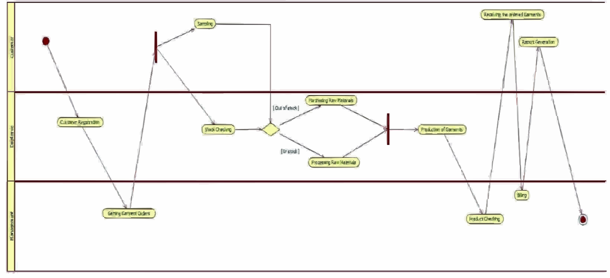
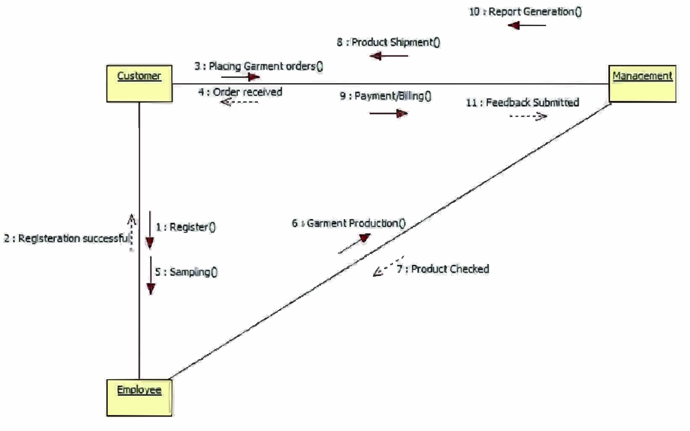

# Chapter 16: Design of UML Diagrams for Textile Management System

> **Book**: *UML Diagramming: A Case Study Approach* by Dr. Suriya Sundaramoorthy (CRC Press, 2022)  
> **Pages**: 177–184 (Total: 8 pages)  
> **Classification**: Industrial Case Study & Diagram Suite  
> **Navigation**: [&larr; Chapter_15_Design_of_UML_Diagrams_for_E_Ration_Shop](Chapter_15_Design_of_UML_Diagrams_for_E_Ration_Shop.md) | [📚 Book Index](../UML_Book.md) | [Chapter_17_Design_of_UML_Diagrams_for_National_Health_ID_2020 &rarr;](Chapter_17_Design_of_UML_Diagrams_for_National_Health_ID_2020.md)

---

## 📌 Executive Summary

Chapter 16 presents an industrial software engineering case study for **Design of UML Diagrams for Textile Management System**. It details the transition from business requirements and domain constraints into formal software architecture specifications, leveraging data-flow modeling and a complete suite of Unified Modeling Language (UML) structural and behavioral diagrams.

---

## 🎯 Problem Statement & System Context

The ‘Textile Management System’ case study is designed to monitor all the processes in a textile manufacturing industry. There are various processes such as order receiving, purchase of raw materials, classification of raw materials, production of goods and selling the products. The main aim of this system is to ensure the reliability of data and to ease the process of manufacturing and transportation of garments and raw materials. This system ensures that the hardships prevailing in the manual systems are overridden by reducing the errors in data handling. The major functionalities are customer registration, sampling, stock checking, purchasing and processing of raw materials, production of garments, product checking and clearance, shipment, billing and report generation (Figures 16.1–16.8).

---

## 📊 Complete UML Diagram Suite & Architecture Specifications

This chapter incorporates **9 standalone vector diagram(s)** illustrating the end-to-end design from functional use cases to physical hardware deployment:

### Figure 16.1: UML Usecase Diagram

**Diagram Category**: `Use Case Diagram`  
**Architectural Role**: Specifies system boundary, primary external actors, and business use cases with include/extend relationships.

### Figure 16.2: UML Activity Diagram

**Diagram Category**: `Activity Diagram`  
**Architectural Role**: Illustrates dynamic procedural workflow, decision branching, concurrent action forks, and synchronization joins.

### Figure 16.3: UML Sequence Diagram

**Diagram Category**: `Sequence Diagram`  
**Architectural Role**: Details chronological object interactions, synchronous message exchanges, return flows, and activation lifelines.

### Figure 16.4: UML Collaboration Diagram

**Diagram Category**: `Communication Diagram`  
**Architectural Role**: Emphasizes structural object topology and numbered sequence messaging between collaborating entities.

### Figure 16.5: UML State Machine Diagram

**Diagram Category**: `State Machine Diagram`  
**Architectural Role**: Captures entity lifecycle states, transition triggers, event guards, and exit/entry actions.

### Figure 16.6: UML Class Diagram

**Diagram Category**: `Class Diagram`  
**Architectural Role**: Models static structural classifiers, entity attributes, operations, and associations (composition, aggregation, inheritance).

### Figure 16.7: UML Component Diagram

**Diagram Category**: `Component Diagram`  
**Architectural Role**: Architects physical modular software components, provided ball interfaces, and required socket dependencies.

### Figure 16.8: UML Deployment Diagram

**Diagram Category**: `Deployment Diagram`  
**Architectural Role**: Maps software execution artifacts to hardware computing nodes, client devices, application tiers, and database servers.

### Visual Artifacts & Supplementary Schematics

The following vector schematics capture operational screen states, user dashboards, or notation components documented in this chapter:

#### Ch16 p184 img01

---

## 💡 Key Architectural Invariants & Modeling Lessons

1. **Traceability**: Every software model directly corresponds to explicit functional requirements defined during the initial domain specification.
2. **Separation of Concerns**: Structural models (Class, Component, Deployment) maintain clear boundaries separating business domain entities from physical infrastructure nodes.
3. **Behavioral Integrity**: Dynamic models (Activity, Sequence, State Machine) guarantee valid state transitions, prevent deadlocks, and verify message order consistency.
4. **Deployment Fidelity**: Physical nodes and execution environments accurately map runtime middleware, database engines, and client access channels.

---

## 🔗 Related Resources & Navigation

- **Navigation**: [&larr; Chapter_15_Design_of_UML_Diagrams_for_E_Ration_Shop](Chapter_15_Design_of_UML_Diagrams_for_E_Ration_Shop.md) | [📚 Book Index](../UML_Book.md) | [Chapter_17_Design_of_UML_Diagrams_for_National_Health_ID_2020 &rarr;](Chapter_17_Design_of_UML_Diagrams_for_National_Health_ID_2020.md)
- **Master Book Catalog**: [`UML_Book.md`](../UML_Book.md)
- **Vector Images Catalog**: [`Vector_Images_Catalog.md`](../vector_images/Vector_Images_Catalog.md)