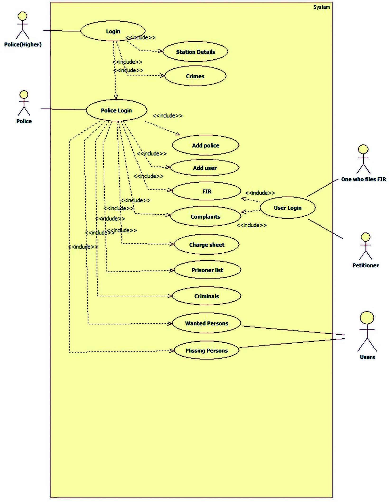
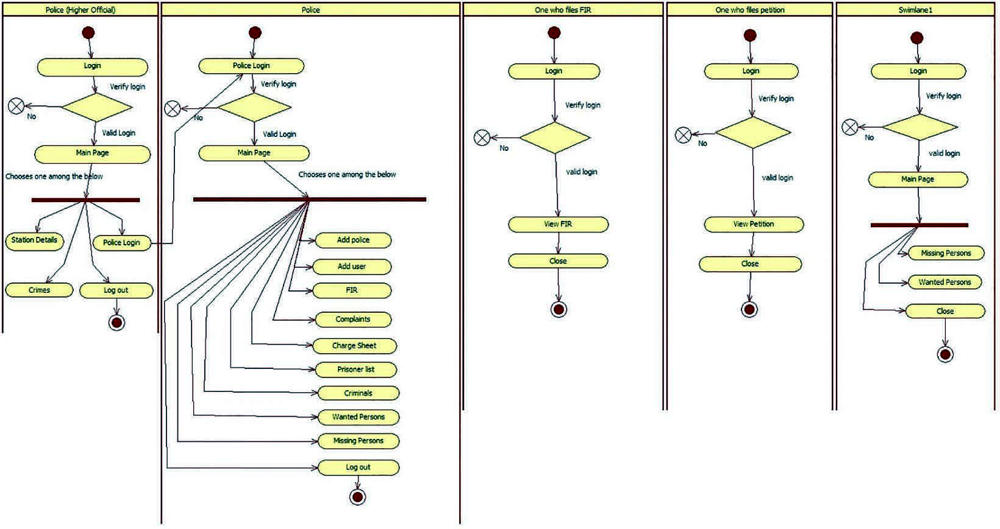
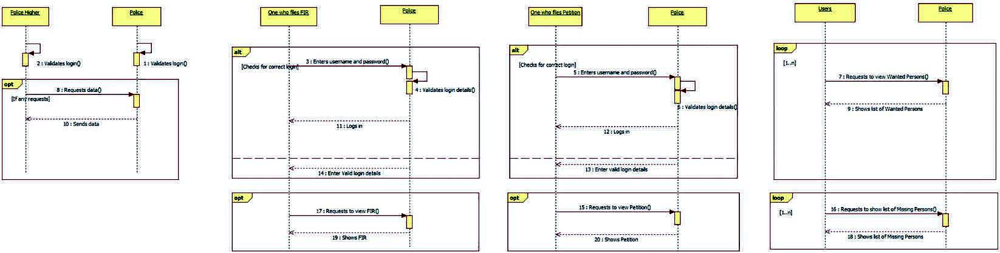
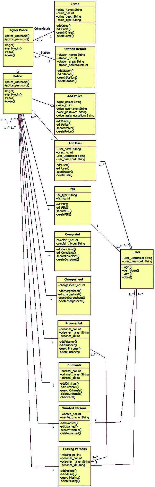

# Chapter 20: Design of UML Diagrams for Crime Bureau

> **Book**: *UML Diagramming: A Case Study Approach* by Dr. Suriya Sundaramoorthy (CRC Press, 2022)  
> **Pages**: 209–218 (Total: 10 pages)  
> **Classification**: Industrial Case Study & UML Modeling Suite  
> **Navigation**: [&larr; Chapter_19_Design_of_UML_Diagrams_for_Online_College_Magazine_System](Chapter_19_Design_of_UML_Diagrams_for_Online_College_Magazine_System.md) | [📚 Book Index](../UML_Book.md) | [Chapter_21_Design_of_UML_Diagrams_for_Smart_Traffic_Management_System &rarr;](Chapter_21_Design_of_UML_Diagrams_for_Smart_Traffic_Management_System.md)

---

## 📌 Executive Summary

Chapter 20 presents an end-to-end software engineering case study for the **Design of UML Diagrams for Crime Bureau**. This chapter demonstrates how business requirements and domain constraints are translated into formal architectural specifications through data-flow modeling and a complete suite of Unified Modeling Language (UML) structural and behavioral models.

The case study analyzes the system from multiple architectural perspectives: identifying external user and service actors, formalizing core operational capabilities, detailing procedural business workflows, specifying domain entity schemas, and architecting modular component deployment across distributed physical infrastructure.

---

## 🎯 Problem Statement & Business Context

Rules and regulations are paramount to all aspects of life. Certain proponents have asserted that crime which is a violation against laws of the society, is integral to the human nature and hence the society can never be completely free from it. In the existing system, all work is done on papers, so it is very difficult to secure crime reports data. This system needs more manpower to track the records of crimes and it lacks security. Modern society is characterized by increasing levels of risk posed by internal and external security threats. This poses the importance to develop an automated crime management system to keep a record of the crime and the criminals involved. The proposed crime bureau is a database system in which the police keeps the record of criminals who have been arrested, to be arrested, or escaped and the complaints. This will help the police department in enhanced management of information. The main entities in the whole process include; the petitioner (the person who files a First Incident Report (FIR)), victim, accused or criminal, case and investigating officer. The proposed crime record management system can overcome all the limitations of the existing system. This system provides proper security and reduces the manual work. This project helps to maintain a database through which the entire crime activities in the state can be monitored (Figures 20.1–20.8).

---

## ⚙️ System Architecture & Functional Capabilities

The **Design of UML Diagrams for Crime Bureau** decomposes business operations into modular functional units. These capabilities address the operational bottlenecks of manual and legacy workflows by introducing automated, role-based, and auditable software processes:

- **Login**: Officials are provided with a username and password, through which they can log into the crime bureau.
- **Station Details**: Holds all the information regarding all the police stations in the state.
- **Crimes**: Lists all the criminal activities for which an FIR or complaint can be filed.
- **Police Login**: Officials are provided with a username and password, through which they can log into the crime bureau.
- **Add Police**: Holds a record of all the police officers.
- **Add User**: Holds a record of all the users who either have filed FIR or complaints.
- **FIR**: Holds a record of all the FIRs filed by the people.
- **Complaints**: Holds a record of all the complaints filed by the people.
- **Charge Sheet**: Holds a record of all the charge sheets filed by the people.
- **Prisoner List**: Holds a list of all the prisoners.
- **Criminals**: Holds a list of all the criminals.
- **Wanted Persons**: Holds a list of wanted persons.
- **Missing Persons**: Holds a list of missing persons.
- **User Login**: Login page for the users

---

## 📊 Complete UML Diagram Suite & Architectural Walkthrough

This chapter incorporates **9 crystal-clear, high-resolution diagram(s)** (extracted losslessly from the source edition at up to 2,000+ px) illustrating the end-to-end design from functional use cases to physical hardware deployment:

### Figure 20.1: UML Usecase Diagram

**Diagram Category**: `Use Case Diagram`  
**Architectural Role**: Specifies system boundary, primary external actors, and business use cases with include/extend relationships.

**System Design Analysis**:
Illustrates the functional boundary of the **Design of UML Diagrams for Crime Bureau**. External actors trigger core use cases, demonstrating how business transactions, authorization checkpoints, and service requests flow into the system. Relationships (`<<include>>` for mandatory sub-routines like authentication and validation, and `<<extend>>` for optional or conditional exception branches) formalize the system's external functional contract.

### Figure 20.2: UML Activity Diagram

**Diagram Category**: `Activity Diagram`  
**Architectural Role**: Illustrates dynamic procedural workflow, decision branching, concurrent action forks, and synchronization joins.

**System Design Analysis**:
Details the step-by-step procedural execution flow for core operations in **Design of UML Diagrams for Crime Bureau**. Begins at an initial state, navigates action states, evaluates guard conditions at decision diamonds, and models parallel execution branches using fork and join synchronizations before reaching the terminal state, ensuring business workflows are deterministic and free of race conditions.

### Figure 20.3: UML Sequence Diagram

**Diagram Category**: `Sequence Diagram`  
**Architectural Role**: Details chronological object interactions, synchronous message exchanges, return flows, and activation lifelines.

**System Design Analysis**:
Traces the time-ordered message sequence between participating objects and services in **Design of UML Diagrams for Crime Bureau**. Vertical dashed lifelines represent entity instances across time, while horizontal solid and dashed arrows show synchronous invocations, data lookups, and return values. Activation bars delineate execution duration, clarifying object collaboration during key transactional workflows.

### Figure 20.4: UML Collaboration Diagram

**Diagram Category**: `Communication Diagram`  
**Architectural Role**: Emphasizes structural object topology and numbered sequence messaging between collaborating entities.

**System Design Analysis**:
Emphasizes the spatial and structural organization of collaborating instances in **Design of UML Diagrams for Crime Bureau**. Shows object links overlaid with numbered messages (e.g., 1.0, 1.1, 2.0), illustrating both structural connectivity and invocation hierarchy, complementing the temporal perspective of the sequence diagram.

### Figure 20.5: UML State Chart Diagram

**Diagram Category**: `State Machine Diagram`  
**Architectural Role**: Captures entity lifecycle states, transition triggers, event guards, and exit/entry actions.

**System Design Analysis**:
Models the complete lifecycle state transitions for central domain entities in **Design of UML Diagrams for Crime Bureau**. Tracks transitions from initial creation through intermediate processing states to completion or cancellation. Explicit state triggers, guard expressions `[condition]`, and entry/exit actions guarantee valid business lifecycle states and eliminate invalid operational state jumps.

### Figure 20.6: UML Class Diagram

**Diagram Category**: `Class Diagram`  
**Architectural Role**: Models static structural classifiers, entity attributes, operations, and associations (composition, aggregation, inheritance).

**System Design Analysis**:
Captures the static structural domain model for **Design of UML Diagrams for Crime Bureau**. Defines primary entity classes, their private/public attributes, operational methods, and relationships. It enforces structural integrity through multiplicities, composition (strong lifecycle ownership of subsidiary records), aggregation, and inheritance hierarchies, forming the foundation for the relational database schema and domain entity classes.

### Figure 20.7: UML Component Diagram

**Diagram Category**: `Component Diagram`  
**Architectural Role**: Architects physical modular software components, provided ball interfaces, and required socket dependencies.

**System Design Analysis**:
Architects the modular software organization for **Design of UML Diagrams for Crime Bureau**. Illustrates autonomous subsystems, business logic controllers, database access layers, and external service adapters. Provided interfaces (ball notation) and required dependencies (socket notation) define clear service contracts, supporting high cohesion and loose coupling.

### Figure 20.8: UML Deployment Diagram

**Diagram Category**: `Deployment Diagram`  
**Architectural Role**: Maps software execution artifacts to hardware computing nodes, client devices, application tiers, and database servers.

**System Design Analysis**:
Maps the physical runtime deployment architecture for **Design of UML Diagrams for Crime Bureau**. Depicts client hardware devices (web browsers, mobile apps), application servers, network firewalls, and persistence database nodes. Communication paths and execution environments reflect production infrastructure, scalability considerations, and network security boundaries.

### Visual Artifacts & Supplementary Schematics

The following high-resolution schematics capture operational screen states, user dashboards, or notation components documented in this chapter:

#### Ch20 p218 img01

**Perspective**: `Conceptual Notation / Architecture Asset` — Supplemental conceptual illustration or notation reference from the source chapter.

---

## 💡 Key Architectural Invariants & Domain Lessons

1. **Requirement Traceability**: Every model in the **Design of UML Diagrams for Crime Bureau** suite traces directly to business requirements and operational constraints established in the problem statement.
2. **State & Workflow Integrity**: Dynamic activity and sequence models guarantee deterministic workflow completion, enforce transactional atomicity, and prevent deadlocks.
3. **Modular Encapsulation**: Component boundaries decouple domain business logic from presentation controllers and external integration adapters, supporting high maintainability.
4. **Operational Security & RBAC**: Strict role-based authorization guards sensitive operations across external actor boundaries and administrative lifelines.
5. **High-Fidelity Deployment**: Physical node topologies reflect real-world tiered infrastructure (DMZ, application cluster, isolated persistence layer), ensuring scalability and fault tolerance.

---

## 🔗 Related Resources & Navigation

- **Navigation**: [&larr; Chapter_19_Design_of_UML_Diagrams_for_Online_College_Magazine_System](Chapter_19_Design_of_UML_Diagrams_for_Online_College_Magazine_System.md) | [📚 Book Index](../UML_Book.md) | [Chapter_21_Design_of_UML_Diagrams_for_Smart_Traffic_Management_System &rarr;](Chapter_21_Design_of_UML_Diagrams_for_Smart_Traffic_Management_System.md)
- **Master Book Catalog**: [`UML_Book.md`](../UML_Book.md)
- **High-Resolution Images Archive**: [`images/`](../images/)