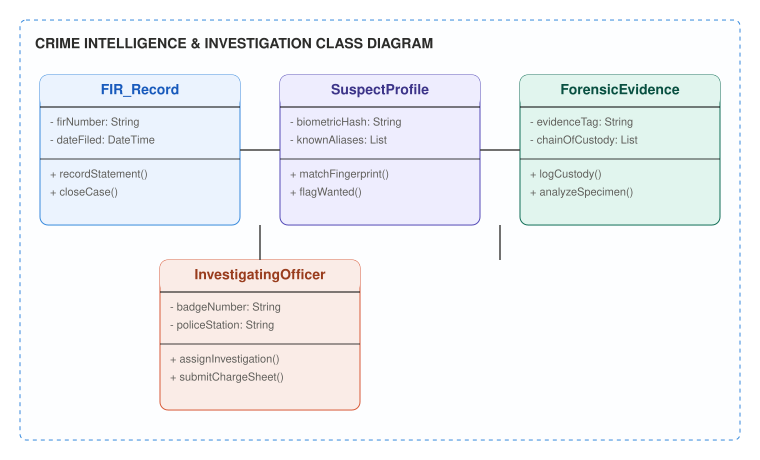

# Chapter 20: Design of UML Diagrams for Crime Bureau

> **Book**: *UML Diagramming: A Case Study Approach* by Dr. Suriya Sundaramoorthy (CRC Press, 2022)  
> **Pages**: 209–218 (Total: 10 pages)  
> **Classification**: Industrial Case Study & Diagram Suite  
> **Navigation**: [&larr; Chapter_19_Design_of_UML_Diagrams_for_Online_College_Magazine_System](Chapter_19_Design_of_UML_Diagrams_for_Online_College_Magazine_System.md) | [📚 Book Index](../UML_Book.md) | [Chapter_21_Design_of_UML_Diagrams_for_Smart_Traffic_Management_System &rarr;](Chapter_21_Design_of_UML_Diagrams_for_Smart_Traffic_Management_System.md)

---

## 📌 Executive Summary

Chapter 20 presents an industrial software engineering case study for **Design of UML Diagrams for Crime Bureau**. It details the transition from business requirements and domain constraints into formal software architecture specifications, leveraging data-flow modeling and a complete suite of Unified Modeling Language (UML) structural and behavioral diagrams.

---

## 🎯 Problem Statement & System Context

Rules and regulations are paramount to all aspects of life. Certain proponents have asserted that crime which is a violation against laws of the society, is integral to the human nature and hence the society can never be completely free from it. In the existing system, all work is done on papers, so it is very difficult to secure crime reports data. This system needs more manpower to track the records of crimes and it lacks security. Modern society is characterized by increasing levels of risk posed by internal and external security threats. This poses the importance to develop an automated crime management system to keep a record of the crime and the criminals involved. The proposed crime bureau is a database system in which the police keeps the record of criminals who have been arrested, to be arrested, or escaped and the complaints. This will help the police department in enhanced management of information. The main entities in the whole process include; the petitioner (the person who files a First Incident Report (FIR)), victim, accused or criminal, case and investigating officer. The proposed crime record management system can overcome all the limitations of the existing system. This system provides proper security and reduces the manual work. This project helps to maintain a database through which the entire crime activities in the state can be monitored (Figures 20.1–20.8).

---

## 📊 Complete UML Diagram Suite & Architecture Specifications

This chapter incorporates **9 standalone vector diagram(s)** illustrating the end-to-end design from functional use cases to physical hardware deployment:

### Figure 20.1: UML Usecase Diagram

**Diagram Category**: `Use Case Diagram`  
**Architectural Role**: Specifies system boundary, primary external actors, and business use cases with include/extend relationships.

### Figure 20.2: UML Activity Diagram

**Diagram Category**: `Activity Diagram`  
**Architectural Role**: Illustrates dynamic procedural workflow, decision branching, concurrent action forks, and synchronization joins.

### Figure 20.3: UML Sequence Diagram

**Diagram Category**: `Sequence Diagram`  
**Architectural Role**: Details chronological object interactions, synchronous message exchanges, return flows, and activation lifelines.

### Figure 20.4: UML Collaboration Diagram

**Diagram Category**: `Communication Diagram`  
**Architectural Role**: Emphasizes structural object topology and numbered sequence messaging between collaborating entities.

### Figure 20.5: UML State Chart Diagram

**Diagram Category**: `State Machine Diagram`  
**Architectural Role**: Captures entity lifecycle states, transition triggers, event guards, and exit/entry actions.

### Figure 20.6: UML Class Diagram

**Diagram Category**: `Class Diagram`  
**Architectural Role**: Models static structural classifiers, entity attributes, operations, and associations (composition, aggregation, inheritance).

### Figure 20.7: UML Component Diagram

**Diagram Category**: `Component Diagram`  
**Architectural Role**: Architects physical modular software components, provided ball interfaces, and required socket dependencies.

### Figure 20.8: UML Deployment Diagram

**Diagram Category**: `Deployment Diagram`  
**Architectural Role**: Maps software execution artifacts to hardware computing nodes, client devices, application tiers, and database servers.

### Visual Artifacts & Supplementary Schematics

The following vector schematics capture operational screen states, user dashboards, or notation components documented in this chapter:

#### Ch20 p218 img01

---

## 💡 Key Architectural Invariants & Modeling Lessons

1. **Traceability**: Every software model directly corresponds to explicit functional requirements defined during the initial domain specification.
2. **Separation of Concerns**: Structural models (Class, Component, Deployment) maintain clear boundaries separating business domain entities from physical infrastructure nodes.
3. **Behavioral Integrity**: Dynamic models (Activity, Sequence, State Machine) guarantee valid state transitions, prevent deadlocks, and verify message order consistency.
4. **Deployment Fidelity**: Physical nodes and execution environments accurately map runtime middleware, database engines, and client access channels.

---

## 🔗 Related Resources & Navigation

- **Navigation**: [&larr; Chapter_19_Design_of_UML_Diagrams_for_Online_College_Magazine_System](Chapter_19_Design_of_UML_Diagrams_for_Online_College_Magazine_System.md) | [📚 Book Index](../UML_Book.md) | [Chapter_21_Design_of_UML_Diagrams_for_Smart_Traffic_Management_System &rarr;](Chapter_21_Design_of_UML_Diagrams_for_Smart_Traffic_Management_System.md)
- **Master Book Catalog**: [`UML_Book.md`](../UML_Book.md)
- **Vector Images Catalog**: [`Vector_Images_Catalog.md`](../vector_images/Vector_Images_Catalog.md)