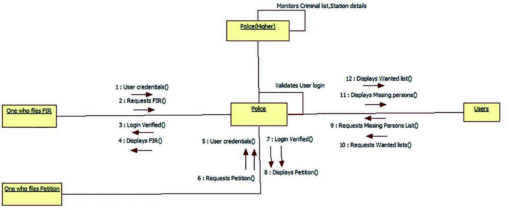
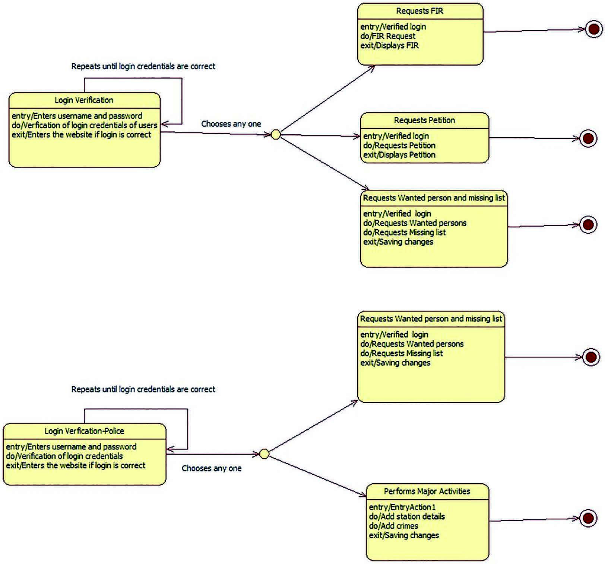
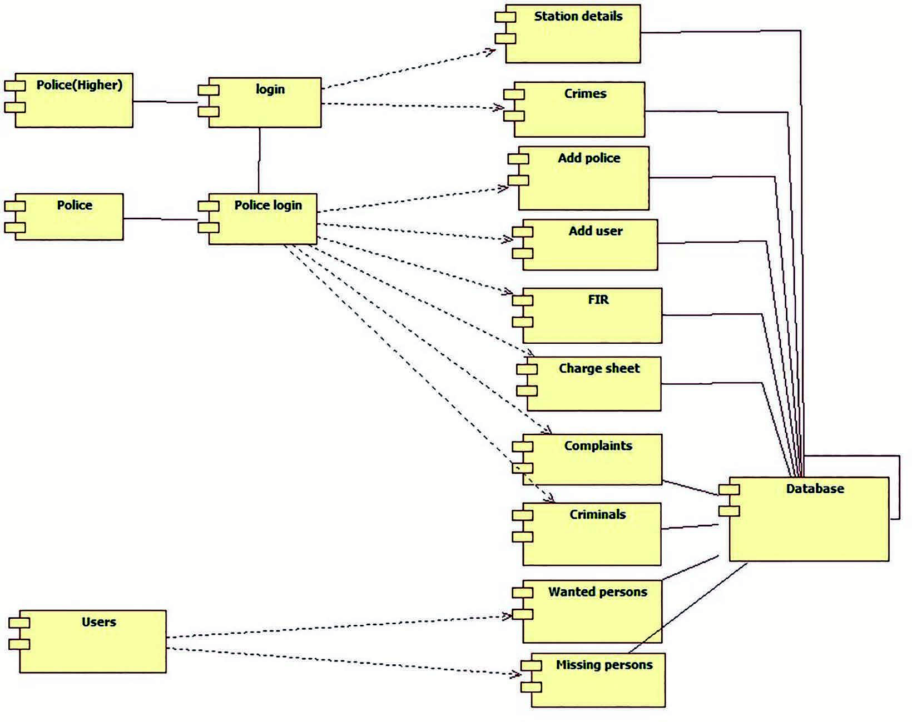
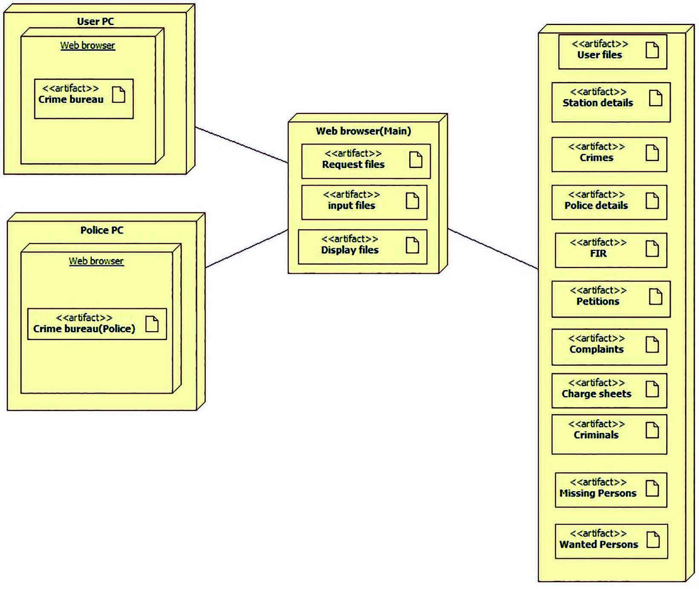

# Chapter 20: Design of UML Diagrams for Crime Bureau

> **Book**: *UML Diagramming: A Case Study Approach* by Dr. Suriya Sundaramoorthy (CRC Press, 2022)  
> **Pages**: 209–218 (Total: 10 pages)  
> **Classification**: Industrial Case Study & UML Modeling Suite  
> **Navigation**: [&larr; Chapter_19_Design_of_UML_Diagrams_for_Online_College_Magazine_System](Chapter_19_Design_of_UML_Diagrams_for_Online_College_Magazine_System.md) | [📚 Book Index](../UML_Book.md) | [Chapter_21_Design_of_UML_Diagrams_for_Smart_Traffic_Management_System &rarr;](Chapter_21_Design_of_UML_Diagrams_for_Smart_Traffic_Management_System.md)

---

## 📌 Executive Summary

Chapter 20 presents an end-to-end software engineering case study for the **Design of UML Diagrams for Crime Bureau**. This chapter demonstrates how business requirements and domain constraints are translated into formal architectural specifications through data-flow modeling and a complete suite of Unified Modeling Language (UML) structural and behavioral models.

The case study analyzes the system from multiple architectural perspectives: identifying external user and service actors, formalizing core operational capabilities, detailing procedural business workflows, specifying domain entity schemas, and architecting modular component deployment across distributed physical infrastructure.

---

## 🎯 Problem Statement & Business Context

### 📋 Executive Summary & Problem Breakdown
- **Core Problem**: Police departments using paper files suffer delays in logging criminal FIRs, tracking suspects across jurisdictions, and sharing evidence.
- **Business Context**: Law enforcement bureaus require a centralized, secure digital database to register crimes and investigate cases efficiently.
- **Key Solution**: Enables online FIR filing, stores biometric and criminal record profiles searchable across police stations, and tracks case evidence and court dates.

### 📖 Authentic Problem Description (with Key Diagram Drivers Highlighted)

> *Below is the complete authentic problem statement from the case study specification. The **bold highlighted sentences** denote explicit functional requirements, actors, entities, and workflows that directly drove the creation of the UML diagrams:*

Rules and regulations are paramount to all aspects of life. Certain proponents have asserted that crime which is a violation against laws of the society, is integral to the human nature and hence the society can never be completely free from it. In the existing system, all work is done on papers, so it is very difficult to secure crime reports data. **This system needs more manpower to track the records of crimes and it lacks security.** Modern society is characterized by increasing levels of risk posed by internal and external security threats. This poses the importance to develop an automated crime management system to keep a record of the crime and the criminals involved. **The proposed crime bureau is a database system in which the police keeps the record of criminals who have been arrested, to be arrested, or escaped and the complaints.** **This will help the police department in enhanced management of information.** **The main entities in the whole process include; the petitioner (the person who files a First Incident Report (FIR)), victim, accused or criminal, case and investigating officer.** **The proposed crime record management system can overcome all the limitations of the existing system.** **This system provides proper security and reduces the manual work.** **This project helps to maintain a database through which the entire crime activities in the state can be monitored (Figures 20.1–20.8).**

> 🔑 **Key Diagram Drivers Derived from Highlighted Requirements**:
> - **Primary & External Actors**: `Citizen / Applicant`, `Investigating / Immigration Officer`, `System Admin`, `Third-party Verifier` *(Derived from user roles explicitly named above)*
> - **Core Functional Use Cases**: `Login`, `Station Details`, `Crimes`, `Police Login`, `Add Police`, `Add User` *(Derived from functional capabilities and actions stated above)*
> - **Domain Entities & Data Stores**: `FIRRecord`, `CriminalProfile`, `VisaApplication`, `CitizenDocument`, `Certificate` *(Derived from persistent records and items stated above)*
> - **Deployment & Runtime Boundaries**: `Public e-Services Portal`, `Biometric Verification Terminal`, `Central Police / Ministry Database` *(Derived from operational touchpoints like web portals, mobile apps, or physical counters)*

---

## ⚙️ System Architecture & Functional Capabilities

The **Design of UML Diagrams for Crime Bureau** decomposes business operations into modular functional units. These capabilities address the operational bottlenecks of manual and legacy workflows by introducing automated, role-based, and auditable software processes:

- **Login**: Officials are provided with a username and password, through which they can log into the crime bureau.
- **Station Details**: Holds all the information regarding all the police stations in the state.
- **Crimes**: Lists all the criminal activities for which an FIR or complaint can be filed.
- **Police Login**: Officials are provided with a username and password, through which they can log into the crime bureau.
- **Add Police**: Holds a record of all the police officers.
- **Add User**: Holds a record of all the users who either have filed FIR or complaints.
- **FIR**: Holds a record of all the FIRs filed by the people.
- **Complaints**: Holds a record of all the complaints filed by the people.
- **Charge Sheet**: Holds a record of all the charge sheets filed by the people.
- **Prisoner List**: Holds a list of all the prisoners.
- **Criminals**: Holds a list of all the criminals.
- **Wanted Persons**: Holds a list of wanted persons.
- **Missing Persons**: Holds a list of missing persons.
- **User Login**: Login page for the users

---

## 📊 Complete UML Diagram Suite & Architectural Walkthrough

This chapter incorporates **9 crystal-clear, high-resolution diagram(s)** (extracted losslessly from the source edition at up to 2,000+ px) illustrating the end-to-end design from functional use cases to physical hardware deployment:

### Figure 20.1: UML Usecase Diagram

**Diagram Category**: `Use Case Diagram`  
**Architectural Role**: Specifies system boundary, primary external actors, and business use cases with include/extend relationships.

**System Design Analysis**:
Illustrates the functional boundary of the **Design of UML Diagrams for Crime Bureau**. External actors trigger core use cases, demonstrating how business transactions, authorization checkpoints, and service requests flow into the system. Relationships (`<<include>>` for mandatory sub-routines like authentication and validation, and `<<extend>>` for optional or conditional exception branches) formalize the system's external functional contract.

#### 🔍 Component Derivation from Problem Requirements

- **Actors Selection (Why they are chosen)**:
  - **Primary Actor (`Citizen / Applicant`)**: Derived from the problem statement as the core user who directly experiences operational pain points and initiates service requests (e.g., self-service tasks, browsing, and transacting).
  - **Secondary Supporting Actor (`Verification Authority / Law Enforcement Agency`)**: Extracted as the external authority or service partner required to fulfill requests (e.g., financial settlements, identity verifications, or physical fulfillment).
  - **Administrative Actor (`Investigating Officer / Embassy Admin`)**: Required by governance rules to oversee security, manage backend configurations, and monitor operational compliance.
- **Use Cases Selection (Why these functions exist)**:
  - High-priority functional requirements (`Login`, `Station Details`, `Crimes`, `Police Login`, `Add Police`, `Add User`) were converted into core use cases inside the system boundary to directly satisfy user business goals.
  - Each use case corresponds directly to a distinct business capability needed to eliminate manual delays, paperwork, or operational bottlenecks.
- **Relationships & Dependency Rationale**:
  - **Associations**: Direct solid lines link `Citizen / Applicant` to primary operational use cases, establishing who has authorization to trigger each transaction.
  - **`<<include>>` Dependencies**: Factored out mandatory sub-routines (such as `Login / Authenticate`, `Verify Eligibility`, and `Process Payment`) that must execute unconditionally during transactions to guarantee security and data consistency.
  - **`<<extend>>` Dependencies**: Attached optional or conditional paths (such as `Apply Promotional Discount`, `Trigger Emergency Escalation`, or `Cancel Request`) that execute only when specific business guard conditions are satisfied.

#### 🛠️ Step-by-Step Construction Guide

1. **Define System Boundary & Scope**:
   - Draw an outer rectangular boundary box representing **Crime Bureau**.
   - Ensure external actors remain outside the boundary while all functional capabilities reside inside.
2. **Identify Primary & Secondary External Actors**:
   - Place `Citizen / Applicant` on the left side of the boundary to initiate business interactions.
   - Position `Verification Authority / Law Enforcement Agency` and `Investigating Officer / Embassy Admin` on the right side as secondary or administrative actors.
3. **Identify & Model Business Use Cases**:
   - Draw horizontal ellipses inside the boundary representing key operational goals (`Login`, `Station Details`, `Crimes`, `Police Login`, `Add Police`, `Add User`).
   - Name each use case with an active verb-noun phrase.
4. **Establish Relationships & Stereotypes (`<<include>>`, `<<extend>>`)**:
   - Connect actors to relevant use cases using solid, unarrowed association lines.
   - Use dashed arrows labeled `<<include>>` directed toward mandatory shared sub-routines (e.g., authentication, data validation).
   - Use dashed arrows labeled `<<extend>>` directed from optional or conditional extension workflows toward base use cases.
5. **Verify Completeness & Cross-Check Requirements**:
   - Trace every functional requirement from the problem specification to confirm complete coverage without disconnected use cases.

### Figure 20.2: UML Activity Diagram

**Diagram Category**: `Activity Diagram`  
**Architectural Role**: Illustrates dynamic procedural workflow, decision branching, concurrent action forks, and synchronization joins.

**System Design Analysis**:
Details the step-by-step procedural execution flow for core operations in **Design of UML Diagrams for Crime Bureau**. Begins at an initial state, navigates action states, evaluates guard conditions at decision diamonds, and models parallel execution branches using fork and join synchronizations before reaching the terminal state, ensuring business workflows are deterministic and free of race conditions.

#### 🔍 Component Derivation from Problem Requirements

- **Workflow Actions Selection**:
  - Derived step-by-step action states directly from the chronological steps required to complete Login.
  - Modeled each human action (e.g., entering data, confirming selection) and automated system action (e.g., validating rules, computing totals, updating records) as discrete rounded rectangles.
- **Swimlanes & Responsibility Partitioning**:
  - Partitioned the workflow across swimlanes representing `Citizen / Applicant`, the Application Controller, and `Verification Authority / Law Enforcement Agency`/Database.
  - Visualizes exactly where operational responsibility transfers across architectural boundaries.
- **Decisions, Guards & Concurrent Forks**:
  - **Decision Diamonds**: Inserted wherever business logic requires verification (e.g., `[Valid Credentials]`, `[Stock Available]`, `[Payment Approved]`), ensuring explicit error handling paths.
  - **Synchronization Bars (Fork/Join)**: Utilized where parallel background tasks (e.g., sending an alert while updating audit logs) occur simultaneously without blocking user execution.

#### 🛠️ Step-by-Step Construction Guide

1. **Establish Initial Node & Execution Swimlanes**:
   - Start the workflow with a solid black circle (Initial Node) representing the trigger event in **Crime Bureau**.
   - Organize participating roles and subsystems into vertical or horizontal swimlanes to establish organizational accountability.
2. **Plot Sequential Action & State Steps**:
   - Draw rounded rectangles for each discrete functional task in chronological order.
   - Connect sequential actions with directed control flow arrows indicating the progression of execution.
3. **Incorporate Decision & Branching Diamonds**:
   - Place diamond decision nodes where the business logic branches based on conditions.
   - Label outgoing paths with explicit boolean guard conditions in brackets (e.g., `[Valid Input]` vs `[Invalid Input]`).
4. **Model Concurrency with Fork & Join Bars**:
   - Use solid horizontal or vertical synchronization bars (Forks) to divide a single flow into simultaneous parallel operations.
   - Pair each Fork with a corresponding Join bar to synchronize parallel tasks before advancing to subsequent stages.
5. **Terminate Flow at Final State Nodes**:
   - Guide successful workflow branches to an encircled solid black dot (Activity Final Node).
   - Use flow final nodes (circle with an X) to terminate individual canceled sub-branches without stopping the entire workflow.

### Figure 20.3: UML Sequence Diagram

**Diagram Category**: `Sequence Diagram`  
**Architectural Role**: Details chronological object interactions, synchronous message exchanges, return flows, and activation lifelines.

**System Design Analysis**:
Traces the time-ordered message sequence between participating objects and services in **Design of UML Diagrams for Crime Bureau**. Vertical dashed lifelines represent entity instances across time, while horizontal solid and dashed arrows show synchronous invocations, data lookups, and return values. Activation bars delineate execution duration, clarifying object collaboration during key transactional workflows.

#### 🔍 Component Derivation from Problem Requirements

- **Participating Lifelines Selection**:
  - Selected key participants along the communication path: `Citizen / Applicant` (initiator), Boundary Controller (API/UI), Business Service Layer, and the Persistent Database / `Verification Authority / Law Enforcement Agency`.
  - Ensures full horizontal separation between user interaction, application logic, and backend data storage.
- **Message Invocations & Temporal Sequence**:
  - Derived sequential message flows from the transaction lifecycle: initialization -> validation -> business calculation -> persistence -> return response.
  - Uses solid arrows with filled heads for synchronous calls where the caller waits for a response before proceeding.
- **Return Payloads & Conditional Fragments**:
  - **Dashed Return Arrows**: Modeled data payloads and status confirmations returned to the caller to maintain state awareness.
  - **`alt` Combined Fragments**: Partitioned if-else execution paths (e.g., success vs. validation error) with explicit boolean guard conditions.

#### 🛠️ Step-by-Step Construction Guide

1. **Arrange Participating Lifelines Horizontally**:
   - Position `Citizen / Applicant`, boundary controllers, service managers, and persistence models horizontally across the top.
   - Drop vertical dashed lines (lifelines) downward from each participant to represent the passage of time from top to bottom.
2. **Overlay Activation Focus Bars**:
   - Place thin vertical rectangular boxes on lifelines to indicate active execution periods where an object is processing instructions.
3. **Model Synchronous & Asynchronous Invocations**:
   - Draw solid horizontal arrows with filled triangular arrowheads for synchronous method calls (e.g., `validateRequest()`).
   - Draw open arrowheads for asynchronous events or non-blocking notification dispatches.
4. **Represent Return Messages & Reply Payloads**:
   - Draw dashed horizontal lines with open arrowheads pointing back to the calling lifeline to model return data or acknowledgment signals.
   - Label return lines with explicit payload descriptions (e.g., `statusConfirmation: Boolean`).
5. **Structure Logic with Combined Interaction Fragments**:
   - Enclose conditional logic within an `alt` fragment box partitioned into alternative execution compartments with bracketed guard expressions.
   - Utilize `opt` frames for optional branches and `loop` frames for iterative business operations.

### Figure 20.4: UML Collaboration Diagram

**Diagram Category**: `Communication Diagram`  
**Architectural Role**: Emphasizes structural object topology and numbered sequence messaging between collaborating entities.

**System Design Analysis**:
Emphasizes the spatial and structural organization of collaborating instances in **Design of UML Diagrams for Crime Bureau**. Shows object links overlaid with numbered messages (e.g., 1.0, 1.1, 2.0), illustrating both structural connectivity and invocation hierarchy, complementing the temporal perspective of the sequence diagram.

#### 🔍 Component Derivation from Problem Requirements

- **Collaborating Object Nodes Selection**:
  - Selected runtime instances of the core architectural entities required to complete the business scenario in **Crime Bureau**.
  - Emphasizes the structural network of communicating instances rather than chronological time progression.
- **Structural Links & Message Numbering**:
  - **Association Links**: Created direct communication links between objects that possess references to each other.
  - **Hierarchical Numbering (`1`, `1.1`, `2`)**: Formulated numbered message vectors along links to preserve the exact call-stack sequence and nested function invocations.

#### 🛠️ Step-by-Step Construction Guide

1. **Place Collaborating Object Nodes**:
   - Position key runtime instances of classes as rectangular nodes labeled `instanceName : ClassName` across the canvas for **Crime Bureau**.
   - Arrange objects to emphasize physical structural connections and organizational proximity.
2. **Draw Structural Association Links**:
   - Connect communicating objects with solid undirected lines representing communication paths and active object references.
3. **Overlay Directional Message Vectors**:
   - Place directional arrows alongside the association links pointing from caller to receiver.
4. **Apply Hierarchical Decimal Sequence Numbering**:
   - Number each message sequentially using decimal nesting (e.g., `1: initiateRequest()`, `1.1: verifyParameters()`, `1.2: queryDatabase()`, `2: returnStatus()`).
   - Use hierarchical numbers to clearly convey the nested call stack and execution chronology without a vertical time axis.
5. **Validate Link Topology & Message Continuity**:
   - Verify that all collaborating objects participate in valid message exchange paths and that message signatures match class definitions.

### Figure 20.5: UML State Chart Diagram

**Diagram Category**: `State Machine Diagram`  
**Architectural Role**: Captures entity lifecycle states, transition triggers, event guards, and exit/entry actions.

**System Design Analysis**:
Models the complete lifecycle state transitions for central domain entities in **Design of UML Diagrams for Crime Bureau**. Tracks transitions from initial creation through intermediate processing states to completion or cancellation. Explicit state triggers, guard expressions `[condition]`, and entry/exit actions guarantee valid business lifecycle states and eliminate invalid operational state jumps.

#### 🔍 Component Derivation from Problem Requirements

- **Entity & Lifecycle States Selection**:
  - Selected the central transactional entity in **Crime Bureau** whose lifecycle undergoes critical state changes.
  - Derived distinct operational states (e.g., `Created`, `PendingApproval`, `Active / InProgress`, `Completed`, `Cancelled`) from domain business rules.
- **State Transitions, Triggers & Guard Rules**:
  - Identified the exact events (e.g., `submit()`, `verify()`, `processPayment()`, `cancel()`) that trigger transitions between states.
  - Formulated transition syntax: `Event [GuardCondition] / ActionEffect` to prevent invalid state jumps and enforce business integrity.

#### 🛠️ Step-by-Step Construction Guide

1. **Identify the Initial Pseudostate**:
   - Begin with a solid black circle (Initial State) marking the creation or activation trigger of the target entity in **Crime Bureau**.
2. **Define Distinct Operational States**:
   - Draw rounded rectangles representing every discrete state the entity can assume during its lifecycle (e.g., `Created`, `Pending`, `Processing`, `Completed`, `Failed`).
   - Add internal behavior compartments for `entry /`, `do /`, and `exit /` action routines where applicable.
3. **Map State Transitions & Triggers**:
   - Connect states using directed transition arrows indicating valid status changes.
   - Label transitions using the formal UML format: `TriggerEvent [GuardCondition] / ActionEffect` (e.g., `confirmTransaction [balanceValid] / generateReceipt()`).
4. **Model Superstates & Substates (Hierarchical States)**:
   - Group related substates within an enclosing composite state rectangle when multiple states share common exit or exception transitions.
5. **Terminate at Final State Nodes**:
   - Direct all terminal lifecycle outcomes (successful fulfillment or terminal rejection) to an encircled black dot (Final State).

### Figure 20.6: UML Class Diagram

**Diagram Category**: `Class Diagram`  
**Architectural Role**: Models static structural classifiers, entity attributes, operations, and associations (composition, aggregation, inheritance).

**System Design Analysis**:
Captures the static structural domain model for **Design of UML Diagrams for Crime Bureau**. Defines primary entity classes, their private/public attributes, operational methods, and relationships. It enforces structural integrity through multiplicities, composition (strong lifecycle ownership of subsidiary records), aggregation, and inheritance hierarchies, forming the foundation for the relational database schema and domain entity classes.

#### 🔍 Component Derivation from Problem Requirements

- **Domain Classes & Classifiers Selection**:
  - **Entity Classes**: Extracted key nouns from the domain requirements to form core data models holding system state (e.g., `Citizen`, `Transaction`, `Record`, `Item/Service`).
  - **Boundary & Controller Classes**: Introduced interface controllers (e.g., `ServiceController`, `SessionManager`) to decouple user presentation inputs from backend database persistence.
- **Attributes & Methods Selection**:
  - **Attributes**: Assigned explicit data types and access modifiers (private `-` for information hiding) to track business properties (e.g., unique IDs, statuses, monetary values, timestamps).
  - **Operations**: Converted domain capabilities (`Login`, `Station Details`, `Crimes`, `Police Login`, `Add Police`, `Add User`) into public (`+`) member methods equipped with validated parameters and deterministic return signatures.
- **Relationships & Multiplicities Rationale**:
  - **Composition (Solid Diamond)**: Applied to strong whole-part relationships where child entities cannot exist independently of their parent aggregate (e.g., an invoice strictly owns its line items).
  - **Aggregation (Hollow Diamond)**: Applied to shared associations where components exist independently in the business domain.
  - **Multiplicities**: Annotated with strict operational constraints (e.g., `1` user owns `0..*` transactions; each transaction maps to exactly `1` payment record) to maintain data integrity.

#### 🛠️ Step-by-Step Construction Guide

1. **Identify Domain Entities & Boundary Objects**:
   - Analyze requirements for **Crime Bureau** to extract core business entities, controllers, and data structures.
   - Represent each entity as a three-compartment rectangular classifier (Class Name, Attributes, Operations).
2. **Define Attributes with Visibility & Data Types**:
   - Populate the middle compartment with private (`-`), protected (`#`), or public (`+`) attributes.
   - Assign standardized data types (e.g., `- id: String`, `- status: Boolean`, `- createdAt: DateTime`).
3. **Specify Member Operations & Business Methods**:
   - Populate the bottom compartment with functions and interface methods that define class behavior.
   - Include parameter types and return signatures (e.g., `+ executeTransaction(amount: Float): Boolean`).
4. **Establish Structural Relationships & Multiplicities**:
   - Connect related classes using solid association lines annotated with numerical multiplicities (e.g., `1`, `0..*`, `1..*`).
   - Apply Composition (solid diamond) for lifecycle-dependent objects, and Aggregation (hollow diamond) for shared references.
   - Model inheritance hierarchies using Generalization (solid line with closed hollow triangular arrowhead).
5. **Validate Architecture & Reduce Coupling**:
   - Review class cohesion to verify single-responsibility principles across data access and business logic layers.
   - Ensure interfaces isolate clients from direct database dependencies.

### Figure 20.7: UML Component Diagram

**Diagram Category**: `Component Diagram`  
**Architectural Role**: Architects physical modular software components, provided ball interfaces, and required socket dependencies.

**System Design Analysis**:
Architects the modular software organization for **Design of UML Diagrams for Crime Bureau**. Illustrates autonomous subsystems, business logic controllers, database access layers, and external service adapters. Provided interfaces (ball notation) and required dependencies (socket notation) define clear service contracts, supporting high cohesion and loose coupling.

#### 🔍 Component Derivation from Problem Requirements

- **Modular Components Selection**:
  - Decomposed **Crime Bureau** into autonomous, reusable software units based on separation of concerns: User Interface Controller, Business Service Core, Persistence Engine, and External Integration Gateways.
  - Ensures each component encapsulates a specific domain capability (`Login`, `Station Details`, `Crimes`, `Police Login`, `Add Police`, `Add User`) without tight coupling.
- **Provided & Required Interfaces Selection**:
  - **Provided Interfaces (Ball)**: Defined public APIs and services exposed by components to serve consumer requests.
  - **Required Interfaces (Socket)**: Defined downstream dependencies, such as database connectors and third-party API contracts required for operation.

#### 🛠️ Step-by-Step Construction Guide

1. **Identify Autonomous Modular Units**:
   - Analyze **Crime Bureau** to identify independent deployable subsystems, microservices, databases, and third-party integrations.
   - Represent each unit as a rectangular component symbol adorned with the `<<component>>` stereotype or component icon tabs.
2. **Define Provided Interfaces (Ball / Lollipop Notation)**:
   - Attach solid circle "ball" connectors to components that provide public API endpoints, RPC interfaces, or query services to external callers.
3. **Define Required Interfaces (Socket Notation)**:
   - Attach semicircular "socket" connectors to components that depend on external services or client data contracts.
4. **Assemble Ball-and-Socket Connectors**:
   - Align matching ball and socket connectors to model direct architectural wiring, loose coupling, and dependency injection.
5. **Group into Architectural Subsystems**:
   - Enclose related components inside package boundaries (e.g., Presentation Layer, Business Core, Data Storage) to enforce clean layer isolation.

### Figure 20.8: UML Deployment Diagram

**Diagram Category**: `Deployment Diagram`  
**Architectural Role**: Maps software execution artifacts to hardware computing nodes, client devices, application tiers, and database servers.

**System Design Analysis**:
Maps the physical runtime deployment architecture for **Design of UML Diagrams for Crime Bureau**. Depicts client hardware devices (web browsers, mobile apps), application servers, network firewalls, and persistence database nodes. Communication paths and execution environments reflect production infrastructure, scalability considerations, and network security boundaries.

#### 🔍 Component Derivation from Problem Requirements

- **Hardware Nodes & Infrastructure Selection**:
  - Derived execution nodes from physical hosting requirements: Client Devices (Smartphones/Desktops), Web & Application Servers, and Database Clusters.
  - Isolates public-facing presentation endpoints from secure, internal database storage to comply with enterprise security standards.
- **Artifact Allocation & Communication Protocols**:
  - **Artifact Deployment**: Mapped executable binaries (`.jar`, `.war`, `.apk`, client web bundles) onto their corresponding execution environments.
  - **Protocol Selection**: Assigned standard secure networking protocols (`<<HTTPS/TLS>>`, `<<TCP/IP>>`, `<<JDBC>>`) based on data sensitivity and network boundaries.

#### 🛠️ Step-by-Step Construction Guide

1. **Identify Physical & Virtual Hardware Nodes**:
   - Draw 3D isometric box cubes representing physical host servers, cloud instances, client smartphones, and database clusters for **Crime Bureau**.
   - Label nodes with stereotypic descriptions (e.g., `<<device>>`, `<<database server>>`, `<<cloud container>>`).
2. **Specify Runtime Execution Environments**:
   - Nest runtime environments inside node cubes (e.g., `<<execution environment>> Web Browser`, `Docker Engine`, `JVM Runtime`).
3. **Assign Executable Artifacts to Nodes**:
   - Place software artifacts (rectangles with `<<artifact>>` stereotype, `.jar`, `.war`, `.apk`, `.sql`) inside their corresponding hosting execution environments.
4. **Draw Network Communication Paths & Protocols**:
   - Connect nodes using solid communication lines labeled with transport protocols and security stereotypes (e.g., `<<HTTPS/TLS>>`, `<<TCP/IP>>`, `<<JDBC>>`, `<<gRPC>>`).
5. **Verify High Availability & Security Boundaries**:
   - Ensure clear physical separation between public demilitarized zones (DMZ), application compute layers, and protected private database networks.

### Visual Artifacts & Supplementary Schematics

The following high-resolution schematics capture operational screen states, user dashboards, or notation components documented in this chapter:

#### Ch20 p218 img01

**Perspective**: `Conceptual Notation / Architecture Asset` — Supplemental conceptual illustration or notation reference from the source chapter.

---

## 💡 Key Architectural Invariants & Domain Lessons

1. **Requirement Traceability**: Every model in the **Design of UML Diagrams for Crime Bureau** suite traces directly to business requirements and operational constraints established in the problem statement.
2. **State & Workflow Integrity**: Dynamic activity and sequence models guarantee deterministic workflow completion, enforce transactional atomicity, and prevent deadlocks.
3. **Modular Encapsulation**: Component boundaries decouple domain business logic from presentation controllers and external integration adapters, supporting high maintainability.
4. **Operational Security & RBAC**: Strict role-based authorization guards sensitive operations across external actor boundaries and administrative lifelines.
5. **High-Fidelity Deployment**: Physical node topologies reflect real-world tiered infrastructure (DMZ, application cluster, isolated persistence layer), ensuring scalability and fault tolerance.

---

## 🔗 Related Resources & Navigation

- **Navigation**: [&larr; Chapter_19_Design_of_UML_Diagrams_for_Online_College_Magazine_System](Chapter_19_Design_of_UML_Diagrams_for_Online_College_Magazine_System.md) | [📚 Book Index](../UML_Book.md) | [Chapter_21_Design_of_UML_Diagrams_for_Smart_Traffic_Management_System &rarr;](Chapter_21_Design_of_UML_Diagrams_for_Smart_Traffic_Management_System.md)
- **Master Book Catalog**: [`UML_Book.md`](../UML_Book.md)
- **High-Resolution Images Archive**: [`images/`](../images/)