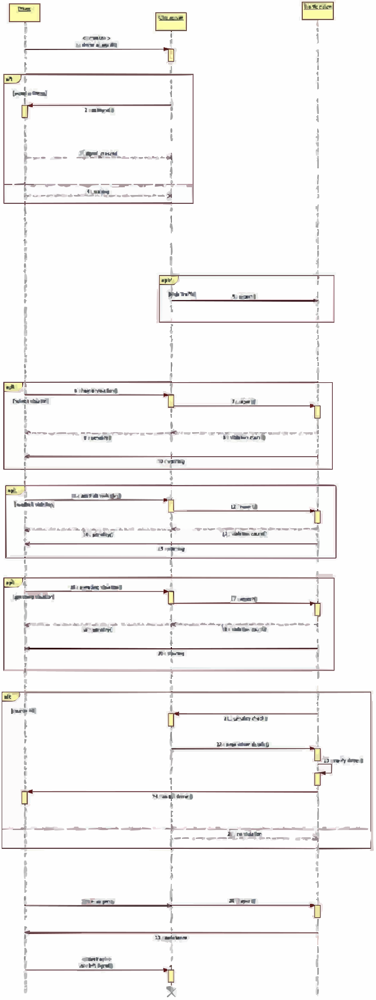
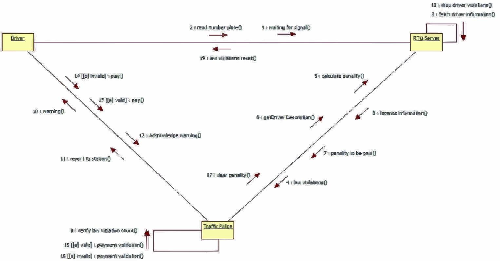

# Chapter 21: Design of UML Diagrams for Smart Traffic Management System

> **Book**: *UML Diagramming: A Case Study Approach* by Dr. Suriya Sundaramoorthy (CRC Press, 2022)  
> **Pages**: 219–226 (Total: 8 pages)  
> **Classification**: Industrial Case Study & Diagram Suite  
> **Navigation**: [&larr; Chapter_20_Design_of_UML_Diagrams_for_Crime_Bureau](Chapter_20_Design_of_UML_Diagrams_for_Crime_Bureau.md) | [📚 Book Index](../UML_Book.md) | [Chapter_22_Design_of_UML_Diagrams_for_Job_Seeker_Portal_System &rarr;](Chapter_22_Design_of_UML_Diagrams_for_Job_Seeker_Portal_System.md)

---

## 📌 Executive Summary

Chapter 21 presents an industrial software engineering case study for **Design of UML Diagrams for Smart Traffic Management System**. It details the transition from business requirements and domain constraints into formal software architecture specifications, leveraging data-flow modeling and a complete suite of Unified Modeling Language (UML) structural and behavioral diagrams.

---

## 🎯 Problem Statement & System Context

In our modern metropolitan city, people don’t follow the traffic rules. The outcome of it is unfortunate. In India, 64.4% of the total deaths are accounted by road accidents. As the automobiles get revolutionized the number of vehicles keep increasing. Conventional traffic signals are not efficient and strict. Smart traffic system aims in minimizing the risks of accidents by precautionary taking actions on people who violate the traffic rules. Cameras to monitor the roads with high traffic levels in order to facilitate the traffic signal. Helmet and seat belt detection using image processing to warn the drivers. Details of the driver are submitted to the traffic police, when he/she violates the law more than two times via the number plate which is captured by cameras. Street lights are operated based on the population density on road at night, thereby saving electricity. License will be cancelled as penalty, if the law is violated. Details of the driver will be passed on to successive signals on account of speeding. Automated traffic lights regulate the traffic flow in order to avoid congestions (Figures 21.1–21.8).

---

## 📊 Complete UML Diagram Suite & Architecture Specifications

This chapter incorporates **8 standalone vector diagram(s)** illustrating the end-to-end design from functional use cases to physical hardware deployment:

### Figure 21.1: UML Usecase Diagram

**Diagram Category**: `Use Case Diagram`  
**Architectural Role**: Specifies system boundary, primary external actors, and business use cases with include/extend relationships.

### Figure 21.2: UML Activity Diagram

**Diagram Category**: `Activity Diagram`  
**Architectural Role**: Illustrates dynamic procedural workflow, decision branching, concurrent action forks, and synchronization joins.

### Figure 21.3: UML Sequence Diagram

**Diagram Category**: `Sequence Diagram`  
**Architectural Role**: Details chronological object interactions, synchronous message exchanges, return flows, and activation lifelines.

### Figure 21.4: UML Collaboration Diagram

**Diagram Category**: `Communication Diagram`  
**Architectural Role**: Emphasizes structural object topology and numbered sequence messaging between collaborating entities.

### Figure 21.5: UML State Chart Diagram

**Diagram Category**: `State Machine Diagram`  
**Architectural Role**: Captures entity lifecycle states, transition triggers, event guards, and exit/entry actions.

### Figure 21.6: UML Class Diagram

**Diagram Category**: `Class Diagram`  
**Architectural Role**: Models static structural classifiers, entity attributes, operations, and associations (composition, aggregation, inheritance).

### Figure 21.7: UML Component Diagram

**Diagram Category**: `Component Diagram`  
**Architectural Role**: Architects physical modular software components, provided ball interfaces, and required socket dependencies.

### Figure 21.8: UML Deployment Diagram

**Diagram Category**: `Deployment Diagram`  
**Architectural Role**: Maps software execution artifacts to hardware computing nodes, client devices, application tiers, and database servers.

---

## 💡 Key Architectural Invariants & Modeling Lessons

1. **Traceability**: Every software model directly corresponds to explicit functional requirements defined during the initial domain specification.
2. **Separation of Concerns**: Structural models (Class, Component, Deployment) maintain clear boundaries separating business domain entities from physical infrastructure nodes.
3. **Behavioral Integrity**: Dynamic models (Activity, Sequence, State Machine) guarantee valid state transitions, prevent deadlocks, and verify message order consistency.
4. **Deployment Fidelity**: Physical nodes and execution environments accurately map runtime middleware, database engines, and client access channels.

---

## 🔗 Related Resources & Navigation

- **Navigation**: [&larr; Chapter_20_Design_of_UML_Diagrams_for_Crime_Bureau](Chapter_20_Design_of_UML_Diagrams_for_Crime_Bureau.md) | [📚 Book Index](../UML_Book.md) | [Chapter_22_Design_of_UML_Diagrams_for_Job_Seeker_Portal_System &rarr;](Chapter_22_Design_of_UML_Diagrams_for_Job_Seeker_Portal_System.md)
- **Master Book Catalog**: [`UML_Book.md`](../UML_Book.md)
- **Vector Images Catalog**: [`Vector_Images_Catalog.md`](../vector_images/Vector_Images_Catalog.md)