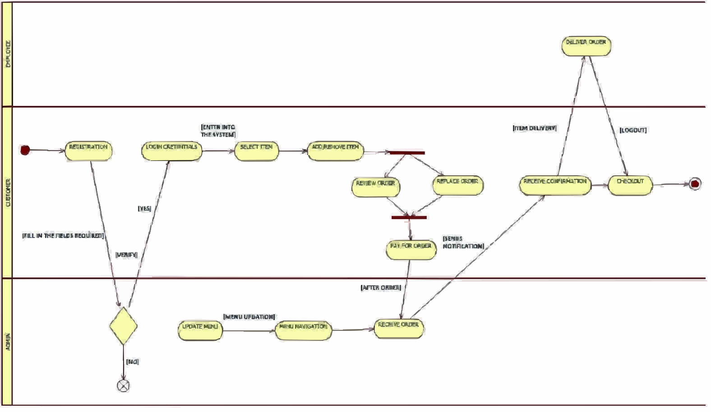
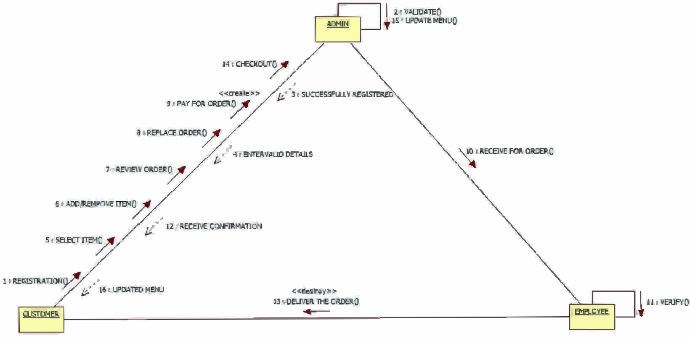
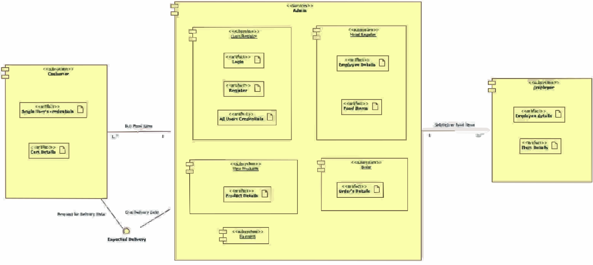

# Chapter 22: Design of UML Diagrams for Job Seeker Portal System

> **Book**: *UML Diagramming: A Case Study Approach* by Dr. Suriya Sundaramoorthy (CRC Press, 2022)  
> **Pages**: 227–236 (Total: 10 pages)  
> **Classification**: Industrial Case Study & Diagram Suite  
> **Navigation**: [&larr; Chapter_21_Design_of_UML_Diagrams_for_Smart_Traffic_Management_System](Chapter_21_Design_of_UML_Diagrams_for_Smart_Traffic_Management_System.md) | [📚 Book Index](../UML_Book.md) | [Chapter_23_Design_of_UML_Diagrams_for_AAROGYA_SETU_Health_Care_APP &rarr;](Chapter_23_Design_of_UML_Diagrams_for_AAROGYA_SETU_Health_Care_APP.md)

---

## 📌 Executive Summary

Chapter 22 presents an industrial software engineering case study for **Design of UML Diagrams for Job Seeker Portal System**. It details the transition from business requirements and domain constraints into formal software architecture specifications, leveraging data-flow modeling and a complete suite of Unified Modeling Language (UML) structural and behavioral diagrams.

---

## 🎯 Problem Statement & System Context

Job seekers work hard to gain the right skills and knowledge to give them an edge over others in the role they seek. However, at times, despite their best efforts, one may find it difficult to move a step closer to this sought-after job. Hence a platform for listing out the availability of jobs irrespective of the field is required. Furthermore, a job site serves a dual purpose. On one hand, it lists out the availability of jobs to candidates, and on the other, it serves as a database of registered candidate’s profiles for companies to shortlist. The objective is to develop a software solution to predict the availability of jobs based on location, sectors, package, platform, interest and eligibility. As it is important to keep the candidates engaged during their job search, it is important to provide facets on the abovementioned criteria so that they can narrow down to the jobs of their choice (Figures 22.1–22.8).

---

## 📊 Complete UML Diagram Suite & Architecture Specifications

This chapter incorporates **9 standalone vector diagram(s)** illustrating the end-to-end design from functional use cases to physical hardware deployment:

### Figure 22.1: UML Usecase Diagram

**Diagram Category**: `Use Case Diagram`  
**Architectural Role**: Specifies system boundary, primary external actors, and business use cases with include/extend relationships.

### Figure 22.2: UML Activity Diagram

**Diagram Category**: `Activity Diagram`  
**Architectural Role**: Illustrates dynamic procedural workflow, decision branching, concurrent action forks, and synchronization joins.

### Figure 22.3: UML Sequence Diagram

**Diagram Category**: `Sequence Diagram`  
**Architectural Role**: Details chronological object interactions, synchronous message exchanges, return flows, and activation lifelines.

### Figure 22.4: UML Collaboration Diagram

**Diagram Category**: `Communication Diagram`  
**Architectural Role**: Emphasizes structural object topology and numbered sequence messaging between collaborating entities.

### Figure 22.5: UML State Machine Diagram

**Diagram Category**: `State Machine Diagram`  
**Architectural Role**: Captures entity lifecycle states, transition triggers, event guards, and exit/entry actions.

### Figure 22.6: UML Class Diagram

**Diagram Category**: `Class Diagram`  
**Architectural Role**: Models static structural classifiers, entity attributes, operations, and associations (composition, aggregation, inheritance).

### Figure 22.7: UML Component Diagram

**Diagram Category**: `Component Diagram`  
**Architectural Role**: Architects physical modular software components, provided ball interfaces, and required socket dependencies.

### Figure 22.8: UML Deployment Diagram

**Diagram Category**: `Deployment Diagram`  
**Architectural Role**: Maps software execution artifacts to hardware computing nodes, client devices, application tiers, and database servers.

### Visual Artifacts & Supplementary Schematics

The following vector schematics capture operational screen states, user dashboards, or notation components documented in this chapter:

#### Ch22 p236 img01

---

## 💡 Key Architectural Invariants & Modeling Lessons

1. **Traceability**: Every software model directly corresponds to explicit functional requirements defined during the initial domain specification.
2. **Separation of Concerns**: Structural models (Class, Component, Deployment) maintain clear boundaries separating business domain entities from physical infrastructure nodes.
3. **Behavioral Integrity**: Dynamic models (Activity, Sequence, State Machine) guarantee valid state transitions, prevent deadlocks, and verify message order consistency.
4. **Deployment Fidelity**: Physical nodes and execution environments accurately map runtime middleware, database engines, and client access channels.

---

## 🔗 Related Resources & Navigation

- **Navigation**: [&larr; Chapter_21_Design_of_UML_Diagrams_for_Smart_Traffic_Management_System](Chapter_21_Design_of_UML_Diagrams_for_Smart_Traffic_Management_System.md) | [📚 Book Index](../UML_Book.md) | [Chapter_23_Design_of_UML_Diagrams_for_AAROGYA_SETU_Health_Care_APP &rarr;](Chapter_23_Design_of_UML_Diagrams_for_AAROGYA_SETU_Health_Care_APP.md)
- **Master Book Catalog**: [`UML_Book.md`](../UML_Book.md)
- **Vector Images Catalog**: [`Vector_Images_Catalog.md`](../vector_images/Vector_Images_Catalog.md)