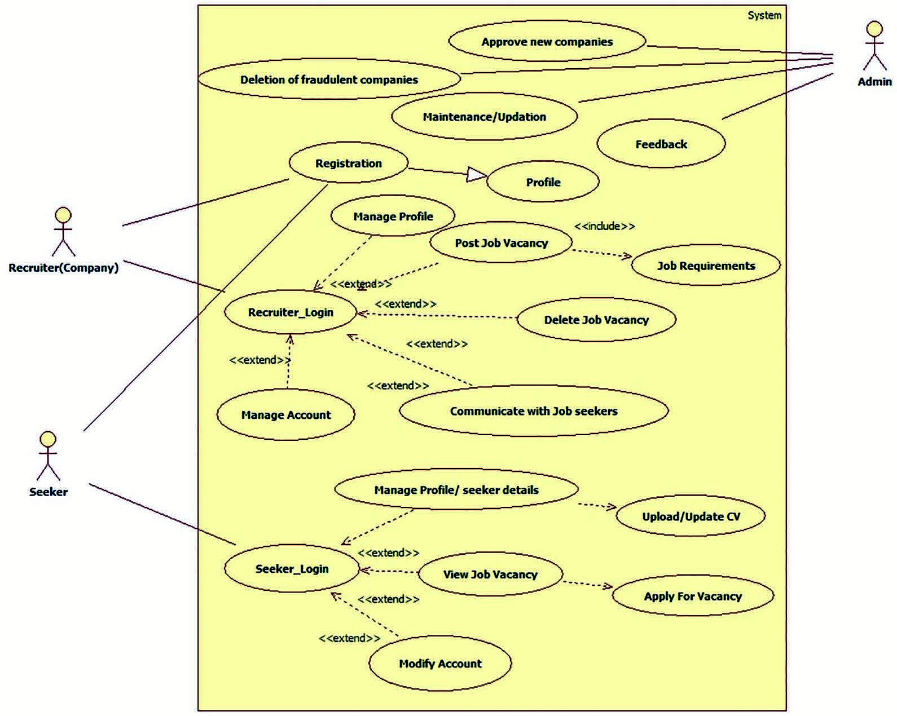
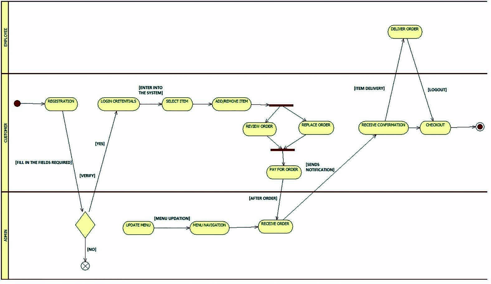
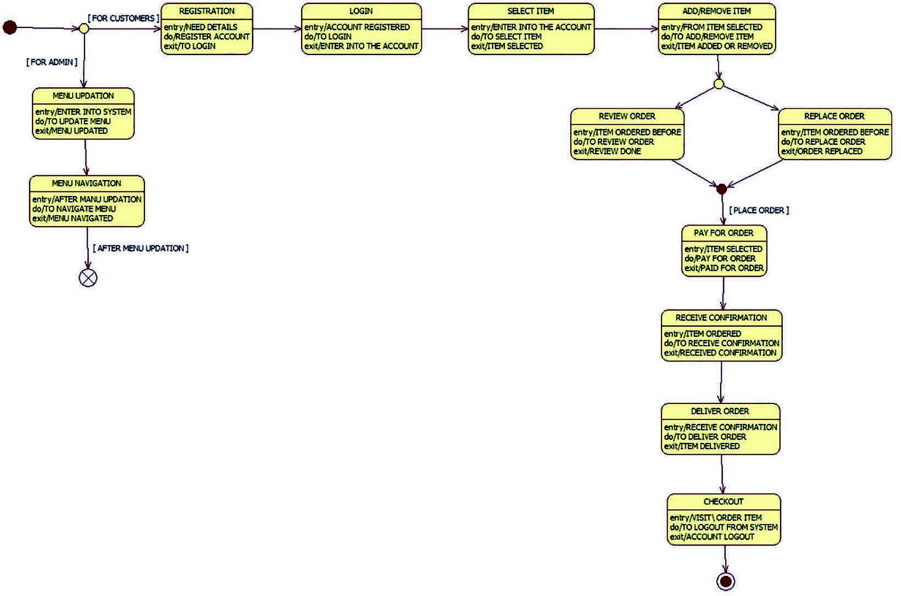
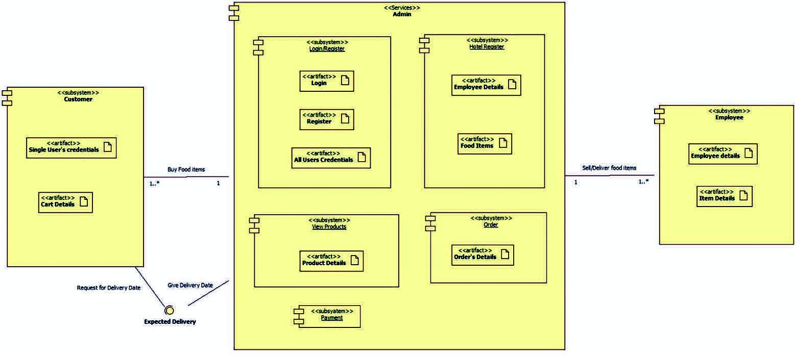
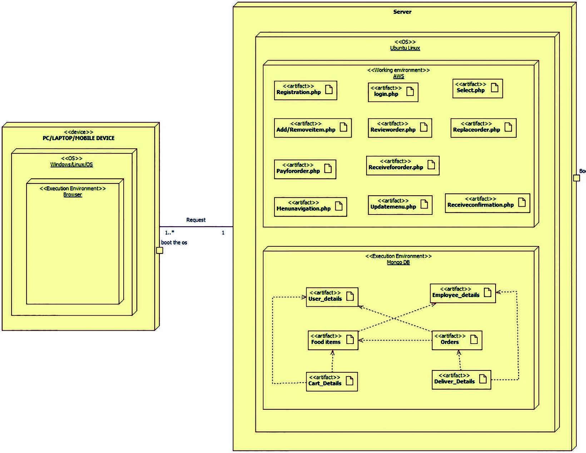

# Chapter 22: Design of UML Diagrams for Job Seeker Portal System

> **Book**: *UML Diagramming: A Case Study Approach* by Dr. Suriya Sundaramoorthy (CRC Press, 2022)  
> **Pages**: 227–236 (Total: 10 pages)  
> **Classification**: Industrial Case Study & UML Modeling Suite  
> **Navigation**: [&larr; Chapter_21_Design_of_UML_Diagrams_for_Smart_Traffic_Management_System](Chapter_21_Design_of_UML_Diagrams_for_Smart_Traffic_Management_System.md) | [📚 Book Index](../UML_Book.md) | [Chapter_23_Design_of_UML_Diagrams_for_AAROGYA_SETU_Health_Care_APP &rarr;](Chapter_23_Design_of_UML_Diagrams_for_AAROGYA_SETU_Health_Care_APP.md)

---

## 📌 Executive Summary

Chapter 22 presents an end-to-end software engineering case study for the **Design of UML Diagrams for Job Seeker Portal System**. This chapter demonstrates how business requirements and domain constraints are translated into formal architectural specifications through data-flow modeling and a complete suite of Unified Modeling Language (UML) structural and behavioral models.

The case study analyzes the system from multiple architectural perspectives: identifying external user and service actors, formalizing core operational capabilities, detailing procedural business workflows, specifying domain entity schemas, and architecting modular component deployment across distributed physical infrastructure.

---

## 🎯 Problem Statement & Business Context

Job seekers work hard to gain the right skills and knowledge to give them an edge over others in the role they seek. However, at times, despite their best efforts, one may find it difficult to move a step closer to this sought-after job. Hence a platform for listing out the availability of jobs irrespective of the field is required. Furthermore, a job site serves a dual purpose. On one hand, it lists out the availability of jobs to candidates, and on the other, it serves as a database of registered candidate’s profiles for companies to shortlist. The objective is to develop a software solution to predict the availability of jobs based on location, sectors, package, platform, interest and eligibility. As it is important to keep the candidates engaged during their job search, it is important to provide facets on the abovementioned criteria so that they can narrow down to the jobs of their choice (Figures 22.1–22.8).

---

## ⚙️ System Architecture & Functional Capabilities

The **Design of UML Diagrams for Job Seeker Portal System** decomposes business operations into modular functional units. These capabilities address the operational bottlenecks of manual and legacy workflows by introducing automated, role-based, and auditable software processes:

- **Approve New Companies**: Checks the credibility of the company and admits the company into the system.
- **Deletion of Fraudulent Companies**: The admin can delete the company from the system if it is proven to be a false/fraudulent company.
- **Maintenance/Updating**: Refers to change an existing information in the system to fix errors or enhance functionality and deleting outdated information and updating of new data into the system.
- **Feedback**: Getting input from recruiter/seeker to verify the credibility of the users and to modify/update the system for better enhancements/quality.
- **Registration**: Every recruiter/seeker must first register to avail the opportunity to use the system.
- **Profile**: This contains the information which will be displayed to all other users of the system.
- **Recruiter Login**: The recruiter/company login through a separate login page.
- **Manage Profile**: Displays the information about the company.
- **Post Job Vacancy**: Can post a job vacancy and the required information about the field, category and salary and so on about the job.
- **Job Requirements**: Displays the information of the job posted.
- **Delete Job Vacancy**: If a job vacancy is filled or if it’s no longer needed, the company could delete the job posting from the system.
- **Communicate with Job Seeker**: If a job seeker applies for a job vacancy, the recruiter should communicate with the seeker to provide the information such as interview date, company test and so on.
- **Manage Account**: This detail actions such as change/update username and password and deletion of the account of the recruiter.
- **Seeker Login**: The job seeker logins through a separate login page.
- **Manage Profile/Seeker Details**: Displays the information of the seeker provided during registration.
- **Upload/Update CV**: The CV/resume, submitted in the profile section is a requirement for applying for jobs.
- **View Job Vacancy**: A job seeker can browse through various job postings, based on category and field and further constraints.
- **Apply for Job Vacancy**: A job seeker, if interested in a certain job posting, can apply for that posting.
- **Modify Account**: This detail actions such as change/update username and password and deletion of the account of the job seeker.

---

## 📊 Complete UML Diagram Suite & Architectural Walkthrough

This chapter incorporates **9 crystal-clear, high-resolution diagram(s)** (extracted losslessly from the source edition at up to 2,000+ px) illustrating the end-to-end design from functional use cases to physical hardware deployment:

### Figure 22.1: UML Usecase Diagram

**Diagram Category**: `Use Case Diagram`  
**Architectural Role**: Specifies system boundary, primary external actors, and business use cases with include/extend relationships.

**System Design Analysis**:
Illustrates the functional boundary of the **Design of UML Diagrams for Job Seeker Portal System**. External actors trigger core use cases, demonstrating how business transactions, authorization checkpoints, and service requests flow into the system. Relationships (`<<include>>` for mandatory sub-routines like authentication and validation, and `<<extend>>` for optional or conditional exception branches) formalize the system's external functional contract.

### Figure 22.2: UML Activity Diagram

**Diagram Category**: `Activity Diagram`  
**Architectural Role**: Illustrates dynamic procedural workflow, decision branching, concurrent action forks, and synchronization joins.

**System Design Analysis**:
Details the step-by-step procedural execution flow for core operations in **Design of UML Diagrams for Job Seeker Portal System**. Begins at an initial state, navigates action states, evaluates guard conditions at decision diamonds, and models parallel execution branches using fork and join synchronizations before reaching the terminal state, ensuring business workflows are deterministic and free of race conditions.

### Figure 22.3: UML Sequence Diagram

**Diagram Category**: `Sequence Diagram`  
**Architectural Role**: Details chronological object interactions, synchronous message exchanges, return flows, and activation lifelines.

**System Design Analysis**:
Traces the time-ordered message sequence between participating objects and services in **Design of UML Diagrams for Job Seeker Portal System**. Vertical dashed lifelines represent entity instances across time, while horizontal solid and dashed arrows show synchronous invocations, data lookups, and return values. Activation bars delineate execution duration, clarifying object collaboration during key transactional workflows.

### Figure 22.4: UML Collaboration Diagram

**Diagram Category**: `Communication Diagram`  
**Architectural Role**: Emphasizes structural object topology and numbered sequence messaging between collaborating entities.

**System Design Analysis**:
Emphasizes the spatial and structural organization of collaborating instances in **Design of UML Diagrams for Job Seeker Portal System**. Shows object links overlaid with numbered messages (e.g., 1.0, 1.1, 2.0), illustrating both structural connectivity and invocation hierarchy, complementing the temporal perspective of the sequence diagram.

### Figure 22.5: UML State Machine Diagram

**Diagram Category**: `State Machine Diagram`  
**Architectural Role**: Captures entity lifecycle states, transition triggers, event guards, and exit/entry actions.

**System Design Analysis**:
Models the complete lifecycle state transitions for central domain entities in **Design of UML Diagrams for Job Seeker Portal System**. Tracks transitions from initial creation through intermediate processing states to completion or cancellation. Explicit state triggers, guard expressions `[condition]`, and entry/exit actions guarantee valid business lifecycle states and eliminate invalid operational state jumps.

### Figure 22.6: UML Class Diagram

**Diagram Category**: `Class Diagram`  
**Architectural Role**: Models static structural classifiers, entity attributes, operations, and associations (composition, aggregation, inheritance).

**System Design Analysis**:
Captures the static structural domain model for **Design of UML Diagrams for Job Seeker Portal System**. Defines primary entity classes, their private/public attributes, operational methods, and relationships. It enforces structural integrity through multiplicities, composition (strong lifecycle ownership of subsidiary records), aggregation, and inheritance hierarchies, forming the foundation for the relational database schema and domain entity classes.

### Figure 22.7: UML Component Diagram

**Diagram Category**: `Component Diagram`  
**Architectural Role**: Architects physical modular software components, provided ball interfaces, and required socket dependencies.

**System Design Analysis**:
Architects the modular software organization for **Design of UML Diagrams for Job Seeker Portal System**. Illustrates autonomous subsystems, business logic controllers, database access layers, and external service adapters. Provided interfaces (ball notation) and required dependencies (socket notation) define clear service contracts, supporting high cohesion and loose coupling.

### Figure 22.8: UML Deployment Diagram

**Diagram Category**: `Deployment Diagram`  
**Architectural Role**: Maps software execution artifacts to hardware computing nodes, client devices, application tiers, and database servers.

**System Design Analysis**:
Maps the physical runtime deployment architecture for **Design of UML Diagrams for Job Seeker Portal System**. Depicts client hardware devices (web browsers, mobile apps), application servers, network firewalls, and persistence database nodes. Communication paths and execution environments reflect production infrastructure, scalability considerations, and network security boundaries.

### Visual Artifacts & Supplementary Schematics

The following high-resolution schematics capture operational screen states, user dashboards, or notation components documented in this chapter:

#### Ch22 p236 img01

**Perspective**: `Conceptual Notation / Architecture Asset` — Supplemental conceptual illustration or notation reference from the source chapter.

---

## 💡 Key Architectural Invariants & Domain Lessons

1. **Requirement Traceability**: Every model in the **Design of UML Diagrams for Job Seeker Portal System** suite traces directly to business requirements and operational constraints established in the problem statement.
2. **State & Workflow Integrity**: Dynamic activity and sequence models guarantee deterministic workflow completion, enforce transactional atomicity, and prevent deadlocks.
3. **Modular Encapsulation**: Component boundaries decouple domain business logic from presentation controllers and external integration adapters, supporting high maintainability.
4. **Operational Security & RBAC**: Strict role-based authorization guards sensitive operations across external actor boundaries and administrative lifelines.
5. **High-Fidelity Deployment**: Physical node topologies reflect real-world tiered infrastructure (DMZ, application cluster, isolated persistence layer), ensuring scalability and fault tolerance.

---

## 🔗 Related Resources & Navigation

- **Navigation**: [&larr; Chapter_21_Design_of_UML_Diagrams_for_Smart_Traffic_Management_System](Chapter_21_Design_of_UML_Diagrams_for_Smart_Traffic_Management_System.md) | [📚 Book Index](../UML_Book.md) | [Chapter_23_Design_of_UML_Diagrams_for_AAROGYA_SETU_Health_Care_APP &rarr;](Chapter_23_Design_of_UML_Diagrams_for_AAROGYA_SETU_Health_Care_APP.md)
- **Master Book Catalog**: [`UML_Book.md`](../UML_Book.md)
- **High-Resolution Images Archive**: [`images/`](../images/)