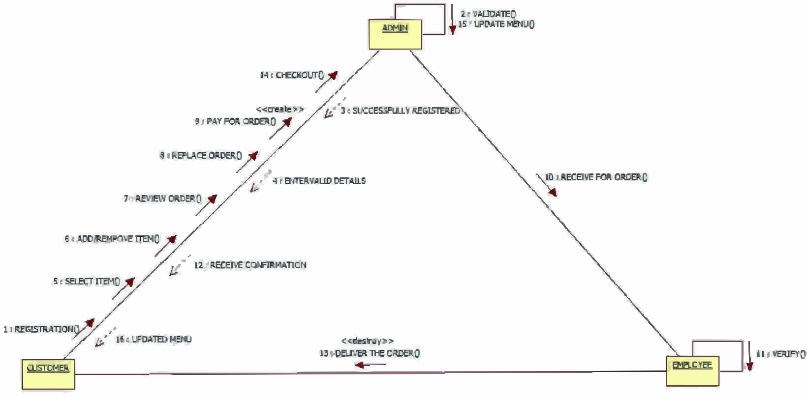
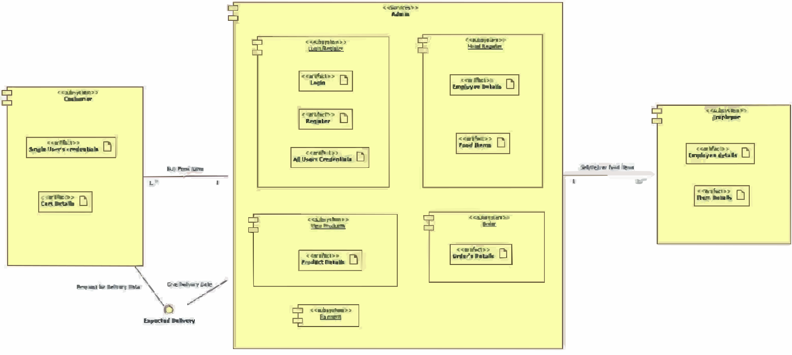

# Chapter 23: Design of UML Diagrams for AAROGYA SETU Health Care APP

> **Book**: *UML Diagramming: A Case Study Approach* by Dr. Suriya Sundaramoorthy (CRC Press, 2022)  
> **Pages**: 237–246 (Total: 10 pages)  
> **Classification**: Industrial Case Study & Diagram Suite  
> **Navigation**: [&larr; Chapter_22_Design_of_UML_Diagrams_for_Job_Seeker_Portal_System](Chapter_22_Design_of_UML_Diagrams_for_Job_Seeker_Portal_System.md) | [📚 Book Index](../UML_Book.md) | [Chapter_24_Design_of_UML_Diagrams_for_Online_Pharmacy_Management_System &rarr;](Chapter_24_Design_of_UML_Diagrams_for_Online_Pharmacy_Management_System.md)

---

## 📌 Executive Summary

Chapter 23 presents an industrial software engineering case study for **Design of UML Diagrams for AAROGYA SETU Health Care APP**. It details the transition from business requirements and domain constraints into formal software architecture specifications, leveraging data-flow modeling and a complete suite of Unified Modeling Language (UML) structural and behavioral diagrams.

---

## 🎯 Problem Statement & System Context

Coronavirus pandemic is spreading in large numbers. Experts suggest that social distancing has been used for a long time as one of the methods to reduce the spike in diseases and infectious illnesses. In India alone, the cases have sharply spiked up in the past two weeks, which has led to imposing even tougher measures. By identifying ‘hotspots’, necessary mapping can help deal with the problem of community transmission, i.e., when cases start Spreading within the population in such a way that people don’t know how they were exposed to the contagion. This is known as ‘Stage 3’ of an outbreak. The Aarogya Setu app, which is a coronavirus tracker of sorts works on the basis of contact tracing and can help a user identify possible coronavirus ‘hotspot’ around his or her area. It can help people stay safe and adopt necessary precautions in some areas where there are cases and accordingly, help stop or prevent community transmission to an extent. On the basis of geotagging, it can also alert a specific user about their proximity to a nearby infection case or hotspot. The app also helps users self-identify their risk and monitor their health assessment, considering the times when it can get difficult (and most of all, is not particularly safe to step out and visit health clinics). Aarogya Setu app also helps people identify the symptoms, alert them about the best safety precautions and other relevant information concerning the spread of COVID-19. While this is a noble initiative, the app also lists down basic quarantine measures for those who are considered to be in the ‘high-risk’ category. It can also help people, who have had a travel history self-quarantine and prevent any risk of transmission (Figures 23.1–23.8).

---

## 📊 Complete UML Diagram Suite & Architecture Specifications

This chapter incorporates **9 standalone vector diagram(s)** illustrating the end-to-end design from functional use cases to physical hardware deployment:

### Figure 23.1: UML Usecase Diagram

**Diagram Category**: `Use Case Diagram`  
**Architectural Role**: Specifies system boundary, primary external actors, and business use cases with include/extend relationships.

### Figure 23.2: UML Activity Diagram

**Diagram Category**: `Activity Diagram`  
**Architectural Role**: Illustrates dynamic procedural workflow, decision branching, concurrent action forks, and synchronization joins.

### Figure 23.3: UML Sequence Diagram

**Diagram Category**: `Sequence Diagram`  
**Architectural Role**: Details chronological object interactions, synchronous message exchanges, return flows, and activation lifelines.

### Figure 23.4: UML Collaboration Diagram

**Diagram Category**: `Communication Diagram`  
**Architectural Role**: Emphasizes structural object topology and numbered sequence messaging between collaborating entities.

### Figure 23.5: UML State Machine Diagram

**Diagram Category**: `State Machine Diagram`  
**Architectural Role**: Captures entity lifecycle states, transition triggers, event guards, and exit/entry actions.

### Figure 23.6: UML Class Diagram

**Diagram Category**: `Class Diagram`  
**Architectural Role**: Models static structural classifiers, entity attributes, operations, and associations (composition, aggregation, inheritance).

### Figure 23.7: UML Component Diagram

**Diagram Category**: `Component Diagram`  
**Architectural Role**: Architects physical modular software components, provided ball interfaces, and required socket dependencies.

### Figure 23.8: UML Deployment Diagram

**Diagram Category**: `Deployment Diagram`  
**Architectural Role**: Maps software execution artifacts to hardware computing nodes, client devices, application tiers, and database servers.

### Visual Artifacts & Supplementary Schematics

The following vector schematics capture operational screen states, user dashboards, or notation components documented in this chapter:

#### Ch23 p246 img01

---

## 💡 Key Architectural Invariants & Modeling Lessons

1. **Traceability**: Every software model directly corresponds to explicit functional requirements defined during the initial domain specification.
2. **Separation of Concerns**: Structural models (Class, Component, Deployment) maintain clear boundaries separating business domain entities from physical infrastructure nodes.
3. **Behavioral Integrity**: Dynamic models (Activity, Sequence, State Machine) guarantee valid state transitions, prevent deadlocks, and verify message order consistency.
4. **Deployment Fidelity**: Physical nodes and execution environments accurately map runtime middleware, database engines, and client access channels.

---

## 🔗 Related Resources & Navigation

- **Navigation**: [&larr; Chapter_22_Design_of_UML_Diagrams_for_Job_Seeker_Portal_System](Chapter_22_Design_of_UML_Diagrams_for_Job_Seeker_Portal_System.md) | [📚 Book Index](../UML_Book.md) | [Chapter_24_Design_of_UML_Diagrams_for_Online_Pharmacy_Management_System &rarr;](Chapter_24_Design_of_UML_Diagrams_for_Online_Pharmacy_Management_System.md)
- **Master Book Catalog**: [`UML_Book.md`](../UML_Book.md)
- **Vector Images Catalog**: [`Vector_Images_Catalog.md`](../vector_images/Vector_Images_Catalog.md)