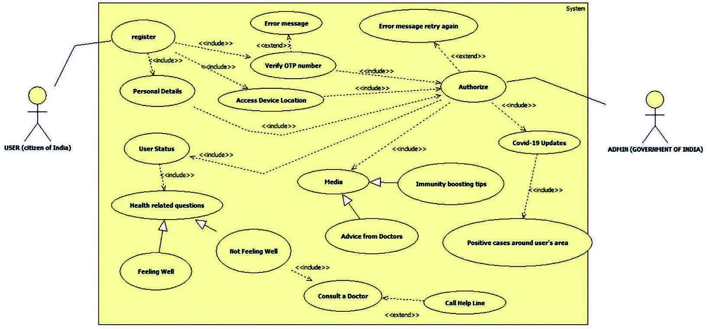
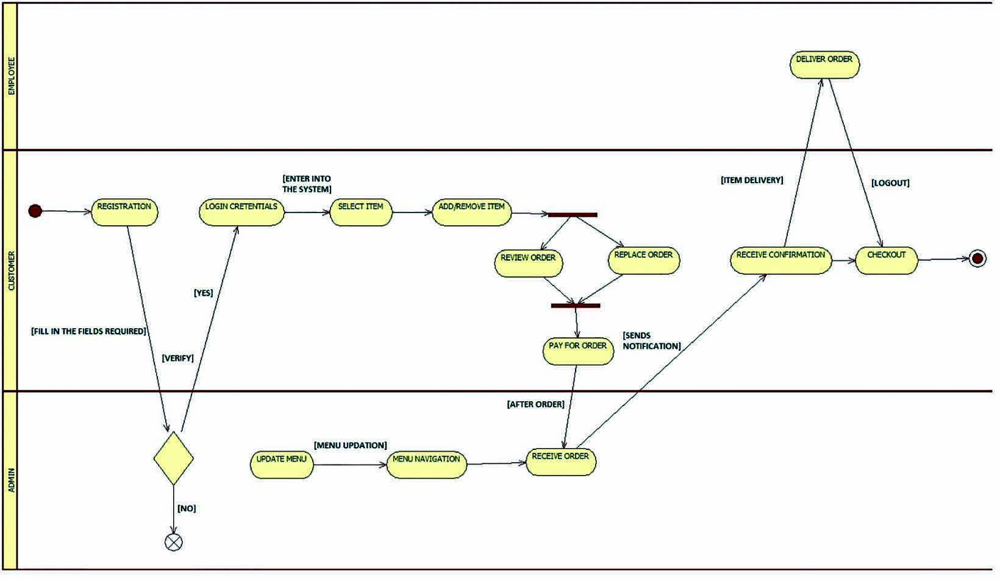
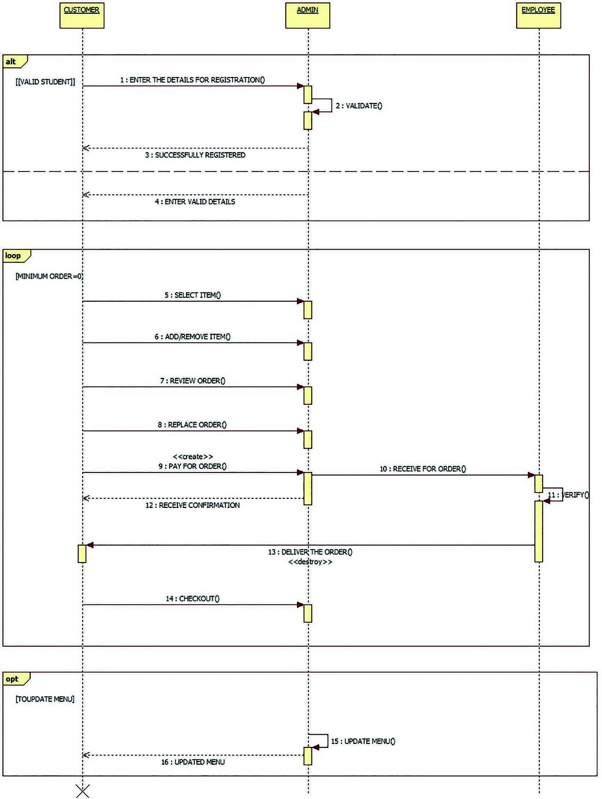
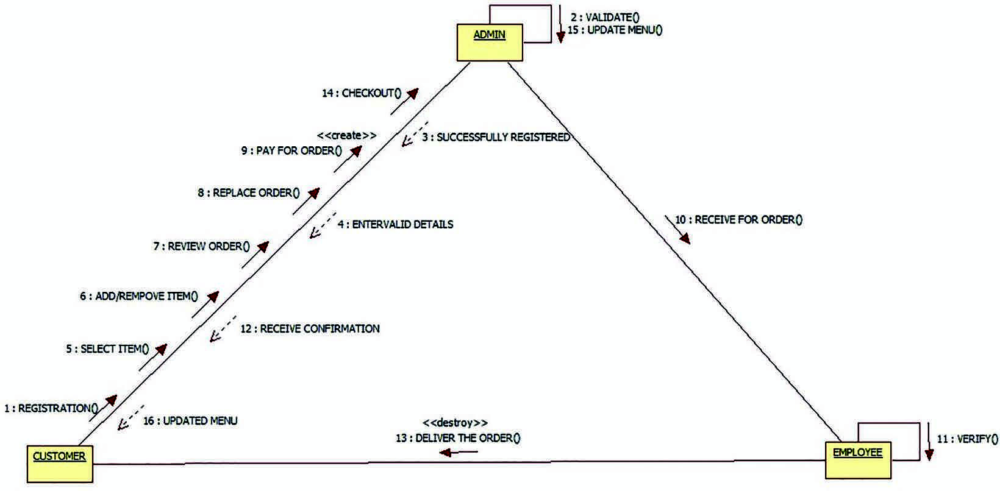
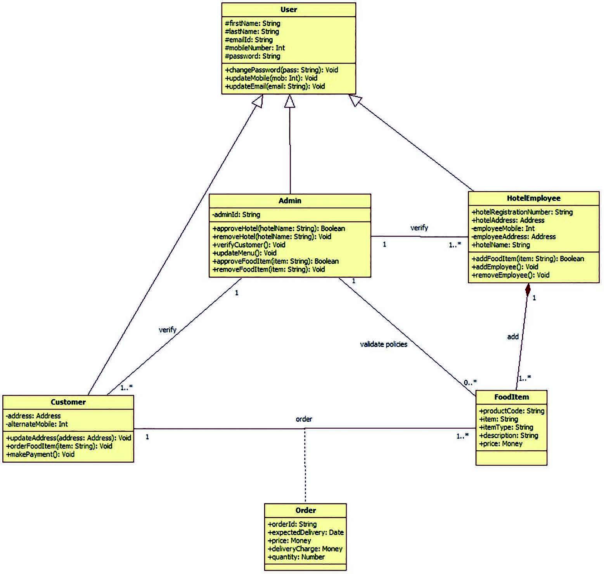

# Chapter 23: Design of UML Diagrams for AAROGYA SETU Health Care APP

> **Book**: *UML Diagramming: A Case Study Approach* by Dr. Suriya Sundaramoorthy (CRC Press, 2022)  
> **Pages**: 237–246 (Total: 10 pages)  
> **Classification**: Industrial Case Study & UML Modeling Suite  
> **Navigation**: [&larr; Chapter_22_Design_of_UML_Diagrams_for_Job_Seeker_Portal_System](Chapter_22_Design_of_UML_Diagrams_for_Job_Seeker_Portal_System.md) | [📚 Book Index](../UML_Book.md) | [Chapter_24_Design_of_UML_Diagrams_for_Online_Pharmacy_Management_System &rarr;](Chapter_24_Design_of_UML_Diagrams_for_Online_Pharmacy_Management_System.md)

---

## 📌 Executive Summary

Chapter 23 presents an end-to-end software engineering case study for the **Design of UML Diagrams for AAROGYA SETU Health Care APP**. This chapter demonstrates how business requirements and domain constraints are translated into formal architectural specifications through data-flow modeling and a complete suite of Unified Modeling Language (UML) structural and behavioral models.

The case study analyzes the system from multiple architectural perspectives: identifying external user and service actors, formalizing core operational capabilities, detailing procedural business workflows, specifying domain entity schemas, and architecting modular component deployment across distributed physical infrastructure.

---

## 🎯 Problem Statement & Business Context

- **Core Problem**: Manual contact tracing during a contagious pandemic is too slow to stop people from unknowingly interacting with infected individuals.
- **Business Context**: Public health agencies need a mobile-first tracing and self-assessment tool to alert citizens of infection risks in their immediate surroundings.
- **Key Solution**: Uses Bluetooth and GPS to log nearby phone interactions, warns users if they crossed paths with an infected person, and provides symptom self-assessment quizzes.

---

## ⚙️ System Architecture & Functional Capabilities

The **Design of UML Diagrams for AAROGYA SETU Health Care APP** decomposes business operations into modular functional units. These capabilities address the operational bottlenecks of manual and legacy workflows by introducing automated, role-based, and auditable software processes:

- **Register**: User should register to get access to the application.
- **Verify OTP Number**: User should enter the OTP number provided by the system for the verification process.
- **Access Device Location**: The user must turn on his/her device location and accept the terms and conditions of the application.
- **Personal Details**: Users should provide all the necessary personal details asked by the system.
- **Error Message**: If the entered user’s OTP number is wrong.
- **Authorize**: Admin authorizes the user into the system after the verification process.
- **Error Message Retry Again**: If the admin did not authorize the user, users should retry again.
- **User Status**: To check the users’ health conditions.
- **Media**: The System provides the users with advices, healthcare tips and trending videos.
- **Covid-19 Updates**: The system provides the users with a daily number of positive cases.
- **Health-Related Questions**: The user should answer the health care questions in order to check their health condition.
- **Feeling Well**: The system provides the users with the output of the self-analysis test as feeling well.
- **Not Feeling Well**: The system provides the users with the output of the self-analysis test as not feeling well.
- **Consult Doctor**: If the users are not feeling well, the system suggests the users to consult a doctor.
- **Call Helpline**: In case if the users are not feeling well, the system suggests the users to call helpline.
- **Advice from Doctors**: The system provides the users with many advising videos of doctors.
- **Immunity-Boosting Tips**: The system provides many immunity-boosting tips to the users.

---

## 📊 Complete UML Diagram Suite & Architectural Walkthrough

This chapter incorporates **9 crystal-clear, high-resolution diagram(s)** (extracted losslessly from the source edition at up to 2,000+ px) illustrating the end-to-end design from functional use cases to physical hardware deployment:

### Figure 23.1: UML Usecase Diagram

**Diagram Category**: `Use Case Diagram`  
**Architectural Role**: Specifies system boundary, primary external actors, and business use cases with include/extend relationships.

**System Design Analysis**:
Illustrates the functional boundary of the **Design of UML Diagrams for AAROGYA SETU Health Care APP**. External actors trigger core use cases, demonstrating how business transactions, authorization checkpoints, and service requests flow into the system. Relationships (`<<include>>` for mandatory sub-routines like authentication and validation, and `<<extend>>` for optional or conditional exception branches) formalize the system's external functional contract.

### Figure 23.2: UML Activity Diagram

**Diagram Category**: `Activity Diagram`  
**Architectural Role**: Illustrates dynamic procedural workflow, decision branching, concurrent action forks, and synchronization joins.

**System Design Analysis**:
Details the step-by-step procedural execution flow for core operations in **Design of UML Diagrams for AAROGYA SETU Health Care APP**. Begins at an initial state, navigates action states, evaluates guard conditions at decision diamonds, and models parallel execution branches using fork and join synchronizations before reaching the terminal state, ensuring business workflows are deterministic and free of race conditions.

### Figure 23.3: UML Sequence Diagram

**Diagram Category**: `Sequence Diagram`  
**Architectural Role**: Details chronological object interactions, synchronous message exchanges, return flows, and activation lifelines.

**System Design Analysis**:
Traces the time-ordered message sequence between participating objects and services in **Design of UML Diagrams for AAROGYA SETU Health Care APP**. Vertical dashed lifelines represent entity instances across time, while horizontal solid and dashed arrows show synchronous invocations, data lookups, and return values. Activation bars delineate execution duration, clarifying object collaboration during key transactional workflows.

### Figure 23.4: UML Collaboration Diagram

**Diagram Category**: `Communication Diagram`  
**Architectural Role**: Emphasizes structural object topology and numbered sequence messaging between collaborating entities.

**System Design Analysis**:
Emphasizes the spatial and structural organization of collaborating instances in **Design of UML Diagrams for AAROGYA SETU Health Care APP**. Shows object links overlaid with numbered messages (e.g., 1.0, 1.1, 2.0), illustrating both structural connectivity and invocation hierarchy, complementing the temporal perspective of the sequence diagram.

### Figure 23.5: UML State Machine Diagram

**Diagram Category**: `State Machine Diagram`  
**Architectural Role**: Captures entity lifecycle states, transition triggers, event guards, and exit/entry actions.

**System Design Analysis**:
Models the complete lifecycle state transitions for central domain entities in **Design of UML Diagrams for AAROGYA SETU Health Care APP**. Tracks transitions from initial creation through intermediate processing states to completion or cancellation. Explicit state triggers, guard expressions `[condition]`, and entry/exit actions guarantee valid business lifecycle states and eliminate invalid operational state jumps.

### Figure 23.6: UML Class Diagram

**Diagram Category**: `Class Diagram`  
**Architectural Role**: Models static structural classifiers, entity attributes, operations, and associations (composition, aggregation, inheritance).

**System Design Analysis**:
Captures the static structural domain model for **Design of UML Diagrams for AAROGYA SETU Health Care APP**. Defines primary entity classes, their private/public attributes, operational methods, and relationships. It enforces structural integrity through multiplicities, composition (strong lifecycle ownership of subsidiary records), aggregation, and inheritance hierarchies, forming the foundation for the relational database schema and domain entity classes.

### Figure 23.7: UML Component Diagram

**Diagram Category**: `Component Diagram`  
**Architectural Role**: Architects physical modular software components, provided ball interfaces, and required socket dependencies.

**System Design Analysis**:
Architects the modular software organization for **Design of UML Diagrams for AAROGYA SETU Health Care APP**. Illustrates autonomous subsystems, business logic controllers, database access layers, and external service adapters. Provided interfaces (ball notation) and required dependencies (socket notation) define clear service contracts, supporting high cohesion and loose coupling.

### Figure 23.8: UML Deployment Diagram

**Diagram Category**: `Deployment Diagram`  
**Architectural Role**: Maps software execution artifacts to hardware computing nodes, client devices, application tiers, and database servers.

**System Design Analysis**:
Maps the physical runtime deployment architecture for **Design of UML Diagrams for AAROGYA SETU Health Care APP**. Depicts client hardware devices (web browsers, mobile apps), application servers, network firewalls, and persistence database nodes. Communication paths and execution environments reflect production infrastructure, scalability considerations, and network security boundaries.

### Visual Artifacts & Supplementary Schematics

The following high-resolution schematics capture operational screen states, user dashboards, or notation components documented in this chapter:

#### Ch23 p246 img01

**Perspective**: `Conceptual Notation / Architecture Asset` — Supplemental conceptual illustration or notation reference from the source chapter.

---

## 💡 Key Architectural Invariants & Domain Lessons

1. **Requirement Traceability**: Every model in the **Design of UML Diagrams for AAROGYA SETU Health Care APP** suite traces directly to business requirements and operational constraints established in the problem statement.
2. **State & Workflow Integrity**: Dynamic activity and sequence models guarantee deterministic workflow completion, enforce transactional atomicity, and prevent deadlocks.
3. **Modular Encapsulation**: Component boundaries decouple domain business logic from presentation controllers and external integration adapters, supporting high maintainability.
4. **Operational Security & RBAC**: Strict role-based authorization guards sensitive operations across external actor boundaries and administrative lifelines.
5. **High-Fidelity Deployment**: Physical node topologies reflect real-world tiered infrastructure (DMZ, application cluster, isolated persistence layer), ensuring scalability and fault tolerance.

---

## 🔗 Related Resources & Navigation

- **Navigation**: [&larr; Chapter_22_Design_of_UML_Diagrams_for_Job_Seeker_Portal_System](Chapter_22_Design_of_UML_Diagrams_for_Job_Seeker_Portal_System.md) | [📚 Book Index](../UML_Book.md) | [Chapter_24_Design_of_UML_Diagrams_for_Online_Pharmacy_Management_System &rarr;](Chapter_24_Design_of_UML_Diagrams_for_Online_Pharmacy_Management_System.md)
- **Master Book Catalog**: [`UML_Book.md`](../UML_Book.md)
- **High-Resolution Images Archive**: [`images/`](../images/)