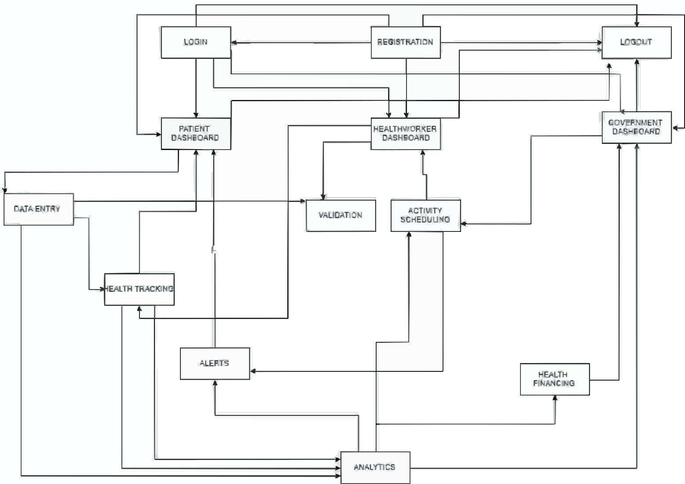
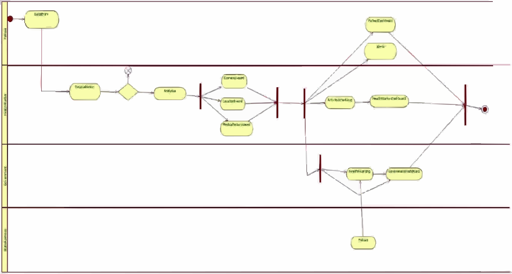

# Chapter 25: Design of UML Diagrams for EQUIHEALTH

> **Book**: *UML Diagramming: A Case Study Approach* by Dr. Suriya Sundaramoorthy (CRC Press, 2022)  
> **Pages**: 265–278 (Total: 14 pages)  
> **Classification**: Industrial Case Study & Diagram Suite  
> **Navigation**: [&larr; Chapter_24_Design_of_UML_Diagrams_for_Online_Pharmacy_Management_System](Chapter_24_Design_of_UML_Diagrams_for_Online_Pharmacy_Management_System.md) | [📚 Book Index](../UML_Book.md) | [Chapter_26_Design_of_UML_Diagrams_for_an_OTT_Based_System_MINI_REEL &rarr;](Chapter_26_Design_of_UML_Diagrams_for_an_OTT_Based_System_MINI_REEL.md)

---

## 📌 Executive Summary

Chapter 25 presents an industrial software engineering case study for **Design of UML Diagrams for EQUIHEALTH**. It details the transition from business requirements and domain constraints into formal software architecture specifications, leveraging data-flow modeling and a complete suite of Unified Modeling Language (UML) structural and behavioral diagrams.

---

## 🎯 Problem Statement & System Context

This case study mainly focusses on developing an application to address the health disparities among the various classes of patients and the appropriate medical interventions in order to achieve health equity for every individual. The target users of the application are patients, caretakers, healthcare providers, medical professionals and government officials. One of the main functionalities of the system is a patient classification based on social determinants such as economic backgrounds, health insurance amount received, medical allowances, demographics, age, type of disability and hereditary health information. It has to be ensured that appropriate treatment is administered for the people of all categories in an equitable manner. The patient should be able to feed health details into the application that will be corroborated by the details furnished by the healthcare providers and the patient’s public health records. Another important functionality is to notify the patients about the relevant medical events and health schemes available based on the system’s categorization of the patient’s data. The system also must provide personal health-tracking facilities for the patients by means of assessing the patients’ individual medical records. The next function is to enable the healthcare providers such as hospitals and clinics to plan and schedule health worker activity based on the patient’s need. Consequently, the application should make available the analysis of these data to the government, thereby assisting in the implementation of significant intervention schemes to offer medical facilities without any conflicts and eliminate the health discrepancies. Thus, with a holistic approach, the application should allow patients to register and upload social and medical data which get classified based on criteria that are then used by the healthcare providers and governments to extend healthcare to all individuals without any disparities. Functionalities: ◾ Registration: The users of the application are registered with unique credentials and categorized as patients, health workers or a government authority. ◾ Login: The login section is for the users to login to the application using the unique credentials provided during the registration phase. ◾ Logout: The logout option is included in the user’s user interface enabling the user to log out of the application at any time the user wants to. ◾ Data Entry: A section to enter all the medical details as well as the various social and economic details including unique identification details for the patient user and registered identification details for the health workers. ◾ Validation of Medical Data: The details entered by the patient will be corroborated by the details furnished by the respective hospital medical records of the patients. ◾ Patient Dashboard: A catered dashboard for every patient user with articles relating to the patient’s present medical conditions and the possible ailments that the patient may be prone to, obtained by analysis of the patient’s medical records. It also incorporates a search bar to search for specific articles relating to a medical term. ◾ Health Worker Dashboard: A dashboard for every health worker belonging to every registered medical institution that provides informative articles pertaining to the worker’s area of specialization. ◾ Health Tracking: A section that provides a health-tracking facility by means of detailed analytics of the patient’s individual health records furnished by the patient as well as the healthcare establishments from where the patient receives active treatment. This section also has provisions to synchronize the data from other health monitoring applications in the user’s device and include them for health tracking. ◾ Alerts: Alerts are scheduled for all the users and dispatched to the patients whenever an activity is due such as a health checkup or a medical camp and dispatched to the health workers to catch up on a scheduled activity. ◾ Activity Scheduling: Activities of the health workers are scheduled according to the analysed requirements of the patients based on various medical and social factors and the progress of these planned activities can be tracked. ◾ Analytics: All the exhaustive data that goes into the application is analysed for patterns of medical disparities based on family and community issues and socio-economic determinants and a holistic report of this data is presented in the dashboard accessible to the authorized government authority to be used to bring about the appropriate health interventions. ◾ Health Financing: Using the application’s analytics data, the government should be able to implement substantial schemes to bring forth health equity for all the affected individuals by initiating health financing schemes with various state-level agencies through an authorized section in the application (Figures 25.1–25.12).

---

## 📊 Complete UML Diagram Suite & Architecture Specifications

This chapter incorporates **13 standalone vector diagram(s)** illustrating the end-to-end design from functional use cases to physical hardware deployment:

### Figure 25.1: System Architecture

**Diagram Category**: `Architectural Figure`  
**Architectural Role**: Structural schematic detailing domain requirements and workflow transitions.

### Figure 25.2: DFD Level 0

**Diagram Category**: `Data Flow Diagram (DFD)`  
**Architectural Role**: Models external entity inputs, core transformation processes, and data store read/write interactions.

### Figure 25.3: DFD Level 1

**Diagram Category**: `Data Flow Diagram (DFD)`  
**Architectural Role**: Models external entity inputs, core transformation processes, and data store read/write interactions.

### Figure 25.4: UML Usecase Diagram

**Diagram Category**: `Use Case Diagram`  
**Architectural Role**: Specifies system boundary, primary external actors, and business use cases with include/extend relationships.

### Figure 25.5: UML Activity Diagram Part 1

**Diagram Category**: `Activity Diagram`  
**Architectural Role**: Illustrates dynamic procedural workflow, decision branching, concurrent action forks, and synchronization joins.

### Figure 25.6: UML Activity Diagram Part 2

**Diagram Category**: `Activity Diagram`  
**Architectural Role**: Illustrates dynamic procedural workflow, decision branching, concurrent action forks, and synchronization joins.

### Figure 25.7: UML Sequence Diagram

**Diagram Category**: `Sequence Diagram`  
**Architectural Role**: Details chronological object interactions, synchronous message exchanges, return flows, and activation lifelines.

### Figure 25.8: UML Collaboration Diagram

**Diagram Category**: `Communication Diagram`  
**Architectural Role**: Emphasizes structural object topology and numbered sequence messaging between collaborating entities.

### Figure 25.9: UML State Machine Diagram

**Diagram Category**: `State Machine Diagram`  
**Architectural Role**: Captures entity lifecycle states, transition triggers, event guards, and exit/entry actions.

### Figure 25.10: UML Class Diagram

**Diagram Category**: `Class Diagram`  
**Architectural Role**: Models static structural classifiers, entity attributes, operations, and associations (composition, aggregation, inheritance).

### Figure 25.11: UML Component Diagram

**Diagram Category**: `Component Diagram`  
**Architectural Role**: Architects physical modular software components, provided ball interfaces, and required socket dependencies.

### Figure 25.12: UML Deployment Diagram

**Diagram Category**: `Deployment Diagram`  
**Architectural Role**: Maps software execution artifacts to hardware computing nodes, client devices, application tiers, and database servers.

### Visual Artifacts & Supplementary Schematics

The following vector schematics capture operational screen states, user dashboards, or notation components documented in this chapter:

#### Ch25 p278 img01

---

## 💡 Key Architectural Invariants & Modeling Lessons

1. **Traceability**: Every software model directly corresponds to explicit functional requirements defined during the initial domain specification.
2. **Separation of Concerns**: Structural models (Class, Component, Deployment) maintain clear boundaries separating business domain entities from physical infrastructure nodes.
3. **Behavioral Integrity**: Dynamic models (Activity, Sequence, State Machine) guarantee valid state transitions, prevent deadlocks, and verify message order consistency.
4. **Deployment Fidelity**: Physical nodes and execution environments accurately map runtime middleware, database engines, and client access channels.

---

## 🔗 Related Resources & Navigation

- **Navigation**: [&larr; Chapter_24_Design_of_UML_Diagrams_for_Online_Pharmacy_Management_System](Chapter_24_Design_of_UML_Diagrams_for_Online_Pharmacy_Management_System.md) | [📚 Book Index](../UML_Book.md) | [Chapter_26_Design_of_UML_Diagrams_for_an_OTT_Based_System_MINI_REEL &rarr;](Chapter_26_Design_of_UML_Diagrams_for_an_OTT_Based_System_MINI_REEL.md)
- **Master Book Catalog**: [`UML_Book.md`](../UML_Book.md)
- **Vector Images Catalog**: [`Vector_Images_Catalog.md`](../vector_images/Vector_Images_Catalog.md)