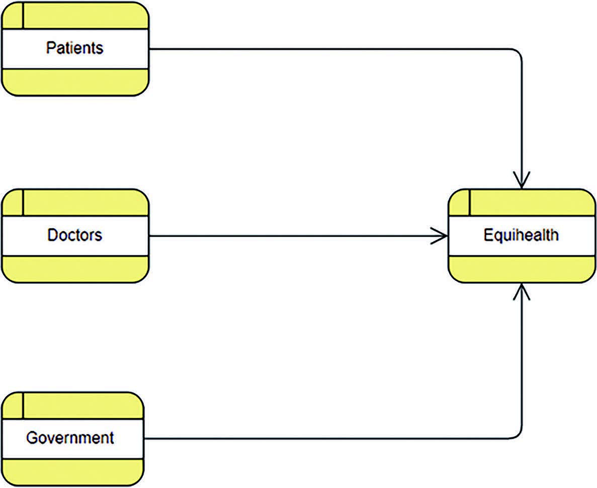
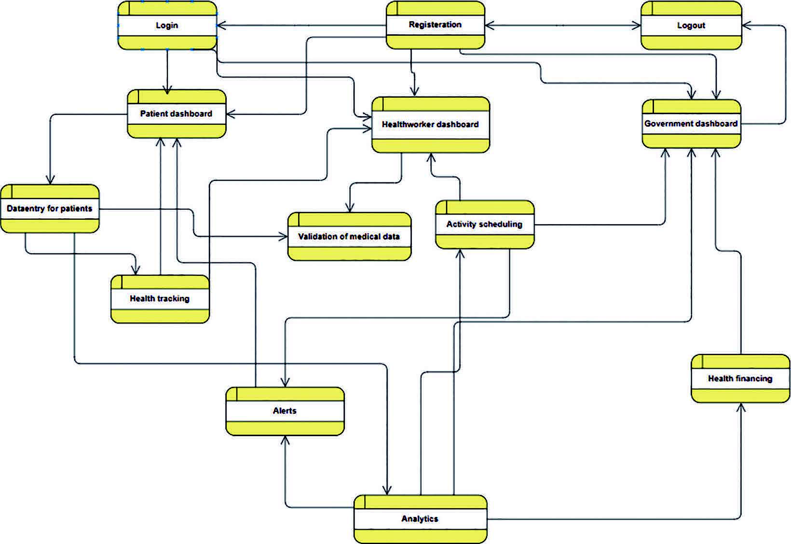
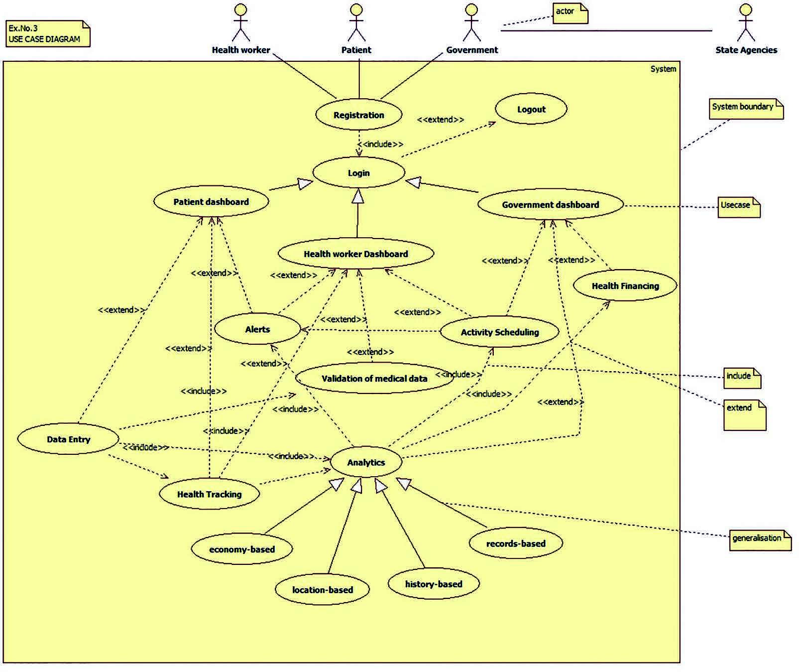
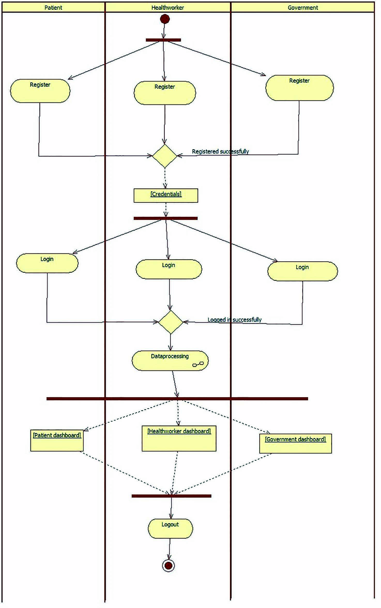
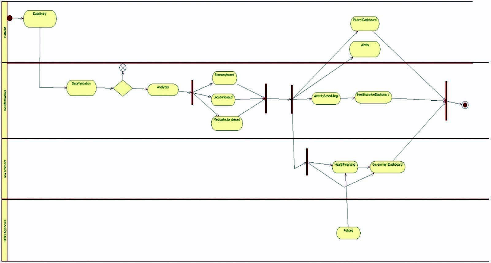
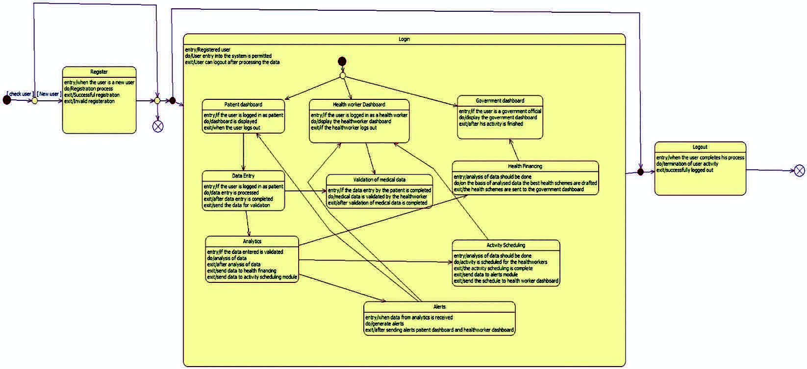
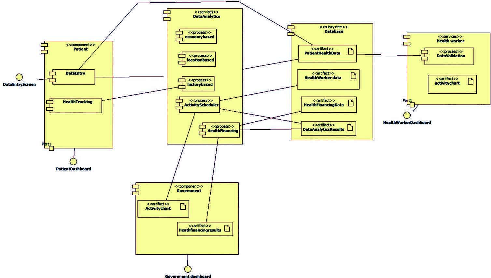

# Chapter 25: Design of UML Diagrams for EQUIHEALTH

> **Book**: *UML Diagramming: A Case Study Approach* by Dr. Suriya Sundaramoorthy (CRC Press, 2022)  
> **Pages**: 265–278 (Total: 14 pages)  
> **Classification**: Industrial Case Study & UML Modeling Suite  
> **Navigation**: [&larr; Chapter_24_Design_of_UML_Diagrams_for_Online_Pharmacy_Management_System](Chapter_24_Design_of_UML_Diagrams_for_Online_Pharmacy_Management_System.md) | [📚 Book Index](../UML_Book.md) | [Chapter_26_Design_of_UML_Diagrams_for_an_OTT_Based_System_MINI_REEL &rarr;](Chapter_26_Design_of_UML_Diagrams_for_an_OTT_Based_System_MINI_REEL.md)

---

## 📌 Executive Summary

Chapter 25 presents an end-to-end software engineering case study for the **Design of UML Diagrams for EQUIHEALTH**. This chapter demonstrates how business requirements and domain constraints are translated into formal architectural specifications through data-flow modeling and a complete suite of Unified Modeling Language (UML) structural and behavioral models.

The case study analyzes the system from multiple architectural perspectives: identifying external user and service actors, formalizing core operational capabilities, detailing procedural business workflows, specifying domain entity schemas, and architecting modular component deployment across distributed physical infrastructure.

---

## 🎯 Problem Statement & Business Context

This case study mainly focusses on developing an application to address the health disparities among the various classes of patients and the appropriate medical interventions in order to achieve health equity for every individual. The target users of the application are patients, caretakers, healthcare providers, medical professionals and government officials. One of the main functionalities of the system is a patient classification based on social determinants such as economic backgrounds, health insurance amount received, medical allowances, demographics, age, type of disability and hereditary health information. It has to be ensured that appropriate treatment is administered for the people of all categories in an equitable manner. The patient should be able to feed health details into the application that will be corroborated by the details furnished by the healthcare providers and the patient’s public health records. Another important functionality is to notify the patients about the relevant medical events and health schemes available based on the system’s categorization of the patient’s data. The system also must provide personal health-tracking facilities for the patients by means of assessing the patients’ individual medical records. The next function is to enable the healthcare providers such as hospitals and clinics to plan and schedule health worker activity based on the patient’s need. Consequently, the application should make available the analysis of these data to the government, thereby assisting in the implementation of significant intervention schemes to offer medical facilities without any conflicts and eliminate the health discrepancies. Thus, with a holistic approach, the application should allow patients to register and upload social and medical data which get classified based on criteria that are then used by the healthcare providers and governments to extend healthcare to all individuals without any disparities. Functionalities: ◾ Registration: The users of the application are registered with unique credentials and categorized as patients, health workers or a government authority. ◾ Login: The login section is for the users to login to the application using the unique credentials provided during the registration phase. ◾ Logout: The logout option is included in the user’s user interface enabling the user to log out of the application at any time the user wants to. ◾ Data Entry: A section to enter all the medical details as well as the various social and economic details including unique identification details for the patient user and registered identification details for the health workers. ◾ Validation of Medical Data: The details entered by the patient will be corroborated by the details furnished by the respective hospital medical records of the patients. ◾ Patient Dashboard: A catered dashboard for every patient user with articles relating to the patient’s present medical conditions and the possible ailments that the patient may be prone to, obtained by analysis of the patient’s medical records. It also incorporates a search bar to search for specific articles relating to a medical term. ◾ Health Worker Dashboard: A dashboard for every health worker belonging to every registered medical institution that provides informative articles pertaining to the worker’s area of specialization. ◾ Health Tracking: A section that provides a health-tracking facility by means of detailed analytics of the patient’s individual health records furnished by the patient as well as the healthcare establishments from where the patient receives active treatment. This section also has provisions to synchronize the data from other health monitoring applications in the user’s device and include them for health tracking. ◾ Alerts: Alerts are scheduled for all the users and dispatched to the patients whenever an activity is due such as a health checkup or a medical camp and dispatched to the health workers to catch up on a scheduled activity. ◾ Activity Scheduling: Activities of the health workers are scheduled according to the analysed requirements of the patients based on various medical and social factors and the progress of these planned activities can be tracked. ◾ Analytics: All the exhaustive data that goes into the application is analysed for patterns of medical disparities based on family and community issues and socio-economic determinants and a holistic report of this data is presented in the dashboard accessible to the authorized government authority to be used to bring about the appropriate health interventions. ◾ Health Financing: Using the application’s analytics data, the government should be able to implement substantial schemes to bring forth health equity for all the affected individuals by initiating health financing schemes with various state-level agencies through an authorized section in the application (Figures 25.1–25.12).

---

## ⚙️ System Architecture & Functional Capabilities

The **Design of UML Diagrams for EQUIHEALTH** decomposes business operations into modular functional units. These capabilities address the operational bottlenecks of manual and legacy workflows by introducing automated, role-based, and auditable software processes:

- **Activity Scheduling**: This usecase is used to schedule activity for the health workers on the basis of the analyzed information in order to remove disparities’.
- **Alerts**: Alerts are scheduled for all the users and dispatched to the patients whenever an activity is due such as a health checkup or a medical camp and dispatched to the health workers to catch up on a scheduled activity.
- **Analytics**: All the exhaustive data that goes into the application is analyzed for patterns of medical disparities based on family and community issues and socio-economic determinants.
- **Data Entry**: A section to enter all the medical details as well as the various social and economic details including unique identification details for the patient user and for registered identification details for the health workers.
- **Government Dashboard**: A holistic report of the analyzed data is presented in the dashboard accessible to the authorized government authority to be used to bring about the appropriate health interventions.
- **Health Financing**: Using the application’s analytics data, the government should be able to implement substantial schemes to bring forth health equity for all the affected individuals by initiating health financing schemes with various state-level agencies through an authorized section in the application.
- **Health Tracking**: A section that provides a health-tracking facility by means of detailed analytics of the patient’s individual health records furnished by the patient as well as the healthcare establishments from where the patient receives active treatment.
- **Health Worker Dashboard**: A dashboard for every health worker belonging to every registered medical institution that provides informative articles pertaining to the worker’s area of specialization.
- **Login**: The login section is for the users to login to the application using the unique credentials provided during the registration phase.
- **Logout**: The logout option is included in the user’s user interface enabling the user to log out of the application at any time the user wants to.
- **Patient Dashboard**: A catered dashboard for every patient user with articles relating to the patient’s present medical conditions and the possible ailments that the patient may be prone to, obtained by analysis of the patient’s medical records.
- **Registration**: The users of the application are registered with unique credentials and categorized as patients, health workers or a government authority.
- **Validation of Medical Data**: The details entered by the patient will be corroborated by the details furnished by the respective hospital medical records of the patients.
- **Economy-based**: This usecase is used to do a deep data analysis based on the economic data provided by the user.
- **History-based**: This usecase analyses data based on the medical history of the patient.
- **Location-based**: This usescase analyses the data based on the geographical location of the patients.
- **Records-based**: This usescase analyses the data based on the present medical data of the patients.

---

## 📊 Complete UML Diagram Suite & Architectural Walkthrough

This chapter incorporates **13 crystal-clear, high-resolution diagram(s)** (extracted losslessly from the source edition at up to 2,000+ px) illustrating the end-to-end design from functional use cases to physical hardware deployment:

### Figure 25.1: System Architecture

**Diagram Category**: `Architectural Figure`  
**Architectural Role**: Structural schematic detailing domain requirements and workflow transitions.

**System Design Analysis**:
Structural architectural schematic detailing operational flow and functional requirements in **Design of UML Diagrams for EQUIHEALTH**.

### Figure 25.2: DFD Level 0

**Diagram Category**: `Data Flow Diagram (DFD)`  
**Architectural Role**: Models external entity inputs, core transformation processes, and data store read/write interactions.

**System Design Analysis**:
Represents data transformations and movement in **Design of UML Diagrams for EQUIHEALTH**. Details data origins from external actors, functional processing steps, and persistence interactions with data stores without imposing strict control flow, providing an accessible high-level systems analysis perspective.

### Figure 25.3: DFD Level 1

**Diagram Category**: `Data Flow Diagram (DFD)`  
**Architectural Role**: Models external entity inputs, core transformation processes, and data store read/write interactions.

**System Design Analysis**:
Represents data transformations and movement in **Design of UML Diagrams for EQUIHEALTH**. Details data origins from external actors, functional processing steps, and persistence interactions with data stores without imposing strict control flow, providing an accessible high-level systems analysis perspective.

### Figure 25.4: UML Usecase Diagram

**Diagram Category**: `Use Case Diagram`  
**Architectural Role**: Specifies system boundary, primary external actors, and business use cases with include/extend relationships.

**System Design Analysis**:
Illustrates the functional boundary of the **Design of UML Diagrams for EQUIHEALTH**. External actors trigger core use cases, demonstrating how business transactions, authorization checkpoints, and service requests flow into the system. Relationships (`<<include>>` for mandatory sub-routines like authentication and validation, and `<<extend>>` for optional or conditional exception branches) formalize the system's external functional contract.

### Figure 25.5: UML Activity Diagram Part 1

**Diagram Category**: `Activity Diagram`  
**Architectural Role**: Illustrates dynamic procedural workflow, decision branching, concurrent action forks, and synchronization joins.

**System Design Analysis**:
Details the step-by-step procedural execution flow for core operations in **Design of UML Diagrams for EQUIHEALTH**. Begins at an initial state, navigates action states, evaluates guard conditions at decision diamonds, and models parallel execution branches using fork and join synchronizations before reaching the terminal state, ensuring business workflows are deterministic and free of race conditions.

### Figure 25.6: UML Activity Diagram Part 2

**Diagram Category**: `Activity Diagram`  
**Architectural Role**: Illustrates dynamic procedural workflow, decision branching, concurrent action forks, and synchronization joins.

**System Design Analysis**:
Details the step-by-step procedural execution flow for core operations in **Design of UML Diagrams for EQUIHEALTH**. Begins at an initial state, navigates action states, evaluates guard conditions at decision diamonds, and models parallel execution branches using fork and join synchronizations before reaching the terminal state, ensuring business workflows are deterministic and free of race conditions.

### Figure 25.7: UML Sequence Diagram

**Diagram Category**: `Sequence Diagram`  
**Architectural Role**: Details chronological object interactions, synchronous message exchanges, return flows, and activation lifelines.

**System Design Analysis**:
Traces the time-ordered message sequence between participating objects and services in **Design of UML Diagrams for EQUIHEALTH**. Vertical dashed lifelines represent entity instances across time, while horizontal solid and dashed arrows show synchronous invocations, data lookups, and return values. Activation bars delineate execution duration, clarifying object collaboration during key transactional workflows.

### Figure 25.8: UML Collaboration Diagram

**Diagram Category**: `Communication Diagram`  
**Architectural Role**: Emphasizes structural object topology and numbered sequence messaging between collaborating entities.

**System Design Analysis**:
Emphasizes the spatial and structural organization of collaborating instances in **Design of UML Diagrams for EQUIHEALTH**. Shows object links overlaid with numbered messages (e.g., 1.0, 1.1, 2.0), illustrating both structural connectivity and invocation hierarchy, complementing the temporal perspective of the sequence diagram.

### Figure 25.9: UML State Machine Diagram

**Diagram Category**: `State Machine Diagram`  
**Architectural Role**: Captures entity lifecycle states, transition triggers, event guards, and exit/entry actions.

**System Design Analysis**:
Models the complete lifecycle state transitions for central domain entities in **Design of UML Diagrams for EQUIHEALTH**. Tracks transitions from initial creation through intermediate processing states to completion or cancellation. Explicit state triggers, guard expressions `[condition]`, and entry/exit actions guarantee valid business lifecycle states and eliminate invalid operational state jumps.

### Figure 25.10: UML Class Diagram

**Diagram Category**: `Class Diagram`  
**Architectural Role**: Models static structural classifiers, entity attributes, operations, and associations (composition, aggregation, inheritance).

**System Design Analysis**:
Captures the static structural domain model for **Design of UML Diagrams for EQUIHEALTH**. Defines primary entity classes, their private/public attributes, operational methods, and relationships. It enforces structural integrity through multiplicities, composition (strong lifecycle ownership of subsidiary records), aggregation, and inheritance hierarchies, forming the foundation for the relational database schema and domain entity classes.

### Figure 25.11: UML Component Diagram

**Diagram Category**: `Component Diagram`  
**Architectural Role**: Architects physical modular software components, provided ball interfaces, and required socket dependencies.

**System Design Analysis**:
Architects the modular software organization for **Design of UML Diagrams for EQUIHEALTH**. Illustrates autonomous subsystems, business logic controllers, database access layers, and external service adapters. Provided interfaces (ball notation) and required dependencies (socket notation) define clear service contracts, supporting high cohesion and loose coupling.

### Figure 25.12: UML Deployment Diagram

**Diagram Category**: `Deployment Diagram`  
**Architectural Role**: Maps software execution artifacts to hardware computing nodes, client devices, application tiers, and database servers.

**System Design Analysis**:
Maps the physical runtime deployment architecture for **Design of UML Diagrams for EQUIHEALTH**. Depicts client hardware devices (web browsers, mobile apps), application servers, network firewalls, and persistence database nodes. Communication paths and execution environments reflect production infrastructure, scalability considerations, and network security boundaries.

### Visual Artifacts & Supplementary Schematics

The following high-resolution schematics capture operational screen states, user dashboards, or notation components documented in this chapter:

#### Ch25 p278 img01

**Perspective**: `Conceptual Notation / Architecture Asset` — Supplemental conceptual illustration or notation reference from the source chapter.

---

## 💡 Key Architectural Invariants & Domain Lessons

1. **Requirement Traceability**: Every model in the **Design of UML Diagrams for EQUIHEALTH** suite traces directly to business requirements and operational constraints established in the problem statement.
2. **State & Workflow Integrity**: Dynamic activity and sequence models guarantee deterministic workflow completion, enforce transactional atomicity, and prevent deadlocks.
3. **Modular Encapsulation**: Component boundaries decouple domain business logic from presentation controllers and external integration adapters, supporting high maintainability.
4. **Operational Security & RBAC**: Strict role-based authorization guards sensitive operations across external actor boundaries and administrative lifelines.
5. **High-Fidelity Deployment**: Physical node topologies reflect real-world tiered infrastructure (DMZ, application cluster, isolated persistence layer), ensuring scalability and fault tolerance.

---

## 🔗 Related Resources & Navigation

- **Navigation**: [&larr; Chapter_24_Design_of_UML_Diagrams_for_Online_Pharmacy_Management_System](Chapter_24_Design_of_UML_Diagrams_for_Online_Pharmacy_Management_System.md) | [📚 Book Index](../UML_Book.md) | [Chapter_26_Design_of_UML_Diagrams_for_an_OTT_Based_System_MINI_REEL &rarr;](Chapter_26_Design_of_UML_Diagrams_for_an_OTT_Based_System_MINI_REEL.md)
- **Master Book Catalog**: [`UML_Book.md`](../UML_Book.md)
- **High-Resolution Images Archive**: [`images/`](../images/)