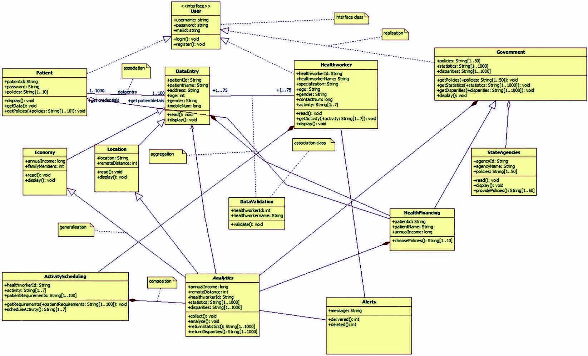

# Chapter 25: Design of UML Diagrams for EQUIHEALTH

> **Book**: *UML Diagramming: A Case Study Approach* by Dr. Suriya Sundaramoorthy (CRC Press, 2022)  
> **Pages**: 265–278 (Total: 14 pages)  
> **Classification**: Industrial Case Study & UML Modeling Suite  
> **Navigation**: [&larr; Chapter_24_Design_of_UML_Diagrams_for_Online_Pharmacy_Management_System](Chapter_24_Design_of_UML_Diagrams_for_Online_Pharmacy_Management_System.md) | [📚 Book Index](../UML_Book.md) | [Chapter_26_Design_of_UML_Diagrams_for_an_OTT_Based_System_MINI_REEL &rarr;](Chapter_26_Design_of_UML_Diagrams_for_an_OTT_Based_System_MINI_REEL.md)

---

## 📌 Executive Summary

Chapter 25 presents an end-to-end software engineering case study for the **Design of UML Diagrams for EQUIHEALTH**. This chapter demonstrates how business requirements and domain constraints are translated into formal architectural specifications through data-flow modeling and a complete suite of Unified Modeling Language (UML) structural and behavioral models.

The case study analyzes the system from multiple architectural perspectives: identifying external user and service actors, formalizing core operational capabilities, detailing procedural business workflows, specifying domain entity schemas, and architecting modular component deployment across distributed physical infrastructure.

---

## 🎯 Problem Statement & Business Context

### 📋 Executive Summary & Problem Breakdown
- **Core Problem**: Poor communities and rural families suffer from severe healthcare disparities, lacking money for specialists and missing out on government health grants.
- **Business Context**: Social welfare organizations and health departments need a platform to identify underserved regions and deliver targeted public healthcare.
- **Key Solution**: Maps health disparities across rural districts, connects underprivileged patients with subsidized medical camps, and assists families in applying for state health subsidies.

### 📖 Authentic Problem Description (with Key Diagram Drivers Highlighted)

> *Below is the complete authentic problem statement from the case study specification. The **bold highlighted sentences** denote explicit functional requirements, actors, entities, and workflows that directly drove the creation of the UML diagrams:*

**This case study mainly focusses on developing an application to address the health disparities among the various classes of patients and the appropriate medical interventions in order to achieve health equity for every individual.** **The target users of the application are patients, caretakers, healthcare providers, medical professionals and government officials.** **One of the main functionalities of the system is a patient classification based on social determinants such as economic backgrounds, health insurance amount received, medical allowances, demographics, age, type of disability and hereditary health information.** **It has to be ensured that appropriate treatment is administered for the people of all categories in an equitable manner.** **The patient should be able to feed health details into the application that will be corroborated by the details furnished by the healthcare providers and the patient’s public health records.** **Another important functionality is to notify the patients about the relevant medical events and health schemes available based on the system’s categorization of the patient’s data.** **The system also must provide personal health-tracking facilities for the patients by means of assessing the patients’ individual medical records.** **The next function is to enable the healthcare providers such as hospitals and clinics to plan and schedule health worker activity based on the patient’s need.** **Consequently, the application should make available the analysis of these data to the government, thereby assisting in the implementation of significant intervention schemes to offer medical facilities without any conflicts and eliminate the health discrepancies.** **Thus, with a holistic approach, the application should allow patients to register and upload social and medical data which get classified based on criteria that are then used by the healthcare providers and governments to extend healthcare to all individuals without any disparities.** **Functionalities: ◾ Registration: The users of the application are registered with unique credentials and categorized as patients, health workers or a government authority. ◾ Login: The login section is for the users to login to the application using the unique credentials provided during the registration phase. ◾ Logout: The logout option is included in the user’s user interface enabling the user to log out of the application at any time the user wants to. ◾ Data Entry: A section to enter all the medical details as well as the various social and economic details including unique identification details for the patient user and registered identification details for the health workers. ◾ Validation of Medical Data: The details entered by the patient will be corroborated by the details furnished by the respective hospital medical records of the patients. ◾ Patient Dashboard: A catered dashboard for every patient user with articles relating to the patient’s present medical conditions and the possible ailments that the patient may be prone to, obtained by analysis of the patient’s medical records.** **It also incorporates a search bar to search for specific articles relating to a medical term. ◾ Health Worker Dashboard: A dashboard for every health worker belonging to every registered medical institution that provides informative articles pertaining to the worker’s area of specialization. ◾ Health Tracking: A section that provides a health-tracking facility by means of detailed analytics of the patient’s individual health records furnished by the patient as well as the healthcare establishments from where the patient receives active treatment.** **This section also has provisions to synchronize the data from other health monitoring applications in the user’s device and include them for health tracking. ◾ Alerts: Alerts are scheduled for all the users and dispatched to the patients whenever an activity is due such as a health checkup or a medical camp and dispatched to the health workers to catch up on a scheduled activity. ◾ Activity Scheduling: Activities of the health workers are scheduled according to the analysed requirements of the patients based on various medical and social factors and the progress of these planned activities can be tracked. ◾ Analytics: All the exhaustive data that goes into the application is analysed for patterns of medical disparities based on family and community issues and socio-economic determinants and a holistic report of this data is presented in the dashboard accessible to the authorized government authority to be used to bring about the appropriate health interventions. ◾ Health Financing: Using the application’s analytics data, the government should be able to implement substantial schemes to bring forth health equity for all the affected individuals by initiating health financing schemes with various state-level agencies through an authorized section in the application (Figures 25.1–25.12).**

> 🔑 **Key Diagram Drivers Derived from Highlighted Requirements**:
> - **Primary & External Actors**: `Patient`, `Caregiver`, `Online Doctor`, `Hospital Admin`, `Pharmacist` *(Derived from user roles explicitly named above)*
> - **Core Functional Use Cases**: `Activity Scheduling`, `Alerts`, `Analytics`, `Data Entry`, `Government Dashboard`, `Health Financing` *(Derived from functional capabilities and actions stated above)*
> - **Domain Entities & Data Stores**: `PatientRecord`, `Appointment`, `Prescription`, `Medicine`, `InsuranceScheme`, `Bill` *(Derived from persistent records and items stated above)*
> - **Deployment & Runtime Boundaries**: `Web Portal`, `Mobile Health App`, `Payment Gateway`, `Ambulance Dispatch API` *(Derived from operational touchpoints like web portals, mobile apps, or physical counters)*

---

## ⚙️ System Architecture & Functional Capabilities

The **Design of UML Diagrams for EQUIHEALTH** decomposes business operations into modular functional units. These capabilities address the operational bottlenecks of manual and legacy workflows by introducing automated, role-based, and auditable software processes:

- **Activity Scheduling**: This usecase is used to schedule activity for the health workers on the basis of the analyzed information in order to remove disparities’.
- **Alerts**: Alerts are scheduled for all the users and dispatched to the patients whenever an activity is due such as a health checkup or a medical camp and dispatched to the health workers to catch up on a scheduled activity.
- **Analytics**: All the exhaustive data that goes into the application is analyzed for patterns of medical disparities based on family and community issues and socio-economic determinants.
- **Data Entry**: A section to enter all the medical details as well as the various social and economic details including unique identification details for the patient user and for registered identification details for the health workers.
- **Government Dashboard**: A holistic report of the analyzed data is presented in the dashboard accessible to the authorized government authority to be used to bring about the appropriate health interventions.
- **Health Financing**: Using the application’s analytics data, the government should be able to implement substantial schemes to bring forth health equity for all the affected individuals by initiating health financing schemes with various state-level agencies through an authorized section in the application.
- **Health Tracking**: A section that provides a health-tracking facility by means of detailed analytics of the patient’s individual health records furnished by the patient as well as the healthcare establishments from where the patient receives active treatment.
- **Health Worker Dashboard**: A dashboard for every health worker belonging to every registered medical institution that provides informative articles pertaining to the worker’s area of specialization.
- **Login**: The login section is for the users to login to the application using the unique credentials provided during the registration phase.
- **Logout**: The logout option is included in the user’s user interface enabling the user to log out of the application at any time the user wants to.
- **Patient Dashboard**: A catered dashboard for every patient user with articles relating to the patient’s present medical conditions and the possible ailments that the patient may be prone to, obtained by analysis of the patient’s medical records.
- **Registration**: The users of the application are registered with unique credentials and categorized as patients, health workers or a government authority.
- **Validation of Medical Data**: The details entered by the patient will be corroborated by the details furnished by the respective hospital medical records of the patients.
- **Economy-based**: This usecase is used to do a deep data analysis based on the economic data provided by the user.
- **History-based**: This usecase analyses data based on the medical history of the patient.
- **Location-based**: This usescase analyses the data based on the geographical location of the patients.
- **Records-based**: This usescase analyses the data based on the present medical data of the patients.

---

## 📊 Complete UML Diagram Suite & Architectural Walkthrough

This chapter incorporates **13 crystal-clear, high-resolution diagram(s)** (extracted losslessly from the source edition at up to 2,000+ px) illustrating the end-to-end design from functional use cases to physical hardware deployment:

### Figure 25.1: System Architecture

**Diagram Category**: `Architectural Figure`  
**Architectural Role**: Structural schematic detailing domain requirements and workflow transitions.

**System Design Analysis**:
Structural architectural schematic detailing operational flow and functional requirements in **Design of UML Diagrams for EQUIHEALTH**.

#### 🔍 Component Derivation from Problem Requirements

- **Architectural Units & Module Selection**:
  - Decomposed **EQUIHEALTH** into structural modules and interface layers directly supporting the business requirements (`Activity Scheduling`, `Alerts`, `Analytics`, `Data Entry`, `Government Dashboard`, `Health Financing`).
  - Identified data origins, processing checkpoints, and terminal delivery interfaces.
- **Interface Pathways & Control Logic**:
  - Established operational connection pathways linking human operator touchpoints to backend compute services and persistent data repositories.
  - Defined explicit data contracts and protocol boundaries ensuring reliable inter-module communication.

#### 🛠️ Step-by-Step Construction Guide

1. **Establish Diagram Purpose & System Boundary**:
   - Define the architectural scope and structural boundaries for **EQUIHEALTH**, identifying all interacting internal and external modules.
2. **Identify Primary System Entities & Structural Units**:
   - Lay out primary subsystems, data structures, controllers, and workflow pipelines required to fulfill the illustrated architectural role.
3. **Map Control & Information Transfer Flows**:
   - Draw directional connection lines between entities, specifying whether the interaction is synchronous, event-driven, or batch-processed.
4. **Apply Architectural Rules & Guard Constraints**:
   - Label transitions, data contracts, and operational states with explicit conditions, protocol types, and operational invariants.
5. **Validate Architectural Cohesion & Traceability**:
   - Cross-reference the diagram against system functional specifications to confirm complete coverage, clear modular decoupling, and robust failure handling.

### Figure 25.2: DFD Level 0

**Diagram Category**: `Data Flow Diagram (DFD)`  
**Architectural Role**: Models external entity inputs, core transformation processes, and data store read/write interactions.

**System Design Analysis**:
Represents data transformations and movement in **Design of UML Diagrams for EQUIHEALTH**. Details data origins from external actors, functional processing steps, and persistence interactions with data stores without imposing strict control flow, providing an accessible high-level systems analysis perspective.

#### 🔍 Component Derivation from Problem Requirements

- **External Entities & Process Selection**:
  - **External Terminators**: Mapped `Patient / Caregiver` and `Doctor / Diagnostic Lab / Ambulance Service` as peripheral entities that input raw business data or receive processed reports.
  - **Processes**: Formulated transformation bubbles representing algorithmic data processing steps (e.g., validation, calculation, update) derived from domain capabilities (`Activity Scheduling`, `Alerts`, `Analytics`, `Data Entry`, `Government Dashboard`, `Health Financing`).
- **Data Stores & Information Flows**:
  - **Data Stores (`D1`, `D2`)**: Defined persistence boundaries for storing accounts, transaction logs, and operational catalog data.
  - **Directional Flows**: Labeled directed arrows with substantive nouns (not verbs) representing data packets in transit.

#### 🛠️ Step-by-Step Construction Guide

1. **Identify External Entities (Terminators)**:
   - Draw rectangular boxes on the periphery representing external users, devices, or third-party organizations that supply data or receive outputs.
2. **Define Transformation Processes**:
   - Draw numbered circular or rounded process bubbles (`0` for Level 0 Context Diagram, `1.0`, `2.0`, `3.0` for Level 1 DFD) that perform data transformations.
3. **Identify & Model Persistent Data Stores**:
   - Draw parallel horizontal open-ended bars labeled `D1: StoreName`, `D2: ...` representing internal persistent database tables or file storage systems.
4. **Trace Directional Data Flows**:
   - Connect entities, processes, and stores using directed arrows labeled with descriptive noun phrases (e.g., `User Credentials`, `Order Details`, `Verification Token`).
5. **Verify Data Conservation & Flow Balancing**:
   - Check for conservation of data: ensure no "black-hole" processes (inputs with zero outputs) and no "miracle" processes (outputs with zero inputs).
   - Verify that data inputs and outputs balance perfectly across hierarchical DFD levels.

### Figure 25.3: DFD Level 1

**Diagram Category**: `Data Flow Diagram (DFD)`  
**Architectural Role**: Models external entity inputs, core transformation processes, and data store read/write interactions.

**System Design Analysis**:
Represents data transformations and movement in **Design of UML Diagrams for EQUIHEALTH**. Details data origins from external actors, functional processing steps, and persistence interactions with data stores without imposing strict control flow, providing an accessible high-level systems analysis perspective.

#### 🔍 Component Derivation from Problem Requirements

- **External Entities & Process Selection**:
  - **External Terminators**: Mapped `Patient / Caregiver` and `Doctor / Diagnostic Lab / Ambulance Service` as peripheral entities that input raw business data or receive processed reports.
  - **Processes**: Formulated transformation bubbles representing algorithmic data processing steps (e.g., validation, calculation, update) derived from domain capabilities (`Activity Scheduling`, `Alerts`, `Analytics`, `Data Entry`, `Government Dashboard`, `Health Financing`).
- **Data Stores & Information Flows**:
  - **Data Stores (`D1`, `D2`)**: Defined persistence boundaries for storing accounts, transaction logs, and operational catalog data.
  - **Directional Flows**: Labeled directed arrows with substantive nouns (not verbs) representing data packets in transit.

#### 🛠️ Step-by-Step Construction Guide

1. **Identify External Entities (Terminators)**:
   - Draw rectangular boxes on the periphery representing external users, devices, or third-party organizations that supply data or receive outputs.
2. **Define Transformation Processes**:
   - Draw numbered circular or rounded process bubbles (`0` for Level 0 Context Diagram, `1.0`, `2.0`, `3.0` for Level 1 DFD) that perform data transformations.
3. **Identify & Model Persistent Data Stores**:
   - Draw parallel horizontal open-ended bars labeled `D1: StoreName`, `D2: ...` representing internal persistent database tables or file storage systems.
4. **Trace Directional Data Flows**:
   - Connect entities, processes, and stores using directed arrows labeled with descriptive noun phrases (e.g., `User Credentials`, `Order Details`, `Verification Token`).
5. **Verify Data Conservation & Flow Balancing**:
   - Check for conservation of data: ensure no "black-hole" processes (inputs with zero outputs) and no "miracle" processes (outputs with zero inputs).
   - Verify that data inputs and outputs balance perfectly across hierarchical DFD levels.

### Figure 25.4: UML Usecase Diagram

**Diagram Category**: `Use Case Diagram`  
**Architectural Role**: Specifies system boundary, primary external actors, and business use cases with include/extend relationships.

**System Design Analysis**:
Illustrates the functional boundary of the **Design of UML Diagrams for EQUIHEALTH**. External actors trigger core use cases, demonstrating how business transactions, authorization checkpoints, and service requests flow into the system. Relationships (`<<include>>` for mandatory sub-routines like authentication and validation, and `<<extend>>` for optional or conditional exception branches) formalize the system's external functional contract.

#### 🔍 Component Derivation from Problem Requirements

- **Actors Selection (Why they are chosen)**:
  - **Primary Actor (`Patient / Caregiver`)**: Derived from the problem statement as the core user who directly experiences operational pain points and initiates service requests (e.g., self-service tasks, browsing, and transacting).
  - **Secondary Supporting Actor (`Doctor / Diagnostic Lab / Ambulance Service`)**: Extracted as the external authority or service partner required to fulfill requests (e.g., financial settlements, identity verifications, or physical fulfillment).
  - **Administrative Actor (`Hospital Admin / Pharmacist`)**: Required by governance rules to oversee security, manage backend configurations, and monitor operational compliance.
- **Use Cases Selection (Why these functions exist)**:
  - High-priority functional requirements (`Activity Scheduling`, `Alerts`, `Analytics`, `Data Entry`, `Government Dashboard`, `Health Financing`) were converted into core use cases inside the system boundary to directly satisfy user business goals.
  - Each use case corresponds directly to a distinct business capability needed to eliminate manual delays, paperwork, or operational bottlenecks.
- **Relationships & Dependency Rationale**:
  - **Associations**: Direct solid lines link `Patient / Caregiver` to primary operational use cases, establishing who has authorization to trigger each transaction.
  - **`<<include>>` Dependencies**: Factored out mandatory sub-routines (such as `Login / Authenticate`, `Verify Eligibility`, and `Process Payment`) that must execute unconditionally during transactions to guarantee security and data consistency.
  - **`<<extend>>` Dependencies**: Attached optional or conditional paths (such as `Apply Promotional Discount`, `Trigger Emergency Escalation`, or `Cancel Request`) that execute only when specific business guard conditions are satisfied.

#### 🛠️ Step-by-Step Construction Guide

1. **Define System Boundary & Scope**:
   - Draw an outer rectangular boundary box representing **EQUIHEALTH**.
   - Ensure external actors remain outside the boundary while all functional capabilities reside inside.
2. **Identify Primary & Secondary External Actors**:
   - Place `Patient / Caregiver` on the left side of the boundary to initiate business interactions.
   - Position `Doctor / Diagnostic Lab / Ambulance Service` and `Hospital Admin / Pharmacist` on the right side as secondary or administrative actors.
3. **Identify & Model Business Use Cases**:
   - Draw horizontal ellipses inside the boundary representing key operational goals (`Activity Scheduling`, `Alerts`, `Analytics`, `Data Entry`, `Government Dashboard`, `Health Financing`).
   - Name each use case with an active verb-noun phrase.
4. **Establish Relationships & Stereotypes (`<<include>>`, `<<extend>>`)**:
   - Connect actors to relevant use cases using solid, unarrowed association lines.
   - Use dashed arrows labeled `<<include>>` directed toward mandatory shared sub-routines (e.g., authentication, data validation).
   - Use dashed arrows labeled `<<extend>>` directed from optional or conditional extension workflows toward base use cases.
5. **Verify Completeness & Cross-Check Requirements**:
   - Trace every functional requirement from the problem specification to confirm complete coverage without disconnected use cases.

### Figure 25.5: UML Activity Diagram Part 1

**Diagram Category**: `Activity Diagram`  
**Architectural Role**: Illustrates dynamic procedural workflow, decision branching, concurrent action forks, and synchronization joins.

**System Design Analysis**:
Details the step-by-step procedural execution flow for core operations in **Design of UML Diagrams for EQUIHEALTH**. Begins at an initial state, navigates action states, evaluates guard conditions at decision diamonds, and models parallel execution branches using fork and join synchronizations before reaching the terminal state, ensuring business workflows are deterministic and free of race conditions.

#### 🔍 Component Derivation from Problem Requirements

- **Workflow Actions Selection**:
  - Derived step-by-step action states directly from the chronological steps required to complete Activity Scheduling.
  - Modeled each human action (e.g., entering data, confirming selection) and automated system action (e.g., validating rules, computing totals, updating records) as discrete rounded rectangles.
- **Swimlanes & Responsibility Partitioning**:
  - Partitioned the workflow across swimlanes representing `Patient / Caregiver`, the Application Controller, and `Doctor / Diagnostic Lab / Ambulance Service`/Database.
  - Visualizes exactly where operational responsibility transfers across architectural boundaries.
- **Decisions, Guards & Concurrent Forks**:
  - **Decision Diamonds**: Inserted wherever business logic requires verification (e.g., `[Valid Credentials]`, `[Stock Available]`, `[Payment Approved]`), ensuring explicit error handling paths.
  - **Synchronization Bars (Fork/Join)**: Utilized where parallel background tasks (e.g., sending an alert while updating audit logs) occur simultaneously without blocking user execution.

#### 🛠️ Step-by-Step Construction Guide

1. **Establish Initial Node & Execution Swimlanes**:
   - Start the workflow with a solid black circle (Initial Node) representing the trigger event in **EQUIHEALTH**.
   - Organize participating roles and subsystems into vertical or horizontal swimlanes to establish organizational accountability.
2. **Plot Sequential Action & State Steps**:
   - Draw rounded rectangles for each discrete functional task in chronological order.
   - Connect sequential actions with directed control flow arrows indicating the progression of execution.
3. **Incorporate Decision & Branching Diamonds**:
   - Place diamond decision nodes where the business logic branches based on conditions.
   - Label outgoing paths with explicit boolean guard conditions in brackets (e.g., `[Valid Input]` vs `[Invalid Input]`).
4. **Model Concurrency with Fork & Join Bars**:
   - Use solid horizontal or vertical synchronization bars (Forks) to divide a single flow into simultaneous parallel operations.
   - Pair each Fork with a corresponding Join bar to synchronize parallel tasks before advancing to subsequent stages.
5. **Terminate Flow at Final State Nodes**:
   - Guide successful workflow branches to an encircled solid black dot (Activity Final Node).
   - Use flow final nodes (circle with an X) to terminate individual canceled sub-branches without stopping the entire workflow.

### Figure 25.6: UML Activity Diagram Part 2

**Diagram Category**: `Activity Diagram`  
**Architectural Role**: Illustrates dynamic procedural workflow, decision branching, concurrent action forks, and synchronization joins.

**System Design Analysis**:
Details the step-by-step procedural execution flow for core operations in **Design of UML Diagrams for EQUIHEALTH**. Begins at an initial state, navigates action states, evaluates guard conditions at decision diamonds, and models parallel execution branches using fork and join synchronizations before reaching the terminal state, ensuring business workflows are deterministic and free of race conditions.

#### 🔍 Component Derivation from Problem Requirements

- **Workflow Actions Selection**:
  - Derived step-by-step action states directly from the chronological steps required to complete Activity Scheduling.
  - Modeled each human action (e.g., entering data, confirming selection) and automated system action (e.g., validating rules, computing totals, updating records) as discrete rounded rectangles.
- **Swimlanes & Responsibility Partitioning**:
  - Partitioned the workflow across swimlanes representing `Patient / Caregiver`, the Application Controller, and `Doctor / Diagnostic Lab / Ambulance Service`/Database.
  - Visualizes exactly where operational responsibility transfers across architectural boundaries.
- **Decisions, Guards & Concurrent Forks**:
  - **Decision Diamonds**: Inserted wherever business logic requires verification (e.g., `[Valid Credentials]`, `[Stock Available]`, `[Payment Approved]`), ensuring explicit error handling paths.
  - **Synchronization Bars (Fork/Join)**: Utilized where parallel background tasks (e.g., sending an alert while updating audit logs) occur simultaneously without blocking user execution.

#### 🛠️ Step-by-Step Construction Guide

1. **Establish Initial Node & Execution Swimlanes**:
   - Start the workflow with a solid black circle (Initial Node) representing the trigger event in **EQUIHEALTH**.
   - Organize participating roles and subsystems into vertical or horizontal swimlanes to establish organizational accountability.
2. **Plot Sequential Action & State Steps**:
   - Draw rounded rectangles for each discrete functional task in chronological order.
   - Connect sequential actions with directed control flow arrows indicating the progression of execution.
3. **Incorporate Decision & Branching Diamonds**:
   - Place diamond decision nodes where the business logic branches based on conditions.
   - Label outgoing paths with explicit boolean guard conditions in brackets (e.g., `[Valid Input]` vs `[Invalid Input]`).
4. **Model Concurrency with Fork & Join Bars**:
   - Use solid horizontal or vertical synchronization bars (Forks) to divide a single flow into simultaneous parallel operations.
   - Pair each Fork with a corresponding Join bar to synchronize parallel tasks before advancing to subsequent stages.
5. **Terminate Flow at Final State Nodes**:
   - Guide successful workflow branches to an encircled solid black dot (Activity Final Node).
   - Use flow final nodes (circle with an X) to terminate individual canceled sub-branches without stopping the entire workflow.

### Figure 25.7: UML Sequence Diagram

**Diagram Category**: `Sequence Diagram`  
**Architectural Role**: Details chronological object interactions, synchronous message exchanges, return flows, and activation lifelines.

**System Design Analysis**:
Traces the time-ordered message sequence between participating objects and services in **Design of UML Diagrams for EQUIHEALTH**. Vertical dashed lifelines represent entity instances across time, while horizontal solid and dashed arrows show synchronous invocations, data lookups, and return values. Activation bars delineate execution duration, clarifying object collaboration during key transactional workflows.

#### 🔍 Component Derivation from Problem Requirements

- **Participating Lifelines Selection**:
  - Selected key participants along the communication path: `Patient / Caregiver` (initiator), Boundary Controller (API/UI), Business Service Layer, and the Persistent Database / `Doctor / Diagnostic Lab / Ambulance Service`.
  - Ensures full horizontal separation between user interaction, application logic, and backend data storage.
- **Message Invocations & Temporal Sequence**:
  - Derived sequential message flows from the transaction lifecycle: initialization -> validation -> business calculation -> persistence -> return response.
  - Uses solid arrows with filled heads for synchronous calls where the caller waits for a response before proceeding.
- **Return Payloads & Conditional Fragments**:
  - **Dashed Return Arrows**: Modeled data payloads and status confirmations returned to the caller to maintain state awareness.
  - **`alt` Combined Fragments**: Partitioned if-else execution paths (e.g., success vs. validation error) with explicit boolean guard conditions.

#### 🛠️ Step-by-Step Construction Guide

1. **Arrange Participating Lifelines Horizontally**:
   - Position `Patient / Caregiver`, boundary controllers, service managers, and persistence models horizontally across the top.
   - Drop vertical dashed lines (lifelines) downward from each participant to represent the passage of time from top to bottom.
2. **Overlay Activation Focus Bars**:
   - Place thin vertical rectangular boxes on lifelines to indicate active execution periods where an object is processing instructions.
3. **Model Synchronous & Asynchronous Invocations**:
   - Draw solid horizontal arrows with filled triangular arrowheads for synchronous method calls (e.g., `validateRequest()`).
   - Draw open arrowheads for asynchronous events or non-blocking notification dispatches.
4. **Represent Return Messages & Reply Payloads**:
   - Draw dashed horizontal lines with open arrowheads pointing back to the calling lifeline to model return data or acknowledgment signals.
   - Label return lines with explicit payload descriptions (e.g., `statusConfirmation: Boolean`).
5. **Structure Logic with Combined Interaction Fragments**:
   - Enclose conditional logic within an `alt` fragment box partitioned into alternative execution compartments with bracketed guard expressions.
   - Utilize `opt` frames for optional branches and `loop` frames for iterative business operations.

### Figure 25.8: UML Collaboration Diagram

**Diagram Category**: `Communication Diagram`  
**Architectural Role**: Emphasizes structural object topology and numbered sequence messaging between collaborating entities.

**System Design Analysis**:
Emphasizes the spatial and structural organization of collaborating instances in **Design of UML Diagrams for EQUIHEALTH**. Shows object links overlaid with numbered messages (e.g., 1.0, 1.1, 2.0), illustrating both structural connectivity and invocation hierarchy, complementing the temporal perspective of the sequence diagram.

#### 🔍 Component Derivation from Problem Requirements

- **Collaborating Object Nodes Selection**:
  - Selected runtime instances of the core architectural entities required to complete the business scenario in **EQUIHEALTH**.
  - Emphasizes the structural network of communicating instances rather than chronological time progression.
- **Structural Links & Message Numbering**:
  - **Association Links**: Created direct communication links between objects that possess references to each other.
  - **Hierarchical Numbering (`1`, `1.1`, `2`)**: Formulated numbered message vectors along links to preserve the exact call-stack sequence and nested function invocations.

#### 🛠️ Step-by-Step Construction Guide

1. **Place Collaborating Object Nodes**:
   - Position key runtime instances of classes as rectangular nodes labeled `instanceName : ClassName` across the canvas for **EQUIHEALTH**.
   - Arrange objects to emphasize physical structural connections and organizational proximity.
2. **Draw Structural Association Links**:
   - Connect communicating objects with solid undirected lines representing communication paths and active object references.
3. **Overlay Directional Message Vectors**:
   - Place directional arrows alongside the association links pointing from caller to receiver.
4. **Apply Hierarchical Decimal Sequence Numbering**:
   - Number each message sequentially using decimal nesting (e.g., `1: initiateRequest()`, `1.1: verifyParameters()`, `1.2: queryDatabase()`, `2: returnStatus()`).
   - Use hierarchical numbers to clearly convey the nested call stack and execution chronology without a vertical time axis.
5. **Validate Link Topology & Message Continuity**:
   - Verify that all collaborating objects participate in valid message exchange paths and that message signatures match class definitions.

### Figure 25.9: UML State Machine Diagram

**Diagram Category**: `State Machine Diagram`  
**Architectural Role**: Captures entity lifecycle states, transition triggers, event guards, and exit/entry actions.

**System Design Analysis**:
Models the complete lifecycle state transitions for central domain entities in **Design of UML Diagrams for EQUIHEALTH**. Tracks transitions from initial creation through intermediate processing states to completion or cancellation. Explicit state triggers, guard expressions `[condition]`, and entry/exit actions guarantee valid business lifecycle states and eliminate invalid operational state jumps.

#### 🔍 Component Derivation from Problem Requirements

- **Entity & Lifecycle States Selection**:
  - Selected the central transactional entity in **EQUIHEALTH** whose lifecycle undergoes critical state changes.
  - Derived distinct operational states (e.g., `Created`, `PendingApproval`, `Active / InProgress`, `Completed`, `Cancelled`) from domain business rules.
- **State Transitions, Triggers & Guard Rules**:
  - Identified the exact events (e.g., `submit()`, `verify()`, `processPayment()`, `cancel()`) that trigger transitions between states.
  - Formulated transition syntax: `Event [GuardCondition] / ActionEffect` to prevent invalid state jumps and enforce business integrity.

#### 🛠️ Step-by-Step Construction Guide

1. **Identify the Initial Pseudostate**:
   - Begin with a solid black circle (Initial State) marking the creation or activation trigger of the target entity in **EQUIHEALTH**.
2. **Define Distinct Operational States**:
   - Draw rounded rectangles representing every discrete state the entity can assume during its lifecycle (e.g., `Created`, `Pending`, `Processing`, `Completed`, `Failed`).
   - Add internal behavior compartments for `entry /`, `do /`, and `exit /` action routines where applicable.
3. **Map State Transitions & Triggers**:
   - Connect states using directed transition arrows indicating valid status changes.
   - Label transitions using the formal UML format: `TriggerEvent [GuardCondition] / ActionEffect` (e.g., `confirmTransaction [balanceValid] / generateReceipt()`).
4. **Model Superstates & Substates (Hierarchical States)**:
   - Group related substates within an enclosing composite state rectangle when multiple states share common exit or exception transitions.
5. **Terminate at Final State Nodes**:
   - Direct all terminal lifecycle outcomes (successful fulfillment or terminal rejection) to an encircled black dot (Final State).

### Figure 25.10: UML Class Diagram

**Diagram Category**: `Class Diagram`  
**Architectural Role**: Models static structural classifiers, entity attributes, operations, and associations (composition, aggregation, inheritance).

**System Design Analysis**:
Captures the static structural domain model for **Design of UML Diagrams for EQUIHEALTH**. Defines primary entity classes, their private/public attributes, operational methods, and relationships. It enforces structural integrity through multiplicities, composition (strong lifecycle ownership of subsidiary records), aggregation, and inheritance hierarchies, forming the foundation for the relational database schema and domain entity classes.

#### 🔍 Component Derivation from Problem Requirements

- **Domain Classes & Classifiers Selection**:
  - **Entity Classes**: Extracted key nouns from the domain requirements to form core data models holding system state (e.g., `Patient`, `Transaction`, `Record`, `Item/Service`).
  - **Boundary & Controller Classes**: Introduced interface controllers (e.g., `ServiceController`, `SessionManager`) to decouple user presentation inputs from backend database persistence.
- **Attributes & Methods Selection**:
  - **Attributes**: Assigned explicit data types and access modifiers (private `-` for information hiding) to track business properties (e.g., unique IDs, statuses, monetary values, timestamps).
  - **Operations**: Converted domain capabilities (`Activity Scheduling`, `Alerts`, `Analytics`, `Data Entry`, `Government Dashboard`, `Health Financing`) into public (`+`) member methods equipped with validated parameters and deterministic return signatures.
- **Relationships & Multiplicities Rationale**:
  - **Composition (Solid Diamond)**: Applied to strong whole-part relationships where child entities cannot exist independently of their parent aggregate (e.g., an invoice strictly owns its line items).
  - **Aggregation (Hollow Diamond)**: Applied to shared associations where components exist independently in the business domain.
  - **Multiplicities**: Annotated with strict operational constraints (e.g., `1` user owns `0..*` transactions; each transaction maps to exactly `1` payment record) to maintain data integrity.

#### 🛠️ Step-by-Step Construction Guide

1. **Identify Domain Entities & Boundary Objects**:
   - Analyze requirements for **EQUIHEALTH** to extract core business entities, controllers, and data structures.
   - Represent each entity as a three-compartment rectangular classifier (Class Name, Attributes, Operations).
2. **Define Attributes with Visibility & Data Types**:
   - Populate the middle compartment with private (`-`), protected (`#`), or public (`+`) attributes.
   - Assign standardized data types (e.g., `- id: String`, `- status: Boolean`, `- createdAt: DateTime`).
3. **Specify Member Operations & Business Methods**:
   - Populate the bottom compartment with functions and interface methods that define class behavior.
   - Include parameter types and return signatures (e.g., `+ executeTransaction(amount: Float): Boolean`).
4. **Establish Structural Relationships & Multiplicities**:
   - Connect related classes using solid association lines annotated with numerical multiplicities (e.g., `1`, `0..*`, `1..*`).
   - Apply Composition (solid diamond) for lifecycle-dependent objects, and Aggregation (hollow diamond) for shared references.
   - Model inheritance hierarchies using Generalization (solid line with closed hollow triangular arrowhead).
5. **Validate Architecture & Reduce Coupling**:
   - Review class cohesion to verify single-responsibility principles across data access and business logic layers.
   - Ensure interfaces isolate clients from direct database dependencies.

### Figure 25.11: UML Component Diagram

**Diagram Category**: `Component Diagram`  
**Architectural Role**: Architects physical modular software components, provided ball interfaces, and required socket dependencies.

**System Design Analysis**:
Architects the modular software organization for **Design of UML Diagrams for EQUIHEALTH**. Illustrates autonomous subsystems, business logic controllers, database access layers, and external service adapters. Provided interfaces (ball notation) and required dependencies (socket notation) define clear service contracts, supporting high cohesion and loose coupling.

#### 🔍 Component Derivation from Problem Requirements

- **Modular Components Selection**:
  - Decomposed **EQUIHEALTH** into autonomous, reusable software units based on separation of concerns: User Interface Controller, Business Service Core, Persistence Engine, and External Integration Gateways.
  - Ensures each component encapsulates a specific domain capability (`Activity Scheduling`, `Alerts`, `Analytics`, `Data Entry`, `Government Dashboard`, `Health Financing`) without tight coupling.
- **Provided & Required Interfaces Selection**:
  - **Provided Interfaces (Ball)**: Defined public APIs and services exposed by components to serve consumer requests.
  - **Required Interfaces (Socket)**: Defined downstream dependencies, such as database connectors and third-party API contracts required for operation.

#### 🛠️ Step-by-Step Construction Guide

1. **Identify Autonomous Modular Units**:
   - Analyze **EQUIHEALTH** to identify independent deployable subsystems, microservices, databases, and third-party integrations.
   - Represent each unit as a rectangular component symbol adorned with the `<<component>>` stereotype or component icon tabs.
2. **Define Provided Interfaces (Ball / Lollipop Notation)**:
   - Attach solid circle "ball" connectors to components that provide public API endpoints, RPC interfaces, or query services to external callers.
3. **Define Required Interfaces (Socket Notation)**:
   - Attach semicircular "socket" connectors to components that depend on external services or client data contracts.
4. **Assemble Ball-and-Socket Connectors**:
   - Align matching ball and socket connectors to model direct architectural wiring, loose coupling, and dependency injection.
5. **Group into Architectural Subsystems**:
   - Enclose related components inside package boundaries (e.g., Presentation Layer, Business Core, Data Storage) to enforce clean layer isolation.

### Figure 25.12: UML Deployment Diagram

**Diagram Category**: `Deployment Diagram`  
**Architectural Role**: Maps software execution artifacts to hardware computing nodes, client devices, application tiers, and database servers.

**System Design Analysis**:
Maps the physical runtime deployment architecture for **Design of UML Diagrams for EQUIHEALTH**. Depicts client hardware devices (web browsers, mobile apps), application servers, network firewalls, and persistence database nodes. Communication paths and execution environments reflect production infrastructure, scalability considerations, and network security boundaries.

#### 🔍 Component Derivation from Problem Requirements

- **Hardware Nodes & Infrastructure Selection**:
  - Derived execution nodes from physical hosting requirements: Client Devices (Smartphones/Desktops), Web & Application Servers, and Database Clusters.
  - Isolates public-facing presentation endpoints from secure, internal database storage to comply with enterprise security standards.
- **Artifact Allocation & Communication Protocols**:
  - **Artifact Deployment**: Mapped executable binaries (`.jar`, `.war`, `.apk`, client web bundles) onto their corresponding execution environments.
  - **Protocol Selection**: Assigned standard secure networking protocols (`<<HTTPS/TLS>>`, `<<TCP/IP>>`, `<<JDBC>>`) based on data sensitivity and network boundaries.

#### 🛠️ Step-by-Step Construction Guide

1. **Identify Physical & Virtual Hardware Nodes**:
   - Draw 3D isometric box cubes representing physical host servers, cloud instances, client smartphones, and database clusters for **EQUIHEALTH**.
   - Label nodes with stereotypic descriptions (e.g., `<<device>>`, `<<database server>>`, `<<cloud container>>`).
2. **Specify Runtime Execution Environments**:
   - Nest runtime environments inside node cubes (e.g., `<<execution environment>> Web Browser`, `Docker Engine`, `JVM Runtime`).
3. **Assign Executable Artifacts to Nodes**:
   - Place software artifacts (rectangles with `<<artifact>>` stereotype, `.jar`, `.war`, `.apk`, `.sql`) inside their corresponding hosting execution environments.
4. **Draw Network Communication Paths & Protocols**:
   - Connect nodes using solid communication lines labeled with transport protocols and security stereotypes (e.g., `<<HTTPS/TLS>>`, `<<TCP/IP>>`, `<<JDBC>>`, `<<gRPC>>`).
5. **Verify High Availability & Security Boundaries**:
   - Ensure clear physical separation between public demilitarized zones (DMZ), application compute layers, and protected private database networks.

### Visual Artifacts & Supplementary Schematics

The following high-resolution schematics capture operational screen states, user dashboards, or notation components documented in this chapter:

#### Ch25 p278 img01

**Perspective**: `Conceptual Notation / Architecture Asset` — Supplemental conceptual illustration or notation reference from the source chapter.

---

## 💡 Key Architectural Invariants & Domain Lessons

1. **Requirement Traceability**: Every model in the **Design of UML Diagrams for EQUIHEALTH** suite traces directly to business requirements and operational constraints established in the problem statement.
2. **State & Workflow Integrity**: Dynamic activity and sequence models guarantee deterministic workflow completion, enforce transactional atomicity, and prevent deadlocks.
3. **Modular Encapsulation**: Component boundaries decouple domain business logic from presentation controllers and external integration adapters, supporting high maintainability.
4. **Operational Security & RBAC**: Strict role-based authorization guards sensitive operations across external actor boundaries and administrative lifelines.
5. **High-Fidelity Deployment**: Physical node topologies reflect real-world tiered infrastructure (DMZ, application cluster, isolated persistence layer), ensuring scalability and fault tolerance.

---

## 🔗 Related Resources & Navigation

- **Navigation**: [&larr; Chapter_24_Design_of_UML_Diagrams_for_Online_Pharmacy_Management_System](Chapter_24_Design_of_UML_Diagrams_for_Online_Pharmacy_Management_System.md) | [📚 Book Index](../UML_Book.md) | [Chapter_26_Design_of_UML_Diagrams_for_an_OTT_Based_System_MINI_REEL &rarr;](Chapter_26_Design_of_UML_Diagrams_for_an_OTT_Based_System_MINI_REEL.md)
- **Master Book Catalog**: [`UML_Book.md`](../UML_Book.md)
- **High-Resolution Images Archive**: [`images/`](../images/)