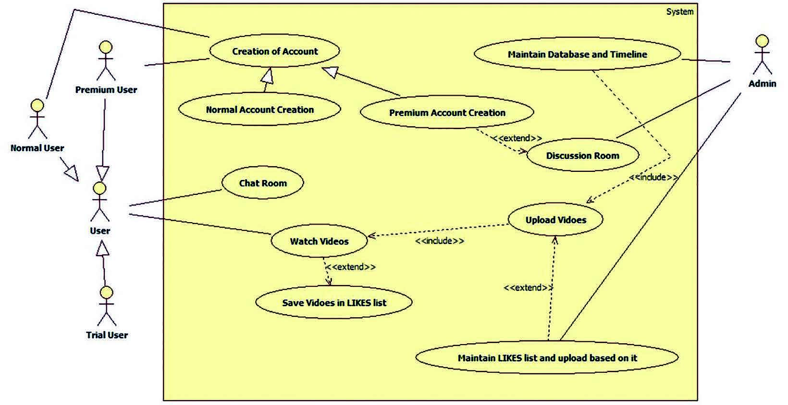
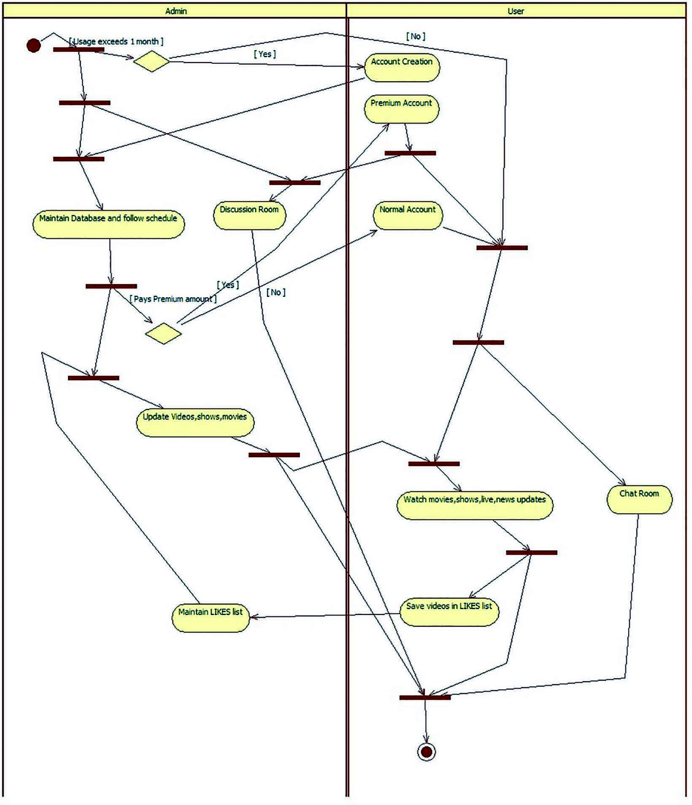
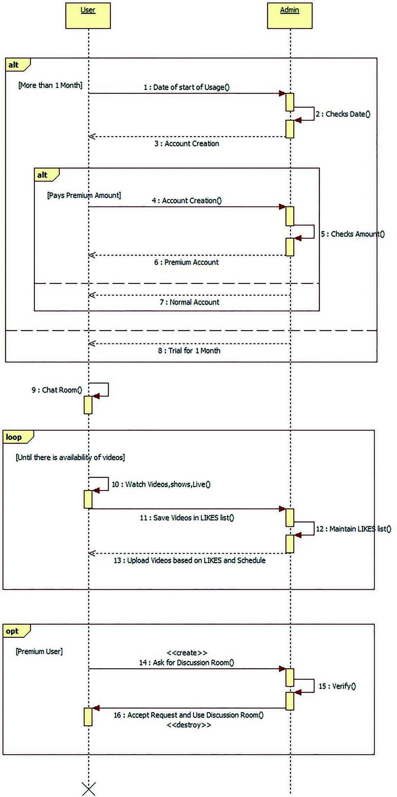
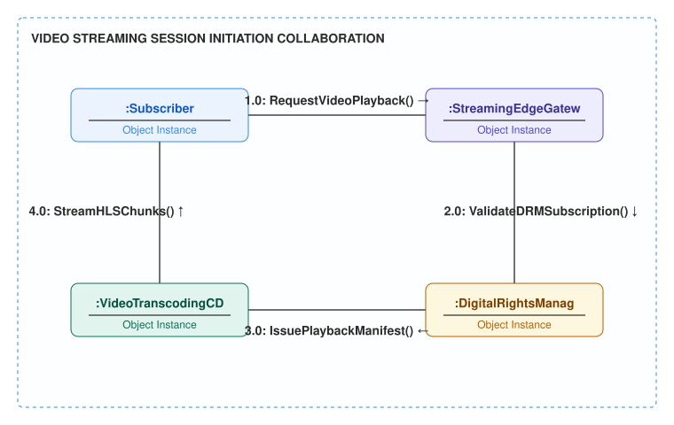
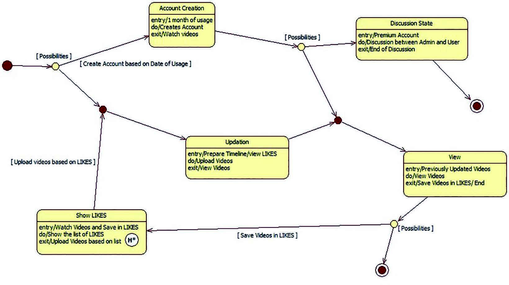
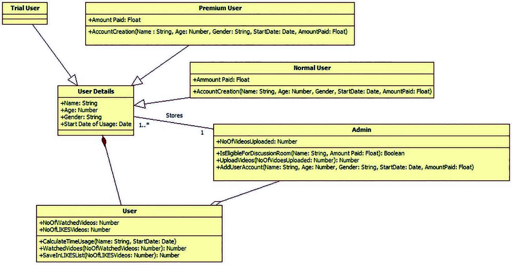
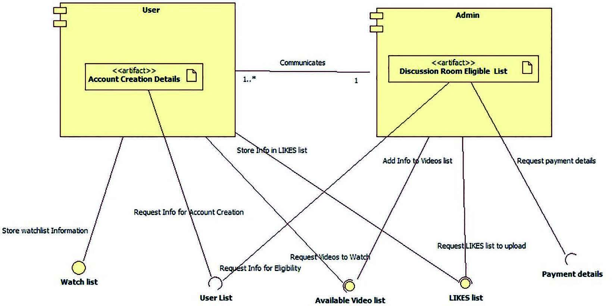
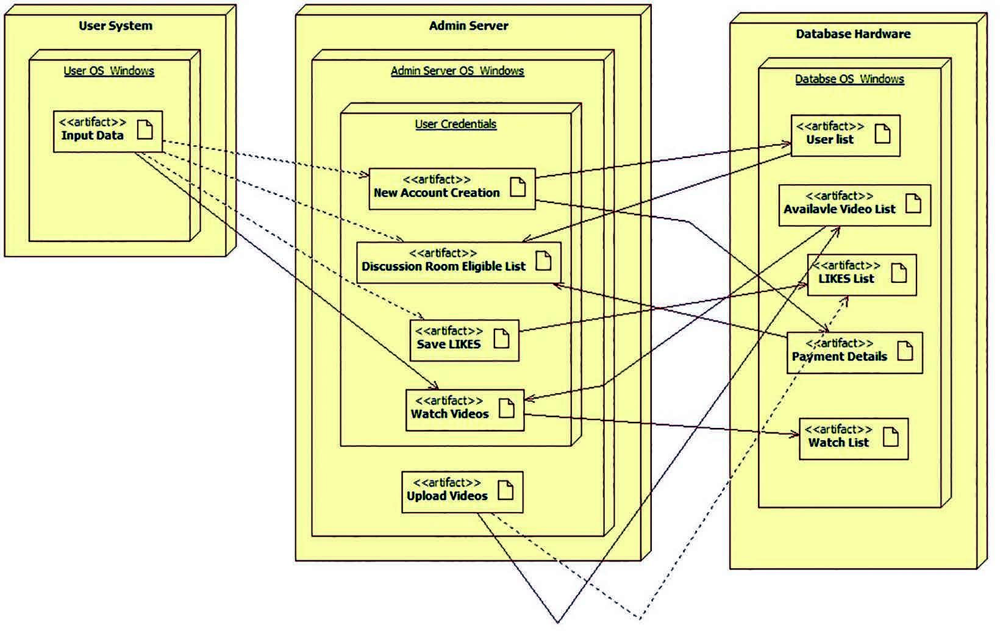

# Chapter 26: Design of UML Diagrams for an OTT Based System MINI REEL

> **Book**: *UML Diagramming: A Case Study Approach* by Dr. Suriya Sundaramoorthy (CRC Press, 2022)  
> **Pages**: 279–286 (Total: 8 pages)  
> **Classification**: Industrial Case Study & UML Modeling Suite  
> **Navigation**: [&larr; Chapter_25_Design_of_UML_Diagrams_for_EQUIHEALTH](Chapter_25_Design_of_UML_Diagrams_for_EQUIHEALTH.md) | [📚 Book Index](../UML_Book.md) | [Chapter_27_Design_of_UML_Diagrams_for_e_Med_Medical_Assistance_Tool &rarr;](Chapter_27_Design_of_UML_Diagrams_for_e_Med_Medical_Assistance_Tool.md)

---

## 📌 Executive Summary

Chapter 26 presents an end-to-end software engineering case study for the **Design of UML Diagrams for an OTT Based System MINI REEL**. This chapter demonstrates how business requirements and domain constraints are translated into formal architectural specifications through data-flow modeling and a complete suite of Unified Modeling Language (UML) structural and behavioral models.

The case study analyzes the system from multiple architectural perspectives: identifying external user and service actors, formalizing core operational capabilities, detailing procedural business workflows, specifying domain entity schemas, and architecting modular component deployment across distributed physical infrastructure.

---

## 🎯 Problem Statement & Business Context

An over-the-top (OTT) media service is a streaming media service offered directly to viewers via the internet. The OTT media can be streamed anywhere with just the use of an internet connection. The scope of this project lies in the maximised use of the internet by the current generation. The system aims at providing a fun-filled and informative services that they would be able to access easily from their place. This system includes streaming of shows and movies that could be viewed by the users and an administrator governing the updates in the OTT based on the schedule of the show or movie release. Users can have a trial package of the services offered for 1 month and further subscriptions are based on the amount paid categorised as normal users and premium users. Creating an account involves payment to the services provided. Hence the trial users could use the trial package for a month and create an account for them maintaining a secret password that makes their account safe from other people accessing it. The premium users have the privilege of providing suggestions of the shows in the discussion room. All the users should be provided with the facility of a chat room where the users can chat and express their views and comments. The administrator will have control over the shows broadcasted and maintain a proper timeline of the shows, movies and live shows. News feeds highlighting the recent updates in the world will also be available in MINIREELS in a brief format. Users can also add their favourite videos to LIKES list and watch them whenever needed (Figures 26.1–26.8).

---

## ⚙️ System Architecture & Functional Capabilities

The **Design of UML Diagrams for an OTT Based System MINI REEL** decomposes business operations into modular functional units. These capabilities address the operational bottlenecks of manual and legacy workflows by introducing automated, role-based, and auditable software processes:

- **Discussion Room**: A chat room where only premium users can provide suggestions or complaints to the administrator directly.
- **Creation of Account**: Normal and premium users create a account by paying a specified amount and enjoy the services.
- **Premium Account Creation**: Creates an account for premium users by paying an amount higher than the normal user.
- **Normal Account Creation**: Creates an account for normal users by paying a specified amount.
- **Chat Room**: A room where users can chat among themselves.
- **Save Videos in LIKES**: Save videos, shows or movies in LIKES list and can watch it later.

---

## 📊 Complete UML Diagram Suite & Architectural Walkthrough

This chapter incorporates **8 crystal-clear, high-resolution diagram(s)** (extracted losslessly from the source edition at up to 2,000+ px) illustrating the end-to-end design from functional use cases to physical hardware deployment:

### Figure 26.1: UML Usecase Diagram

**Diagram Category**: `Use Case Diagram`  
**Architectural Role**: Specifies system boundary, primary external actors, and business use cases with include/extend relationships.

**System Design Analysis**:
Illustrates the functional boundary of the **Design of UML Diagrams for an OTT Based System MINI REEL**. External actors trigger core use cases, demonstrating how business transactions, authorization checkpoints, and service requests flow into the system. Relationships (`<<include>>` for mandatory sub-routines like authentication and validation, and `<<extend>>` for optional or conditional exception branches) formalize the system's external functional contract.

### Figure 26.2: UML Activity Diagram

**Diagram Category**: `Activity Diagram`  
**Architectural Role**: Illustrates dynamic procedural workflow, decision branching, concurrent action forks, and synchronization joins.

**System Design Analysis**:
Details the step-by-step procedural execution flow for core operations in **Design of UML Diagrams for an OTT Based System MINI REEL**. Begins at an initial state, navigates action states, evaluates guard conditions at decision diamonds, and models parallel execution branches using fork and join synchronizations before reaching the terminal state, ensuring business workflows are deterministic and free of race conditions.

### Figure 26.3: UML Sequence Diagram

**Diagram Category**: `Sequence Diagram`  
**Architectural Role**: Details chronological object interactions, synchronous message exchanges, return flows, and activation lifelines.

**System Design Analysis**:
Traces the time-ordered message sequence between participating objects and services in **Design of UML Diagrams for an OTT Based System MINI REEL**. Vertical dashed lifelines represent entity instances across time, while horizontal solid and dashed arrows show synchronous invocations, data lookups, and return values. Activation bars delineate execution duration, clarifying object collaboration during key transactional workflows.

### Figure 26.4: UML Collaboration Diagram

**Diagram Category**: `Communication Diagram`  
**Architectural Role**: Emphasizes structural object topology and numbered sequence messaging between collaborating entities.

**System Design Analysis**:
Emphasizes the spatial and structural organization of collaborating instances in **Design of UML Diagrams for an OTT Based System MINI REEL**. Shows object links overlaid with numbered messages (e.g., 1.0, 1.1, 2.0), illustrating both structural connectivity and invocation hierarchy, complementing the temporal perspective of the sequence diagram.

### Figure 26.5: UML State Chart Diagram

**Diagram Category**: `State Machine Diagram`  
**Architectural Role**: Captures entity lifecycle states, transition triggers, event guards, and exit/entry actions.

**System Design Analysis**:
Models the complete lifecycle state transitions for central domain entities in **Design of UML Diagrams for an OTT Based System MINI REEL**. Tracks transitions from initial creation through intermediate processing states to completion or cancellation. Explicit state triggers, guard expressions `[condition]`, and entry/exit actions guarantee valid business lifecycle states and eliminate invalid operational state jumps.

### Figure 26.6: UML Class Diagram

**Diagram Category**: `Class Diagram`  
**Architectural Role**: Models static structural classifiers, entity attributes, operations, and associations (composition, aggregation, inheritance).

**System Design Analysis**:
Captures the static structural domain model for **Design of UML Diagrams for an OTT Based System MINI REEL**. Defines primary entity classes, their private/public attributes, operational methods, and relationships. It enforces structural integrity through multiplicities, composition (strong lifecycle ownership of subsidiary records), aggregation, and inheritance hierarchies, forming the foundation for the relational database schema and domain entity classes.

### Figure 26.7: UML Component Diagram

**Diagram Category**: `Component Diagram`  
**Architectural Role**: Architects physical modular software components, provided ball interfaces, and required socket dependencies.

**System Design Analysis**:
Architects the modular software organization for **Design of UML Diagrams for an OTT Based System MINI REEL**. Illustrates autonomous subsystems, business logic controllers, database access layers, and external service adapters. Provided interfaces (ball notation) and required dependencies (socket notation) define clear service contracts, supporting high cohesion and loose coupling.

### Figure 26.8: UML Deployment Diagram

**Diagram Category**: `Deployment Diagram`  
**Architectural Role**: Maps software execution artifacts to hardware computing nodes, client devices, application tiers, and database servers.

**System Design Analysis**:
Maps the physical runtime deployment architecture for **Design of UML Diagrams for an OTT Based System MINI REEL**. Depicts client hardware devices (web browsers, mobile apps), application servers, network firewalls, and persistence database nodes. Communication paths and execution environments reflect production infrastructure, scalability considerations, and network security boundaries.

---

## 💡 Key Architectural Invariants & Domain Lessons

1. **Requirement Traceability**: Every model in the **Design of UML Diagrams for an OTT Based System MINI REEL** suite traces directly to business requirements and operational constraints established in the problem statement.
2. **State & Workflow Integrity**: Dynamic activity and sequence models guarantee deterministic workflow completion, enforce transactional atomicity, and prevent deadlocks.
3. **Modular Encapsulation**: Component boundaries decouple domain business logic from presentation controllers and external integration adapters, supporting high maintainability.
4. **Operational Security & RBAC**: Strict role-based authorization guards sensitive operations across external actor boundaries and administrative lifelines.
5. **High-Fidelity Deployment**: Physical node topologies reflect real-world tiered infrastructure (DMZ, application cluster, isolated persistence layer), ensuring scalability and fault tolerance.

---

## 🔗 Related Resources & Navigation

- **Navigation**: [&larr; Chapter_25_Design_of_UML_Diagrams_for_EQUIHEALTH](Chapter_25_Design_of_UML_Diagrams_for_EQUIHEALTH.md) | [📚 Book Index](../UML_Book.md) | [Chapter_27_Design_of_UML_Diagrams_for_e_Med_Medical_Assistance_Tool &rarr;](Chapter_27_Design_of_UML_Diagrams_for_e_Med_Medical_Assistance_Tool.md)
- **Master Book Catalog**: [`UML_Book.md`](../UML_Book.md)
- **High-Resolution Images Archive**: [`images/`](../images/)