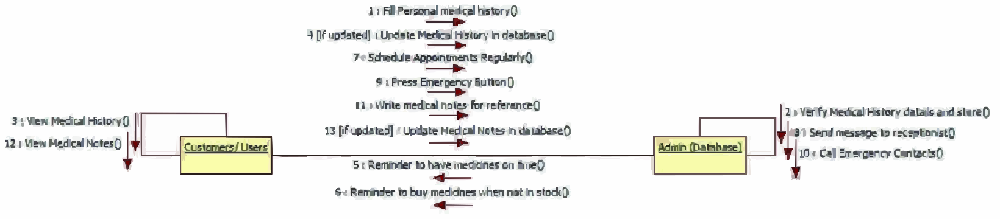

# Chapter 27: Design of UML Diagrams for e Med Medical Assistance Tool

> **Book**: *UML Diagramming: A Case Study Approach* by Dr. Suriya Sundaramoorthy (CRC Press, 2022)  
> **Pages**: 287–294 (Total: 8 pages)  
> **Classification**: Industrial Case Study & Diagram Suite  
> **Navigation**: [&larr; Chapter_26_Design_of_UML_Diagrams_for_an_OTT_Based_System_MINI_REEL](Chapter_26_Design_of_UML_Diagrams_for_an_OTT_Based_System_MINI_REEL.md) | [📚 Book Index](../UML_Book.md) | [Chapter_28_Design_of_UML_Diagrams_for_Diet_Care &rarr;](Chapter_28_Design_of_UML_Diagrams_for_Diet_Care.md)

---

## 📌 Executive Summary

Chapter 27 presents an industrial software engineering case study for **Design of UML Diagrams for e Med Medical Assistance Tool**. It details the transition from business requirements and domain constraints into formal software architecture specifications, leveraging data-flow modeling and a complete suite of Unified Modeling Language (UML) structural and behavioral diagrams.

---

## 🎯 Problem Statement & System Context

e-Med is your perfect medical friend. We often see our grandparents forgetting to take their medicines or getting tensed when they run out of medical supplies. In this fast-paced world with unhealthy lifestyles, a number of young people also have some medical issues. e-Med is a tool that helps keep track of and address all your personal medical needs. Once the data is fed regarding the schedule of intake of medicines, this tool will provide reminders for taking the medicines. It will also send notifications to restock the medicines. It is also programmed to schedule monthly or yearly appointments regularly with the family doctor. Another interesting feature of this tool is that during critical situations, pressing the emergency button will automatically contact your near and dear ones whose contacts are in your emergency contact list. The tool helps in keeping a record of your medical history such as your blood sugar levels, pressure levels, etc. by using the Medical Notes feature. e-Med is an indispensable tool for people of all ages with medical issues to help maintain a good health routine (Figures 27.1–27.8).

---

## 📊 Complete UML Diagram Suite & Architecture Specifications

This chapter incorporates **8 standalone vector diagram(s)** illustrating the end-to-end design from functional use cases to physical hardware deployment:

### Figure 27.1: UML Usecase Diagram

**Diagram Category**: `Use Case Diagram`  
**Architectural Role**: Specifies system boundary, primary external actors, and business use cases with include/extend relationships.

### Figure 27.2: UML Activity Diagram

**Diagram Category**: `Activity Diagram`  
**Architectural Role**: Illustrates dynamic procedural workflow, decision branching, concurrent action forks, and synchronization joins.

### Figure 27.3: UML Sequence Diagram

**Diagram Category**: `Sequence Diagram`  
**Architectural Role**: Details chronological object interactions, synchronous message exchanges, return flows, and activation lifelines.

### Figure 27.4: UML Collaboration Diagram

**Diagram Category**: `Communication Diagram`  
**Architectural Role**: Emphasizes structural object topology and numbered sequence messaging between collaborating entities.

### Figure 27.5: UML State Chart Diagram

**Diagram Category**: `State Machine Diagram`  
**Architectural Role**: Captures entity lifecycle states, transition triggers, event guards, and exit/entry actions.

### Figure 27.6: UML Class Diagram

**Diagram Category**: `Class Diagram`  
**Architectural Role**: Models static structural classifiers, entity attributes, operations, and associations (composition, aggregation, inheritance).

### Figure 27.7: UML Component Diagram

**Diagram Category**: `Component Diagram`  
**Architectural Role**: Architects physical modular software components, provided ball interfaces, and required socket dependencies.

### Figure 27.8: UML Deployment Diagram

**Diagram Category**: `Deployment Diagram`  
**Architectural Role**: Maps software execution artifacts to hardware computing nodes, client devices, application tiers, and database servers.

---

## 💡 Key Architectural Invariants & Modeling Lessons

1. **Traceability**: Every software model directly corresponds to explicit functional requirements defined during the initial domain specification.
2. **Separation of Concerns**: Structural models (Class, Component, Deployment) maintain clear boundaries separating business domain entities from physical infrastructure nodes.
3. **Behavioral Integrity**: Dynamic models (Activity, Sequence, State Machine) guarantee valid state transitions, prevent deadlocks, and verify message order consistency.
4. **Deployment Fidelity**: Physical nodes and execution environments accurately map runtime middleware, database engines, and client access channels.

---

## 🔗 Related Resources & Navigation

- **Navigation**: [&larr; Chapter_26_Design_of_UML_Diagrams_for_an_OTT_Based_System_MINI_REEL](Chapter_26_Design_of_UML_Diagrams_for_an_OTT_Based_System_MINI_REEL.md) | [📚 Book Index](../UML_Book.md) | [Chapter_28_Design_of_UML_Diagrams_for_Diet_Care &rarr;](Chapter_28_Design_of_UML_Diagrams_for_Diet_Care.md)
- **Master Book Catalog**: [`UML_Book.md`](../UML_Book.md)
- **Vector Images Catalog**: [`Vector_Images_Catalog.md`](../vector_images/Vector_Images_Catalog.md)