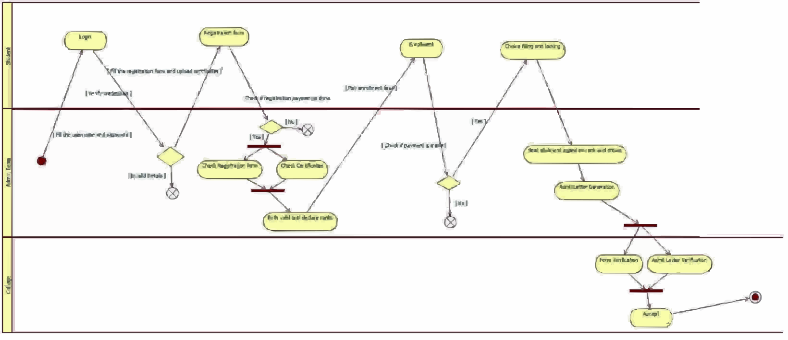
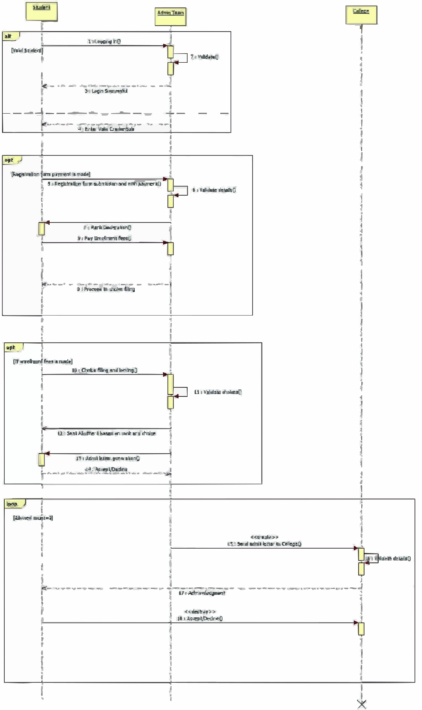
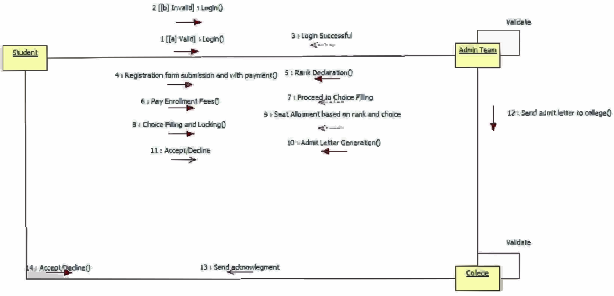

# Chapter 29: Design of UML Diagrams for Student Counselling Management System

> **Book**: *UML Diagramming: A Case Study Approach* by Dr. Suriya Sundaramoorthy (CRC Press, 2022)  
> **Pages**: 303–312 (Total: 10 pages)  
> **Classification**: Industrial Case Study & Diagram Suite  
> **Navigation**: [&larr; Chapter_28_Design_of_UML_Diagrams_for_Diet_Care](Chapter_28_Design_of_UML_Diagrams_for_Diet_Care.md) | [📚 Book Index](../UML_Book.md) | [Chapter_30_Design_of_UML_Diagrams_for_E_Visa_Processing_and_Follow_Up_System &rarr;](Chapter_30_Design_of_UML_Diagrams_for_E_Visa_Processing_and_Follow_Up_System.md)

---

## 📌 Executive Summary

Chapter 29 presents an industrial software engineering case study for **Design of UML Diagrams for Student Counselling Management System**. It details the transition from business requirements and domain constraints into formal software architecture specifications, leveraging data-flow modeling and a complete suite of Unified Modeling Language (UML) structural and behavioral diagrams.

---

## 🎯 Problem Statement & System Context

The first phase of a person’s life is confined mainly by education and training. Hence, counselling is an important aspect for the students of the current technological generation as an individual counsellor may remain in contact with all individual students as well as parents. Student Counselling Management System will simplify the process and reduce the manual paperwork. It is used to smoothen the work of each counsellor who is facing problems currently, and making complete atomization of manual process to computerized system. The main objective of the Student Counselling Management System is to design a system to rationalize the admission to particular courses in a university/institution. Through this system, the student will be able to register for counselling if he is eligible. If the student is qualifying the criteria then he will get the information regarding the colleges and the universities in which he can apply. The main features are online admission, report generation based on student’s merit list and keeping track of counselling procedures and finally publishing results. A student can also get the information regarding how many seats have been booked and vacant seats available in the institution (Figures 29.1–29.8).

---

## 📊 Complete UML Diagram Suite & Architecture Specifications

This chapter incorporates **9 standalone vector diagram(s)** illustrating the end-to-end design from functional use cases to physical hardware deployment:

### Figure 29.1: UML Usecase Diagram

**Diagram Category**: `Use Case Diagram`  
**Architectural Role**: Specifies system boundary, primary external actors, and business use cases with include/extend relationships.

### Figure 29.2: UML Activity Diagram

**Diagram Category**: `Activity Diagram`  
**Architectural Role**: Illustrates dynamic procedural workflow, decision branching, concurrent action forks, and synchronization joins.

### Figure 29.3: UML Sequence Diagram

**Diagram Category**: `Sequence Diagram`  
**Architectural Role**: Details chronological object interactions, synchronous message exchanges, return flows, and activation lifelines.

### Figure 29.4: UML Collaboration Diagram

**Diagram Category**: `Communication Diagram`  
**Architectural Role**: Emphasizes structural object topology and numbered sequence messaging between collaborating entities.

### Figure 29.5: UML State Chart Diagram

**Diagram Category**: `State Machine Diagram`  
**Architectural Role**: Captures entity lifecycle states, transition triggers, event guards, and exit/entry actions.

### Figure 29.6: UML Class Diagram

**Diagram Category**: `Class Diagram`  
**Architectural Role**: Models static structural classifiers, entity attributes, operations, and associations (composition, aggregation, inheritance).

### Figure 29.7: UML Component Diagram

**Diagram Category**: `Component Diagram`  
**Architectural Role**: Architects physical modular software components, provided ball interfaces, and required socket dependencies.

### Figure 29.8: UML Deployment Diagram

**Diagram Category**: `Deployment Diagram`  
**Architectural Role**: Maps software execution artifacts to hardware computing nodes, client devices, application tiers, and database servers.

### Visual Artifacts & Supplementary Schematics

The following vector schematics capture operational screen states, user dashboards, or notation components documented in this chapter:

#### Ch29 p312 img01

---

## 💡 Key Architectural Invariants & Modeling Lessons

1. **Traceability**: Every software model directly corresponds to explicit functional requirements defined during the initial domain specification.
2. **Separation of Concerns**: Structural models (Class, Component, Deployment) maintain clear boundaries separating business domain entities from physical infrastructure nodes.
3. **Behavioral Integrity**: Dynamic models (Activity, Sequence, State Machine) guarantee valid state transitions, prevent deadlocks, and verify message order consistency.
4. **Deployment Fidelity**: Physical nodes and execution environments accurately map runtime middleware, database engines, and client access channels.

---

## 🔗 Related Resources & Navigation

- **Navigation**: [&larr; Chapter_28_Design_of_UML_Diagrams_for_Diet_Care](Chapter_28_Design_of_UML_Diagrams_for_Diet_Care.md) | [📚 Book Index](../UML_Book.md) | [Chapter_30_Design_of_UML_Diagrams_for_E_Visa_Processing_and_Follow_Up_System &rarr;](Chapter_30_Design_of_UML_Diagrams_for_E_Visa_Processing_and_Follow_Up_System.md)
- **Master Book Catalog**: [`UML_Book.md`](../UML_Book.md)
- **Vector Images Catalog**: [`Vector_Images_Catalog.md`](../vector_images/Vector_Images_Catalog.md)