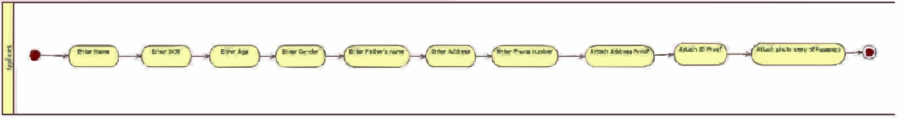
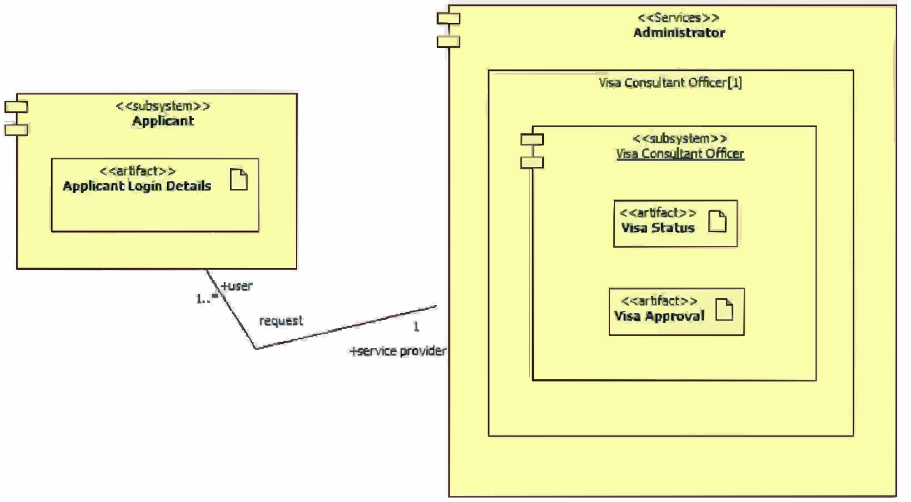

# Chapter 30: Design of UML Diagrams for E Visa Processing and Follow Up System

> **Book**: *UML Diagramming: A Case Study Approach* by Dr. Suriya Sundaramoorthy (CRC Press, 2022)  
> **Pages**: 313–324 (Total: 12 pages)  
> **Classification**: Industrial Case Study & Diagram Suite  
> **Navigation**: [&larr; Chapter_29_Design_of_UML_Diagrams_for_Student_Counselling_Management_System](Chapter_29_Design_of_UML_Diagrams_for_Student_Counselling_Management_System.md) | [📚 Book Index](../UML_Book.md) | [Chapter_31_Design_of_UML_Diagrams_for_Placement_Automation_System &rarr;](Chapter_31_Design_of_UML_Diagrams_for_Placement_Automation_System.md)

---

## 📌 Executive Summary

Chapter 30 presents an industrial software engineering case study for **Design of UML Diagrams for E Visa Processing and Follow Up System**. It details the transition from business requirements and domain constraints into formal software architecture specifications, leveraging data-flow modeling and a complete suite of Unified Modeling Language (UML) structural and behavioral diagrams.

---

## 🎯 Problem Statement & System Context

A visa is a document issued by a country giving a certain individual permission to enter a country for a given period of time for certain purposes. It is received after several verifications through offline mode. It requires the applicant to go to the Passport Verification Centre for the verification of documents. Sometimes even the cost of getting the visa will be high as there may be middlemen involved in it. It takes anywhere from two weeks to two months to receive the visa if applied in offline mode. With the use of an online visa processing system, the middlemen entry in getting the visa gets reduced and the process of application of visa becomes easier. The overall aim of the system is that the applicant can apply for the visa from anywhere and at any time. The applicant can apply for the visa and submit it online. It provides more flexibility to the applicant compared to the existing system. There are certain types of visas that the applicant can apply for such as employment visa, study visa, resident visa, H1 visa, business visa, etc. People who apply for the visa for work, education, etc will be benefitted a lot from this system. The applicant should register by providing a valid email and a password. The applicant has to log in to apply for the visa. The credentials are checked for correctness and the applicant to allow to log in. Once the applicant logs in, he/she will be shown the application form which asks the applicant to provide the necessary details and asks him/her to attach the necessary documents. It also provides a list of visas to choose from. He/she can also view the details of fair to visa for each country. The applicant can view, modify and delete the details applied. The system will have a provision for the administrator to view the details of what types of visas are required by the applicant. The administrator will also be able to update and delete the details of the applicants. The administrator will have a facility to interact with the Visa Consultant Officer. The Visa Consultant Officer can be able to view and check the document proofs (valid passport, Demand Draft Visa Fee I-20 form, letter of admission, aid letter, etc.) submitted by the applicant and can be able to view the purpose of application of visa. He/She has the authority to accept/reject the visa application applied by the applicant (Figures 30.1–30.9).

---

## 📊 Complete UML Diagram Suite & Architecture Specifications

This chapter incorporates **10 standalone vector diagram(s)** illustrating the end-to-end design from functional use cases to physical hardware deployment:

### Figure 30.1: UML Usecase Diagram

**Diagram Category**: `Use Case Diagram`  
**Architectural Role**: Specifies system boundary, primary external actors, and business use cases with include/extend relationships.

### Figure 30.2: UML Activity Diagram Scenario 1

**Diagram Category**: `Activity Diagram`  
**Architectural Role**: Illustrates dynamic procedural workflow, decision branching, concurrent action forks, and synchronization joins.

### Figure 30.3: UML Activity Diagram Scenario 2

**Diagram Category**: `Activity Diagram`  
**Architectural Role**: Illustrates dynamic procedural workflow, decision branching, concurrent action forks, and synchronization joins.

### Figure 30.4: UML Sequence Diagram

**Diagram Category**: `Sequence Diagram`  
**Architectural Role**: Details chronological object interactions, synchronous message exchanges, return flows, and activation lifelines.

### Figure 30.5: UML Collaboration Diagram

**Diagram Category**: `Communication Diagram`  
**Architectural Role**: Emphasizes structural object topology and numbered sequence messaging between collaborating entities.

### Figure 30.6: UML State Chart Diagram

**Diagram Category**: `State Machine Diagram`  
**Architectural Role**: Captures entity lifecycle states, transition triggers, event guards, and exit/entry actions.

### Figure 30.7: UML Class Diagram

**Diagram Category**: `Class Diagram`  
**Architectural Role**: Models static structural classifiers, entity attributes, operations, and associations (composition, aggregation, inheritance).

### Figure 30.8: UML Component Diagram

**Diagram Category**: `Component Diagram`  
**Architectural Role**: Architects physical modular software components, provided ball interfaces, and required socket dependencies.

### Figure 30.9: UML Deployment Diagram

**Diagram Category**: `Deployment Diagram`  
**Architectural Role**: Maps software execution artifacts to hardware computing nodes, client devices, application tiers, and database servers.

### Visual Artifacts & Supplementary Schematics

The following vector schematics capture operational screen states, user dashboards, or notation components documented in this chapter:

#### Ch30 p324 img01

---

## 💡 Key Architectural Invariants & Modeling Lessons

1. **Traceability**: Every software model directly corresponds to explicit functional requirements defined during the initial domain specification.
2. **Separation of Concerns**: Structural models (Class, Component, Deployment) maintain clear boundaries separating business domain entities from physical infrastructure nodes.
3. **Behavioral Integrity**: Dynamic models (Activity, Sequence, State Machine) guarantee valid state transitions, prevent deadlocks, and verify message order consistency.
4. **Deployment Fidelity**: Physical nodes and execution environments accurately map runtime middleware, database engines, and client access channels.

---

## 🔗 Related Resources & Navigation

- **Navigation**: [&larr; Chapter_29_Design_of_UML_Diagrams_for_Student_Counselling_Management_System](Chapter_29_Design_of_UML_Diagrams_for_Student_Counselling_Management_System.md) | [📚 Book Index](../UML_Book.md) | [Chapter_31_Design_of_UML_Diagrams_for_Placement_Automation_System &rarr;](Chapter_31_Design_of_UML_Diagrams_for_Placement_Automation_System.md)
- **Master Book Catalog**: [`UML_Book.md`](../UML_Book.md)
- **Vector Images Catalog**: [`Vector_Images_Catalog.md`](../vector_images/Vector_Images_Catalog.md)