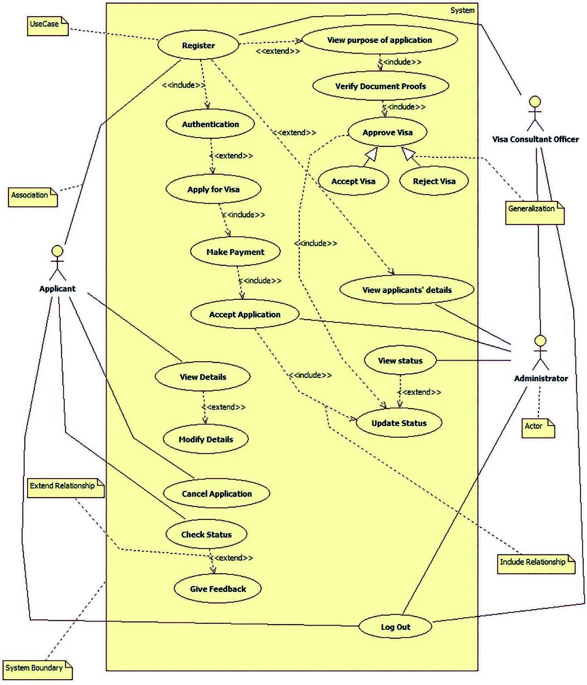
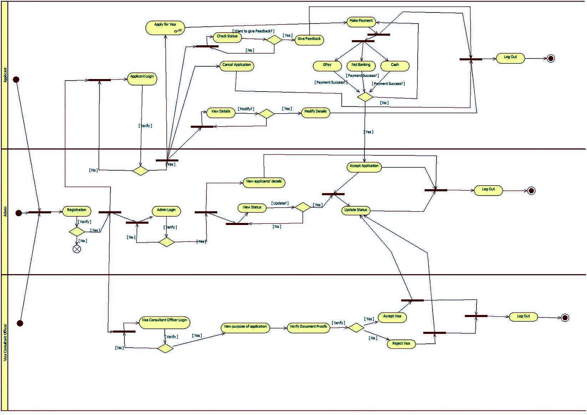
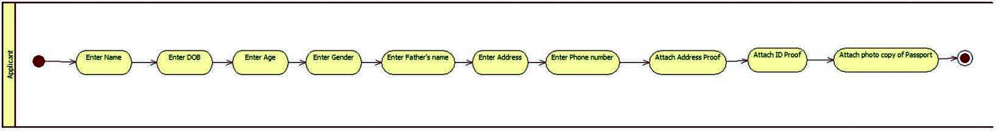
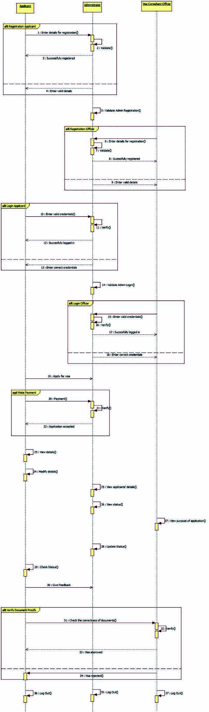
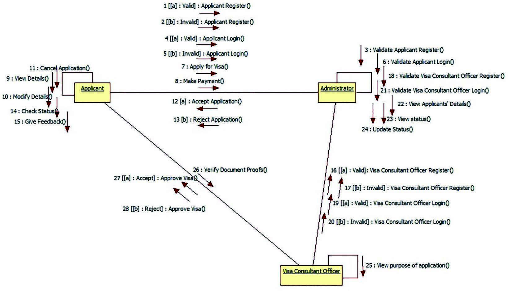
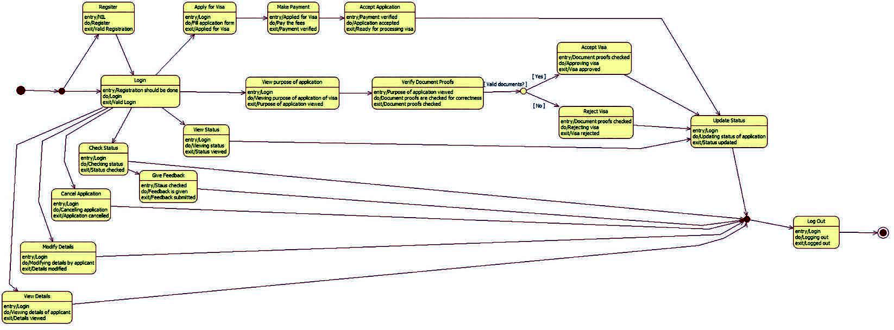
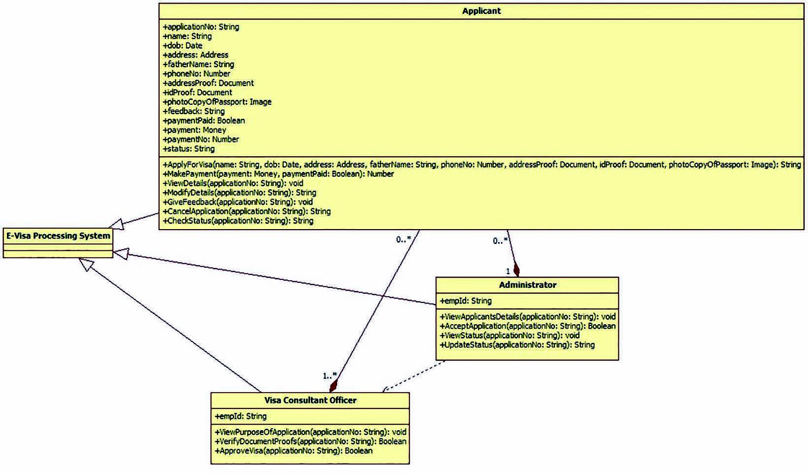
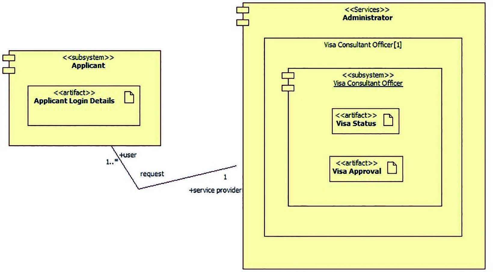
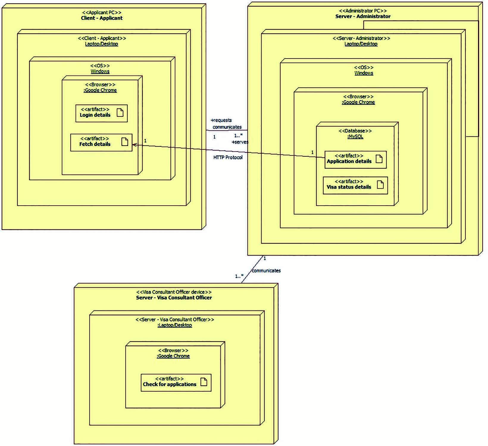

# Chapter 30: Design of UML Diagrams for E Visa Processing and Follow Up System

> **Book**: *UML Diagramming: A Case Study Approach* by Dr. Suriya Sundaramoorthy (CRC Press, 2022)  
> **Pages**: 313–324 (Total: 12 pages)  
> **Classification**: Industrial Case Study & UML Modeling Suite  
> **Navigation**: [&larr; Chapter_29_Design_of_UML_Diagrams_for_Student_Counselling_Management_System](Chapter_29_Design_of_UML_Diagrams_for_Student_Counselling_Management_System.md) | [📚 Book Index](../UML_Book.md) | [Chapter_31_Design_of_UML_Diagrams_for_Placement_Automation_System &rarr;](Chapter_31_Design_of_UML_Diagrams_for_Placement_Automation_System.md)

---

## 📌 Executive Summary

Chapter 30 presents an end-to-end software engineering case study for the **Design of UML Diagrams for E Visa Processing and Follow Up System**. This chapter demonstrates how business requirements and domain constraints are translated into formal architectural specifications through data-flow modeling and a complete suite of Unified Modeling Language (UML) structural and behavioral models.

The case study analyzes the system from multiple architectural perspectives: identifying external user and service actors, formalizing core operational capabilities, detailing procedural business workflows, specifying domain entity schemas, and architecting modular component deployment across distributed physical infrastructure.

---

## 🎯 Problem Statement & Business Context

A visa is a document issued by a country giving a certain individual permission to enter a country for a given period of time for certain purposes. It is received after several verifications through offline mode. It requires the applicant to go to the Passport Verification Centre for the verification of documents. Sometimes even the cost of getting the visa will be high as there may be middlemen involved in it. It takes anywhere from two weeks to two months to receive the visa if applied in offline mode. With the use of an online visa processing system, the middlemen entry in getting the visa gets reduced and the process of application of visa becomes easier. The overall aim of the system is that the applicant can apply for the visa from anywhere and at any time. The applicant can apply for the visa and submit it online. It provides more flexibility to the applicant compared to the existing system. There are certain types of visas that the applicant can apply for such as employment visa, study visa, resident visa, H1 visa, business visa, etc. People who apply for the visa for work, education, etc will be benefitted a lot from this system. The applicant should register by providing a valid email and a password. The applicant has to log in to apply for the visa. The credentials are checked for correctness and the applicant to allow to log in. Once the applicant logs in, he/she will be shown the application form which asks the applicant to provide the necessary details and asks him/her to attach the necessary documents. It also provides a list of visas to choose from. He/she can also view the details of fair to visa for each country. The applicant can view, modify and delete the details applied. The system will have a provision for the administrator to view the details of what types of visas are required by the applicant. The administrator will also be able to update and delete the details of the applicants. The administrator will have a facility to interact with the Visa Consultant Officer. The Visa Consultant Officer can be able to view and check the document proofs (valid passport, Demand Draft Visa Fee I-20 form, letter of admission, aid letter, etc.) submitted by the applicant and can be able to view the purpose of application of visa. He/She has the authority to accept/reject the visa application applied by the applicant (Figures 30.1–30.9).

---

## ⚙️ System Architecture & Functional Capabilities

The **Design of UML Diagrams for E Visa Processing and Follow Up System** decomposes business operations into modular functional units. These capabilities address the operational bottlenecks of manual and legacy workflows by introducing automated, role-based, and auditable software processes:

- **Accept Application**: Enables the administrator to accept applications submitted by the applicants.
- **Accept Visa**: Enables the Visa Consultant Officer to accept (approve) visa of applicants.
- **Apply for Visa**: Helps the applicants to apply for a visa by filing an application form online.
- **Approve Visa**: Enables the Visa Consultant Officer to either accept or reject the visa.
- **Authentication**: Used to verify the credentials when an actor logs in.
- **Cancel Application**: Enables the user to cancel his/her application.
- **Check Status**: Enables the applicant to check the status of his/her application.
- **Give Feedback**: Enables the user to give feedback about the visa that is being processed.
- **Log Out**: enables all the actors to log out of the system.
- **Make Payment**: Enables the applicant to make payment.
- **Modify Details**: Enables the applicant to modify the details that were given in the application form.
- **Register**: Enables a user to register with the system.
- **Reject Visa**: Enables the Visa Consultant Officer to reject the visa.
- **Update Status**: Updating the status of the visa as per the process being carried out.
- **Verify Document Proofs**: The document proofs submitted by the applicant are verified for correctness by the Visa Consultant Officer.
- **View Details**: Enables the applicant to view the details which he/she gave in the form.
- **View Purpose of Application**: The Visa Consultant Officer can view the purpose of visa application (tourist visa, study visa, etc.).
- **View Status**: Enables the administrator can view the status of the visa of the applicants.

---

## 📊 Complete UML Diagram Suite & Architectural Walkthrough

This chapter incorporates **10 crystal-clear, high-resolution diagram(s)** (extracted losslessly from the source edition at up to 2,000+ px) illustrating the end-to-end design from functional use cases to physical hardware deployment:

### Figure 30.1: UML Usecase Diagram

**Diagram Category**: `Use Case Diagram`  
**Architectural Role**: Specifies system boundary, primary external actors, and business use cases with include/extend relationships.

**System Design Analysis**:
Illustrates the functional boundary of the **Design of UML Diagrams for E Visa Processing and Follow Up System**. External actors trigger core use cases, demonstrating how business transactions, authorization checkpoints, and service requests flow into the system. Relationships (`<<include>>` for mandatory sub-routines like authentication and validation, and `<<extend>>` for optional or conditional exception branches) formalize the system's external functional contract.

### Figure 30.2: UML Activity Diagram Scenario 1

**Diagram Category**: `Activity Diagram`  
**Architectural Role**: Illustrates dynamic procedural workflow, decision branching, concurrent action forks, and synchronization joins.

**System Design Analysis**:
Details the step-by-step procedural execution flow for core operations in **Design of UML Diagrams for E Visa Processing and Follow Up System**. Begins at an initial state, navigates action states, evaluates guard conditions at decision diamonds, and models parallel execution branches using fork and join synchronizations before reaching the terminal state, ensuring business workflows are deterministic and free of race conditions.

### Figure 30.3: UML Activity Diagram Scenario 2

**Diagram Category**: `Activity Diagram`  
**Architectural Role**: Illustrates dynamic procedural workflow, decision branching, concurrent action forks, and synchronization joins.

**System Design Analysis**:
Details the step-by-step procedural execution flow for core operations in **Design of UML Diagrams for E Visa Processing and Follow Up System**. Begins at an initial state, navigates action states, evaluates guard conditions at decision diamonds, and models parallel execution branches using fork and join synchronizations before reaching the terminal state, ensuring business workflows are deterministic and free of race conditions.

### Figure 30.4: UML Sequence Diagram

**Diagram Category**: `Sequence Diagram`  
**Architectural Role**: Details chronological object interactions, synchronous message exchanges, return flows, and activation lifelines.

**System Design Analysis**:
Traces the time-ordered message sequence between participating objects and services in **Design of UML Diagrams for E Visa Processing and Follow Up System**. Vertical dashed lifelines represent entity instances across time, while horizontal solid and dashed arrows show synchronous invocations, data lookups, and return values. Activation bars delineate execution duration, clarifying object collaboration during key transactional workflows.

### Figure 30.5: UML Collaboration Diagram

**Diagram Category**: `Communication Diagram`  
**Architectural Role**: Emphasizes structural object topology and numbered sequence messaging between collaborating entities.

**System Design Analysis**:
Emphasizes the spatial and structural organization of collaborating instances in **Design of UML Diagrams for E Visa Processing and Follow Up System**. Shows object links overlaid with numbered messages (e.g., 1.0, 1.1, 2.0), illustrating both structural connectivity and invocation hierarchy, complementing the temporal perspective of the sequence diagram.

### Figure 30.6: UML State Chart Diagram

**Diagram Category**: `State Machine Diagram`  
**Architectural Role**: Captures entity lifecycle states, transition triggers, event guards, and exit/entry actions.

**System Design Analysis**:
Models the complete lifecycle state transitions for central domain entities in **Design of UML Diagrams for E Visa Processing and Follow Up System**. Tracks transitions from initial creation through intermediate processing states to completion or cancellation. Explicit state triggers, guard expressions `[condition]`, and entry/exit actions guarantee valid business lifecycle states and eliminate invalid operational state jumps.

### Figure 30.7: UML Class Diagram

**Diagram Category**: `Class Diagram`  
**Architectural Role**: Models static structural classifiers, entity attributes, operations, and associations (composition, aggregation, inheritance).

**System Design Analysis**:
Captures the static structural domain model for **Design of UML Diagrams for E Visa Processing and Follow Up System**. Defines primary entity classes, their private/public attributes, operational methods, and relationships. It enforces structural integrity through multiplicities, composition (strong lifecycle ownership of subsidiary records), aggregation, and inheritance hierarchies, forming the foundation for the relational database schema and domain entity classes.

### Figure 30.8: UML Component Diagram

**Diagram Category**: `Component Diagram`  
**Architectural Role**: Architects physical modular software components, provided ball interfaces, and required socket dependencies.

**System Design Analysis**:
Architects the modular software organization for **Design of UML Diagrams for E Visa Processing and Follow Up System**. Illustrates autonomous subsystems, business logic controllers, database access layers, and external service adapters. Provided interfaces (ball notation) and required dependencies (socket notation) define clear service contracts, supporting high cohesion and loose coupling.

### Figure 30.9: UML Deployment Diagram

**Diagram Category**: `Deployment Diagram`  
**Architectural Role**: Maps software execution artifacts to hardware computing nodes, client devices, application tiers, and database servers.

**System Design Analysis**:
Maps the physical runtime deployment architecture for **Design of UML Diagrams for E Visa Processing and Follow Up System**. Depicts client hardware devices (web browsers, mobile apps), application servers, network firewalls, and persistence database nodes. Communication paths and execution environments reflect production infrastructure, scalability considerations, and network security boundaries.

### Visual Artifacts & Supplementary Schematics

The following high-resolution schematics capture operational screen states, user dashboards, or notation components documented in this chapter:

#### Ch30 p324 img01

**Perspective**: `Conceptual Notation / Architecture Asset` — Supplemental conceptual illustration or notation reference from the source chapter.

---

## 💡 Key Architectural Invariants & Domain Lessons

1. **Requirement Traceability**: Every model in the **Design of UML Diagrams for E Visa Processing and Follow Up System** suite traces directly to business requirements and operational constraints established in the problem statement.
2. **State & Workflow Integrity**: Dynamic activity and sequence models guarantee deterministic workflow completion, enforce transactional atomicity, and prevent deadlocks.
3. **Modular Encapsulation**: Component boundaries decouple domain business logic from presentation controllers and external integration adapters, supporting high maintainability.
4. **Operational Security & RBAC**: Strict role-based authorization guards sensitive operations across external actor boundaries and administrative lifelines.
5. **High-Fidelity Deployment**: Physical node topologies reflect real-world tiered infrastructure (DMZ, application cluster, isolated persistence layer), ensuring scalability and fault tolerance.

---

## 🔗 Related Resources & Navigation

- **Navigation**: [&larr; Chapter_29_Design_of_UML_Diagrams_for_Student_Counselling_Management_System](Chapter_29_Design_of_UML_Diagrams_for_Student_Counselling_Management_System.md) | [📚 Book Index](../UML_Book.md) | [Chapter_31_Design_of_UML_Diagrams_for_Placement_Automation_System &rarr;](Chapter_31_Design_of_UML_Diagrams_for_Placement_Automation_System.md)
- **Master Book Catalog**: [`UML_Book.md`](../UML_Book.md)
- **High-Resolution Images Archive**: [`images/`](../images/)