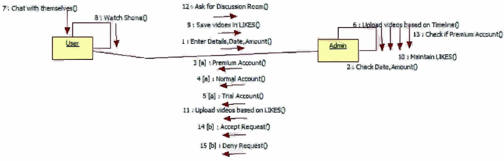

# Chapter 31: Design of UML Diagrams for Placement Automation System

> **Book**: *UML Diagramming: A Case Study Approach* by Dr. Suriya Sundaramoorthy (CRC Press, 2022)  
> **Pages**: 325–332 (Total: 8 pages)  
> **Classification**: Industrial Case Study & Diagram Suite  
> **Navigation**: [&larr; Chapter_30_Design_of_UML_Diagrams_for_E_Visa_Processing_and_Follow_Up_System](Chapter_30_Design_of_UML_Diagrams_for_E_Visa_Processing_and_Follow_Up_System.md) | [📚 Book Index](../UML_Book.md) | [Chapter_32_Design_of_UML_Diagrams_for_Farm_Management_System &rarr;](Chapter_32_Design_of_UML_Diagrams_for_Farm_Management_System.md)

---

## 📌 Executive Summary

Chapter 31 presents an industrial software engineering case study for **Design of UML Diagrams for Placement Automation System**. It details the transition from business requirements and domain constraints into formal software architecture specifications, leveraging data-flow modeling and a complete suite of Unified Modeling Language (UML) structural and behavioral diagrams.

---

## 🎯 Problem Statement & System Context

Placement provides the opportunity for the students to gain Specific Subject skills as well as Real work employability skills. Placement Offices play a crucial role in providing students the necessary training and various opportunities where the students can effectively evidence their various skills and abilities on their resume. Hence, the Automation of Placement office provides a more smooth placement process for both the companies and the students. This System mainly focuses on flows between the company’s activity, Registration, Resumes, Users, Skills and Their Training. Hence, the system comprises five modules, namely, User module, Company module, Admin module, Registration module and Training module. Functionalities: Admin can ◾ Add a new company ◾ Delete/update a company ◾ Keeps track of students interested in placements ◾ Add a new training for students (which is demanded by many companies) ◾ Update/delete a training (which are not demanded by many companies), etc. User (Job Seeking Student) can ◾ Register for a particular job ◾ Register for a particular company ◾ Undertake a training ◾ Submit resume ◾ Update resume, etc. Company can ◾ Register in the placement office ◾ View Student resume ◾ Recruit a student with good resume and skills ◾ Recruit a student trained in a specific area, etc. (Figures 31.1–31.8).

---

## 📊 Complete UML Diagram Suite & Architecture Specifications

This chapter incorporates **8 standalone vector diagram(s)** illustrating the end-to-end design from functional use cases to physical hardware deployment:

### Figure 31.1: UML Usecase Diagram

**Diagram Category**: `Use Case Diagram`  
**Architectural Role**: Specifies system boundary, primary external actors, and business use cases with include/extend relationships.

### Figure 31.2: UML Activity Diagram

**Diagram Category**: `Activity Diagram`  
**Architectural Role**: Illustrates dynamic procedural workflow, decision branching, concurrent action forks, and synchronization joins.

### Figure 31.3: UML Sequence Diagram

**Diagram Category**: `Sequence Diagram`  
**Architectural Role**: Details chronological object interactions, synchronous message exchanges, return flows, and activation lifelines.

### Figure 31.4: UML Collaboration Diagram

**Diagram Category**: `Communication Diagram`  
**Architectural Role**: Emphasizes structural object topology and numbered sequence messaging between collaborating entities.

### Figure 31.5: UML State Chart Diagram

**Diagram Category**: `State Machine Diagram`  
**Architectural Role**: Captures entity lifecycle states, transition triggers, event guards, and exit/entry actions.

### Figure 31.6: UML Class Diagram

**Diagram Category**: `Class Diagram`  
**Architectural Role**: Models static structural classifiers, entity attributes, operations, and associations (composition, aggregation, inheritance).

### Figure 31.7: UML Component Diagram

**Diagram Category**: `Component Diagram`  
**Architectural Role**: Architects physical modular software components, provided ball interfaces, and required socket dependencies.

### Figure 31.8: UML Deployment Diagram

**Diagram Category**: `Deployment Diagram`  
**Architectural Role**: Maps software execution artifacts to hardware computing nodes, client devices, application tiers, and database servers.

---

## 💡 Key Architectural Invariants & Modeling Lessons

1. **Traceability**: Every software model directly corresponds to explicit functional requirements defined during the initial domain specification.
2. **Separation of Concerns**: Structural models (Class, Component, Deployment) maintain clear boundaries separating business domain entities from physical infrastructure nodes.
3. **Behavioral Integrity**: Dynamic models (Activity, Sequence, State Machine) guarantee valid state transitions, prevent deadlocks, and verify message order consistency.
4. **Deployment Fidelity**: Physical nodes and execution environments accurately map runtime middleware, database engines, and client access channels.

---

## 🔗 Related Resources & Navigation

- **Navigation**: [&larr; Chapter_30_Design_of_UML_Diagrams_for_E_Visa_Processing_and_Follow_Up_System](Chapter_30_Design_of_UML_Diagrams_for_E_Visa_Processing_and_Follow_Up_System.md) | [📚 Book Index](../UML_Book.md) | [Chapter_32_Design_of_UML_Diagrams_for_Farm_Management_System &rarr;](Chapter_32_Design_of_UML_Diagrams_for_Farm_Management_System.md)
- **Master Book Catalog**: [`UML_Book.md`](../UML_Book.md)
- **Vector Images Catalog**: [`Vector_Images_Catalog.md`](../vector_images/Vector_Images_Catalog.md)