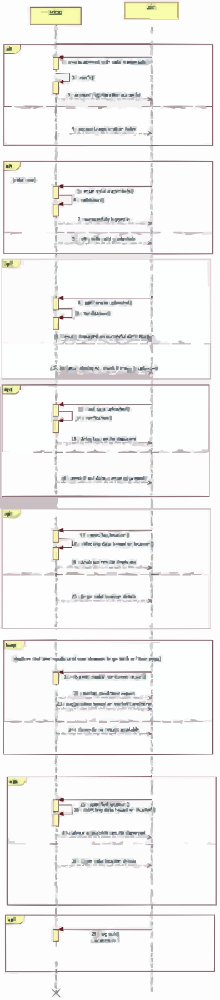
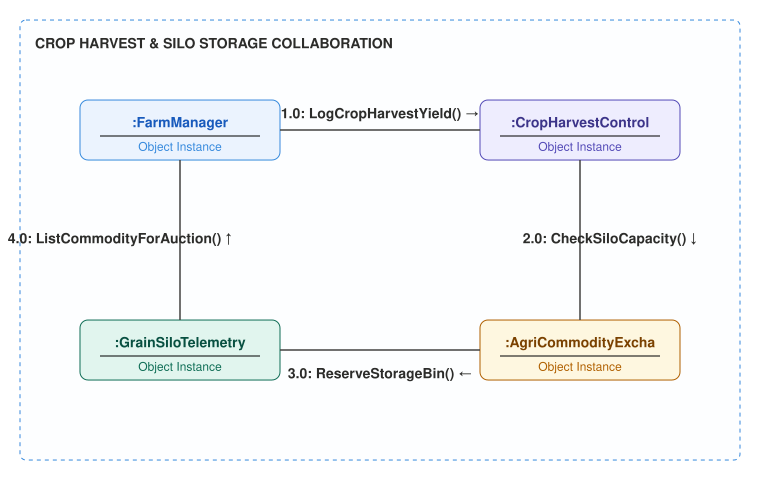

# Chapter 32: Design of UML Diagrams for Farm Management System

> **Book**: *UML Diagramming: A Case Study Approach* by Dr. Suriya Sundaramoorthy (CRC Press, 2022)  
> **Pages**: 333–340 (Total: 8 pages)  
> **Classification**: Industrial Case Study & Diagram Suite  
> **Navigation**: [&larr; Chapter_31_Design_of_UML_Diagrams_for_Placement_Automation_System](Chapter_31_Design_of_UML_Diagrams_for_Placement_Automation_System.md) | [📚 Book Index](../UML_Book.md) | [Chapter_33_Design_of_UML_Diagrams_for_Green_Rides &rarr;](Chapter_33_Design_of_UML_Diagrams_for_Green_Rides.md)

---

## 📌 Executive Summary

Chapter 32 presents an industrial software engineering case study for **Design of UML Diagrams for Farm Management System**. It details the transition from business requirements and domain constraints into formal software architecture specifications, leveraging data-flow modeling and a complete suite of Unified Modeling Language (UML) structural and behavioral diagrams.

---

## 🎯 Problem Statement & System Context

In India, 1 out of 4 farmers own a smartphone. But they don’t use it optimally for insights on farming based on real-time data – such as weather, soil conditions, market conditions, labour availability etcetera, which can allow them to make data-driven decisions to get the best possible results. Current technologies that solve such issues are either paid services or inaccurate. They also tend to be more complex making it really hard for anyone to understand and interpret. An application if developed should primarily aim at reducing the risks, reducing the costs, improving yield, and most importantly, easy for anyone to interpret (Figures 32.1–32.8).

---

## 📊 Complete UML Diagram Suite & Architecture Specifications

This chapter incorporates **8 standalone vector diagram(s)** illustrating the end-to-end design from functional use cases to physical hardware deployment:

### Figure 32.1: UML Usecase Diagram

**Diagram Category**: `Use Case Diagram`  
**Architectural Role**: Specifies system boundary, primary external actors, and business use cases with include/extend relationships.

### Figure 32.2: UML Activity Diagram

**Diagram Category**: `Activity Diagram`  
**Architectural Role**: Illustrates dynamic procedural workflow, decision branching, concurrent action forks, and synchronization joins.

### Figure 32.3: UML Sequence Diagram

**Diagram Category**: `Sequence Diagram`  
**Architectural Role**: Details chronological object interactions, synchronous message exchanges, return flows, and activation lifelines.

### Figure 32.4: UML Collaboration Diagram

**Diagram Category**: `Communication Diagram`  
**Architectural Role**: Emphasizes structural object topology and numbered sequence messaging between collaborating entities.

### Figure 32.5: UML State Chart Diagram

**Diagram Category**: `State Machine Diagram`  
**Architectural Role**: Captures entity lifecycle states, transition triggers, event guards, and exit/entry actions.

### Figure 32.6: UML Class Diagram

**Diagram Category**: `Class Diagram`  
**Architectural Role**: Models static structural classifiers, entity attributes, operations, and associations (composition, aggregation, inheritance).

### Figure 32.7: UML Component Diagram

**Diagram Category**: `Component Diagram`  
**Architectural Role**: Architects physical modular software components, provided ball interfaces, and required socket dependencies.

### Figure 32.8: UML Deployment Diagram

**Diagram Category**: `Deployment Diagram`  
**Architectural Role**: Maps software execution artifacts to hardware computing nodes, client devices, application tiers, and database servers.

---

## 💡 Key Architectural Invariants & Modeling Lessons

1. **Traceability**: Every software model directly corresponds to explicit functional requirements defined during the initial domain specification.
2. **Separation of Concerns**: Structural models (Class, Component, Deployment) maintain clear boundaries separating business domain entities from physical infrastructure nodes.
3. **Behavioral Integrity**: Dynamic models (Activity, Sequence, State Machine) guarantee valid state transitions, prevent deadlocks, and verify message order consistency.
4. **Deployment Fidelity**: Physical nodes and execution environments accurately map runtime middleware, database engines, and client access channels.

---

## 🔗 Related Resources & Navigation

- **Navigation**: [&larr; Chapter_31_Design_of_UML_Diagrams_for_Placement_Automation_System](Chapter_31_Design_of_UML_Diagrams_for_Placement_Automation_System.md) | [📚 Book Index](../UML_Book.md) | [Chapter_33_Design_of_UML_Diagrams_for_Green_Rides &rarr;](Chapter_33_Design_of_UML_Diagrams_for_Green_Rides.md)
- **Master Book Catalog**: [`UML_Book.md`](../UML_Book.md)
- **Vector Images Catalog**: [`Vector_Images_Catalog.md`](../vector_images/Vector_Images_Catalog.md)