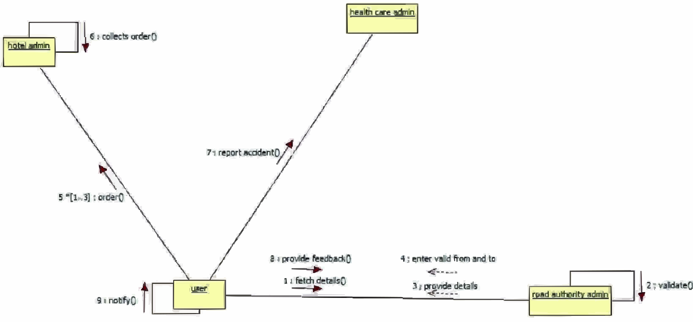

# Chapter 33: Design of UML Diagrams for Green Rides

> **Book**: *UML Diagramming: A Case Study Approach* by Dr. Suriya Sundaramoorthy (CRC Press, 2022)  
> **Pages**: 341–348 (Total: 8 pages)  
> **Classification**: Industrial Case Study & Diagram Suite  
> **Navigation**: [&larr; Chapter_32_Design_of_UML_Diagrams_for_Farm_Management_System](Chapter_32_Design_of_UML_Diagrams_for_Farm_Management_System.md) | [📚 Book Index](../UML_Book.md) | [Chapter_34_Design_of_UML_Diagrams_for_Art_Gallery_Management_System &rarr;](Chapter_34_Design_of_UML_Diagrams_for_Art_Gallery_Management_System.md)

---

## 📌 Executive Summary

Chapter 33 presents an industrial software engineering case study for **Design of UML Diagrams for Green Rides**. It details the transition from business requirements and domain constraints into formal software architecture specifications, leveraging data-flow modeling and a complete suite of Unified Modeling Language (UML) structural and behavioral diagrams.

---

## 🎯 Problem Statement & System Context

This system is useful in the road transport and highways field (Ministry of Road Transport and Highways). Green rides is a technical solution for the general public to guide them to a less polluted path while travelling, to know about the traffic jam, identification of accident- prone spots, meals- on- wheel, the establishment of drive-mode applications. This app consists of a Google map view on the main screen. A user can select the source to destination path which then will be processed to give a number of routes to reach the destination from source with amount of traffic at various locations in that path along with current pollution status in that route (which updates overtime). If there exists a traffic jam, a user can blow a horn to all users within a specific radius. According to his current location in the form of a small notification which the persons in the specified radius will receive. The accidents that occurred at specific spots will be reported by the user to the concerned authority who will do the rescue operations and hence the accident- prone areas will be categorized based on the number of accidents taking place and a notification appears for the user to drive slow and safe when they are in that particular location. The road authority admin checks the system often. Meals- on- wheel provides information about hotels and restaurants which are available in the chosen route so that the user can place the order as per the available menu at a particular eating place including time of service so that one need not wait at the restaurant for placing the order. Drive- mode helps to minimize the risks of accidents while attending mobile phones during driving. This module would send an SMS to the caller that the particular person is driving when the geo- coordinates show the mobile shifting of the driver is beyond some specified speed limit (say, 20 kmph). Before start of the journey, this module can be turned on. The feedback feature allows the user to give feedbacks about the accuracy in the traffic and pollution levels in a given area (Figures 33.1–33.8).

---

## 📊 Complete UML Diagram Suite & Architecture Specifications

This chapter incorporates **8 standalone vector diagram(s)** illustrating the end-to-end design from functional use cases to physical hardware deployment:

### Figure 33.1: UML Usecase Diagram

**Diagram Category**: `Use Case Diagram`  
**Architectural Role**: Specifies system boundary, primary external actors, and business use cases with include/extend relationships.

### Figure 33.2: UML Activity Diagram

**Diagram Category**: `Activity Diagram`  
**Architectural Role**: Illustrates dynamic procedural workflow, decision branching, concurrent action forks, and synchronization joins.

### Figure 33.3: UML Sequence Diagram

**Diagram Category**: `Sequence Diagram`  
**Architectural Role**: Details chronological object interactions, synchronous message exchanges, return flows, and activation lifelines.

### Figure 33.4: UML Collaboration Diagram

**Diagram Category**: `Communication Diagram`  
**Architectural Role**: Emphasizes structural object topology and numbered sequence messaging between collaborating entities.

### Figure 33.5: UML State Chart Diagram

**Diagram Category**: `State Machine Diagram`  
**Architectural Role**: Captures entity lifecycle states, transition triggers, event guards, and exit/entry actions.

### Figure 33.6: UML Class Diagram

**Diagram Category**: `Class Diagram`  
**Architectural Role**: Models static structural classifiers, entity attributes, operations, and associations (composition, aggregation, inheritance).

### Figure 33.7: UML Component Diagram

**Diagram Category**: `Component Diagram`  
**Architectural Role**: Architects physical modular software components, provided ball interfaces, and required socket dependencies.

### Figure 33.8: UML Deployment Diagram

**Diagram Category**: `Deployment Diagram`  
**Architectural Role**: Maps software execution artifacts to hardware computing nodes, client devices, application tiers, and database servers.

---

## 💡 Key Architectural Invariants & Modeling Lessons

1. **Traceability**: Every software model directly corresponds to explicit functional requirements defined during the initial domain specification.
2. **Separation of Concerns**: Structural models (Class, Component, Deployment) maintain clear boundaries separating business domain entities from physical infrastructure nodes.
3. **Behavioral Integrity**: Dynamic models (Activity, Sequence, State Machine) guarantee valid state transitions, prevent deadlocks, and verify message order consistency.
4. **Deployment Fidelity**: Physical nodes and execution environments accurately map runtime middleware, database engines, and client access channels.

---

## 🔗 Related Resources & Navigation

- **Navigation**: [&larr; Chapter_32_Design_of_UML_Diagrams_for_Farm_Management_System](Chapter_32_Design_of_UML_Diagrams_for_Farm_Management_System.md) | [📚 Book Index](../UML_Book.md) | [Chapter_34_Design_of_UML_Diagrams_for_Art_Gallery_Management_System &rarr;](Chapter_34_Design_of_UML_Diagrams_for_Art_Gallery_Management_System.md)
- **Master Book Catalog**: [`UML_Book.md`](../UML_Book.md)
- **Vector Images Catalog**: [`Vector_Images_Catalog.md`](../vector_images/Vector_Images_Catalog.md)