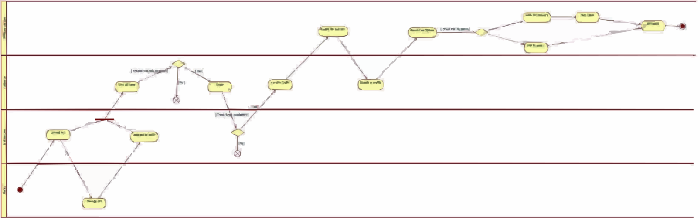
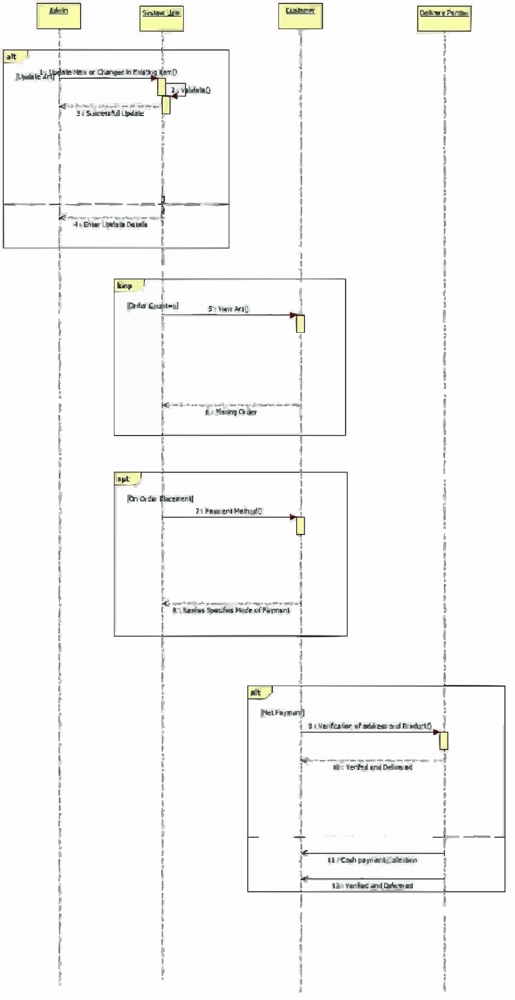

# Chapter 34: Design of UML Diagrams for Art Gallery Management System

> **Book**: *UML Diagramming: A Case Study Approach* by Dr. Suriya Sundaramoorthy (CRC Press, 2022)  
> **Pages**: 349–356 (Total: 8 pages)  
> **Classification**: Industrial Case Study & Diagram Suite  
> **Navigation**: [&larr; Chapter_33_Design_of_UML_Diagrams_for_Green_Rides](Chapter_33_Design_of_UML_Diagrams_for_Green_Rides.md) | [📚 Book Index](../UML_Book.md) | [Chapter_35_Design_of_UML_Diagrams_for_GUIDE_Dropshipping_Website &rarr;](Chapter_35_Design_of_UML_Diagrams_for_GUIDE_Dropshipping_Website.md)

---

## 📌 Executive Summary

Chapter 34 presents an industrial software engineering case study for **Design of UML Diagrams for Art Gallery Management System**. It details the transition from business requirements and domain constraints into formal software architecture specifications, leveraging data-flow modeling and a complete suite of Unified Modeling Language (UML) structural and behavioral diagrams.

---

## 🎯 Problem Statement & System Context

To provide an online platform to manage the buying, selling and storage of artistic creations provided by creators/other platforms or auctions and to organize events to exhibit these products. The system is a gallery having art pieces with its description, price and other information and the order activity, payment activity, order update activity and so on. The objective is to provide an online platform through which museums and art galleries can make use-off to exhibit their collections in times of unavailable street galleries. Like in times of pandemic also people need not bother not going to a museum or art gallery instead they can have online art shopping and art exhibits. The system should be immune to any chances of misuse and unauthorized reproduction of works of arts and designs. There will be two types of users accessing the system: Admin (Creators/authority of the art displayed) and Customer (One who looks to buy the art). The main features provided for the admin are that they will be able to update, add, delete, input price, description and information about an art (stock availability), generate report of gallery and that for the customers are that they will be able to order (Payment), delete order, view end-user projected art particulars (Figures 34.1–34.8).

---

## 📊 Complete UML Diagram Suite & Architecture Specifications

This chapter incorporates **8 standalone vector diagram(s)** illustrating the end-to-end design from functional use cases to physical hardware deployment:

### Figure 34.1: UML Usecase Diagram

**Diagram Category**: `Use Case Diagram`  
**Architectural Role**: Specifies system boundary, primary external actors, and business use cases with include/extend relationships.

### Figure 34.2: UML Activity Diagram

**Diagram Category**: `Activity Diagram`  
**Architectural Role**: Illustrates dynamic procedural workflow, decision branching, concurrent action forks, and synchronization joins.

### Figure 34.3: UML Sequence Diagram

**Diagram Category**: `Sequence Diagram`  
**Architectural Role**: Details chronological object interactions, synchronous message exchanges, return flows, and activation lifelines.

### Figure 34.4: UML Collaboration Diagram

**Diagram Category**: `Communication Diagram`  
**Architectural Role**: Emphasizes structural object topology and numbered sequence messaging between collaborating entities.

### Figure 34.5: UML State Chart Diagram

**Diagram Category**: `State Machine Diagram`  
**Architectural Role**: Captures entity lifecycle states, transition triggers, event guards, and exit/entry actions.

### Figure 34.6: UML Class Diagram

**Diagram Category**: `Class Diagram`  
**Architectural Role**: Models static structural classifiers, entity attributes, operations, and associations (composition, aggregation, inheritance).

### Figure 34.7: UML Component Diagram

**Diagram Category**: `Component Diagram`  
**Architectural Role**: Architects physical modular software components, provided ball interfaces, and required socket dependencies.

### Figure 34.8: UML Deployment Diagram

**Diagram Category**: `Deployment Diagram`  
**Architectural Role**: Maps software execution artifacts to hardware computing nodes, client devices, application tiers, and database servers.

---

## 💡 Key Architectural Invariants & Modeling Lessons

1. **Traceability**: Every software model directly corresponds to explicit functional requirements defined during the initial domain specification.
2. **Separation of Concerns**: Structural models (Class, Component, Deployment) maintain clear boundaries separating business domain entities from physical infrastructure nodes.
3. **Behavioral Integrity**: Dynamic models (Activity, Sequence, State Machine) guarantee valid state transitions, prevent deadlocks, and verify message order consistency.
4. **Deployment Fidelity**: Physical nodes and execution environments accurately map runtime middleware, database engines, and client access channels.

---

## 🔗 Related Resources & Navigation

- **Navigation**: [&larr; Chapter_33_Design_of_UML_Diagrams_for_Green_Rides](Chapter_33_Design_of_UML_Diagrams_for_Green_Rides.md) | [📚 Book Index](../UML_Book.md) | [Chapter_35_Design_of_UML_Diagrams_for_GUIDE_Dropshipping_Website &rarr;](Chapter_35_Design_of_UML_Diagrams_for_GUIDE_Dropshipping_Website.md)
- **Master Book Catalog**: [`UML_Book.md`](../UML_Book.md)
- **Vector Images Catalog**: [`Vector_Images_Catalog.md`](../vector_images/Vector_Images_Catalog.md)