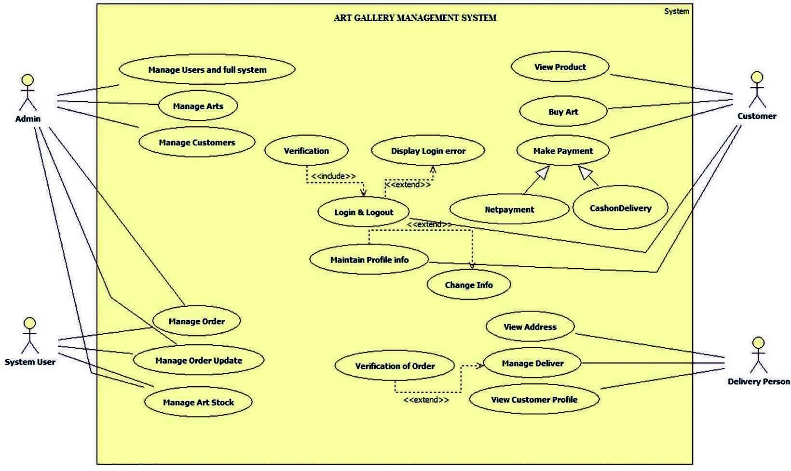
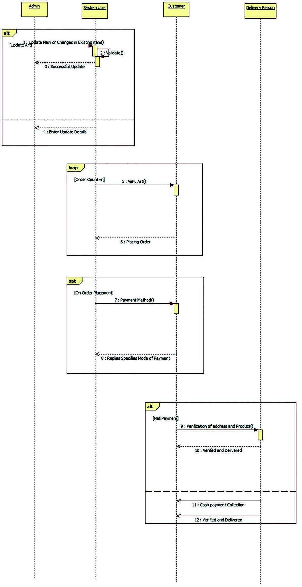
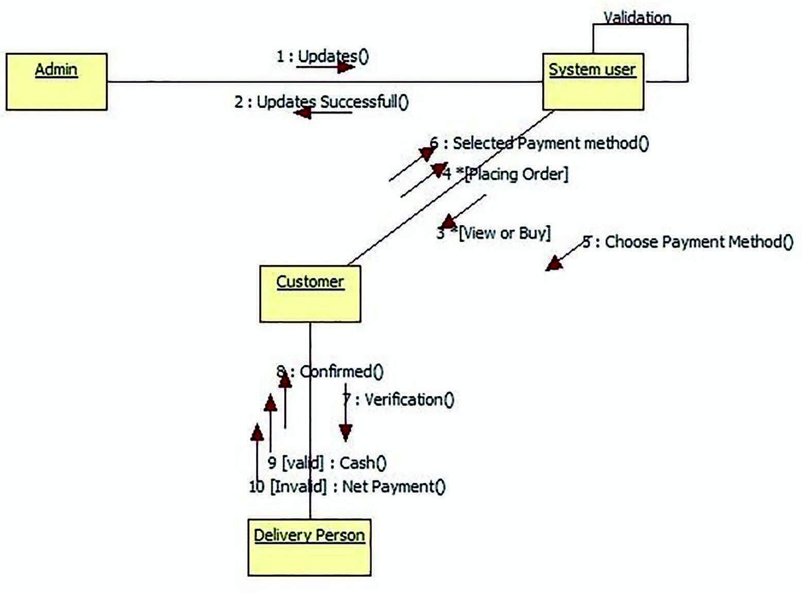
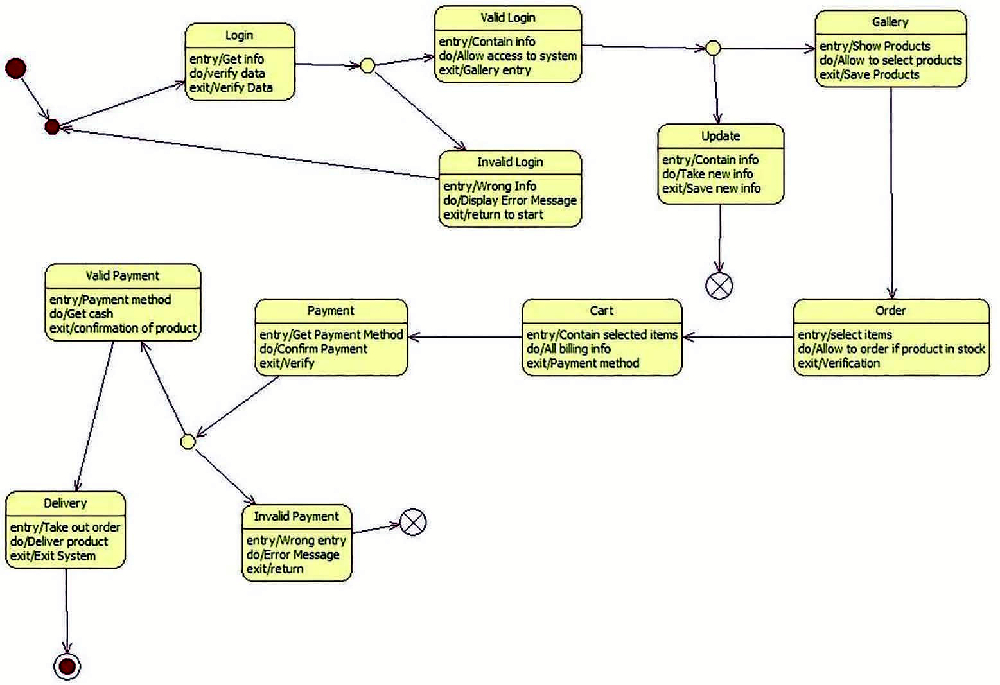
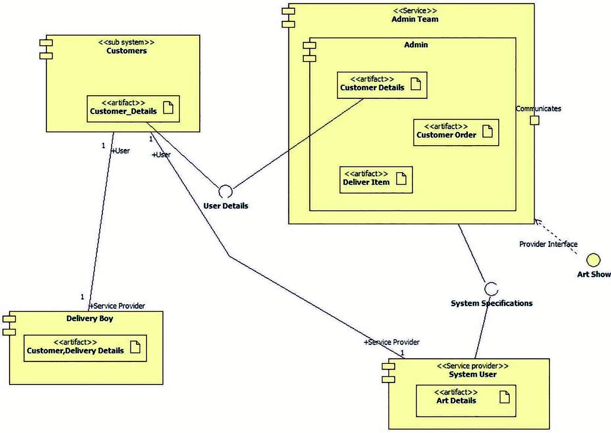
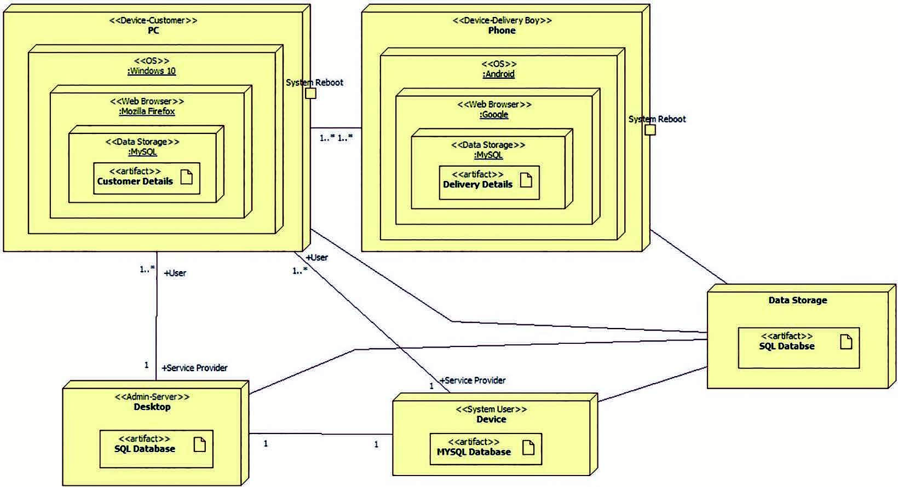

# Chapter 34: Design of UML Diagrams for Art Gallery Management System

> **Book**: *UML Diagramming: A Case Study Approach* by Dr. Suriya Sundaramoorthy (CRC Press, 2022)  
> **Pages**: 349–356 (Total: 8 pages)  
> **Classification**: Industrial Case Study & UML Modeling Suite  
> **Navigation**: [&larr; Chapter_33_Design_of_UML_Diagrams_for_Green_Rides](Chapter_33_Design_of_UML_Diagrams_for_Green_Rides.md) | [📚 Book Index](../UML_Book.md) | [Chapter_35_Design_of_UML_Diagrams_for_GUIDE_Dropshipping_Website &rarr;](Chapter_35_Design_of_UML_Diagrams_for_GUIDE_Dropshipping_Website.md)

---

## 📌 Executive Summary

Chapter 34 presents an end-to-end software engineering case study for the **Design of UML Diagrams for Art Gallery Management System**. This chapter demonstrates how business requirements and domain constraints are translated into formal architectural specifications through data-flow modeling and a complete suite of Unified Modeling Language (UML) structural and behavioral models.

The case study analyzes the system from multiple architectural perspectives: identifying external user and service actors, formalizing core operational capabilities, detailing procedural business workflows, specifying domain entity schemas, and architecting modular component deployment across distributed physical infrastructure.

---

## 🎯 Problem Statement & Business Context

To provide an online platform to manage the buying, selling and storage of artistic creations provided by creators/other platforms or auctions and to organize events to exhibit these products. The system is a gallery having art pieces with its description, price and other information and the order activity, payment activity, order update activity and so on. The objective is to provide an online platform through which museums and art galleries can make use-off to exhibit their collections in times of unavailable street galleries. Like in times of pandemic also people need not bother not going to a museum or art gallery instead they can have online art shopping and art exhibits. The system should be immune to any chances of misuse and unauthorized reproduction of works of arts and designs. There will be two types of users accessing the system: Admin (Creators/authority of the art displayed) and Customer (One who looks to buy the art). The main features provided for the admin are that they will be able to update, add, delete, input price, description and information about an art (stock availability), generate report of gallery and that for the customers are that they will be able to order (Payment), delete order, view end-user projected art particulars (Figures 34.1–34.8).

---

## ⚙️ System Architecture & Functional Capabilities

The **Design of UML Diagrams for Art Gallery Management System** decomposes business operations into modular functional units. These capabilities address the operational bottlenecks of manual and legacy workflows by introducing automated, role-based, and auditable software processes:

- **Buy Art**: Leads the customer to the process of buying the art they desire.
- **Cash on Delivery**: Final stage of the system.
- **Change Info**: Allows the user to keep an updated profile.
- **Display Login Error**: Checks for login details entered by the user while logging in and displays if incorrect.
- **Maintain Profile Info**: Allows the user to keep a profile.
- **Make Payment**: Allows the user to make payment in order to buy an item.
- **Manage Art Stock**: Keeps the system updated with new stocks.
- **Manage Arts**: Keeps the system updated with existing stocks (like the availability, quality, delivery time, etc.).
- **Manage Customers**: Maintains the records of the customers.
- **Manage Deliver**: Should assure that the correct order is delivered to the correct customer.
- **Manage Order**: Should be able to satisfy or complete an order.
- **Manage Order Update**: Updates the order tracks.
- **Manage Users and Full System**: Maintains complete system from end to end.
- **Net Payment**: Allows customers to pay online.
- **Verification of Order**: Makes sure that the correct order is delivered to the correct customer.
- **View Address**: Makes sure the order is delivered to the correct customer.
- **View Customer Profile**: Allows the delivery person to view customer profiles for any reference.
- **View Product**: Allows the user to view any product available in the system.

---

## 📊 Complete UML Diagram Suite & Architectural Walkthrough

This chapter incorporates **8 crystal-clear, high-resolution diagram(s)** (extracted losslessly from the source edition at up to 2,000+ px) illustrating the end-to-end design from functional use cases to physical hardware deployment:

### Figure 34.1: UML Usecase Diagram

**Diagram Category**: `Use Case Diagram`  
**Architectural Role**: Specifies system boundary, primary external actors, and business use cases with include/extend relationships.

**System Design Analysis**:
Illustrates the functional boundary of the **Design of UML Diagrams for Art Gallery Management System**. External actors trigger core use cases, demonstrating how business transactions, authorization checkpoints, and service requests flow into the system. Relationships (`<<include>>` for mandatory sub-routines like authentication and validation, and `<<extend>>` for optional or conditional exception branches) formalize the system's external functional contract.

### Figure 34.2: UML Activity Diagram

**Diagram Category**: `Activity Diagram`  
**Architectural Role**: Illustrates dynamic procedural workflow, decision branching, concurrent action forks, and synchronization joins.

**System Design Analysis**:
Details the step-by-step procedural execution flow for core operations in **Design of UML Diagrams for Art Gallery Management System**. Begins at an initial state, navigates action states, evaluates guard conditions at decision diamonds, and models parallel execution branches using fork and join synchronizations before reaching the terminal state, ensuring business workflows are deterministic and free of race conditions.

### Figure 34.3: UML Sequence Diagram

**Diagram Category**: `Sequence Diagram`  
**Architectural Role**: Details chronological object interactions, synchronous message exchanges, return flows, and activation lifelines.

**System Design Analysis**:
Traces the time-ordered message sequence between participating objects and services in **Design of UML Diagrams for Art Gallery Management System**. Vertical dashed lifelines represent entity instances across time, while horizontal solid and dashed arrows show synchronous invocations, data lookups, and return values. Activation bars delineate execution duration, clarifying object collaboration during key transactional workflows.

### Figure 34.4: UML Collaboration Diagram

**Diagram Category**: `Communication Diagram`  
**Architectural Role**: Emphasizes structural object topology and numbered sequence messaging between collaborating entities.

**System Design Analysis**:
Emphasizes the spatial and structural organization of collaborating instances in **Design of UML Diagrams for Art Gallery Management System**. Shows object links overlaid with numbered messages (e.g., 1.0, 1.1, 2.0), illustrating both structural connectivity and invocation hierarchy, complementing the temporal perspective of the sequence diagram.

### Figure 34.5: UML State Chart Diagram

**Diagram Category**: `State Machine Diagram`  
**Architectural Role**: Captures entity lifecycle states, transition triggers, event guards, and exit/entry actions.

**System Design Analysis**:
Models the complete lifecycle state transitions for central domain entities in **Design of UML Diagrams for Art Gallery Management System**. Tracks transitions from initial creation through intermediate processing states to completion or cancellation. Explicit state triggers, guard expressions `[condition]`, and entry/exit actions guarantee valid business lifecycle states and eliminate invalid operational state jumps.

### Figure 34.6: UML Class Diagram

**Diagram Category**: `Class Diagram`  
**Architectural Role**: Models static structural classifiers, entity attributes, operations, and associations (composition, aggregation, inheritance).

**System Design Analysis**:
Captures the static structural domain model for **Design of UML Diagrams for Art Gallery Management System**. Defines primary entity classes, their private/public attributes, operational methods, and relationships. It enforces structural integrity through multiplicities, composition (strong lifecycle ownership of subsidiary records), aggregation, and inheritance hierarchies, forming the foundation for the relational database schema and domain entity classes.

### Figure 34.7: UML Component Diagram

**Diagram Category**: `Component Diagram`  
**Architectural Role**: Architects physical modular software components, provided ball interfaces, and required socket dependencies.

**System Design Analysis**:
Architects the modular software organization for **Design of UML Diagrams for Art Gallery Management System**. Illustrates autonomous subsystems, business logic controllers, database access layers, and external service adapters. Provided interfaces (ball notation) and required dependencies (socket notation) define clear service contracts, supporting high cohesion and loose coupling.

### Figure 34.8: UML Deployment Diagram

**Diagram Category**: `Deployment Diagram`  
**Architectural Role**: Maps software execution artifacts to hardware computing nodes, client devices, application tiers, and database servers.

**System Design Analysis**:
Maps the physical runtime deployment architecture for **Design of UML Diagrams for Art Gallery Management System**. Depicts client hardware devices (web browsers, mobile apps), application servers, network firewalls, and persistence database nodes. Communication paths and execution environments reflect production infrastructure, scalability considerations, and network security boundaries.

---

## 💡 Key Architectural Invariants & Domain Lessons

1. **Requirement Traceability**: Every model in the **Design of UML Diagrams for Art Gallery Management System** suite traces directly to business requirements and operational constraints established in the problem statement.
2. **State & Workflow Integrity**: Dynamic activity and sequence models guarantee deterministic workflow completion, enforce transactional atomicity, and prevent deadlocks.
3. **Modular Encapsulation**: Component boundaries decouple domain business logic from presentation controllers and external integration adapters, supporting high maintainability.
4. **Operational Security & RBAC**: Strict role-based authorization guards sensitive operations across external actor boundaries and administrative lifelines.
5. **High-Fidelity Deployment**: Physical node topologies reflect real-world tiered infrastructure (DMZ, application cluster, isolated persistence layer), ensuring scalability and fault tolerance.

---

## 🔗 Related Resources & Navigation

- **Navigation**: [&larr; Chapter_33_Design_of_UML_Diagrams_for_Green_Rides](Chapter_33_Design_of_UML_Diagrams_for_Green_Rides.md) | [📚 Book Index](../UML_Book.md) | [Chapter_35_Design_of_UML_Diagrams_for_GUIDE_Dropshipping_Website &rarr;](Chapter_35_Design_of_UML_Diagrams_for_GUIDE_Dropshipping_Website.md)
- **Master Book Catalog**: [`UML_Book.md`](../UML_Book.md)
- **High-Resolution Images Archive**: [`images/`](../images/)