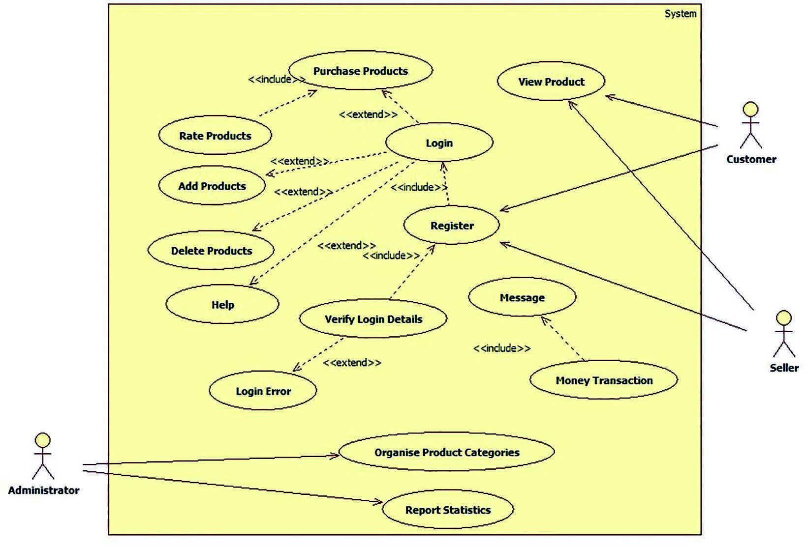
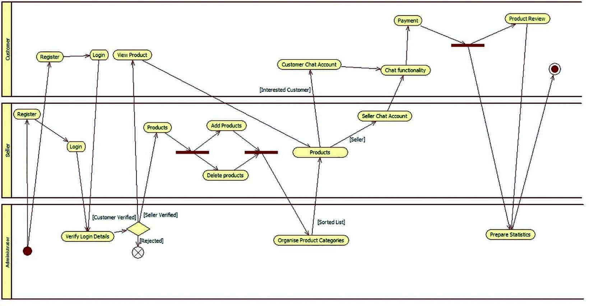
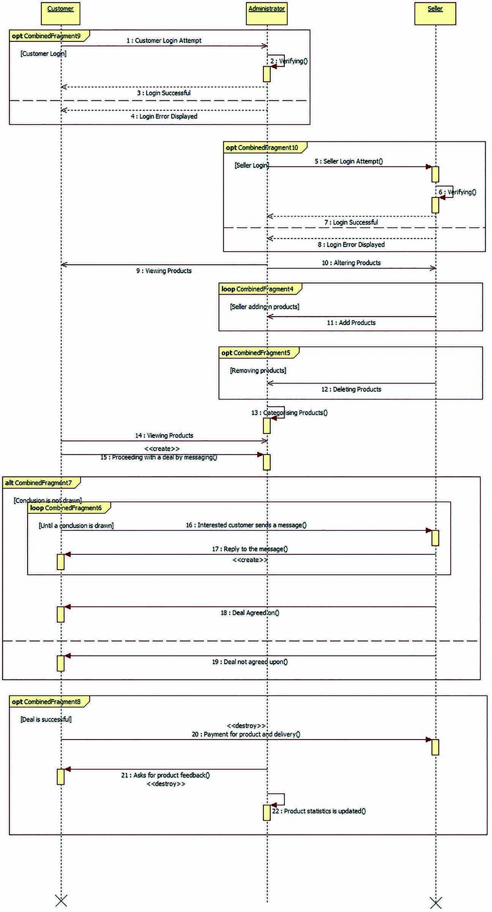
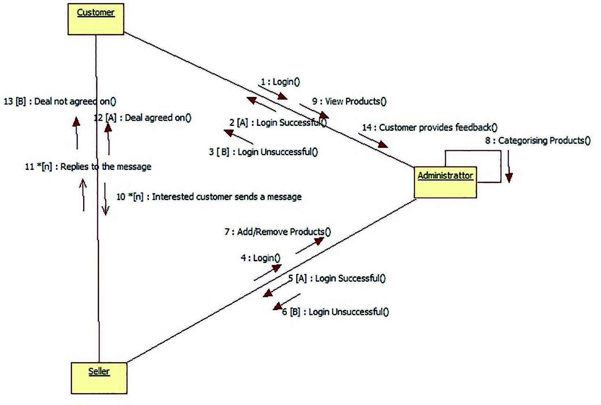
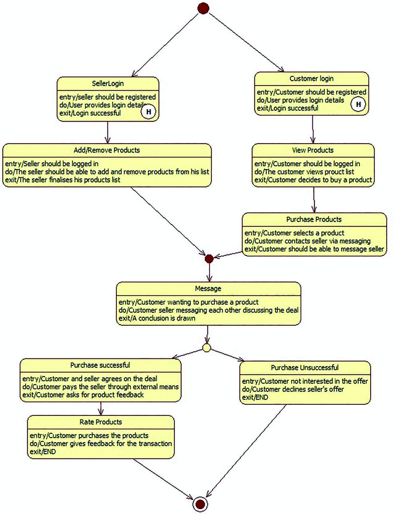
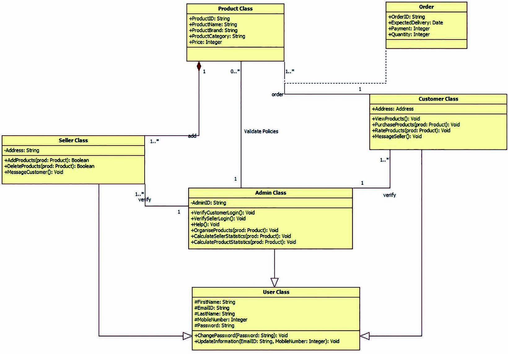
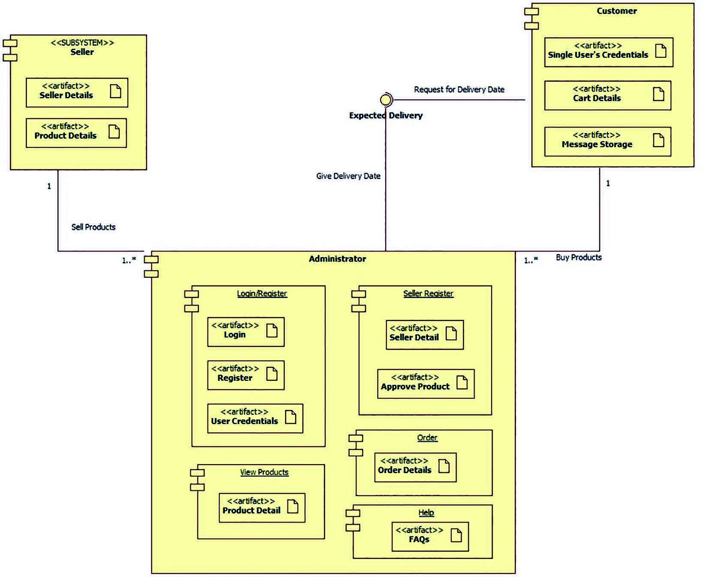
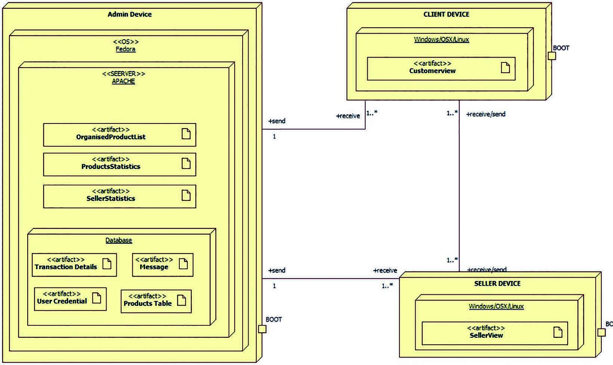

# Chapter 35: Design of UML Diagrams for GUIDE Dropshipping Website

> **Book**: *UML Diagramming: A Case Study Approach* by Dr. Suriya Sundaramoorthy (CRC Press, 2022)  
> **Pages**: 357–366 (Total: 10 pages)  
> **Classification**: Industrial Case Study & UML Modeling Suite  
> **Navigation**: [&larr; Chapter_34_Design_of_UML_Diagrams_for_Art_Gallery_Management_System](Chapter_34_Design_of_UML_Diagrams_for_Art_Gallery_Management_System.md) | [📚 Book Index](../UML_Book.md) | [Chapter_36_Design_of_UML_Diagrams_for_Online_Quiz_System &rarr;](Chapter_36_Design_of_UML_Diagrams_for_Online_Quiz_System.md)

---

## 📌 Executive Summary

Chapter 35 presents an end-to-end software engineering case study for the **Design of UML Diagrams for GUIDE Dropshipping Website**. This chapter demonstrates how business requirements and domain constraints are translated into formal architectural specifications through data-flow modeling and a complete suite of Unified Modeling Language (UML) structural and behavioral models.

The case study analyzes the system from multiple architectural perspectives: identifying external user and service actors, formalizing core operational capabilities, detailing procedural business workflows, specifying domain entity schemas, and architecting modular component deployment across distributed physical infrastructure.

---

## 🎯 Problem Statement & Business Context

The students in our college have a lot of unnecessary goods lying around, whereas many other people might be benefitted from those things. So I would like to put forward a website that can be used to sell or trade the goods with someone who needs them. It proves to be extremely useful in cases like buying and trading secondhand books or study materials among students and faculties. Initially, the website can exclusively only be accessed by the students within the PSG Tech College campus. Later on, if expected demands are met, it shall be expanded to other colleges. The sellers are given special accounts in which they are rated based on their previous records with which the buyers can choose their seller. Functionalities: 1. The buyer can opt for the payment options with which they control the risk. 2. Userfriendly website layout. 3. The buyer gets to inspect the product in front of the seller which ensures customer satisfaction (Figures 35.1–35.8).

---

## ⚙️ System Architecture & Functional Capabilities

The **Design of UML Diagrams for GUIDE Dropshipping Website** decomposes business operations into modular functional units. These capabilities address the operational bottlenecks of manual and legacy workflows by introducing automated, role-based, and auditable software processes:

- **Login**: Buyer has his/her own username and password. Using this, he/she has to log in to the system.
- **Register**: The buyer and seller can register for a new account.
- **Message**: The buyer and seller can contact each other with the chat functionality.
- **View Product**: The buyer can view products that the person wishes to purchase.
- **Verify Login Details**: The login details provided by the user is verified in the database.
- **Login Error**: If the details provided by the user does not match the details in the database, then this throws an error.
- **Help**: The users can surf through FAQs and also post questions to which answers will be provided by our team.
- **Delete Products**: The seller can delete the products they listed if they don’t want to sell the product.
- **Add Product**: The seller can add a product for selling.
- **Purchasing Products**: The buyer can pay a fair price for the products.
- **Rate Products**: The buyer can rate their experience of the purchase with respect to the product quality and seller response.
- **Money Transaction**: The customer pays the seller through external means mediated by the chat application.
- **Organize Product Categories**: The administrator organizes the product categories that may sometimes be included in the wrong categories by the seller.
- **Report Statistics**: The administrator prepares statistics based on predefined criteria.

---

## 📊 Complete UML Diagram Suite & Architectural Walkthrough

This chapter incorporates **9 crystal-clear, high-resolution diagram(s)** (extracted losslessly from the source edition at up to 2,000+ px) illustrating the end-to-end design from functional use cases to physical hardware deployment:

### Figure 35.1: UML Usecase Diagram

**Diagram Category**: `Use Case Diagram`  
**Architectural Role**: Specifies system boundary, primary external actors, and business use cases with include/extend relationships.

**System Design Analysis**:
Illustrates the functional boundary of the **Design of UML Diagrams for GUIDE Dropshipping Website**. External actors trigger core use cases, demonstrating how business transactions, authorization checkpoints, and service requests flow into the system. Relationships (`<<include>>` for mandatory sub-routines like authentication and validation, and `<<extend>>` for optional or conditional exception branches) formalize the system's external functional contract.

### Figure 35.2: UML Activity Diagram

**Diagram Category**: `Activity Diagram`  
**Architectural Role**: Illustrates dynamic procedural workflow, decision branching, concurrent action forks, and synchronization joins.

**System Design Analysis**:
Details the step-by-step procedural execution flow for core operations in **Design of UML Diagrams for GUIDE Dropshipping Website**. Begins at an initial state, navigates action states, evaluates guard conditions at decision diamonds, and models parallel execution branches using fork and join synchronizations before reaching the terminal state, ensuring business workflows are deterministic and free of race conditions.

### Figure 35.3: UML Sequence Diagram

**Diagram Category**: `Sequence Diagram`  
**Architectural Role**: Details chronological object interactions, synchronous message exchanges, return flows, and activation lifelines.

**System Design Analysis**:
Traces the time-ordered message sequence between participating objects and services in **Design of UML Diagrams for GUIDE Dropshipping Website**. Vertical dashed lifelines represent entity instances across time, while horizontal solid and dashed arrows show synchronous invocations, data lookups, and return values. Activation bars delineate execution duration, clarifying object collaboration during key transactional workflows.

### Figure 35.4: UML Collaboration Diagram

**Diagram Category**: `Communication Diagram`  
**Architectural Role**: Emphasizes structural object topology and numbered sequence messaging between collaborating entities.

**System Design Analysis**:
Emphasizes the spatial and structural organization of collaborating instances in **Design of UML Diagrams for GUIDE Dropshipping Website**. Shows object links overlaid with numbered messages (e.g., 1.0, 1.1, 2.0), illustrating both structural connectivity and invocation hierarchy, complementing the temporal perspective of the sequence diagram.

### Figure 35.5: UML State Chart Diagram

**Diagram Category**: `State Machine Diagram`  
**Architectural Role**: Captures entity lifecycle states, transition triggers, event guards, and exit/entry actions.

**System Design Analysis**:
Models the complete lifecycle state transitions for central domain entities in **Design of UML Diagrams for GUIDE Dropshipping Website**. Tracks transitions from initial creation through intermediate processing states to completion or cancellation. Explicit state triggers, guard expressions `[condition]`, and entry/exit actions guarantee valid business lifecycle states and eliminate invalid operational state jumps.

### Figure 35.6: UML Class Diagram

**Diagram Category**: `Class Diagram`  
**Architectural Role**: Models static structural classifiers, entity attributes, operations, and associations (composition, aggregation, inheritance).

**System Design Analysis**:
Captures the static structural domain model for **Design of UML Diagrams for GUIDE Dropshipping Website**. Defines primary entity classes, their private/public attributes, operational methods, and relationships. It enforces structural integrity through multiplicities, composition (strong lifecycle ownership of subsidiary records), aggregation, and inheritance hierarchies, forming the foundation for the relational database schema and domain entity classes.

### Figure 35.7: UML Component Diagram

**Diagram Category**: `Component Diagram`  
**Architectural Role**: Architects physical modular software components, provided ball interfaces, and required socket dependencies.

**System Design Analysis**:
Architects the modular software organization for **Design of UML Diagrams for GUIDE Dropshipping Website**. Illustrates autonomous subsystems, business logic controllers, database access layers, and external service adapters. Provided interfaces (ball notation) and required dependencies (socket notation) define clear service contracts, supporting high cohesion and loose coupling.

### Figure 35.8: UML Deployment Diagram

**Diagram Category**: `Deployment Diagram`  
**Architectural Role**: Maps software execution artifacts to hardware computing nodes, client devices, application tiers, and database servers.

**System Design Analysis**:
Maps the physical runtime deployment architecture for **Design of UML Diagrams for GUIDE Dropshipping Website**. Depicts client hardware devices (web browsers, mobile apps), application servers, network firewalls, and persistence database nodes. Communication paths and execution environments reflect production infrastructure, scalability considerations, and network security boundaries.

### Visual Artifacts & Supplementary Schematics

The following high-resolution schematics capture operational screen states, user dashboards, or notation components documented in this chapter:

#### Ch35 p366 img01

**Perspective**: `Conceptual Notation / Architecture Asset` — Supplemental conceptual illustration or notation reference from the source chapter.

---

## 💡 Key Architectural Invariants & Domain Lessons

1. **Requirement Traceability**: Every model in the **Design of UML Diagrams for GUIDE Dropshipping Website** suite traces directly to business requirements and operational constraints established in the problem statement.
2. **State & Workflow Integrity**: Dynamic activity and sequence models guarantee deterministic workflow completion, enforce transactional atomicity, and prevent deadlocks.
3. **Modular Encapsulation**: Component boundaries decouple domain business logic from presentation controllers and external integration adapters, supporting high maintainability.
4. **Operational Security & RBAC**: Strict role-based authorization guards sensitive operations across external actor boundaries and administrative lifelines.
5. **High-Fidelity Deployment**: Physical node topologies reflect real-world tiered infrastructure (DMZ, application cluster, isolated persistence layer), ensuring scalability and fault tolerance.

---

## 🔗 Related Resources & Navigation

- **Navigation**: [&larr; Chapter_34_Design_of_UML_Diagrams_for_Art_Gallery_Management_System](Chapter_34_Design_of_UML_Diagrams_for_Art_Gallery_Management_System.md) | [📚 Book Index](../UML_Book.md) | [Chapter_36_Design_of_UML_Diagrams_for_Online_Quiz_System &rarr;](Chapter_36_Design_of_UML_Diagrams_for_Online_Quiz_System.md)
- **Master Book Catalog**: [`UML_Book.md`](../UML_Book.md)
- **High-Resolution Images Archive**: [`images/`](../images/)