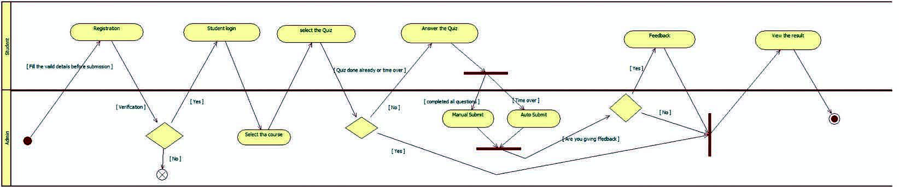
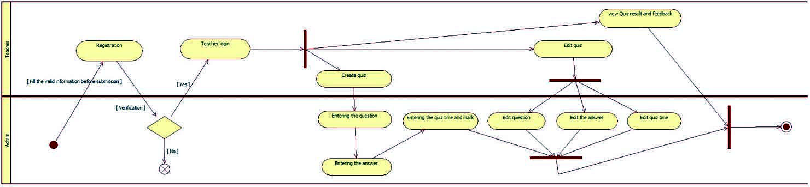
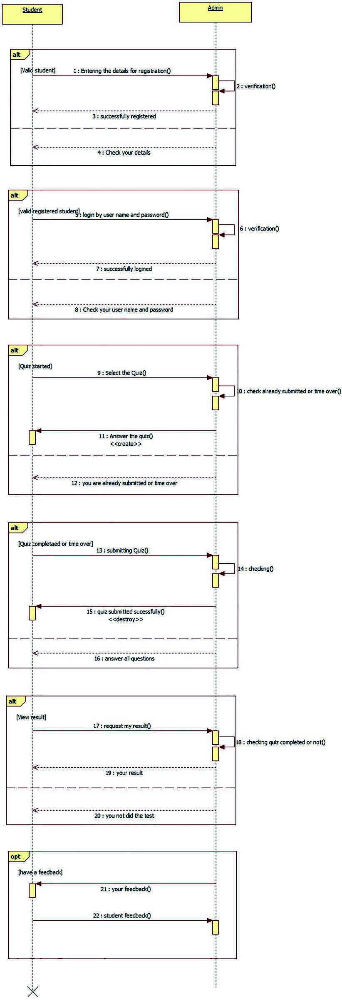
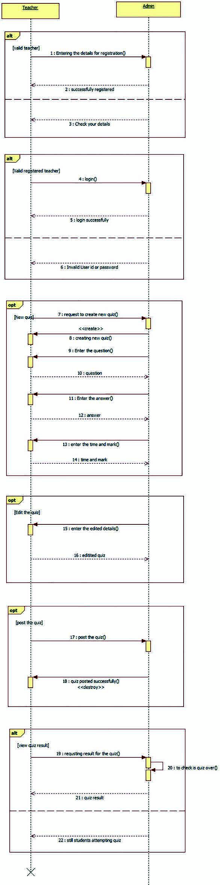
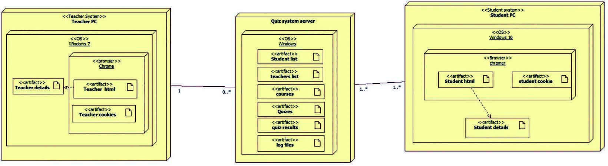

# Chapter 36: Design of UML Diagrams for Online Quiz System

> **Book**: *UML Diagramming: A Case Study Approach* by Dr. Suriya Sundaramoorthy (CRC Press, 2022)  
> **Pages**: 367–376 (Total: 10 pages)  
> **Classification**: Industrial Case Study & UML Modeling Suite  
> **Navigation**: [&larr; Chapter_35_Design_of_UML_Diagrams_for_GUIDE_Dropshipping_Website](Chapter_35_Design_of_UML_Diagrams_for_GUIDE_Dropshipping_Website.md) | [📚 Book Index](../UML_Book.md) | [Chapter_37_Design_of_UML_Diagrams_for_Book_Bank_Management_System &rarr;](Chapter_37_Design_of_UML_Diagrams_for_Book_Bank_Management_System.md)

---

## 📌 Executive Summary

Chapter 36 presents an end-to-end software engineering case study for the **Design of UML Diagrams for Online Quiz System**. This chapter demonstrates how business requirements and domain constraints are translated into formal architectural specifications through data-flow modeling and a complete suite of Unified Modeling Language (UML) structural and behavioral models.

The case study analyzes the system from multiple architectural perspectives: identifying external user and service actors, formalizing core operational capabilities, detailing procedural business workflows, specifying domain entity schemas, and architecting modular component deployment across distributed physical infrastructure.

---

## 🎯 Problem Statement & Business Context

Online learning is a part of many institution’s course offerings around the world. The scope of online quiz systems increased in this pandemic situation. The objective of the system is to maintain and improve the education rate by conducting quizzes (exams). The system acts as a bridge between student and teacher to gain knowledge and monitor it by the institution (admin). This system provides teachers to know about the students in remote education. The delightful features of the system are online teachers, remote tests, auto evaluation and feedback from students. Admin is responsible for the registration of both teachers and students. Teachers define the number of questions, time of the quiz, schedule for the quiz and they can edit it. At the end of a quiz, students can see the correct answers and their performance (Figures 36.1–36.10).

---

## ⚙️ System Architecture & Functional Capabilities

The **Design of UML Diagrams for Online Quiz System** decomposes business operations into modular functional units. These capabilities address the operational bottlenecks of manual and legacy workflows by introducing automated, role-based, and auditable software processes:

- **Registration**: It is the process of admitting students and teachers into the course by the admin.
- **Login as Teacher**: Teacher login into his profile and prepare an analysis quiz.
- **Create Quiz**: Preparing quiz questions and test schedule.
- **Enter Quiz Question**: Teachers can enter the quiz questions while creating the quiz.
- **Enter Quiz Answer**: Enter the quiz answers for the corresponding question for auto-correction.
- **Set Quiz Answer**: Schedule the test start time, end time and time for each question.
- **Edit Quiz**: Modify the quiz question, answer and schedule time.
- **View Quiz Result and Feedback**: This option provides the teacher to view the quiz result and feedback from students.
- **Login as Student**: Students enter into their profile by entering their id and password.
- **Select the Quiz**: Students select the course and quiz before answering.
- **Answer the Quiz**: After selecting the quiz, the student starts answering the quiz.
- **Submit**: After answering the quiz or schedule time, quiz answers are submitted for evaluation.
- **Auto Submit**: Quiz answers are submitted automatically, after schedule time gets over.
- **Manual Submit**: Students can submit answers before end time by manually.
- **Feedback**: After submitting the quiz, students can post the queries regarding the test.
- **View Quiz Result**: Students can view their performance and correct answers.

---

## 📊 Complete UML Diagram Suite & Architectural Walkthrough

This chapter incorporates **11 crystal-clear, high-resolution diagram(s)** (extracted losslessly from the source edition at up to 2,000+ px) illustrating the end-to-end design from functional use cases to physical hardware deployment:

### Figure 36.1: UML Usecase Diagram

**Diagram Category**: `Use Case Diagram`  
**Architectural Role**: Specifies system boundary, primary external actors, and business use cases with include/extend relationships.

**System Design Analysis**:
Illustrates the functional boundary of the **Design of UML Diagrams for Online Quiz System**. External actors trigger core use cases, demonstrating how business transactions, authorization checkpoints, and service requests flow into the system. Relationships (`<<include>>` for mandatory sub-routines like authentication and validation, and `<<extend>>` for optional or conditional exception branches) formalize the system's external functional contract.

### Figure 36.2: UML Activity Diagram Scenario 1

**Diagram Category**: `Activity Diagram`  
**Architectural Role**: Illustrates dynamic procedural workflow, decision branching, concurrent action forks, and synchronization joins.

**System Design Analysis**:
Details the step-by-step procedural execution flow for core operations in **Design of UML Diagrams for Online Quiz System**. Begins at an initial state, navigates action states, evaluates guard conditions at decision diamonds, and models parallel execution branches using fork and join synchronizations before reaching the terminal state, ensuring business workflows are deterministic and free of race conditions.

### Figure 36.3: UML Activity Diagram Scenario 2

**Diagram Category**: `Activity Diagram`  
**Architectural Role**: Illustrates dynamic procedural workflow, decision branching, concurrent action forks, and synchronization joins.

**System Design Analysis**:
Details the step-by-step procedural execution flow for core operations in **Design of UML Diagrams for Online Quiz System**. Begins at an initial state, navigates action states, evaluates guard conditions at decision diamonds, and models parallel execution branches using fork and join synchronizations before reaching the terminal state, ensuring business workflows are deterministic and free of race conditions.

### Figure 36.4: UML Sequence Diagram Scenario 1

**Diagram Category**: `Sequence Diagram`  
**Architectural Role**: Details chronological object interactions, synchronous message exchanges, return flows, and activation lifelines.

**System Design Analysis**:
Traces the time-ordered message sequence between participating objects and services in **Design of UML Diagrams for Online Quiz System**. Vertical dashed lifelines represent entity instances across time, while horizontal solid and dashed arrows show synchronous invocations, data lookups, and return values. Activation bars delineate execution duration, clarifying object collaboration during key transactional workflows.

### Figure 36.5: UML Sequence Diagram Scenario 2

**Diagram Category**: `Sequence Diagram`  
**Architectural Role**: Details chronological object interactions, synchronous message exchanges, return flows, and activation lifelines.

**System Design Analysis**:
Traces the time-ordered message sequence between participating objects and services in **Design of UML Diagrams for Online Quiz System**. Vertical dashed lifelines represent entity instances across time, while horizontal solid and dashed arrows show synchronous invocations, data lookups, and return values. Activation bars delineate execution duration, clarifying object collaboration during key transactional workflows.

### Figure 36.6: UML Collaboration Diagram

**Diagram Category**: `Communication Diagram`  
**Architectural Role**: Emphasizes structural object topology and numbered sequence messaging between collaborating entities.

**System Design Analysis**:
Emphasizes the spatial and structural organization of collaborating instances in **Design of UML Diagrams for Online Quiz System**. Shows object links overlaid with numbered messages (e.g., 1.0, 1.1, 2.0), illustrating both structural connectivity and invocation hierarchy, complementing the temporal perspective of the sequence diagram.

### Figure 36.7: UML State Chart Diagram

**Diagram Category**: `State Machine Diagram`  
**Architectural Role**: Captures entity lifecycle states, transition triggers, event guards, and exit/entry actions.

**System Design Analysis**:
Models the complete lifecycle state transitions for central domain entities in **Design of UML Diagrams for Online Quiz System**. Tracks transitions from initial creation through intermediate processing states to completion or cancellation. Explicit state triggers, guard expressions `[condition]`, and entry/exit actions guarantee valid business lifecycle states and eliminate invalid operational state jumps.

### Figure 36.8: UML Class Diagram

**Diagram Category**: `Class Diagram`  
**Architectural Role**: Models static structural classifiers, entity attributes, operations, and associations (composition, aggregation, inheritance).

**System Design Analysis**:
Captures the static structural domain model for **Design of UML Diagrams for Online Quiz System**. Defines primary entity classes, their private/public attributes, operational methods, and relationships. It enforces structural integrity through multiplicities, composition (strong lifecycle ownership of subsidiary records), aggregation, and inheritance hierarchies, forming the foundation for the relational database schema and domain entity classes.

### Figure 36.9: UML Component Diagram

**Diagram Category**: `Component Diagram`  
**Architectural Role**: Architects physical modular software components, provided ball interfaces, and required socket dependencies.

**System Design Analysis**:
Architects the modular software organization for **Design of UML Diagrams for Online Quiz System**. Illustrates autonomous subsystems, business logic controllers, database access layers, and external service adapters. Provided interfaces (ball notation) and required dependencies (socket notation) define clear service contracts, supporting high cohesion and loose coupling.

### Figure 36.10: UML Deployment Diagram

**Diagram Category**: `Deployment Diagram`  
**Architectural Role**: Maps software execution artifacts to hardware computing nodes, client devices, application tiers, and database servers.

**System Design Analysis**:
Maps the physical runtime deployment architecture for **Design of UML Diagrams for Online Quiz System**. Depicts client hardware devices (web browsers, mobile apps), application servers, network firewalls, and persistence database nodes. Communication paths and execution environments reflect production infrastructure, scalability considerations, and network security boundaries.

### Visual Artifacts & Supplementary Schematics

The following high-resolution schematics capture operational screen states, user dashboards, or notation components documented in this chapter:

#### Ch36 p376 img01

**Perspective**: `Conceptual Notation / Architecture Asset` — Supplemental conceptual illustration or notation reference from the source chapter.

---

## 💡 Key Architectural Invariants & Domain Lessons

1. **Requirement Traceability**: Every model in the **Design of UML Diagrams for Online Quiz System** suite traces directly to business requirements and operational constraints established in the problem statement.
2. **State & Workflow Integrity**: Dynamic activity and sequence models guarantee deterministic workflow completion, enforce transactional atomicity, and prevent deadlocks.
3. **Modular Encapsulation**: Component boundaries decouple domain business logic from presentation controllers and external integration adapters, supporting high maintainability.
4. **Operational Security & RBAC**: Strict role-based authorization guards sensitive operations across external actor boundaries and administrative lifelines.
5. **High-Fidelity Deployment**: Physical node topologies reflect real-world tiered infrastructure (DMZ, application cluster, isolated persistence layer), ensuring scalability and fault tolerance.

---

## 🔗 Related Resources & Navigation

- **Navigation**: [&larr; Chapter_35_Design_of_UML_Diagrams_for_GUIDE_Dropshipping_Website](Chapter_35_Design_of_UML_Diagrams_for_GUIDE_Dropshipping_Website.md) | [📚 Book Index](../UML_Book.md) | [Chapter_37_Design_of_UML_Diagrams_for_Book_Bank_Management_System &rarr;](Chapter_37_Design_of_UML_Diagrams_for_Book_Bank_Management_System.md)
- **Master Book Catalog**: [`UML_Book.md`](../UML_Book.md)
- **High-Resolution Images Archive**: [`images/`](../images/)