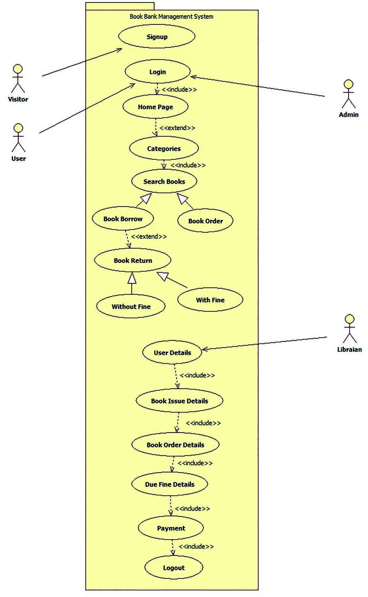
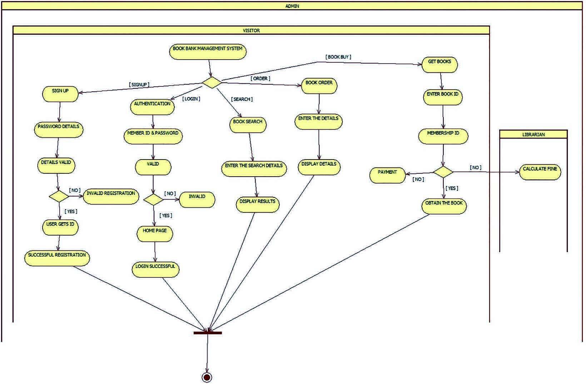
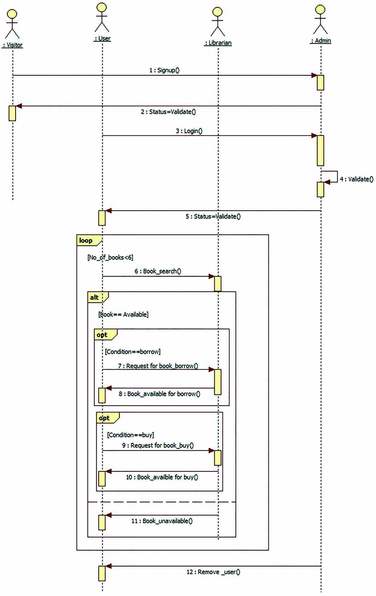
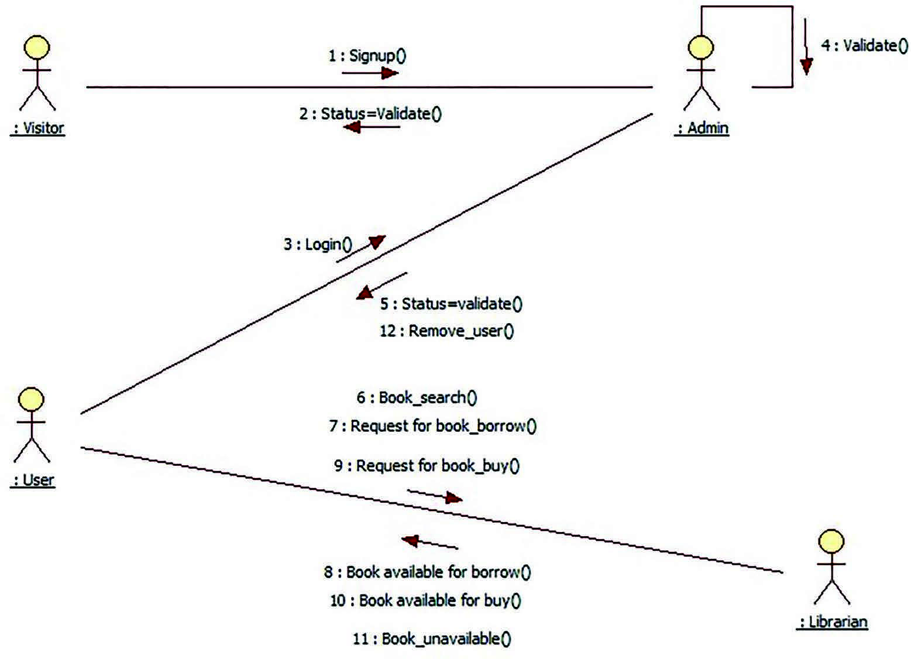
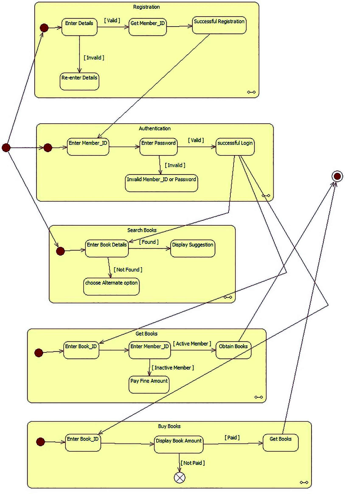
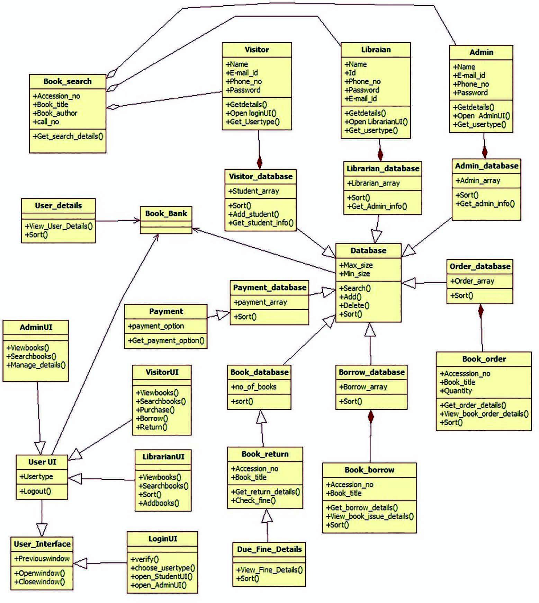
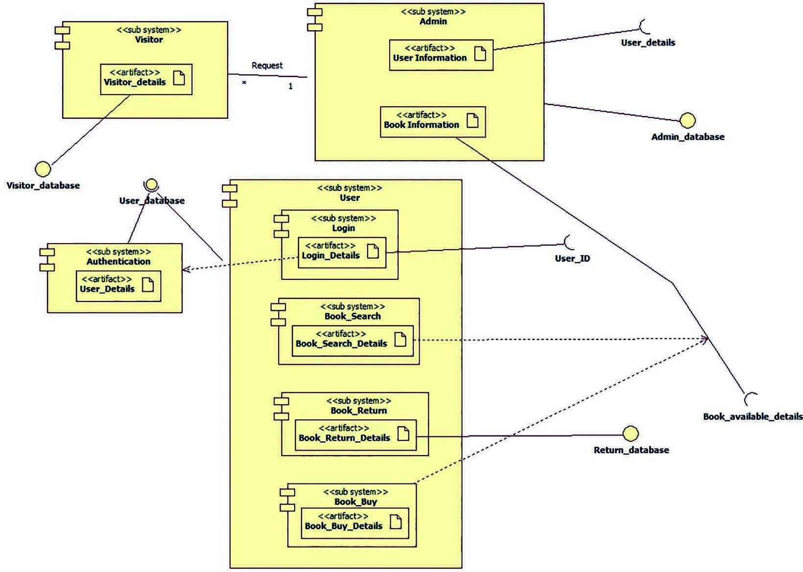
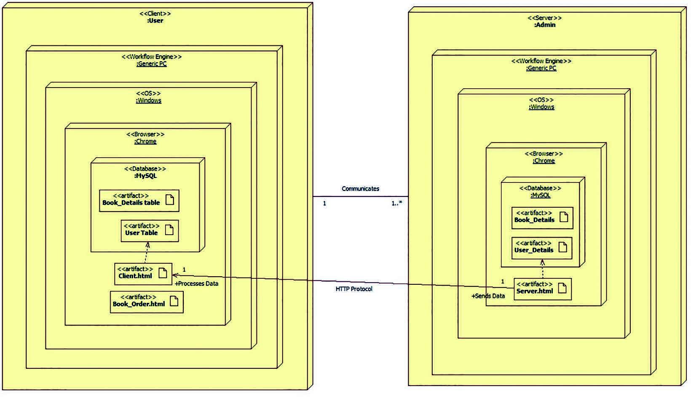

# Chapter 37: Design of UML Diagrams for Book Bank Management System

> **Book**: *UML Diagramming: A Case Study Approach* by Dr. Suriya Sundaramoorthy (CRC Press, 2022)  
> **Pages**: 377–388 (Total: 12 pages)  
> **Classification**: Industrial Case Study & UML Modeling Suite  
> **Navigation**: [&larr; Chapter_36_Design_of_UML_Diagrams_for_Online_Quiz_System](Chapter_36_Design_of_UML_Diagrams_for_Online_Quiz_System.md) | [📚 Book Index](../UML_Book.md) | [Chapter_38_Design_of_UML_Diagrams_for_Website_Development &rarr;](Chapter_38_Design_of_UML_Diagrams_for_Website_Development.md)

---

## 📌 Executive Summary

Chapter 37 presents an end-to-end software engineering case study for the **Design of UML Diagrams for Book Bank Management System**. This chapter demonstrates how business requirements and domain constraints are translated into formal architectural specifications through data-flow modeling and a complete suite of Unified Modeling Language (UML) structural and behavioral models.

The case study analyzes the system from multiple architectural perspectives: identifying external user and service actors, formalizing core operational capabilities, detailing procedural business workflows, specifying domain entity schemas, and architecting modular component deployment across distributed physical infrastructure.

---

## 🎯 Problem Statement & Business Context

- **Core Problem**: Academic libraries suffer from misplaced books on wrong shelves, overdue return tracking issues, and slow manual checkout queues.
- **Business Context**: Academic libraries and student book banks need an automated lending system to make textbooks easily accessible and track book returns accurately.
- **Key Solution**: Issues and returns books digitally for registered members, uses barcode scanners to detect misplaced shelf books, and automatically calculates overdue fines.

---

## ⚙️ System Architecture & Functional Capabilities

The **Design of UML Diagrams for Book Bank Management System** decomposes business operations into modular functional units. These capabilities address the operational bottlenecks of manual and legacy workflows by introducing automated, role-based, and auditable software processes:

- **Book Borrow**: This usecase is used to lend books to the user who wished to borrow.
- **Book Issue Details**: This usecase function deals with the details of the book that is to be issued.
- **Book Order**: This usecase function is used for placing an order to buy a book.
- **Book Order Details**: This usecase function displays the details of the books that have been ordered such as the person who ordered the book, its price etc.
- **Book Return**: This usecase function is used for updating when the person returns the book.
- **Categories**: This usecase function displays the books under each category for fast searching and easy retrieval.
- **Due Fine Details**: This usecase function displays the details of the members who exceeded their return date and displays the fine amount calculated accordingly.
- **Home Page**: This usecase function is the first screen of the system when the user successfully logs in.
- **Login**: This usecase function is used as a prerequisite for a user to enter the system. Each member is provided with a user name and password to log in.
- **Logout**: This usecase function is used to leave the system by clicking the logout button available once the member logs in to the system.
- **Payment**: This usecase function is used to buy the selected book using various payment options available.
- **Search Books**: This usecase function is used to search books based on author name, id, etc.
- **Signup**: This usecase function is used for the user to create a membership in the library.
- **User Details**: This functionality deals with the user details.it describes the total users who are accessing the systems.
- **With Fine**: This functionality says when the user doesn’t return the book ion the time the user has to pay the fine.
- **Without Fine**: The functionality says that the user returns the book without any fine.

---

## 📊 Complete UML Diagram Suite & Architectural Walkthrough

This chapter incorporates **9 crystal-clear, high-resolution diagram(s)** (extracted losslessly from the source edition at up to 2,000+ px) illustrating the end-to-end design from functional use cases to physical hardware deployment:

### Figure 37.1: UML Usecase Diagram

**Diagram Category**: `Use Case Diagram`  
**Architectural Role**: Specifies system boundary, primary external actors, and business use cases with include/extend relationships.

**System Design Analysis**:
Illustrates the functional boundary of the **Design of UML Diagrams for Book Bank Management System**. External actors trigger core use cases, demonstrating how business transactions, authorization checkpoints, and service requests flow into the system. Relationships (`<<include>>` for mandatory sub-routines like authentication and validation, and `<<extend>>` for optional or conditional exception branches) formalize the system's external functional contract.

### Figure 37.2: UML Activity Diagram

**Diagram Category**: `Activity Diagram`  
**Architectural Role**: Illustrates dynamic procedural workflow, decision branching, concurrent action forks, and synchronization joins.

**System Design Analysis**:
Details the step-by-step procedural execution flow for core operations in **Design of UML Diagrams for Book Bank Management System**. Begins at an initial state, navigates action states, evaluates guard conditions at decision diamonds, and models parallel execution branches using fork and join synchronizations before reaching the terminal state, ensuring business workflows are deterministic and free of race conditions.

### Figure 37.3: UML Sequence Diagram

**Diagram Category**: `Sequence Diagram`  
**Architectural Role**: Details chronological object interactions, synchronous message exchanges, return flows, and activation lifelines.

**System Design Analysis**:
Traces the time-ordered message sequence between participating objects and services in **Design of UML Diagrams for Book Bank Management System**. Vertical dashed lifelines represent entity instances across time, while horizontal solid and dashed arrows show synchronous invocations, data lookups, and return values. Activation bars delineate execution duration, clarifying object collaboration during key transactional workflows.

### Figure 37.4: UML Collaboration Diagram

**Diagram Category**: `Communication Diagram`  
**Architectural Role**: Emphasizes structural object topology and numbered sequence messaging between collaborating entities.

**System Design Analysis**:
Emphasizes the spatial and structural organization of collaborating instances in **Design of UML Diagrams for Book Bank Management System**. Shows object links overlaid with numbered messages (e.g., 1.0, 1.1, 2.0), illustrating both structural connectivity and invocation hierarchy, complementing the temporal perspective of the sequence diagram.

### Figure 37.5: UML State Chart Diagram

**Diagram Category**: `State Machine Diagram`  
**Architectural Role**: Captures entity lifecycle states, transition triggers, event guards, and exit/entry actions.

**System Design Analysis**:
Models the complete lifecycle state transitions for central domain entities in **Design of UML Diagrams for Book Bank Management System**. Tracks transitions from initial creation through intermediate processing states to completion or cancellation. Explicit state triggers, guard expressions `[condition]`, and entry/exit actions guarantee valid business lifecycle states and eliminate invalid operational state jumps.

### Figure 37.6: UML Class Diagram

**Diagram Category**: `Class Diagram`  
**Architectural Role**: Models static structural classifiers, entity attributes, operations, and associations (composition, aggregation, inheritance).

**System Design Analysis**:
Captures the static structural domain model for **Design of UML Diagrams for Book Bank Management System**. Defines primary entity classes, their private/public attributes, operational methods, and relationships. It enforces structural integrity through multiplicities, composition (strong lifecycle ownership of subsidiary records), aggregation, and inheritance hierarchies, forming the foundation for the relational database schema and domain entity classes.

### Figure 37.7: UML Component Diagram

**Diagram Category**: `Component Diagram`  
**Architectural Role**: Architects physical modular software components, provided ball interfaces, and required socket dependencies.

**System Design Analysis**:
Architects the modular software organization for **Design of UML Diagrams for Book Bank Management System**. Illustrates autonomous subsystems, business logic controllers, database access layers, and external service adapters. Provided interfaces (ball notation) and required dependencies (socket notation) define clear service contracts, supporting high cohesion and loose coupling.

### Figure 37.8: UML Deployment Diagram

**Diagram Category**: `Deployment Diagram`  
**Architectural Role**: Maps software execution artifacts to hardware computing nodes, client devices, application tiers, and database servers.

**System Design Analysis**:
Maps the physical runtime deployment architecture for **Design of UML Diagrams for Book Bank Management System**. Depicts client hardware devices (web browsers, mobile apps), application servers, network firewalls, and persistence database nodes. Communication paths and execution environments reflect production infrastructure, scalability considerations, and network security boundaries.

### Visual Artifacts & Supplementary Schematics

The following high-resolution schematics capture operational screen states, user dashboards, or notation components documented in this chapter:

#### Ch37 p388 img01

**Perspective**: `Conceptual Notation / Architecture Asset` — Supplemental conceptual illustration or notation reference from the source chapter.

---

## 💡 Key Architectural Invariants & Domain Lessons

1. **Requirement Traceability**: Every model in the **Design of UML Diagrams for Book Bank Management System** suite traces directly to business requirements and operational constraints established in the problem statement.
2. **State & Workflow Integrity**: Dynamic activity and sequence models guarantee deterministic workflow completion, enforce transactional atomicity, and prevent deadlocks.
3. **Modular Encapsulation**: Component boundaries decouple domain business logic from presentation controllers and external integration adapters, supporting high maintainability.
4. **Operational Security & RBAC**: Strict role-based authorization guards sensitive operations across external actor boundaries and administrative lifelines.
5. **High-Fidelity Deployment**: Physical node topologies reflect real-world tiered infrastructure (DMZ, application cluster, isolated persistence layer), ensuring scalability and fault tolerance.

---

## 🔗 Related Resources & Navigation

- **Navigation**: [&larr; Chapter_36_Design_of_UML_Diagrams_for_Online_Quiz_System](Chapter_36_Design_of_UML_Diagrams_for_Online_Quiz_System.md) | [📚 Book Index](../UML_Book.md) | [Chapter_38_Design_of_UML_Diagrams_for_Website_Development &rarr;](Chapter_38_Design_of_UML_Diagrams_for_Website_Development.md)
- **Master Book Catalog**: [`UML_Book.md`](../UML_Book.md)
- **High-Resolution Images Archive**: [`images/`](../images/)