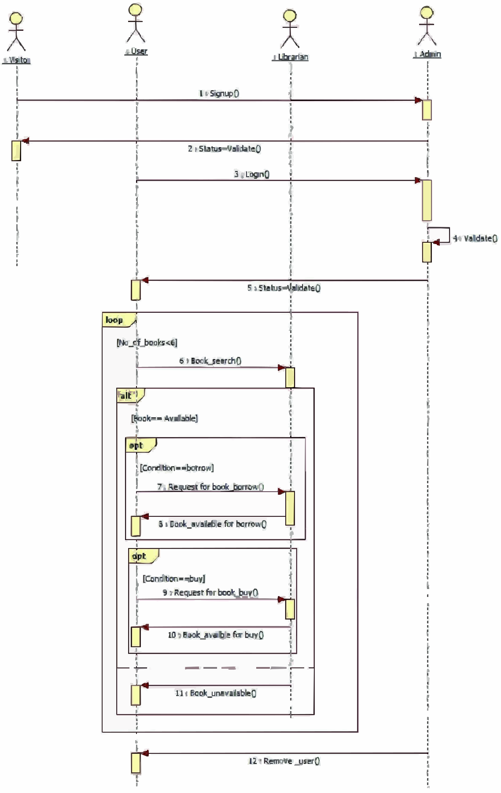
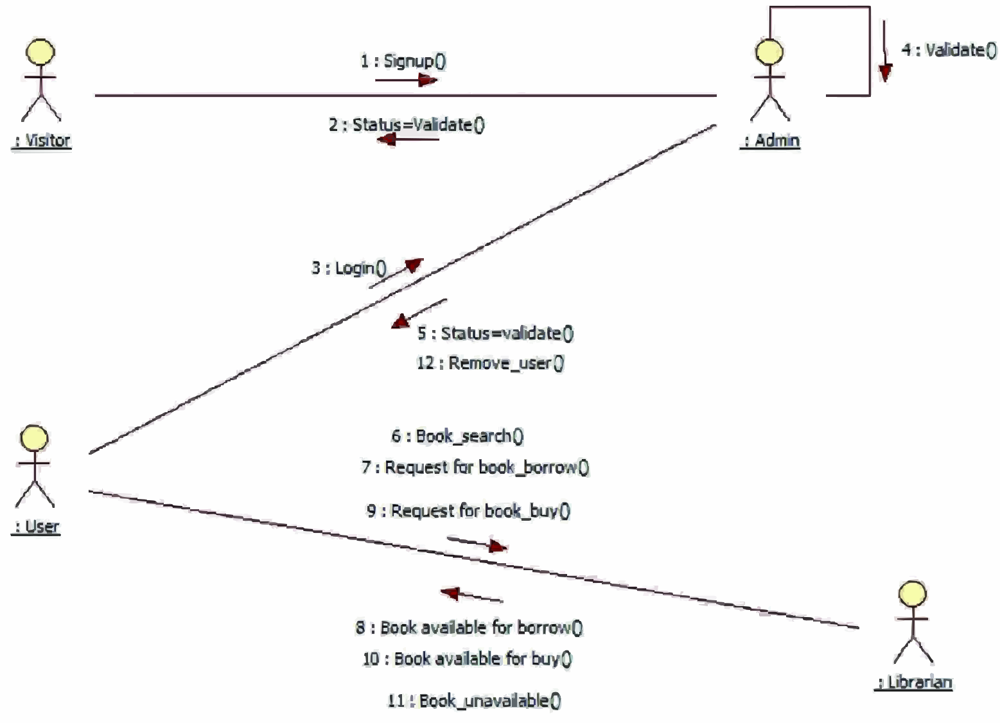

# Chapter 37: Design of UML Diagrams for Book Bank Management System

> **Book**: *UML Diagramming: A Case Study Approach* by Dr. Suriya Sundaramoorthy (CRC Press, 2022)  
> **Pages**: 377–388 (Total: 12 pages)  
> **Classification**: Industrial Case Study & Diagram Suite  
> **Navigation**: [&larr; Chapter_36_Design_of_UML_Diagrams_for_Online_Quiz_System](Chapter_36_Design_of_UML_Diagrams_for_Online_Quiz_System.md) | [📚 Book Index](../UML_Book.md) | [Chapter_38_Design_of_UML_Diagrams_for_Website_Development &rarr;](Chapter_38_Design_of_UML_Diagrams_for_Website_Development.md)

---

## 📌 Executive Summary

Chapter 37 presents an industrial software engineering case study for **Design of UML Diagrams for Book Bank Management System**. It details the transition from business requirements and domain constraints into formal software architecture specifications, leveraging data-flow modeling and a complete suite of Unified Modeling Language (UML) structural and behavioral diagrams.

---

## 🎯 Problem Statement & System Context

The book bank management is a software in which a member can register themselves and then he can borrow books from the book bank or the members can buy the books from the book bank. A Book Bank lends books and magazines to member, who is registered in the system. It mainly concentrates on providing the book for authorized members only. A member can reserve a book or magazine that is not currently available in the book bank, so that when it is returned or purchased by the book bank, that person is notified. The book bank can easily create, replace and delete information about the titles, members and reservations from the system. The main issue of the system is that only registered members can lend the book from the book bank. In the case of lending, we should maintain the database for the status and issue of the book and also we have to calculate the fine amount with respect to the due date. We should maintain the book according to the department, generals, and year of study. Another main issue of the system is that if the user takes the book and misplace it on another shelf, then we have the chip of bar scanner to scan the books and indicate to the admin that the book has been replaced. All the above issues will be satisfied by developing the software as a user-friendly system. The main functionality of the system is that Sign in, Login, Log out, Book storing, Book retrieval, Book for buying, Stock Updating, Due fine, E-books, Payment, Book maintenance, Sales report, User records and Sorting. If the software is not developed, the members will affect based on criteria like the book is not in stock, the book is not arranged in order and maintenance will be more. The software is developed to satisfy the needs according to the members. The software will be very useful in the area of institutions, libraries and for general citizens. The software is developed to act as a useful interface for the users to easily access books.

---

## 📊 Complete UML Diagram Suite & Architecture Specifications

This chapter incorporates **9 standalone vector diagram(s)** illustrating the end-to-end design from functional use cases to physical hardware deployment:

### Figure 37.1: UML Usecase Diagram

**Diagram Category**: `Use Case Diagram`  
**Architectural Role**: Specifies system boundary, primary external actors, and business use cases with include/extend relationships.

### Figure 37.2: UML Activity Diagram

**Diagram Category**: `Activity Diagram`  
**Architectural Role**: Illustrates dynamic procedural workflow, decision branching, concurrent action forks, and synchronization joins.

### Figure 37.3: UML Sequence Diagram

**Diagram Category**: `Sequence Diagram`  
**Architectural Role**: Details chronological object interactions, synchronous message exchanges, return flows, and activation lifelines.

### Figure 37.4: UML Collaboration Diagram

**Diagram Category**: `Communication Diagram`  
**Architectural Role**: Emphasizes structural object topology and numbered sequence messaging between collaborating entities.

### Figure 37.5: UML State Chart Diagram

**Diagram Category**: `State Machine Diagram`  
**Architectural Role**: Captures entity lifecycle states, transition triggers, event guards, and exit/entry actions.

### Figure 37.6: UML Class Diagram

**Diagram Category**: `Class Diagram`  
**Architectural Role**: Models static structural classifiers, entity attributes, operations, and associations (composition, aggregation, inheritance).

### Figure 37.7: UML Component Diagram

**Diagram Category**: `Component Diagram`  
**Architectural Role**: Architects physical modular software components, provided ball interfaces, and required socket dependencies.

### Figure 37.8: UML Deployment Diagram

**Diagram Category**: `Deployment Diagram`  
**Architectural Role**: Maps software execution artifacts to hardware computing nodes, client devices, application tiers, and database servers.

### Visual Artifacts & Supplementary Schematics

The following vector schematics capture operational screen states, user dashboards, or notation components documented in this chapter:

#### Ch37 p388 img01

---

## 💡 Key Architectural Invariants & Modeling Lessons

1. **Traceability**: Every software model directly corresponds to explicit functional requirements defined during the initial domain specification.
2. **Separation of Concerns**: Structural models (Class, Component, Deployment) maintain clear boundaries separating business domain entities from physical infrastructure nodes.
3. **Behavioral Integrity**: Dynamic models (Activity, Sequence, State Machine) guarantee valid state transitions, prevent deadlocks, and verify message order consistency.
4. **Deployment Fidelity**: Physical nodes and execution environments accurately map runtime middleware, database engines, and client access channels.

---

## 🔗 Related Resources & Navigation

- **Navigation**: [&larr; Chapter_36_Design_of_UML_Diagrams_for_Online_Quiz_System](Chapter_36_Design_of_UML_Diagrams_for_Online_Quiz_System.md) | [📚 Book Index](../UML_Book.md) | [Chapter_38_Design_of_UML_Diagrams_for_Website_Development &rarr;](Chapter_38_Design_of_UML_Diagrams_for_Website_Development.md)
- **Master Book Catalog**: [`UML_Book.md`](../UML_Book.md)
- **Vector Images Catalog**: [`Vector_Images_Catalog.md`](../vector_images/Vector_Images_Catalog.md)