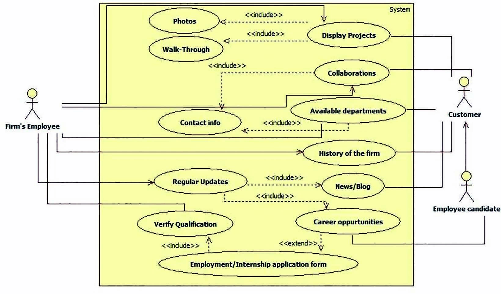
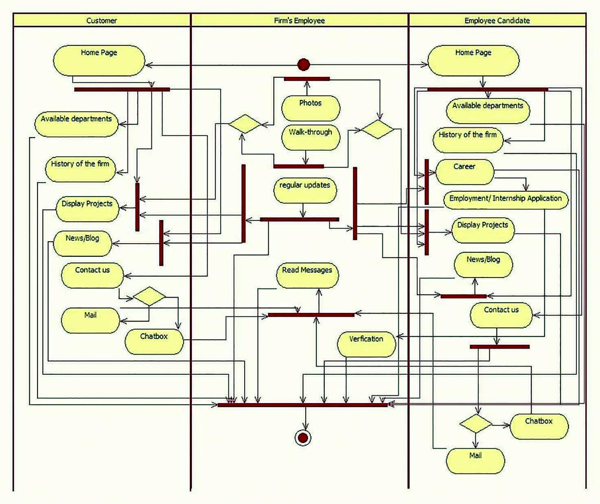
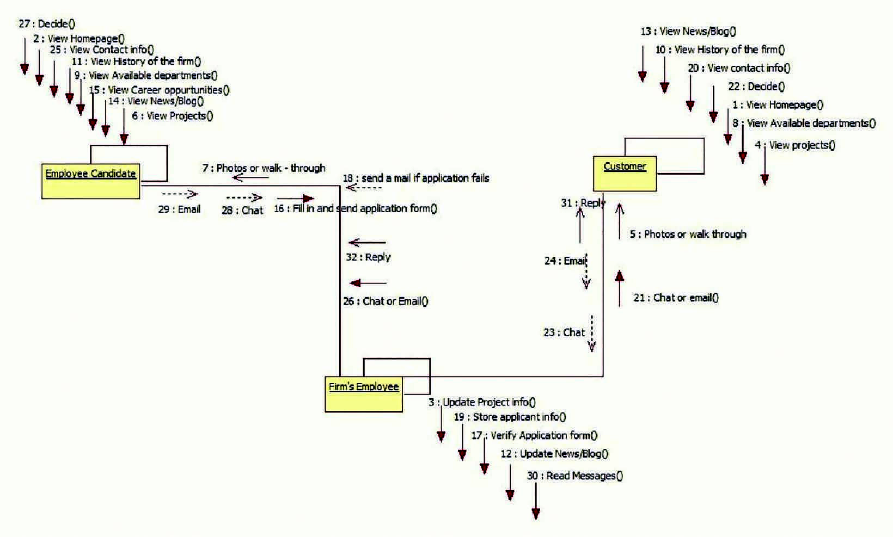
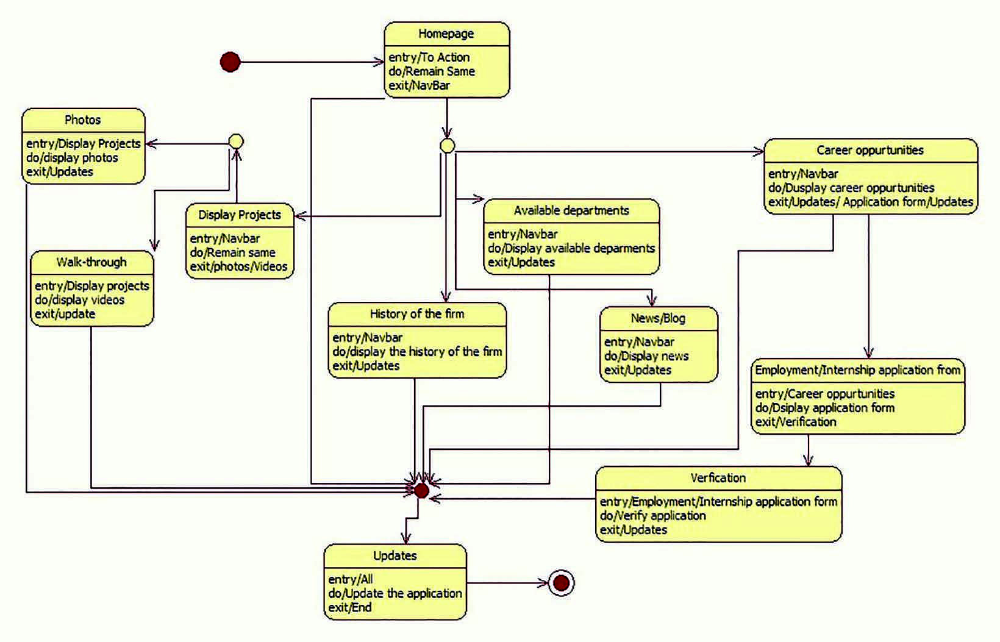
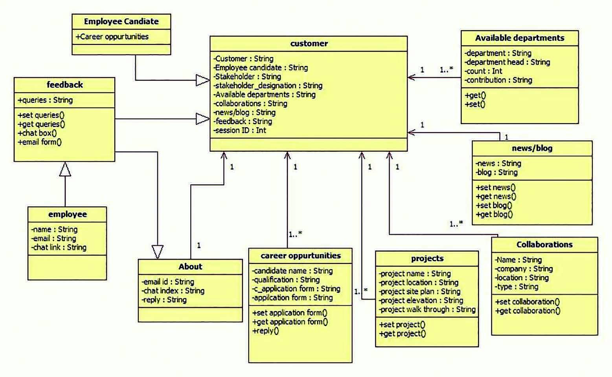
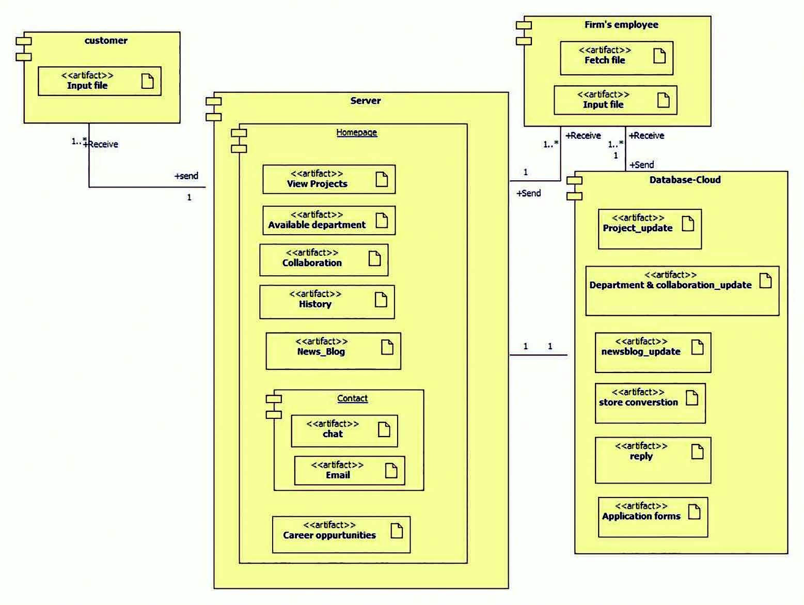
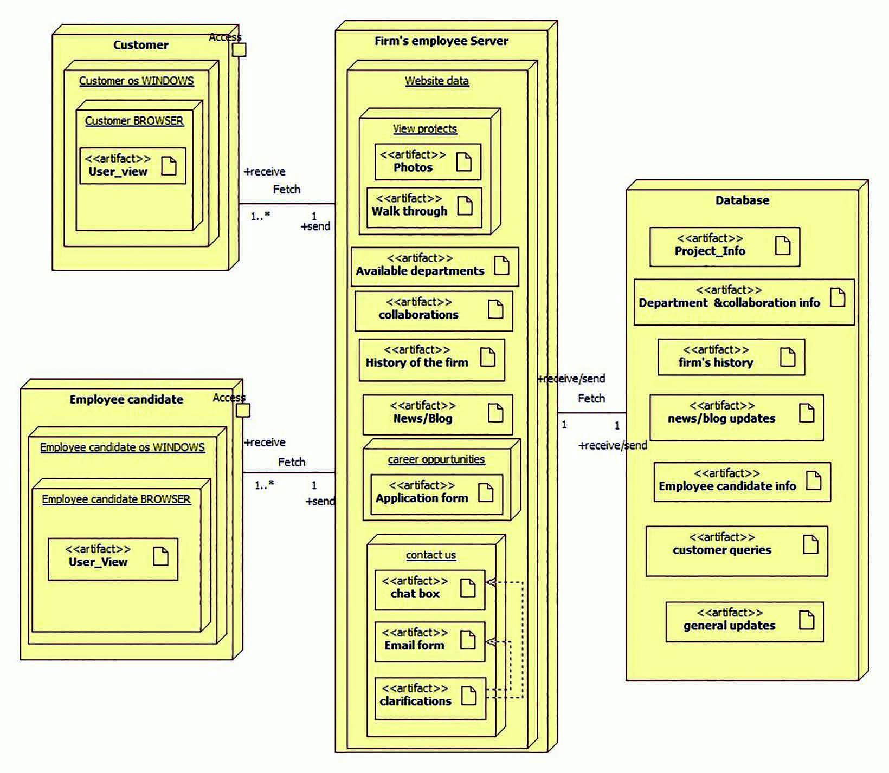

# Chapter 38: Design of UML Diagrams for Website Development

> **Book**: *UML Diagramming: A Case Study Approach* by Dr. Suriya Sundaramoorthy (CRC Press, 2022)  
> **Pages**: 389–396 (Total: 8 pages)  
> **Classification**: Industrial Case Study & UML Modeling Suite  
> **Navigation**: [&larr; Chapter_37_Design_of_UML_Diagrams_for_Book_Bank_Management_System](Chapter_37_Design_of_UML_Diagrams_for_Book_Bank_Management_System.md) | [📚 Book Index](../UML_Book.md) | [Chapter_39_Design_of_UML_Diagrams_for_STARTUP_MEET &rarr;](Chapter_39_Design_of_UML_Diagrams_for_STARTUP_MEET.md)

---

## 📌 Executive Summary

Chapter 38 presents an end-to-end software engineering case study for the **Design of UML Diagrams for Website Development**. This chapter demonstrates how business requirements and domain constraints are translated into formal architectural specifications through data-flow modeling and a complete suite of Unified Modeling Language (UML) structural and behavioral models.

The case study analyzes the system from multiple architectural perspectives: identifying external user and service actors, formalizing core operational capabilities, detailing procedural business workflows, specifying domain entity schemas, and architecting modular component deployment across distributed physical infrastructure.

---

## 🎯 Problem Statement & Business Context

Mega Associates is an evolving architectural firm that is facing a fierce competition. The competitors have a modern, well-built website that is pulling some of the firm’s clients towards themselves. In order to avoid a situation like this and to retain all the firm’s clients and to attract new ones, a refreshing website is needed. The website of the firm should include the major projects of the firm, a brief on all the available departments and collaborations, recent news with respect to the firm, the firm’s insights, the history of the firm, mail or chat feature, and career opportunities with regard to the firm (Figures 38.1–38.8).

---

## ⚙️ System Architecture & Functional Capabilities

The **Design of UML Diagrams for Website Development** decomposes business operations into modular functional units. These capabilities address the operational bottlenecks of manual and legacy workflows by introducing automated, role-based, and auditable software processes:

- **Display Projects**: Functionality involves displaying all the major projects done by the firm.
- **Collaborations**: This functionality tells about the various collaborations of the firm with other Companies/firms.
- **Available Departments**: This functionality talks about the available departments in the firm and the services that they can offer.
- **History of the Firm**: This functionality displays the history of the firm.
- **News/Blog**: This functionality gives the recent news with respect to the firm.
- **Career Opportunities**: This functionality displays all the available job opportunities with respect to the firm.
- **Photos**: This functionality displays the projects to the firm in the form of photos.
- **Wa lk-Through**: This functionality displays the walk-through (animated/3D video of a building that is to be built) of the projects of the firm.
- **Contact Info**: This functionality displays various forms of contact details/information with respect to the firm.
- **Regular Updates**: This functionality helps in updating the recent news and career opportunities with respect to the firm.
- **Employment/Internship Application Form**: This functionality displays the application form for Employment/Internship.
- **Qualification Verification**: This functionality checks all the necessary requirements in the applicant’s application form.

---

## 📊 Complete UML Diagram Suite & Architectural Walkthrough

This chapter incorporates **8 crystal-clear, high-resolution diagram(s)** (extracted losslessly from the source edition at up to 2,000+ px) illustrating the end-to-end design from functional use cases to physical hardware deployment:

### Figure 38.1: UML Usecase Diagram

**Diagram Category**: `Use Case Diagram`  
**Architectural Role**: Specifies system boundary, primary external actors, and business use cases with include/extend relationships.

**System Design Analysis**:
Illustrates the functional boundary of the **Design of UML Diagrams for Website Development**. External actors trigger core use cases, demonstrating how business transactions, authorization checkpoints, and service requests flow into the system. Relationships (`<<include>>` for mandatory sub-routines like authentication and validation, and `<<extend>>` for optional or conditional exception branches) formalize the system's external functional contract.

### Figure 38.2: UML Activity Diagram

**Diagram Category**: `Activity Diagram`  
**Architectural Role**: Illustrates dynamic procedural workflow, decision branching, concurrent action forks, and synchronization joins.

**System Design Analysis**:
Details the step-by-step procedural execution flow for core operations in **Design of UML Diagrams for Website Development**. Begins at an initial state, navigates action states, evaluates guard conditions at decision diamonds, and models parallel execution branches using fork and join synchronizations before reaching the terminal state, ensuring business workflows are deterministic and free of race conditions.

### Figure 38.3: UML Sequence Diagram

**Diagram Category**: `Sequence Diagram`  
**Architectural Role**: Details chronological object interactions, synchronous message exchanges, return flows, and activation lifelines.

**System Design Analysis**:
Traces the time-ordered message sequence between participating objects and services in **Design of UML Diagrams for Website Development**. Vertical dashed lifelines represent entity instances across time, while horizontal solid and dashed arrows show synchronous invocations, data lookups, and return values. Activation bars delineate execution duration, clarifying object collaboration during key transactional workflows.

### Figure 38.4: UML Collaboration Diagram

**Diagram Category**: `Communication Diagram`  
**Architectural Role**: Emphasizes structural object topology and numbered sequence messaging between collaborating entities.

**System Design Analysis**:
Emphasizes the spatial and structural organization of collaborating instances in **Design of UML Diagrams for Website Development**. Shows object links overlaid with numbered messages (e.g., 1.0, 1.1, 2.0), illustrating both structural connectivity and invocation hierarchy, complementing the temporal perspective of the sequence diagram.

### Figure 38.5: UML State Chart Diagram

**Diagram Category**: `State Machine Diagram`  
**Architectural Role**: Captures entity lifecycle states, transition triggers, event guards, and exit/entry actions.

**System Design Analysis**:
Models the complete lifecycle state transitions for central domain entities in **Design of UML Diagrams for Website Development**. Tracks transitions from initial creation through intermediate processing states to completion or cancellation. Explicit state triggers, guard expressions `[condition]`, and entry/exit actions guarantee valid business lifecycle states and eliminate invalid operational state jumps.

### Figure 38.6: UML Class Diagram

**Diagram Category**: `Class Diagram`  
**Architectural Role**: Models static structural classifiers, entity attributes, operations, and associations (composition, aggregation, inheritance).

**System Design Analysis**:
Captures the static structural domain model for **Design of UML Diagrams for Website Development**. Defines primary entity classes, their private/public attributes, operational methods, and relationships. It enforces structural integrity through multiplicities, composition (strong lifecycle ownership of subsidiary records), aggregation, and inheritance hierarchies, forming the foundation for the relational database schema and domain entity classes.

### Figure 38.7: UML Component Diagram

**Diagram Category**: `Component Diagram`  
**Architectural Role**: Architects physical modular software components, provided ball interfaces, and required socket dependencies.

**System Design Analysis**:
Architects the modular software organization for **Design of UML Diagrams for Website Development**. Illustrates autonomous subsystems, business logic controllers, database access layers, and external service adapters. Provided interfaces (ball notation) and required dependencies (socket notation) define clear service contracts, supporting high cohesion and loose coupling.

### Figure 38.8: UML Deployment Diagram

**Diagram Category**: `Deployment Diagram`  
**Architectural Role**: Maps software execution artifacts to hardware computing nodes, client devices, application tiers, and database servers.

**System Design Analysis**:
Maps the physical runtime deployment architecture for **Design of UML Diagrams for Website Development**. Depicts client hardware devices (web browsers, mobile apps), application servers, network firewalls, and persistence database nodes. Communication paths and execution environments reflect production infrastructure, scalability considerations, and network security boundaries.

---

## 💡 Key Architectural Invariants & Domain Lessons

1. **Requirement Traceability**: Every model in the **Design of UML Diagrams for Website Development** suite traces directly to business requirements and operational constraints established in the problem statement.
2. **State & Workflow Integrity**: Dynamic activity and sequence models guarantee deterministic workflow completion, enforce transactional atomicity, and prevent deadlocks.
3. **Modular Encapsulation**: Component boundaries decouple domain business logic from presentation controllers and external integration adapters, supporting high maintainability.
4. **Operational Security & RBAC**: Strict role-based authorization guards sensitive operations across external actor boundaries and administrative lifelines.
5. **High-Fidelity Deployment**: Physical node topologies reflect real-world tiered infrastructure (DMZ, application cluster, isolated persistence layer), ensuring scalability and fault tolerance.

---

## 🔗 Related Resources & Navigation

- **Navigation**: [&larr; Chapter_37_Design_of_UML_Diagrams_for_Book_Bank_Management_System](Chapter_37_Design_of_UML_Diagrams_for_Book_Bank_Management_System.md) | [📚 Book Index](../UML_Book.md) | [Chapter_39_Design_of_UML_Diagrams_for_STARTUP_MEET &rarr;](Chapter_39_Design_of_UML_Diagrams_for_STARTUP_MEET.md)
- **Master Book Catalog**: [`UML_Book.md`](../UML_Book.md)
- **High-Resolution Images Archive**: [`images/`](../images/)