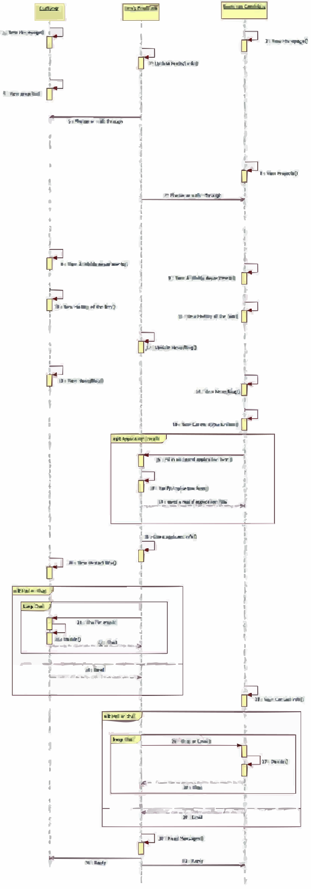

# Chapter 38: Design of UML Diagrams for Website Development

> **Book**: *UML Diagramming: A Case Study Approach* by Dr. Suriya Sundaramoorthy (CRC Press, 2022)  
> **Pages**: 389–396 (Total: 8 pages)  
> **Classification**: Industrial Case Study & Diagram Suite  
> **Navigation**: [&larr; Chapter_37_Design_of_UML_Diagrams_for_Book_Bank_Management_System](Chapter_37_Design_of_UML_Diagrams_for_Book_Bank_Management_System.md) | [📚 Book Index](../UML_Book.md) | [Chapter_39_Design_of_UML_Diagrams_for_STARTUP_MEET &rarr;](Chapter_39_Design_of_UML_Diagrams_for_STARTUP_MEET.md)

---

## 📌 Executive Summary

Chapter 38 presents an industrial software engineering case study for **Design of UML Diagrams for Website Development**. It details the transition from business requirements and domain constraints into formal software architecture specifications, leveraging data-flow modeling and a complete suite of Unified Modeling Language (UML) structural and behavioral diagrams.

---

## 🎯 Problem Statement & System Context

Mega Associates is an evolving architectural firm that is facing a fierce competition. The competitors have a modern, well-built website that is pulling some of the firm’s clients towards themselves. In order to avoid a situation like this and to retain all the firm’s clients and to attract new ones, a refreshing website is needed. The website of the firm should include the major projects of the firm, a brief on all the available departments and collaborations, recent news with respect to the firm, the firm’s insights, the history of the firm, mail or chat feature, and career opportunities with regard to the firm (Figures 38.1–38.8).

---

## 📊 Complete UML Diagram Suite & Architecture Specifications

This chapter incorporates **8 standalone vector diagram(s)** illustrating the end-to-end design from functional use cases to physical hardware deployment:

### Figure 38.1: UML Usecase Diagram

**Diagram Category**: `Use Case Diagram`  
**Architectural Role**: Specifies system boundary, primary external actors, and business use cases with include/extend relationships.

### Figure 38.2: UML Activity Diagram

**Diagram Category**: `Activity Diagram`  
**Architectural Role**: Illustrates dynamic procedural workflow, decision branching, concurrent action forks, and synchronization joins.

### Figure 38.3: UML Sequence Diagram

**Diagram Category**: `Sequence Diagram`  
**Architectural Role**: Details chronological object interactions, synchronous message exchanges, return flows, and activation lifelines.

### Figure 38.4: UML Collaboration Diagram

**Diagram Category**: `Communication Diagram`  
**Architectural Role**: Emphasizes structural object topology and numbered sequence messaging between collaborating entities.

### Figure 38.5: UML State Chart Diagram

**Diagram Category**: `State Machine Diagram`  
**Architectural Role**: Captures entity lifecycle states, transition triggers, event guards, and exit/entry actions.

### Figure 38.6: UML Class Diagram

**Diagram Category**: `Class Diagram`  
**Architectural Role**: Models static structural classifiers, entity attributes, operations, and associations (composition, aggregation, inheritance).

### Figure 38.7: UML Component Diagram

**Diagram Category**: `Component Diagram`  
**Architectural Role**: Architects physical modular software components, provided ball interfaces, and required socket dependencies.

### Figure 38.8: UML Deployment Diagram

**Diagram Category**: `Deployment Diagram`  
**Architectural Role**: Maps software execution artifacts to hardware computing nodes, client devices, application tiers, and database servers.

---

## 💡 Key Architectural Invariants & Modeling Lessons

1. **Traceability**: Every software model directly corresponds to explicit functional requirements defined during the initial domain specification.
2. **Separation of Concerns**: Structural models (Class, Component, Deployment) maintain clear boundaries separating business domain entities from physical infrastructure nodes.
3. **Behavioral Integrity**: Dynamic models (Activity, Sequence, State Machine) guarantee valid state transitions, prevent deadlocks, and verify message order consistency.
4. **Deployment Fidelity**: Physical nodes and execution environments accurately map runtime middleware, database engines, and client access channels.

---

## 🔗 Related Resources & Navigation

- **Navigation**: [&larr; Chapter_37_Design_of_UML_Diagrams_for_Book_Bank_Management_System](Chapter_37_Design_of_UML_Diagrams_for_Book_Bank_Management_System.md) | [📚 Book Index](../UML_Book.md) | [Chapter_39_Design_of_UML_Diagrams_for_STARTUP_MEET &rarr;](Chapter_39_Design_of_UML_Diagrams_for_STARTUP_MEET.md)
- **Master Book Catalog**: [`UML_Book.md`](../UML_Book.md)
- **Vector Images Catalog**: [`Vector_Images_Catalog.md`](../vector_images/Vector_Images_Catalog.md)