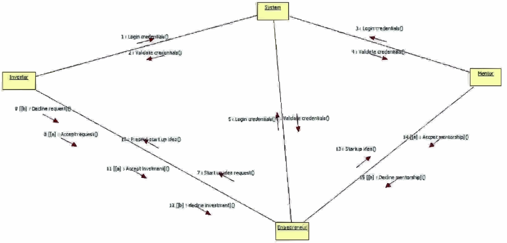

# Chapter 39: Design of UML Diagrams for STARTUP MEET

> **Book**: *UML Diagramming: A Case Study Approach* by Dr. Suriya Sundaramoorthy (CRC Press, 2022)  
> **Pages**: 397–404 (Total: 8 pages)  
> **Classification**: Industrial Case Study & Diagram Suite  
> **Navigation**: [&larr; Chapter_38_Design_of_UML_Diagrams_for_Website_Development](Chapter_38_Design_of_UML_Diagrams_for_Website_Development.md) | [📚 Book Index](../UML_Book.md) | [Chapter_40_Design_of_UML_Diagrams_for_Video_Suggestion_System &rarr;](Chapter_40_Design_of_UML_Diagrams_for_Video_Suggestion_System.md)

---

## 📌 Executive Summary

Chapter 39 presents an industrial software engineering case study for **Design of UML Diagrams for STARTUP MEET**. It details the transition from business requirements and domain constraints into formal software architecture specifications, leveraging data-flow modeling and a complete suite of Unified Modeling Language (UML) structural and behavioral diagrams.

---

## 🎯 Problem Statement & System Context

The policies and guidelines for startups vary from state to state. Also, startups related to a particular domain are emphasized in particular areas. The people with the startups ideas at different levels of implementation have to approach different firms or individuals for investment who are in their nearest business circles, if not in the same state. All of these will adversely impact the opportunities for the startups. Startup meet is a platform for people to privately approach firms or angel investors with their ideas implemented at different levels for funding and mentorship. Also, the government policies and loan schemes of different states can be known and applied. If people are interested in the idea a virtual presentation can be given about it to them. There will be profiles for investors and entrepreneurs (people with startup ideas) where they will be describing about what they are looking for. The entrepreneur has to request investors or mentors from different states for submitting his ideas. Once accepted he can send an abstract about it. If the investors like it, they can call for a presentation of it. The mentors also can give mentorship. The government loans and policies can be viewed and also be applied through the portal. So, startup meet is a comprehensive platform for people who are into startups (Figures 39.1–39.8).

---

## 📊 Complete UML Diagram Suite & Architecture Specifications

This chapter incorporates **8 standalone vector diagram(s)** illustrating the end-to-end design from functional use cases to physical hardware deployment:

### Figure 39.1: UML Usecase Diagram

**Diagram Category**: `Use Case Diagram`  
**Architectural Role**: Specifies system boundary, primary external actors, and business use cases with include/extend relationships.

### Figure 39.2: UML Activity Diagram

**Diagram Category**: `Activity Diagram`  
**Architectural Role**: Illustrates dynamic procedural workflow, decision branching, concurrent action forks, and synchronization joins.

### Figure 39.3: UML Sequence Diagram

**Diagram Category**: `Sequence Diagram`  
**Architectural Role**: Details chronological object interactions, synchronous message exchanges, return flows, and activation lifelines.

### Figure 39.4: UML Collaboration Diagram

**Diagram Category**: `Communication Diagram`  
**Architectural Role**: Emphasizes structural object topology and numbered sequence messaging between collaborating entities.

### Figure 39.5: UML State Chart Diagram

**Diagram Category**: `State Machine Diagram`  
**Architectural Role**: Captures entity lifecycle states, transition triggers, event guards, and exit/entry actions.

### Figure 39.6: UML Class Diagram

**Diagram Category**: `Class Diagram`  
**Architectural Role**: Models static structural classifiers, entity attributes, operations, and associations (composition, aggregation, inheritance).

### Figure 39.7: UML Component Diagram

**Diagram Category**: `Component Diagram`  
**Architectural Role**: Architects physical modular software components, provided ball interfaces, and required socket dependencies.

### Figure 39.8: UML Deployment Diagram

**Diagram Category**: `Deployment Diagram`  
**Architectural Role**: Maps software execution artifacts to hardware computing nodes, client devices, application tiers, and database servers.

---

## 💡 Key Architectural Invariants & Modeling Lessons

1. **Traceability**: Every software model directly corresponds to explicit functional requirements defined during the initial domain specification.
2. **Separation of Concerns**: Structural models (Class, Component, Deployment) maintain clear boundaries separating business domain entities from physical infrastructure nodes.
3. **Behavioral Integrity**: Dynamic models (Activity, Sequence, State Machine) guarantee valid state transitions, prevent deadlocks, and verify message order consistency.
4. **Deployment Fidelity**: Physical nodes and execution environments accurately map runtime middleware, database engines, and client access channels.

---

## 🔗 Related Resources & Navigation

- **Navigation**: [&larr; Chapter_38_Design_of_UML_Diagrams_for_Website_Development](Chapter_38_Design_of_UML_Diagrams_for_Website_Development.md) | [📚 Book Index](../UML_Book.md) | [Chapter_40_Design_of_UML_Diagrams_for_Video_Suggestion_System &rarr;](Chapter_40_Design_of_UML_Diagrams_for_Video_Suggestion_System.md)
- **Master Book Catalog**: [`UML_Book.md`](../UML_Book.md)
- **Vector Images Catalog**: [`Vector_Images_Catalog.md`](../vector_images/Vector_Images_Catalog.md)