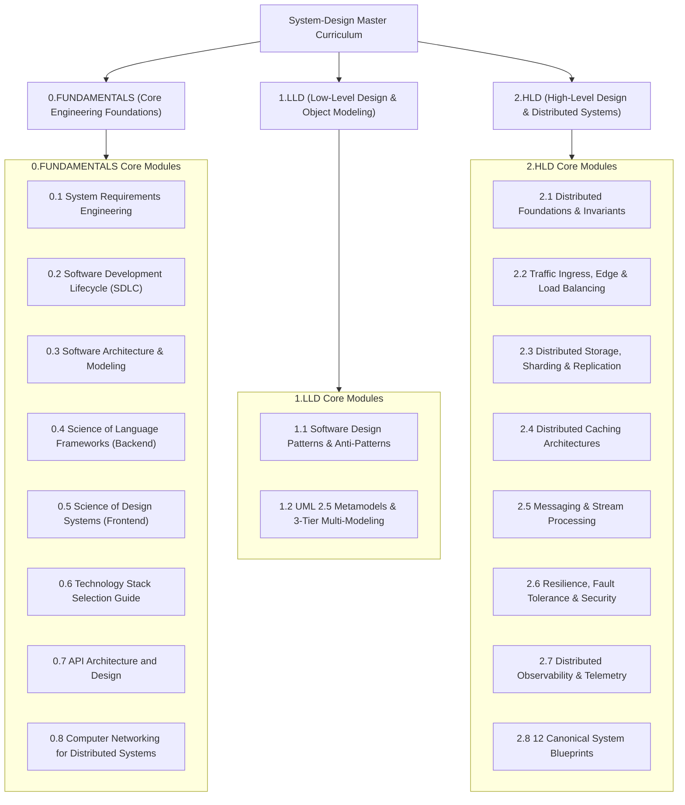

# Master Topic Curriculum & Learning Outline (`topics/outline/outline.md`)

This document is the **comprehensive, publication-grade topic curriculum and architectural syllabus** for the entire **System-Design** repository. It details all foundational engineering domains, object-oriented low-level design patterns, distributed high-level architectures, and real-world industrial case studies to be discussed and mastered across **0.FUNDAMENTALS**, **1.LLD**, and **2.HLD**.

---

## 🧭 Repository Quick Links

- **Repository Overview & Landing**: [`README.md`](../../README.md)
- **Master Navigation Catalog (Queries & Notes)**: [`index.md`](../../index.md)
- **Root Syllabus Mirror**: [`outline.md`](../../outline.md)
- **Permanent Operational Rules**: [`chat/universal_rules.md`](../../chat/universal_rules.md)
- **Full Activity Transcript**: [`chat/chatLog.md`](../../chat/chatLog.md)

---

## 🏛️ End-to-End Architectural Curriculum Flow

---

## 📚 0. FUNDAMENTALS (Core Engineering Foundations)

### Module 0.1: System Requirements Engineering
- **Directory**: [`topics/0.FUNDAMENTALS/System Requirements/`](../0.FUNDAMENTALS/System%20Requirements/)
- **Core Deliverable**: [`System_Requirements_Engineering.md`](../0.FUNDAMENTALS/System%20Requirements/System_Requirements_Engineering.md)
- **Detailed Topics Discussed**:
  1. **Requirement Taxonomies & Decomposition**:
     - Functional Requirements (FR): Explicit user workflows, business logic invariants, and system capabilities.
     - Non-Functional Requirements (NFR / Quality Attributes): Performance, scalability, availability, durability, reliability, maintainability, and security.
     - Architectural Constraints & Boundaries: Legal/regulatory frameworks, budget, existing legacy systems, team topology.
  2. **Specification Standards & Contract Clarity**:
     - Acceptance Criteria definition using Gherkin syntax (`Given-When-Then`).
     - Explicit input validation boundaries, state machine preconditions, and postcondition guarantees.
     - Ambiguity elimination techniques in product requirements.
  3. **The Non-Functional Vector & SLA Mathematics**:
     - Latency profiles: Understanding median (`p50`), 95th percentile (`p95`), and tail latencies (`p99`, `p99.9`).
     - Throughput metrics: Queries Per Second (QPS), Transactions Per Second (TPS), and peak-to-average multipliers.
     - High Availability mathematics: Calculating downtime for "Three Nines" (99.9% = 8.76 hours/yr), "Four Nines" (99.99% = 52.6 minutes/yr), and "Five Nines" (99.999% = 5.26 minutes/yr).
     - Disaster Recovery baselines: Recovery Point Objective (RPO) and Recovery Time Objective (RTO).
     - Compliance & Security baselines: GDPR, HIPAA, SOC 2, and PCI-DSS data retention invariants.
  4. **Engineering Scoping & Back-of-the-Envelope Calculations**:
     - Sizing calculations: Storage capacity projections (1-year vs. 5-year horizons).
     - Bandwidth ingestion and egress estimation: Bits per second (bps) vs. Bytes per second (Bps).
     - Memory budgets: Working set estimation (Pareto 80/20 rule for cache sizing).
     - Server capacity sizing and Little's Law applications.

---

### Module 0.2: Software Development Lifecycle (SDLC)
- **Directory**: [`topics/0.FUNDAMENTALS/Software Development Lifecycle/`](../0.FUNDAMENTALS/Software%20Development%20Lifecycle/)
- **Detailed Topics Discussed**:
  1. **Engineering Methodologies & Team Topologies**:
     - Waterfall, V-Model, Agile Scrum, Kanban, Extreme Programming (XP).
     - Conway's Law: How organizational communication topologies shape software system architecture.
  2. **The RFC & Architectural Decision Process**:
     - Product Requirement Documents (PRDs): Defining problem statements, user personas, and success metrics.
     - Request for Comments (RFC) engineering culture: Peer-reviewed architectural designs, alternative trade-off analysis.
     - Architecture Decision Records (ADRs): Capturing architectural context, decisions, status, and consequences.
  3. **Architecture & Contract-First Design**:
     - Interface-first development: Establishing strict interface contracts before writing implementation logic.
     - Machine-readable API specifications (OpenAPI, Protobuf IDL) as source of truth for client/server scaffolding.
  4. **Quality Engineering & Verification Pyramid**:
     - The Testing Pyramid: Unit tests, Integration tests, Contract tests (Pact), and End-to-End (E2E) tests.
     - Static code analysis: Linters, SonarQube quality gates, security dependency audits (SAST/DAST).
     - Mutation testing: Evaluating test suite quality and coverage efficacy.
  5. **CI/CD, Release Engineering & SRE Metrics**:
     - Automated continuous integration pipelines: Compilation, artifact building, automated testing, container packaging.
     - Progressive delivery strategies: Blue-Green deployments, Canary rollouts, Feature flags (toggles).
     - SRE Operational Metrics: Service Level Indicators (SLI), Service Level Objectives (SLO), Mean Time to Detect (MTTD), Mean Time to Repair (MTTR).

---

### Module 0.3: Software Architecture and Modeling
- **Directory**: [`topics/0.FUNDAMENTALS/Software Architecture and Modeling/`](../0.FUNDAMENTALS/Software%20Architecture%20and%20Modeling/)
- **Detailed Sub-Modules Discussed**:
  * **1. Architecture Styles** ([`1.ARCHITECTURE/1. Architecture Styles/`](../0.FUNDAMENTALS/Software%20Architecture%20and%20Modeling/1.ARCHITECTURE/1.%20Architecture%20Styles/)):
    - Deliverables: [`001_architectural_styles_catalog`](../0.FUNDAMENTALS/Software%20Architecture%20and%20Modeling/1.ARCHITECTURE/1.%20Architecture%20Styles/output/query_Architecture_Styles/001_architectural_styles_catalog_and_comparative_analysis.md), [`002_mvc_mvt_classification`](../0.FUNDAMENTALS/Software%20Architecture%20and%20Modeling/1.ARCHITECTURE/1.%20Architecture%20Styles/output/query_Architecture_Styles/002_mvc_mvt_in_architectural_styles_classification.md), [`003_complete_architectural_styles_catalog`](../0.FUNDAMENTALS/Software%20Architecture%20and%20Modeling/1.ARCHITECTURE/1.%20Architecture%20Styles/output/query_Architecture_Styles/003_complete_architectural_styles_catalog.md).
    - Monolithic Architecture: Single-quantum deployment, in-memory call performance, shared ACID transactions, single point of failure.
    - Layered / 3-Tier Architecture: Technical partitioning (Presentation, Business, Data Access), closed vs. open layers, the Architecture Sinkhole anti-pattern.
    - Microservices Architecture: Bounded contexts, database-per-service invariant, Saga orchestration/choreography, polyglot persistence, network overhead.
    - Event-Driven Architecture (EDA): Broker vs. Mediator topologies, asynchronous event channels, decoupling producers and consumers, eventual consistency.
    - Space-Based Architecture (SBA): In-memory data grids, processing units, virtualized middleware, data pumps/writers, extreme horizontal scalability.
    - Service-Based Architecture: Coarse-grained domain services (4-12 services) with a shared database, pragmatic migration bridge.
    - Modular Monolith: Single deployable artifact with compile-time bounded module enforcement (ArchUnit/Java modules) and in-memory event buses.
    - Architectural Styles vs. Architecture Patterns vs. Design Patterns (MVC/MVT classification).
  * **2. Architecture Patterns** ([`1.ARCHITECTURE/2. Architecture Patterns/`](../0.FUNDAMENTALS/Software%20Architecture%20and%20Modeling/1.ARCHITECTURE/2.%20Architecture%20Patterns/)):
    - Deliverables: [`001_software_architecture_patterns_antipatterns`](../0.FUNDAMENTALS/Software%20Architecture%20and%20Modeling/1.ARCHITECTURE/2.%20Architecture%20Patterns/output/query_Architecture_Patterns/001_software_architecture_patterns_antipatterns_and_pitfalls.md), [`002_styles_vs_patterns_vs_design_patterns`](../0.FUNDAMENTALS/Software%20Architecture%20and%20Modeling/1.ARCHITECTURE/2.%20Architecture%20Patterns/output/query_Architecture_Patterns/002_architectural_styles_vs_architecture_patterns_vs_design_patterns.md), [`003_complete_patterns_catalog`](../0.FUNDAMENTALS/Software%20Architecture%20and%20Modeling/1.ARCHITECTURE/2.%20Architecture%20Patterns/output/query_Architecture_Patterns/003_complete_architectural_patterns_catalog.md).
    - 24 Enterprise Patterns: Command Query Responsibility Segregation (CQRS), Event Sourcing, Saga Pattern, Transactional Outbox, Backend-for-Frontend (BFF), Strangler Fig, Pipe and Filter, Microkernel.
    - Architectural Anti-Patterns: Global Coupling, Groundhog Day, Distributed Monolith, Cargo Cult Architecture.
  * **3. Architecture Modeling & Viewpoints** ([`2.ARCHITECTURE_MODELING/`](../0.FUNDAMENTALS/Software%20Architecture%20and%20Modeling/2.ARCHITECTURE_MODELING/)):
    - Kruchten 4+1 View Model: Logical, Development, Process, Physical views centered around Use Case Scenarios.
    - Simon Brown's C4 Model: Context, Container, Component, and Code architectural hierarchy.
    - Rozanski & Woods Viewpoints & Perspectives: Structural, Behavioral, Information, Security, and Operational perspectives.

---

### Module 0.4: Science of Language Frameworks [Backend]
- **Directory**: [`topics/0.FUNDAMENTALS/Science of Language Frameworks [Backend]/`](../0.FUNDAMENTALS/Science%20of%20Language%20Frameworks%20[Backend]/)
- **Detailed Topics Discussed**:
  1. **Runtime Execution Models & Concurrency**:
     - Thread-per-request model (traditional OS threads) vs. Event-driven non-blocking I/O (Reactor / Proactor).
     - Modern lightweight concurrency: Java 21 Virtual Threads (Project Loom), Go Goroutines with M:N scheduler, Node.js event loop with libuv, Rust async/await with Tokio.
  2. **Memory Management & Garbage Collection (GC)**:
     - Generational GC: JVM garbage collectors (G1, ZGC low-latency, Shenandoah), object promotion, stop-the-world pauses.
     - Concurrent mark-sweep: Go runtime GC, write barriers, pointer scanning overhead.
     - Compile-time zero-cost abstractions: Rust ownership, borrowing, lifetimes, and deterministic RAII destruction.
  3. **Framework Ecosystems & Trade-Offs**:
     - JVM: Spring Boot, Quarkus (GraalVM native images), Micronaut.
     - Go: Gin, Fiber, standard `net/http`.
     - Node.js / TypeScript: NestJS, Fastify, Express.
     - Python: FastAPI (Starlette + Pydantic), Django.
     - Rust: Axum (Tower service stack), Actix-web.
  4. **Data Access, Drivers & Connection Pools**:
     - Object-Relational Mapping (ORM: Hibernate, Prisma) vs. SQL-first query builders vs. Raw SQL.
     - Connection pool mechanics: HikariCP sizing, connection leak detection, validation timeouts.
     - Transaction management: ACID boundaries, isolation levels (Read Committed vs. Repeatable Read vs. Serializable).
  5. **Resilience & Production Readiness**:
     - Circuit breakers (Resilience4j), Bulkheads, Rate limiters, Health check probes, and OpenTelemetry instrumentation.

---

### Module 0.5: Science of Design Systems [Front End]
- **Directory**: [`topics/0.FUNDAMENTALS/Design System [Front End]/`](../0.FUNDAMENTALS/Design%20System%20[Front%20End]/)
- **Detailed Topics Discussed**:
  1. **Design Tokens & Visual Primitives**:
     - Global tokens, semantic tokens, and component-specific tokens.
     - Style Dictionary compilation across web (CSS variables), iOS (Swift), and Android (XML/Compose).
  2. **Component Architecture & Composition**:
     - Atomic Design methodology: Atoms, Molecules, Organisms, Templates, Pages.
     - Headless UI components (Radix, React Aria) vs. Styled design systems (Tailwind CSS, Material UI).
     - Polymorphic components, compound component patterns, and render props.
  3. **State Management & Data Synchronization**:
     - Local component state vs. Global client state (Zustand, Redux Toolkit).
     - Server cache synchronization: TanStack Query (React Query), SWR, optimistic UI updates, cache invalidation.
  4. **Accessibility (a11y) & Usability**:
     - WCAG 2.1 / 2.2 Level AA and AAA compliance.
     - WAI-ARIA roles, attributes, focus trapping in modal dialogs, and screen reader announcements.
  5. **Testing, Tooling & Governance**:
     - Component workbenches with Storybook.
     - Visual regression testing with Playwright and Chromatic.
     - Monorepo package distribution via Turborepo or Nx.

---

### Module 0.6: Technology Stack Selection Guide
- **Directory**: [`topics/0.FUNDAMENTALS/Select Technology Stack/`](../0.FUNDAMENTALS/Select%20Technology%20Stack/)
- **Core Deliverable**: [`Technology_Stack_Selection_Guide.md`](../0.FUNDAMENTALS/Select%20Technology%20Stack/Technology_Stack_Selection_Guide.md)
- **Detailed Topics Discussed**:
  1. **Selection Philosophy & Risk Management**:
     - Constraint satisfaction, Total Cost of Ownership (TCO), and eliminating "Resume-Driven Development".
  2. **The 5-Dimension Evaluation Vector**:
     - Dimension 1: Workload Profile (I/O-bound vs. CPU-bound vs. Memory-intensive).
     - Dimension 2: Data Access Pattern & Consistency (Strict ACID vs. Eventual BASE).
     - Dimension 3: Latency & Throughput SLA constraints.
     - Dimension 4: Engineering Velocity vs. Static Type Safety.
     - Dimension 5: Operational Maturity, Cloud Support & Community Longevity.
  3. **Multi-Criteria Decision Analysis (MCDA / MCDM)**:
     - Weighted scoring matrices for comparing technology candidates.
     - Proof-of-Concept (PoC) spike methodology and formulating ADR justifications.

---

### Module 0.7: API Architecture and Design
- **Directory**: [`topics/0.FUNDAMENTALS/API Architecture and Design/`](../0.FUNDAMENTALS/API%20Architecture%20and%20Design/)
- **Core Deliverables**: [`API_Architecture_and_Design.md`](../0.FUNDAMENTALS/API%20Architecture%20and%20Design/output/Note_version-1_API_Architecture_and_Design/API_Architecture_and_Design.md), [`001_api_communication_patterns`](../0.FUNDAMENTALS/API%20Architecture%20and%20Design/output/query_API_Architecture_and_Design/001_api_communication_patterns_taxonomy_and_architectural_mechanics.md).
- **Detailed Topics Discussed**:
  1. **Protocols & Transport Mechanisms**:
     - HTTP/1.1 (pipelining limitations, head-of-line blocking).
     - HTTP/2 (binary framing, stream multiplexing over a single TCP connection, HPACK header compression).
     - HTTP/3 QUIC (UDP binary framing, 0-RTT handshakes, connection migration across network switches, elimination of transport-layer head-of-line blocking).
     - REST (Richardson Maturity Model), gRPC (HTTP/2 binary transport, Protobuf IDL, bidirectional streaming), GraphQL (DataLoader N+1 mitigation), WebSockets, and Server-Sent Events (SSE).
  2. **Contract-First Specifications**:
     - OpenAPI 3.1 / Swagger, AsyncAPI for event streams, Protobuf `.proto` schemas.
     - RESTful URI naming conventions, safe vs. idempotent HTTP methods.
     - Standardized error contracts: IETF RFC 7807 (Problem Details for HTTP APIs).
  3. **Advanced Behavioral Patterns**:
     - **Pagination Strategies**: Offset-based (`?page=2&limit=20`) vs. Keyset / Cursor-based (`?cursor=eyJpZCI6MTAxfQ==&limit=20`), page drift immunity, RFC 5988/8288 `Link` headers.
     - **Distributed Idempotency Keys**: Network failure retry protection via `Idempotency-Key` headers, Redis atomic locks, and response caching.
     - **API Versioning Strategies**: URI path versioning (`/v1/orders`), Query parameters (`?version=2`), Custom headers (`X-API-Version: 2`), and Content negotiation (`Accept: application/vnd.company.v2+json`).
  4. **Security, Governance & Observability**:
     - OAuth 2.0 (Authorization Code with PKCE, Client Credentials), OpenID Connect (OIDC).
     - Stateless JWT vs. Stateful sessions, RS256 asymmetric cryptographic signing.
     - Mutual TLS (mTLS) for zero-trust service communication.
     - Distributed tracing header propagation (W3C TraceContext: `traceparent`, `tracestate`).

---

### Module 0.8: Computer Networking for Distributed Systems
- **Directory**: [`topics/0.FUNDAMENTALS/Networking/`](../0.FUNDAMENTALS/Networking/)
- **Core Deliverable**: [`Networking.md`](../0.FUNDAMENTALS/Networking/output/Note_version-1_Networking/Networking.md)
- **Detailed Topics Discussed**:
  1. **Layer Abstractions & Encapsulation**:
     - OSI 7-Layer Model vs. TCP/IP 4-Layer Model.
     - Packet encapsulation/decapsulation lifecycles, Maximum Transmission Unit (MTU) and Maximum Segment Size (MSS) fragmentation.
  2. **Layer 2 (Data Link) & Layer 3 (Network Layer)**:
     - Ethernet frames, MAC addresses, Address Resolution Protocol (ARP), broadcast domains.
     - IPv4 vs. IPv6 headers, CIDR subnetting, Network Address Translation (NAT / SNAT / DNAT).
     - Internet Control Message Protocol (ICMP) and global routing protocols (BGP Anycast, OSPF).
  3. **Layer 4 (Transport Layer)**:
     - TCP Connection Lifecycle: 3-way handshake (`SYN` -> `SYN-ACK` -> `ACK`), 4-way teardown (`FIN` -> `ACK` -> `FIN` -> `ACK`), `TIME_WAIT` socket exhaustion.
     - TCP Flow Control: Sliding window, Zero Window Probing.
     - TCP Congestion Control: Slow Start, Congestion Avoidance, Fast Retransmit, CUBIC and BBR algorithms.
     - Nagle's Algorithm (`TCP_NODELAY`) vs. Delayed ACK deadlocks.
     - UDP and QUIC transport mechanics.
  4. **Layer 7 & Network Services**:
     - DNS resolution hierarchy: Recursive resolvers, Root servers, TLD servers, Authoritative nameservers, Anycast DNS.
     - TLS 1.3 cryptographic handshake: ECDH key exchange, forward secrecy, 0-RTT resumption.
  5. **Kernel & OS Socket Programming**:
     - BSD Sockets API: `socket()`, `bind()`, `listen()`, `accept()`, `send()`, `recv()`.
     - Socket buffers (`SO_RCVBUF`, `SO_SNDBUF`).
     - I/O Multiplexing evolution: `select()` (`O(N)`), `poll()` (`O(N)`), Linux `epoll` (`O(1)` edge/level triggered), BSD `kqueue`, and modern Linux `io_uring` kernel submission queues.
  6. **Cloud & Production Networking**:
     - Virtual Private Clouds (VPCs), public and private subnets, NAT Gateways, Internet Gateways.
     - Overlay networks (VXLAN) in container orchestration (Kubernetes CNI).
     - SYN flood defenses (`syncookies`), DDoS mitigation, network packet analysis (`tcpdump`, Wireshark), diagnostic CLI tooling (`ping`, `traceroute`, `ss`, `dig`).

---

## 🧩 1. LLD (Low-Level Design & Object-Oriented Modeling)

### Module 1.1: Software Design Patterns
- **Directory**: [`topics/1.LLD/DESIGN_PATTERNS/`](../1.LLD/DESIGN_PATTERNS/)
- **Core Deliverables**: [`design_patterns.md`](../1.LLD/DESIGN_PATTERNS/output/query_DESIGN_PATTERNS/design_patterns.md), [`001_head_first_design_patterns_and_antipatterns.md`](../1.LLD/DESIGN_PATTERNS/output/query_DESIGN_PATTERNS/001_head_first_design_patterns_and_antipatterns.md).
- **Detailed Topics Discussed**:
  1. **Creational Patterns**:
     - Singleton: Lazy initialization, double-checked locking with `volatile`, Bill Pugh static inner class, and Java `Enum` singleton.
     - Factory Method vs. Abstract Factory: Decoupling object creation families.
     - Builder: Fluent interfaces, handling complex immutable object creation.
     - Prototype: Deep vs. shallow cloning, copy constructors.
  2. **Structural Patterns**:
     - Adapter: Two-way and class/object adapters bridging incompatible interfaces.
     - Decorator: Dynamic behavior extension without subclass explosion (Java I/O streams).
     - Facade: Simplified interface over complex subsystems.
     - Composite: Tree-structured hierarchical object compositions.
     - Proxy: Virtual proxies (lazy loading), Protection proxies (RBAC), and Dynamic reflection proxies.
     - Bridge: Decoupling an abstraction from its implementation so both vary independently.
     - Flyweight: Intrinsic vs. extrinsic state sharing to minimize memory footprint.
  3. **Behavioral Patterns**:
     - Strategy: Encapsulating interchangeable algorithms, eliminating `switch`/`if-else` branching.
     - Observer: Decoupled publish-subscribe mechanics in object graphs.
     - Command: Encapsulating requests as objects, enabling undo/redo, command queues, and macros.
     - Template Method: Defining algorithm skeletons with hook methods.
     - Iterator: Traversing collections without exposing underlying data representations.
     - State: Modeling finite state machines by encapsulating state-dependent behavior.
     - Chain of Responsibility: Passing requests along dynamic handler chains (HTTP middleware).
     - Mediator: Centralizing complex communication between colleague objects.
     - Memento: Capturing and externalizing internal object state for rollbacks without violating encapsulation.
     - Visitor: Adding operations to complex object structures without modifying classes.
     - Interpreter: Grammar definition and AST evaluation for domain-specific languages.
  4. **Concurrency & Threading Patterns**:
     - Thread Pool, Producer-Consumer (Blocking Queues), Read-Write Lock, Semaphore, Active Object, Barrier.
  5. **Anti-Patterns & Code Smells**:
     - God Object, Spaghetti Code, Golden Hammer, Premature Optimization, Feature Envy, Long Parameter Lists.

---

### Module 1.2: UML 2.5 Metamodels & 3-Tier Multi-Modeling
- **Directory**: [`topics/1.LLD/UML-DIAGRAMMING/`](../1.LLD/UML-DIAGRAMMING/)
- **Outputs**: [`001_uml_2_5_taxonomy`](../1.LLD/UML-DIAGRAMMING/output/query_UML-DIAGRAMMING/001_uml_2_5_taxonomy_structural_vs_behavioral.md), [`002_sequence_diagram`](../1.LLD/UML-DIAGRAMMING/output/query_UML-DIAGRAMMING/002_sequence_diagram_and_object_interactions.md).
- **Detailed Topics Discussed**:
  1. **OMG UML 2.5 Metamodels & Taxonomy**:
     - Full classification of all 14 official UML diagrams (Structural vs. Behavioral vs. Interaction).
  2. **Structural Modeling Standards**:
     - Class Diagrams: Visibility indicators (`+`, `-`, `#`, `~`), multiplicities (`0..1`, `1..*`), relationships (Association, Aggregation, Composition, Generalization, Dependency).
     - Component & Package Diagrams: Ports, interfaces, sub-system boundaries.
     - Object & Deployment Diagrams: Runtime instance snapshots, physical execution nodes and artifacts.
  3. **Behavioral Modeling Standards**:
     - Sequence Diagrams: Lifelines, synchronous vs. asynchronous messages, combined fragments (`alt`, `opt`, `loop`, `par`, `break`).
     - State Machine Diagrams: States, transitions, events, guards, entry/exit actions, composite orthogonal states.
     - Activity Diagrams: Control flow, decision diamonds, concurrency fork/join bars, object nodes, swimlanes.
     - Use Case Diagrams: Actors, system boundary, `<<include>>` and `<<extend>>` relationships.
  4. **Mandatory 3-Tier Multi-Representation**:
     - **Layer 1: Concrete Object-Oriented Code**: Production-grade Java 21 implementation (records, sealed classes, pattern matching).
     - **Layer 2: Formal UML Diagram**: Precise graphical Mermaid and PlantUML specifications.
     - **Layer 3: Runtime Execution & Memory State**: Physical JVM heap object references, stack frame activation records, and pointer graphs.

---

## 🌐 2. HLD (High-Level Design & Distributed Systems)

### Module 2.1: Distributed Systems Core Foundations & Theoretical Invariants
- **Directory**: [`topics/2.HLD/1.DISTRIBUTED_FOUNDATIONS/`](../2.HLD/1.DISTRIBUTED_FOUNDATIONS/)
- **Detailed Topics Discussed**:
  1. **Performance & Scalability Invariants**:
     - Vertical Scaling (Scale-Up) limits vs. Horizontal Scaling (Scale-Out) shared-nothing architectures.
     - Latency vs. Throughput trade-offs; Amdahl's Law and Gunther's Universal Scalability Law (USL).
     - Tail latency amplification: Why a multi-service RPC tree (`50` microservices with `p99 = 100ms`) degrades overall user `p99` latency to `>39%`.
     - Little's Law (`L = \lambda W`) and queueing theory bottlenecks (M/M/1 queues, arrival rates, waiting times).
     - High Availability mathematics: Calculating downtime, MTBF (Mean Time Between Failures), MTTR (Mean Time to Repair), RPO, and RTO.
  2. **Theoretical Guarantees & Distributed Laws**:
     - **CAP Theorem**: Formal definitions of Consistency (Linearizability), Availability, and Partition Tolerance during network partitions.
     - **PACELC Theorem**: Latency (`L`) vs. Consistency (`C`) in normal execution states vs. Availability (`A`) vs. Consistency (`C`) under network Partitions (`P`).
     - ACID vs. BASE (Basically Available, Soft-state, Eventual consistency).
     - The 8 Fallacies of Distributed Computing and their modern architectural mitigations.
  3. **Time, Clocks & Ordering**:
     - Physical clock drift, crystal oscillator skew, and Network Time Protocol (NTP) inaccuracies.
     - Google TrueTime API: GPS receivers + atomic clocks bounded by uncertainty window `ε` in Spanner.
     - Logical Clocks: Lamport Timestamps (partial ordering) vs. Vector Clocks (causality tracking, version vectors, conflict detection).
  4. **Consensus & Distributed Coordination**:
     - The Byzantine Generals Problem vs. Crash-Fault-Tolerant (CFT) models.
     - **Raft Consensus Protocol**: Leader Election, Log Replication, Safety Invariants, Joint Consensus configuration changes.
     - **Paxos** (Classic vs. Multi-Paxos) and **ZooKeeper Atomic Broadcast (ZAB)**.
     - Distributed state stores: `etcd`, HashiCorp Consul, ZooKeeper.
     - Quorum mathematics (`W + R > N`, strict vs. sloppy quorums), Split-Brain mitigation, and Fencing Tokens.

---

### Module 2.2: Traffic Ingress, Edge Networking & Load Balancing
- **Directory**: [`topics/2.HLD/2.LOAD_BALANCING_TRAFFIC_INGRESS/`](../2.HLD/2.LOAD_BALANCING_TRAFFIC_INGRESS/)
- **Detailed Topics Discussed**:
  1. **Edge Routing & Global Traffic Management**:
     - Global Server Load Balancing (GSLB), GeoDNS, and Latency-Based Routing.
     - **BGP Anycast Routing**: Equal-Cost Multi-Path (ECMP) routing across Autonomous Systems (AS).
     - Content Delivery Networks (CDNs): Edge points of presence (PoPs), Origin Shielding, Dynamic Site Acceleration (DSA), Edge Computing (Cloudflare Workers, Fastly Compute@Edge).
  2. **Layer 4 vs. Layer 7 Load Balancing**:
     - **Layer 4 (Transport Layer)**: High-throughput packet forwarding based on IP + TCP/UDP port (IPVS, Maglev, Katran), zero-copy kernel forwarding.
     - **Layer 7 (Application Layer)**: Deep packet inspection, HTTP/2 multiplexing, path/header/cookie-based routing, TLS termination, compression (Envoy, Nginx, HAProxy, AWS ALB).
  3. **Load Balancing Topologies**:
     - Reverse Proxy Mode (two-arm).
     - NAT / SNAT Mode.
     - **Direct Server Return (DSR)**: Inbound request routed via LB, outbound high-bandwidth response returned directly from backend worker to client.
  4. **Routing & Dispatch Algorithms**:
     - Round Robin, Weighted Round Robin, IP Hash.
     - Least Connections, Weighted Least Response Time (TTFB).
     - **Consistent Hashing**: Virtual Nodes (vnodes) to prevent hash ring imbalance during node failure/addition.
     - **Power of Two Random Choices (P2C)** with peak-EWMA latency weighting to eliminate herd behavior.
  5. **High Availability & Edge Clustering**:
     - Active-Passive failover: Virtual Router Redundancy Protocol (VRRP) / Keepalived with Floating Virtual IP (VIP).
     - Active-Active failover: Anycast IP with ECMP switches.
     - Health checking mechanics: Active polling vs. Passive circuit-tripping, flap damping.
  6. **API Gateways & Reverse Proxies**:
     - Gateway topologies: Centralized Enterprise Gateway vs. Microgateway vs. Service Mesh Ingress.
     - Authentication, mTLS termination, request validation, distributed tracing context injection.
  7. **Distributed Rate Limiting & Congestion Control**:
     - Algorithms: Token Bucket, Leaky Bucket, Fixed Window, Sliding Window Log, Sliding Window Counter.
     - Multi-Region Redis clusters with transactional Lua scripts.
     - Load shedding, concurrency limits, and adaptive throttling.

---

### Module 2.3: Distributed Storage, Sharding & Replication
- **Directory**: [`topics/2.HLD/3.DISTRIBUTED_STORAGE_CACHING/`](../2.HLD/3.DISTRIBUTED_STORAGE_CACHING/)
- **Detailed Topics Discussed**:
  1. **Database Selection Framework**:
     - Relational (PostgreSQL, MySQL) vs. Document (MongoDB) vs. Key-Value (Redis, DynamoDB) vs. Wide-Column (Cassandra, ScyllaDB) vs. Graph (Neo4j) vs. Time-Series (TimescaleDB).
  2. **Data Partitioning (Sharding)**:
     - Range-Based vs. Hash-Based Partitioning.
     - Directory-Based Partitioning (Lookup Service).
     - Resharding mechanics, partition rebalancing, and hotspot mitigation (the "Celebrity / Hot Key" problem).
     - **Scatter-Gather Query Mechanics & Distributed Pagination**: The distributed offset multiplication problem vs. composite shard-checkpoint cursors.
  3. **Replication Topologies**:
     - **Single-Leader Replication**: Synchronous vs. Asynchronous WAL streaming, read replica scaling, failover mechanics.
     - **Multi-Leader Replication**: Active-Active multi-datacenter topologies, conflict resolution (Last-Write-Wins vs. Conflict-Free Replicated Data Types - CRDTs).
     - **Leaderless Replication**: Dynamo-style architecture, sloppy quorums, hinted handoff, and read repair.
  4. **Storage Engine Internals**:
     - **Log-Structured Merge-Trees (LSM-Trees)**: Append-only write path, MemTable, Write-Ahead Log (WAL), SSTables, Bloom Filters, and Compaction strategies (Size-Tiered vs. Leveled in RocksDB/Cassandra).
     - **B+ Trees**: Page caches, disk blocks, write amplification, random in-place updates (InnoDB, PostgreSQL).
  5. **Distributed Transactions & Data Consistency**:
     - Two-Phase Commit (2PC) and Three-Phase Commit (3PC): Coordinator bottlenecks and blocking states.
     - **Saga Pattern**: Choreography (event-driven) vs. Orchestration (state machine) with compensating transactions.
     - **Transactional Outbox Pattern**: Decoupling database mutations from messaging queues via Debezium Change Data Capture (CDC).

---

### Module 2.4: Distributed Caching Architectures
- **Directory**: [`topics/2.HLD/3.DISTRIBUTED_STORAGE_CACHING/`](../2.HLD/3.DISTRIBUTED_STORAGE_CACHING/)
- **Detailed Topics Discussed**:
  1. **Multi-Tier Cache Placement**:
     - Client / Browser Cache → Edge CDN → API Gateway Cache → Process-Local Cache (Caffeine) → Distributed Shared Cache (Redis, Memcached).
  2. **Cache Access & Synchronization Patterns**:
     - **Cache-Aside (Lazy Loading)**: Application reads cache, falls back to DB, writes back.
     - **Read-Through & Write-Through**: Cache acts as the primary data store abstraction.
     - **Write-Behind (Write-Back)**: High-speed asynchronous persistence with queue-backed durability.
     - **Refresh-Ahead**: Proactive background reload based on access heuristics.
  3. **Cache Eviction Policies**:
     - LRU (Least Recently Used), LFU (Least Frequently Used), FIFO, Segmented LRU (SLRU), Adaptive Replacement Cache (ARC).
  4. **Distributed Cache Failure Modes & Defense Invariants**:
     - **Cache Stampede / Thundering Herd**: Probabilistic early expiration (XFetch algorithm), mutual exclusion distributed locks.
     - **Cache Penetration**: Querying non-existent keys → Bloom Filters and null-value caching with short TTLs.
     - **Cache Breakdown**: Hot key expiration → Mutex locks on cache misses.
     - **Cache Avalanche**: Mass simultaneous TTL expiration → Randomized TTL jittering.
  5. **Distributed Locks**:
     - Redis Redlock algorithm, ZooKeeper ephemeral sequential nodes, PostgreSQL advisory locks.

---

### Module 2.5: Asynchronous Messaging & Real-Time Stream Processing
- **Directory**: [`topics/2.HLD/4.STREAMING_ASYNCHRONOUS_SYSTEMS/`](../2.HLD/4.STREAMING_ASYNCHRONOUS_SYSTEMS/)
- **Detailed Topics Discussed**:
  1. **Message Queues vs. Distributed Commit Logs**:
     - **Point-to-Point Task Queues**: RabbitMQ, AWS SQS; AMQP exchanges, message acknowledgments, Dead-Letter Queues (DLQ).
     - **Distributed Partitioned Append-Only Logs**: Apache Kafka, Apache Pulsar; broker architecture, consumer groups, partitions, zero-copy OS data transfer (`sendfile`).
  2. **Event Sourcing & CQRS**:
     - Command Query Responsibility Segregation (CQRS): Decoupling write commands from materialized read views.
     - Event Sourcing: Preserving immutable delta event streams, event replaying, snapshotting.
  3. **Real-Time Stream Analytics & Processing**:
     - Stream processing runtimes: Apache Flink, Kafka Streams, Spark Streaming.
     - Windowing primitives: Tumbling windows, Sliding windows, Session windows.
     - Handling out-of-order and late-arriving events via Watermarks.
  4. **Delivery Guarantees & Deduplication**:
     - At-Most-Once, At-Least-Once, and Exactly-Once Semantics (EOS).
     - Distributed idempotency keys, duplicate elimination, and transactional producers/consumers.

---

### Module 2.6: Distributed Resilience, Fault Tolerance & Security
- **Directory**: [`topics/2.HLD/5.DISTRIBUTED_RESILIENCE_OBSERVABILITY/`](../2.HLD/5.DISTRIBUTED_RESILIENCE_OBSERVABILITY/)
- **Detailed Topics Discussed**:
  1. **Resilience & Fault Tolerance Patterns**:
     - **Circuit Breaker**: Closed, Open, Half-Open state machines (Resilience4j, Envoy).
     - **Bulkheads**: Thread pool and connection pool isolation preventing cascading resource starvation.
     - **Timeouts & Deadlines**: Propagating deadline budgets across microservice call trees (gRPC deadlines).
     - **Exponential Backoff with Full Jitter**: Decorrelated jitter algorithms preventing retry storms.
     - Graceful degradation and fallback handlers.
  2. **Zero-Trust Distributed Security**:
     - OAuth 2.0 (PKCE, Client Credentials Grant) & OpenID Connect (OIDC).
     - Stateless JWT authentication vs. Stateful Session tokens, cryptographic verification (RS256 vs. HS256).
     - Mutual TLS (mTLS) with SPIFFE/SPIRE cryptographic workload identity.
     - Centralized secrets management (HashiCorp Vault, AWS Secrets Manager).

---

### Module 2.7: Distributed Observability & Operational Telemetry
- **Directory**: [`topics/2.HLD/5.DISTRIBUTED_RESILIENCE_OBSERVABILITY/`](../2.HLD/5.DISTRIBUTED_RESILIENCE_OBSERVABILITY/)
- **Detailed Topics Discussed**:
  1. **The Three Pillars of Observability**:
     - **Distributed Tracing**: OpenTelemetry, Jaeger, W3C TraceContext (`traceparent`, `tracestate`), span trees, distributed context propagation.
     - **Metrics**: Prometheus, Grafana; the RED method (Rate, Errors, Duration) for request-driven services; the USE method (Utilization, Saturation, Errors) for infrastructure.
     - **Centralized Structured Logging**: OpenSearch, ELK / EFK, correlation IDs across microservice boundaries.
  2. **Health Probing & Deployment Strategies**:
     - Deep vs. Shallow liveness/readiness probes.
     - Blue-Green deployments, Canary rollouts with automated metric rollback.
     - **Chaos Engineering**: Injecting network latency, packet loss, and node failure (Chaos Mesh, Chaos Monkey).

---

### Module 2.8: Canonical Real-World Distributed System Case Studies
- **Directory**: [`topics/2.HLD/6.SYSTEM_DESIGN_CASE_STUDIES/`](../2.HLD/6.SYSTEM_DESIGN_CASE_STUDIES/)
- **Detailed Topics & Case Studies Discussed**:
  1. **URL Shortening Service (TinyURL / Bitly)**:
     - Base62 encoding, Key Generation Service (KGS), 100:1 read-to-write ratio, multi-region caching, HTTP 301 vs. 302 redirects.
  2. **Distributed Unique ID Generator**:
     - Twitter Snowflake (64-bit ID layout: 41-bit timestamp + 10-bit machine/datacenter ID + 12-bit sequence), clock drift mitigation, UUIDv7.
  3. **Distributed Rate Limiter**:
     - Multi-region Redis clusters, sliding window log vs. sliding window counter via Lua scripts, token bucket edge filters.
  4. **Social Media Feed System (Twitter / Instagram)**:
     - Fan-out on Write (push) vs. Fan-out on Read (pull) vs. Hybrid celebrity model, timeline caching, home timeline generation.
  5. **Real-Time Chat & Messaging (WhatsApp / Discord)**:
     - WebSocket gateway clusters, Presence servers, message sequencing, end-to-end encryption, ephemeral channels.
  6. **Global Video Streaming Platform (Netflix / YouTube)**:
     - Ingestion chunking, multi-bitrate HLS/DASH transcoding pipelines, 2-tier CDN edge caching, adaptive bitrate streaming.
  7. **Flash Sale / High-Concurrency Ticketing (Ticketmaster / Amazon Prime Day)**:
     - High-concurrency Redis distributed locks, in-memory stock reservation, queue throttling, overselling prevention.
  8. **Ride-Sharing & Geospatial Matching (Uber / Lyft)**:
     - Geospatial indexing (Quadtree, Google S2, Uber H3), real-time driver-rider matching engine, WebSocket telemetry.
  9. **Distributed Financial Ledger (Stripe / Banking)**:
     - Double-entry bookkeeping, strict idempotency keys, zero-data-loss ACID state machines, fraud scoring pipeline.
  10. **Distributed Web Crawler & Search Engine (Google Search)**:
      - Distributed BFS crawl frontier, URL deduplication (Bloom filters), inverted indexing, PageRank, distributed parsing.
  11. **Cloud File Storage & Sync (Dropbox / Google Drive)**:
      - Chunk-based block storage, content-addressable storage (SHA-256), delta synchronization algorithms, metadata databases.
  12. **Distributed Key-Value Store (DynamoDB / Cassandra Clone)**:
      - Consistent hashing ring, SSTables, LSM trees, hinted handoff, gossip protocol, quorum reads/writes.
